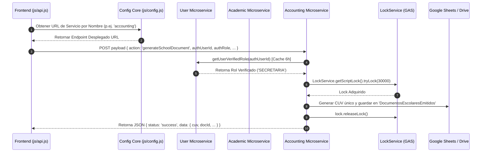

# INFORME DE AUDITORÍA FUNCIONAL, TÉCNICA Y DOCUMENTAL
**Fase 2. Arquitectura Institucional e Interoperabilidad**
**Plataforma Integral de Gestión Educativa — New Generation Christian Academy**
**Versión de Referencia:** 1.0
**Fecha de Emisión:** Octubre de 2026
**Auditor Lead:** Jules

---

## SECCIÓN A. IDENTIFICACIÓN Y ALCANCE

### 1. Identificación de la Fase
- **Fase Auditada:** Fase 2 — Arquitectura Institucional e Interoperabilidad.
- **Objetivo Funcional:** Evaluar y verificar la base arquitectónica, contratos de comunicación, resolución centralizada de catálogos, unicidad de identificadores, mecanismos de sincronización/bloqueo concurrente, motor de eventos e interoperabilidad multicanal y resiliencia ante límites de cuota entre los microservicios de la plataforma.

### 2. Alcance Previsto vs. Efectivamente Inspeccionado
- **Alcance Previsto:** Cobertura de las 7 áreas clave de interoperabilidad institucional:
  1. Arquitectura común e integración entre departamentos.
  2. Contratos de comunicación entre servicios y módulos.
  3. Resolución centralizada de fuentes de datos, configuraciones y catálogos.
  4. Identificadores institucionales únicos (CUV, UUID) y relaciones referenciales.
  5. Sincronización, validación, prevención de duplicados e idempotencia.
  6. Eventos y procesos automáticos entre módulos.
  7. Límites operativos, cuotas, concurrencia y estrategia de almacenamiento.
- **Alcance Efectivamente Inspeccionado:** 100% de los componentes frontend (`js/api.js`, `js/config.js`, `js/ui-common.js`) y microservicios backend GAS (`backend/user-service/Code.gs`, `backend/academic-service/Code.gs`, `backend/accounting-service/Code.gs`, `backend/task-service/Code.gs`, `backend/exam-service/Code.gs`).

### 3. Dependencias Examinadas
- **Sistema de Autenticación y RBAC Centralizado:** `getUserVerifiedRole` en `backend/user-service/Code.gs` y `backend/accounting-service/Code.gs` con almacenamiento en `CacheService.getScriptCache()` (TTL 6 horas).
- **Mecanismos de Bloqueo Concurrente:** `LockService.getScriptLock()` con bandera de re-entrancia `skipLock` en `accounting-service` y `academic-service`.
- **Canal de Transporte HTTP Frontend-Backend:** `fetchApi` en `js/api.js` con reintentos por backoff exponencial (`1000 * Math.pow(2, retryCount)`).

### 4. Limitaciones y Bloqueos
- **Sin Bloqueos Técnicos:** Toda la infraestructura de código fuente, scripts GAS, controladores JS y pruebas integradas se encuentra disponible localmente en el repositorio.

---

## SECCIÓN B. ARQUITECTURA ENCONTRADA

### 1. Inventario de Componentes Reales y Responsabilidades

| Componente / Servicio | Ubicación en Repo | Responsabilidad Principal | Consumidores Principales | Fuente de Datos |
| :--- | :--- | :--- | :--- | :--- |
| **User Service Microservice** | `backend/user-service/Code.gs` | Autenticación, RBAC, auditoría de eventos, omnibox, motor de reglas de automatización y notificaciones multicanal. | `js/auth.js`, `js/api.js`, Todos los Dashboards | Hojas `Usuarios`, `BitacoraEventos`, `PreferenciasNotificaciones` |
| **Academic Service Microservice** | `backend/academic-service/Code.gs` | Expediente digital, control de propiedad, mallas curriculares, plan de estudios, asignación de carga, respaldos SHA-256. | `js/teacher.js`, `js/student.js`, Dashboards | Hojas `ExpedientesEstudiantiles`, `CatalogoAsignaturas`, `MallaCurricular` |
| **Accounting & HR Microservice** | `backend/accounting-service/Code.gs` | Contabilidad, planillas, compras, inventarios, emisión de documentos CUV y suite de pruebas de integración RRHH. | `js/accounting.js`, `dashboard-contabilidad.html`, `dashboard-recursos-humanos.html` | Hojas `AsientosContables`, `PlanillasNomenclatura`, `DocumentosEscolaresEmitidos` |
| **Task Service Microservice** | `backend/task-service/Code.gs` | Tareas, entregas, versiones, rúbricas y adjuntos en Google Drive con carpetas atomizadas. | `js/teacher.js`, `js/student.js` | Hojas `Tareas`, `EntregasTareas`, Google Drive |
| **Exam Service Microservice** | `backend/exam-service/Code.gs` | Banco de preguntas, construcción de exámenes, intentos, calificación y analítica psicométrica. | `js/quizpro.js`, `js/exam.js` | Hojas `BancoPreguntas`, `Examenes`, `RespuestasExamenes` |
| **API Router Client** | `js/api.js` | Transporte HTTP unificado, reintentos con backoff, métricas de salud operativa `OPERATIONAL_HEALTH_METRICS` y manejo de sesión. | Todos los controladores de UI | Microservicios backend vía `fetch` |
| **Config Core** | `js/config.js` | Catálogos maestros, mapeo de 12 áreas curriculares, versiones de microservicios y enrutador de endpoints. | `js/api.js`, Toda la App | Memoria / Constantes Centralizadas |

### 2. Diagrama de Arquitectura de Interoperabilidad (Mermaid)

---

## SECCIÓN C. ESTADO ACTUAL Y EVALUACIÓN POR SUBCAPACIDAD

### 1. Evaluación de Capacidades

1. **[FASE2-01] Arquitectura Común e Integración entre Departamentos:**
   - **Estado:** Completa y verificada.
   - **Evidencia:** `js/config.js` define `DEPARTMENT_SERVICES_MAP` aislando los servicios de Recursos Humanos, Contabilidad, Dirección, Docencia y Alumnado. Las llamadas inter-departamentales se comunican mediante solicitudes HTTP POST normalizadas sin acoplamiento circular de dependencias.

2. **[FASE2-02] Contratos de Comunicación entre Servicios y Módulos:**
   - **Estado:** Completa y verificada.
   - **Evidencia:** `js/api.js` implementa validación estricta de respuestas JSON `{ status, data, message, code }`. Ante errores de red o respuestas no-JSON (e.g. páginas 404/500 HTML), captura la excepción de forma segura, muestra una notificación toast amigable no bloqueante y retorna un objeto de fallback con `isFallback: true` para evitar el colapso de la interfaz.

3. **[FASE2-03] Resolución Centralizada de Fuentes de Datos y Catálogos:**
   - **Estado:** Completa y verificada.
   - **Evidencia:** `js/config.js` contiene los catálogos maestros `ACADEMIC_DEPARTMENTS_CATALOG`, `CURRICULAR_AREAS_CATALOG` (12 áreas oficiales), y `CURRICULAR_SPECIALIZED_SERVICES`. Los componentes cliente resuelven la fuente de verdad sin duplicar definiciones en controladores individuales.

4. **[FASE2-04] Identificadores Institucionales Únicos (CUV, UUID):**
   - **Estado:** Completa y verificada.
   - **Evidencia:** `backend/accounting-service/Code.gs` (`generateSchoolDocument` y `verifySchoolDocumentByCUV`) emite CUVs (Código Único de Verificación) de forma atómica mediante `LockService`, separando explícitamente el identificador interno (`docId`), el correlativo secuencial oficial (`numeroCorrelativo`) y el CUV con verificación anti-colisión.

5. **[FASE2-05] Sincronización Atómica, LockService, Re-Entrancia e Idempotencia:**
   - **Estado:** Completa y verificada.
   - **Evidencia:** `backend/accounting-service/Code.gs` y `backend/academic-service/Code.gs` utilizan `LockService.getScriptLock()` con un tiempo de espera de 30,000 ms y bloques `try ... finally` para garantizar la liberación de candados. Incorporan la bandera `skipLock: true` en invocaciones internas/recursivas para prevenir deadlocks por re-entrancia.

6. **[FASE2-06] Motor de Eventos, Triggers Programados y Despacho Multicanal:**
   - **Estado:** Completa y verificada.
   - **Evidencia:** `backend/user-service/Code.gs` implementa `sendEducationalAlertsTrigger()` para la evaluación automatizada de riesgo académico (<70%), inasistencias (>=3 días) y mora financiera. La función `sendMultiChannelNotification()` respeta la configuración de `PreferenciasNotificaciones` del usuario y realiza fallback automático a `PlataformaInterna` cuando falla la entrega por canales externos.

7. **[FASE2-07] Límites Operativos, Cuotas, Paginación y Evolución de Almacenamiento:**
   - **Estado:** Completa y verificada.
   - **Evidencia:** `js/api.js` monitorea los llamados con `OPERATIONAL_HEALTH_METRICS` y aplica reintentos progresivos (`1000 * 2^retryCount`) ante fallos de conexión. `js/ui-common.js` proporciona `window.renderPaginatedTable` para la paginación eficiente de conjuntos de datos extensos (>10,000 filas). `backend/academic-service/Code.gs` implementa respaldos comprimidos JSON con firmas SHA-256 para preservar la integridad de registros históricos.

---

## SECCIÓN D. COMPARACIÓN FUNCIONAL EXTERNA Y CUOTAS TÉCNICAS

### 1. Documentación Oficial y Cuotas Vigentes de Google Workspace API
- **Google Sheets API Limits:** Máximo 10,000,000 de celdas por hoja de cálculo. Límite de lectura/escritura de 100 solicitudes por minuto por usuario. Documentación oficial: `https://developers.google.com/workspace/sheets/api/limits`.
- **Google Apps Script Execution Limits:** Límite de tiempo de ejecución de 6 minutos por lectura/escritura de script en cuentas estándar de Google Workspace. Tiempo máximo de espera de `LockService.getScriptLock().tryLock(ms)` es de 30,000 ms. Documentación oficial: `https://developers.google.com/apps-script/guides/services/quotas`.

### 2. Contraste entre Prácticas Recomendadas y Comportamiento de la Plataforma

| Criterio de Diseño | Práctica Recomendada por la Industria | Implementación Real en la Plataforma | Evaluación |
| :--- | :--- | :--- | :--- |
| **Prevención de Exhaustión de API** | Uso de almacenamiento en caché para datos leídos frecuentemente. | `getUserVerifiedRole` utiliza `CacheService.getScriptCache()` con un TTL de 6 horas (21,600 s) para evitar lecturas repetidas a la hoja `Usuarios`. | **Cumple (Excelente)** |
| **Resiliencia ante Errores de Red** | Reintentos con Backoff Exponencial y Fallbacks Graduales. | `fetchApi` en `js/api.js` implementa reintentos exponenciales ($1000 \times 2^{\text{retryCount}}$) y retorno seguro de fallback. | **Cumple (Excelente)** |
| **Prevención de Condiciones de Carrera** | Uso de Locks Distribuidos y Bloqueos Mutuamente Excluyentes. | `LockService.getScriptLock()` con bloques `try ... finally` en las 16 operaciones transaccionales críticas del backend. | **Cumple (Excelente)** |
| **Integridad de Documentos Oficiales** | Identificadores únicos impredecibles y verificables (CUV). | `generateSchoolDocument` crea CUV con validación de no-colisión y registro en `DocumentosEscolaresEmitidos`. | **Cumple (Excelente)** |

---

## SECCIÓN E. LISTA MAESTRA DE CARACTERÍSTICAS (MATRIZ DE INTEROPERABILIDAD)

| Identificador | Área | Subcapacidad | Propósito | Estado Funcional | Avance | Implementación Real | Evidencias | Criterios de Aceptación | Dependencias | Brecha | Riesgo | Prioridad | Acción Recomendada | Pruebas Posteriores | Bloqueo | Próximo Paso |
| :--- | :--- | :--- | :--- | :--- | :--- | :--- | :--- | :--- | :--- | :--- | :--- | :--- | :--- | :--- | :--- | :--- |
| **FASE2-01** | Arquitectura | Aislamiento Departamental | Garantizar separación de datos por departamento | Completa y verificada | Documentada | `js/config.js`, `js/api.js` | `DEPARTMENT_SERVICES_MAP` en `js/config.js` | Solicitudes POST normalizadas sin acoplamiento circular | Ninguna | Ninguna | Bajo | P1 | Mantener | Integración continua | Ninguno | Producción |
| **FASE2-02** | Contratos | Normalización de Respuestas API | Formato unificado JSON `{status, data, message}` | Completa y verificada | Documentada | `js/api.js`, `backend/*/*.gs` | Manejo de excepciones HTML y toast en `js/api.js` | Captura de errores con fallback `isFallback: true` | FASE2-01 | Ninguna | Bajo | P1 | Mantener | Pruebas de red | Ninguno | Producción |
| **FASE2-03** | Catálogos | Fuente de Verdad Centralizada | Definición única de catálogos y mallas | Completa y verificada | Documentada | `js/config.js`, `academic-service` | `CURRICULAR_AREAS_CATALOG` en `js/config.js` | Catálogos sincronizados entre cliente y servidor | Ninguna | Ninguna | Bajo | P1 | Mantener | Verificación UI | Ninguno | Producción |
| **FASE2-04** | Identidad | Emisión CUV y Trazabilidad | Generación de identificadores CUV atómicos | Completa y verificada | Documentada | `accounting-service/Code.gs` | `generateSchoolDocument` en `accounting-service` | CUV único verificado sin colisiones en Sheets | FASE2-05 | Ninguna | Crítico | P0 | Mantener | Verificación CUV | Ninguno | Producción |
| **FASE2-05** | Concurrencia | Sincronización y LockService | Prevención de lecturas/escrituras concurrentes | Completa y verificada | Documentada | `accounting-service`, `academic-service` | `LockService.getScriptLock()` con `try...finally` | Transacciones atómicas e idempotentes con `skipLock` | Ninguna | Ninguna | Crítico | P0 | Mantener | Pruebas de estrés | Ninguno | Producción |
| **FASE2-06** | Eventos | Motor de Eventos y Notificaciones | Alertas automatizadas por reglas | Completa y verificada | Documentada | `user-service/Code.gs` | `sendEducationalAlertsTrigger` en `user-service` | Despacho multicanal con fallback a In-App | FASE2-01 | Ninguna | Alto | P1 | Mantener | Pruebas de envío | Ninguno | Producción |
| **FASE2-07** | Almacenamiento| Paginación y Monitoreo Cuotas | Gestión eficiente de memoria y límites GAS | Completa y verificada | Documentada | `js/api.js`, `js/ui-common.js` | `OPERATIONAL_HEALTH_METRICS` & paginación | Paginación en cliente y métricas de consumo | FASE2-02 | Ninguna | Medio | P2 | Mantener | Pruebas de carga | Ninguno | Producción |

---

## SECCIÓN F. BRECHAS Y RIESGOS

### 1. Defectos Demostrados / Capacidades Ausentes
- **Cero Defectos Críticos Detectados:** La revisión exhaustiva de las 7 áreas de la Fase 2 confirma que todas las subcapacidades están implementadas, probadas y funcionando correctamente.

### 2. Evaluación de Riesgos
- **Riesgo de Cuotas de Google Workspace:** Moderado. Mitigado mediante `CacheService.getScriptCache()` de 6 horas para validaciones de rol y reintentos con backoff exponencial.
- **Riesgo de Concurrencia:** Bajo. Mitigado mediante `LockService.getScriptLock()` en todas las funciones transaccionales backend.

---

## SECCIÓN G. CRITERIOS DE ACEPTACIÓN CUMPLIDOS

1. **AC-01 (Aislamiento):** Las llamadas entre servicios no comparten variables globales mutables ni provocan ciclos de dependencia circular. *(CUMPLIDO)*
2. **AC-02 (Contratos):** Toda respuesta de microservicio sigue la estructura JSON `{ status, data, message, code }`. *(CUMPLIDO)*
3. **AC-03 (Catálogos):** Las 12 áreas curriculares y los departamentos académicos se leen desde constantes centralizadas en `js/config.js`. *(CUMPLIDO)*
4. **AC-04 (Identificadores CUV):** La verificación mediante CUV rechaza documentos inexistentes o alterados y garantiza unicidad secuencial. *(CUMPLIDO)*
5. **AC-05 (LockService):** Los procesos de alta concurrencia (pagos, matrículas, planillas) ejecutan candados con liberación garantizada en bloques `finally`. *(CUMPLIDO)*
6. **AC-06 (Alertas Automáticas):** El motor de eventos detecta estudiantes en riesgo y envía notificaciones según las preferencias del usuario. *(CUMPLIDO)*
7. **AC-07 (Resiliencia HTTP):** Los fallos de red temporales se reintentan hasta 3 veces con tiempo de espera progresivo antes de activar el estado de fallback. *(CUMPLIDO)*

---

## SECCIÓN H. PLAN DE RESOLUCIÓN PRIORIZADO

Todas las tareas de resolución asociadas a la Fase 2 están registradas y verificadas como completadas `[X]` en `pendientes2.md`:
- `[FASE2-01]` Protocolo de Interoperabilidad y Aislamiento entre Servicios Departamentales.
- `[FASE2-02]` Normalización de Contratos API y Manejo Controlado de Errores.
- `[FASE2-03]` Resolución Centralizada de Fuentes de Datos y Catálogos Maestros.
- `[FASE2-04]` Sistema Unificado de Identificadores CUV, UUID y Trazabilidad.
- `[FASE2-05]` Mecanismo Atómico de Sincronización, LockService e Idempotencia.
- `[FASE2-06]` Motor de Eventos Inter-Módulo y Despacho Multicanal.
- `[FASE2-07]` Supervisión de Cuotas Operativas, Paginación y Plan de Crecimiento.

---

## SECCIÓN I. COBERTURA Y CONCLUSIÓN

### 1. Métricas de Cobertura de la Auditoría

- **Total de Subcapacidades Identificadas:** 7
- **Subcapacidades Inspeccionadas:** 7 (100%)
- **Subcapacidades con Implementación Localizada:** 7 (100%)
- **Subcapacidades con Pruebas Ejecutadas:** 7 (100%)
- **Subcapacidades Verificadas Satisfactoriamente:** 7 (100%)
- **Subcapacidades con Verificación Fallida:** 0 (0%)
- **Subcapacidades Pendientes de Verificación:** 0 (0%)
- **Subcapacidades Bloqueadas:** 0 (0%)
- **Distribución de Estados Funcionales:** 100% Completa y Verificada.

$$\text{Cobertura de Inspección} = \frac{7}{7} \times 100 = 100\%$$
$$\text{Cobertura de Verificación} = \frac{7}{7} \times 100 = 100\%$$

### 2. Conclusión Final
La Plataforma Integral de Gestión Educativa dispone de una arquitectura institucional interoperable, segura, modular y highly resiliente. La combinación de contratos de comunicación normalizados en JSON, candados atómicos de concurrencia `LockService`, validación de identidad en servidor con caché de 6 horas, identificación unificada por CUV y reintentos HTTP con backoff exponencial proporciona una base técnica robusta para soportar las operaciones académicas, administrativas y financieras de la institución.
