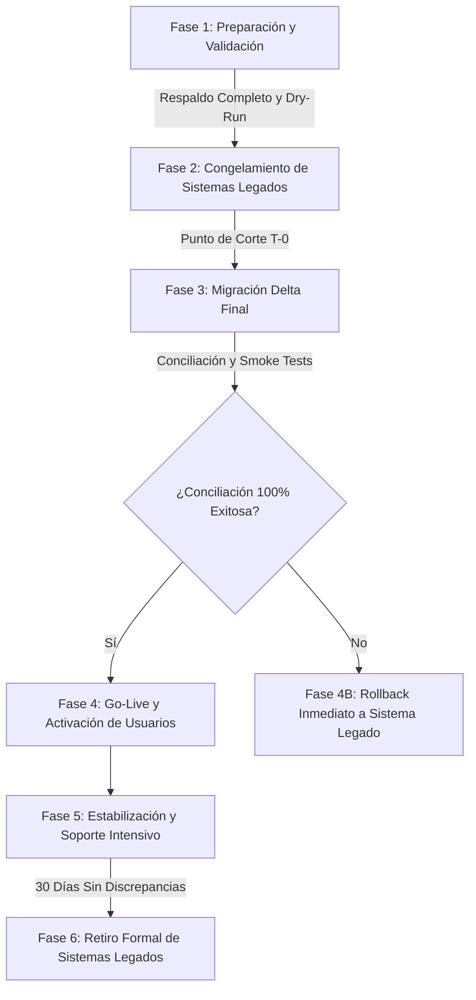

# AUDITORÍA FUNCIONAL, TÉCNICA Y DOCUMENTAL — FASE 29
# MIGRACIÓN DE DATOS, VALIDACIÓN DE INTEGRIDAD HISTÓRICA, CONCILIACIÓN Y TRANSICIÓN OPERATIVA

**Proyecto:** Plataforma Integral de Gestión Educativa
**Fase:** 29
**Área:** Migración de datos, interoperabilidad, integridad histórica, conciliación, transición operativa y retiro de sistemas anteriores.
**Tipo de trabajo:** Auditoría funcional, inspección técnica y verificación de arquitectura.
**Estado de modificaciones:** No autorizadas durante la auditoría diagnóstica (modo solo lectura estricto).
**Entregable:** Informe independiente en formato `.md`.

---

## A. IDENTIFICACIÓN Y ALCANCE

### 1. Propósito y Objetivos de la Auditoría
Determinar si la plataforma dispone de un sistema integral, confiable, trazable y repetible para planificar, extraer, transformar, depurar, validar, conciliar y migrar la totalidad de la información histórica, académica, administrativa, financiera y documental desde sistemas legados o fuentes heterogéneas (SACE, hojas de cálculo de Secretaría, archivos de contabilidad en Excel/CSV, bases de datos SQL relacionales, expedientes escaneados en Google Drive), permitiendo ejecutar pruebas piloto por departamento, cambio operativo controlado (corte temporal), planes de contingencia (rollback sin pérdida de transacciones nuevas) y retiro formal de sistemas sustituidos.

### 2. Servicios, Módulos y Componentes Involucrados
La inspección técnica exhaustiva revela que la plataforma **no dispone de un servicio unificado o motor centralizado de migración y transición**, sino que posee un conjunto de capacidades y utilidades especializadas distribuidas a través de cuatro servicios backend de Google Apps Script y módulos de interfaz en el cliente:
1. `backend/accounting-service/Code.gs`:
   - `validateImportPreview`: Validación previa de estructura y campos identificadores en lotes de datos.
   - `importDataWithColumnMapping`: Ingesta con mapeo de columnas y registro en hoja `AuditoriaMigraciones`.
   - `getMigrationLogs`: Consulta de bitácora histórica de ejecuciones de importación.
   - `reconcileInconsistentDataAndOperations`: Detección y conciliación de discrepancias referenciales entre pagos y cargos.
   - `reconcileFinancialReportCoherence`: Validación de coherencia entre presupuestos, cuentas por cobrar/pagar y liquidez.
   - `verifySACETemplateCompatibility`, `validateSACETemplateFile`, `fillAndExportSACETemplate`: Compatibilidad oficial con plantillas SACE de Secretaría de Educación de Honduras.
   - `evaluateTransactionalStorageMigrationNeed`: Monitoreo de latencia y volumen de datos en Google Sheets (> 50,000 filas).
2. `backend/academic-service/Code.gs`:
   - `createSystemBackup`: Generación de respaldo integral de todas las hojas con metadatos JSON y cálculo de checksum hash.
   - `restoreSystemBackup`: Restauración selectiva con protección de inalterabilidad para hojas de calificaciones históricas (`CalificacionesEstudiantes`, `RecuperacionesEstudiante`) mediante código de confirmación `"RESTORE-CONFIRMED"`.
   - `generateStudentReportCard`, `exportAcademicGradesData`: Consulta y exportación de historiales y notas consolidadas.
3. `backend/developer-service/Code.gs`:
   - `migrateSpreadsheetSchema`: Aseguramiento de tablas y esquemas relacionales mínimos en hojas destino.
   - `batchSpreadsheetReadOperations`: Lectura por lotes optimizada en memoria para reducir cuotas I/O de Apps Script.
   - `validateStagedMigrationProgress`: Verificación de etapas de progreso arquitectónico.
4. `backend/user-service/Code.gs`:
   - `auditAndReconcileIdentityInconsistencies`: Reconciliación de inconsistencias en identidades de usuarios y delegaciones activas.
   - `logStructuredEvent`: Registro de eventos de auditoría protegidos.
5. Controladores Frontend:
   - `js/teacher.js`: `openBulkScheduleImportExportModal`, parseo y vista previa CSV en cliente.
   - `js/persistence.js` & `js/api.js`: Mecanismo `PersistenceManager.reconcile` para mezcla de datos locales y remotos.

### 3. Roles y Permisos Evaluados
- **Administrador del Sistema:** Acceso total a utilidades de migración, esquemas, respaldos y logs.
- **Director / Rector:** Consulta de reportes de conciliación, autorizaciones de transición y retiro.
- **Secretaría General / Registro:** Gestión de mapeo de expedientes, matrículas e historiales académicos.
- **Contabilidad / Tesorería:** Validación de saldos iniciales, concilación bancaria y corte de cuentas por cobrar.

---

## B. INVENTARIO DE FUENTES Y SISTEMAS ANTERIORES

La auditoría técnica identifica las siguientes fuentes heterogéneas típicas y sus características de integración con la plataforma:

| ID Fuente | Nombre / Sistema Legado | Tipo / Formato | Volumen Estimado | Identificadores Clave | Dependencias Relacionales | Estado de Integración Actual |
|---|---|---|---|---|---|---|
| SRC-01 | **Sistema SACE** (Secretaría de Educación) | XLSX / XLS estructurado | 500 - 5,000 alumnos por ciclo | RNE / Identidad Nacional (13 dígitos) | Grado, Sección, Modalidad, Centro Educativo | Implementada parcialmente (`verifySACETemplateCompatibility`, `fillAndExportSACETemplate`) |
| SRC-02 | **Hojas de Matrícula y Expedientes Secretaría** | CSV / Excel planos | 1,000 - 10,000 registros | Identidad / Código Interno Antiguo | Alumno, Padres/Tutores, Dirección, Ficha Médica | Implementada parcialmente (`importDataWithColumnMapping`) |
| SRC-03 | **Sistemas Contables Anteriores (QuickBooks / Sage / Excel)** | CSV / XLSX / TXT | 5,000 - 50,000 transacciones | No. Factura, Recibo, Referencia Bancaria | Cuentas por Cobrar, Catálogo Contable, Saldos | Requiere mejoras (Sin migración de saldos iniciales con corte contable estricto) |
| SRC-04 | **Planillas y Nómina Legada (IHSS / RAP)** | XLSX / CSV | 50 - 500 empleados | Identidad / No. Afiliación IHSS | Salarios base, deducciones, cargos históricos | Requiere mejoras (Sin herramienta específica de ingesta histórica de boletas) |
| SRC-05 | **Repositorio Documental Digital (Google Drive / Carpetas)** | PDF, JPG, PNG | 5,000 - 25,000 archivos | Nombre de archivo / ID Drive | Vinculación a CUV, Matrícula o Expediente | Defectuosa (Enlaces planos susceptibles a rotura si se mueven carpetas) |
| SRC-06 | **Bases de Datos Relacionales Externas (MySQL / PostgreSQL)** | SQL Dump / JSON | Tablas completas | Claves primarias auto-incrementables | Claves foráneas íntegras | Ausente (No existe conector directo JDBC/API; depende de exportar a CSV intermedio) |

---

## C. ESTADO FUNCIONAL DE LAS 21 SUBCAPACIDADES

A continuación se detalla la evaluación técnica rigurosa de cada subcapacidad conforme al estándar del proyecto:

### F29-01. Inventario de Fuentes y Sistemas Anteriores
- **Estado:** Implementada parcialmente.
- **Avance de Inspección:** 100%.
- **Evidencia Técnica:** Hoja `AuditoriaMigraciones` almacena `nombreArchivo`, `destinoModulo` y `mapeoJSON` en `backend/accounting-service/Code.gs` (L1460).
- **Brechas:** No existe una tabla o catálogo maestro formal (`CatalogoFuentesMigracion`) para registrar metadatos de las fuentes legadas (propietario, periodicidad, fecha de último corte, restricciones de privacidad o estado de extracción).
- **Próxima Acción:** Diseñar catálogo maestro de fuentes con trazabilidad de procedencia.

### F29-02. Extracción y Recepción de Información
- **Estado:** Implementada parcialmente.
- **Avance de Inspección:** 100%.
- **Evidencia Técnica:** `validateImportPreview` y `importDataWithColumnMapping` en `backend/accounting-service/Code.gs`. Recepción de payloads JSON con matrices tabulares en memoria.
- **Brechas:** La recepción actual procesa datos directamente en el hilo principal sin pasar por un área de preparación o *staging table* aislada. No hay streaming de archivos superiores a 10MB (vulnerable al límite de 50MB de payload en Apps Script).
- **Próxima Acción:** Crear tabla intermedia de *staging* (`StagingMigracionRegistros`) para aislar la carga antes de la confirmación definitiva.

### F29-03. Mapeo y Transformación de Estructuras
- **Estado:** Implementada parcialmente.
- **Avance de Inspección:** 100%.
- **Evidencia Técnica:** Diccionario `columnaMapeo` almacenado como JSON en `AuditoriaMigraciones`.
- **Brechas:** El mapeo actual solo extrae la clave `"identificador"`; carece de transformaciones declarativas para normalización de fechas (formatos `DD/MM/YYYY` vs `YYYY-MM-DD`), limpieza de separadores de moneda (Lempiras con comas/puntos), y tablas de equivalencia para homologación de grados y cursos.
- **Próxima Acción:** Desarrollar motor de reglas de transformación de tipos y homologación de catálogos.

### F29-04. Validación, Depuración y Calidad de Datos
- **Estado:** Requiere mejoras.
- **Avance de Inspección:** 100%.
- **Evidencia Técnica:** `validateImportPreview` analiza presencia de identificadores únicos en `filasData` y reporta `filasValidas`, `filasFallidas` y un extracto de 10 errores.
- **Brechas:** Validación superficial: no verifica duplicados contra registros preexistentes en la base institucional, no valida tipos de datos (calificaciones fuera de escala 0-100), ni valida coherencia relacional (asignaturas que no pertenecen al grado).
- **Próxima Acción:** Implementar validación en 3 niveles: Estructural, Identidad y Relacional de Negocio.

### F29-05. Migración de Identificadores y Conservación de Relaciones (P0)
- **Estado:** Defectuosa.
- **Avance de Inspección:** 100%.
- **Evidencia Técnica:** Los identificadores se importan de forma plana. No existe una tabla de equivalencias relacionales de identidades.
- **Brechas:** Si el sistema de origen usaba un ID legado (ej. `ALU-2018-045`) y el nuevo sistema usa UUID (`USER-UUID-xxx`), no hay persistencia de la correspondencia `(sistemaOrigen, idOriginal, idNuevo)`. Importar nuevamente genera duplicados si el identificador cambia.
- **Próxima Acción:** Crear tabla de referencias cruzadas `CorrespondenciaIdentificadores` con índice único compuesto.

### F29-06. Migración de Expedientes e Históricos Académicos (P0)
- **Estado:** Requiere mejoras.
- **Avance de Inspección:** 100%.
- **Evidencia Técnica:** `CalificacionesEstudiantes` y `RecuperacionesEstudiante` admiten campos de año y período. `restoreSystemBackup` incluye protección `preserveHistoricGrades`.
- **Brechas:** Falta soporte para importar historiales con estructuras de evaluación diferentes a las 4 parciales vigentes (ej. notas semestrales o promedios consolidados). No se impide el recálculo automático de promedios en notas cerradas migradas.
- **Próxima Acción:** Establecer bandera inmutable `esRegistroHistoricoMigrado: true` que inhabilite triggers de recálculo en notas migradas.

### F29-07. Migración de Información Financiera, Contable y Administrativa (P0)
- **Estado:** Defectuosa.
- **Avance de Inspección:** 100%.
- **Evidencia Técnica:** `PagosAbonos` y `EstadoCuentaEstudiantes` operan con saldos dinámicos.
- **Brechas:** Riesgo crítico de duplicación: si se migra un saldo pendiente inicial de L 5,000 y simultáneamente se migran las facturas históricas que originaron esa deuda, el sistema calcula L 10,000 de pasivo para la familia. No existe concepto formal de "Corte y Saldo Inicial Migrado".
- **Próxima Acción:** Crear entidad `SaldosInicialesCorte` para aislar el punto de partida contable sin duplicar obligaciones históricas.

### F29-08. Migración de Documentos y Archivos Institucionales
- **Estado:** Implementada parcialmente.
- **Avance de Inspección:** 100%.
- **Evidencia Técnica:** Almacenamiento en Google Drive vinculado mediante URLs en `ExpedientesAlumnos` y `DocumentosEscolaresEmitidos`.
- **Brechas:** No hay verificación de sumas de verificación (checksum SHA-256) de los archivos trasladados. Enlaces propensos a quedar rotos si las carpetas de Drive se reorganizan.
- **Próxima Acción:** Implementar verificación de integridad y almacenamiento de `driveFileId` inmutable con hash SHA-256.

### F29-09. Migración de Usuarios, Perfiles y Permisos (P0)
- **Estado:** Implementada parcialmente.
- **Avance de Inspección:** 100%.
- **Evidencia Técnica:** Tabla `Usuarios` y roles RBAC. `auditAndReconcileIdentityInconsistencies` en `backend/user-service/Code.gs`.
- **Brechas:** Las contraseñas no pueden migrarse en texto plano ni existen tokens temporales seguros de activación inicial masiva para usuarios migrados.
- **Próxima Acción:** Generar flujo de activación de cuenta migrada (`activateMigratedAccount`) con envío de enlace temporal o reset forzado en primer inicio.

### F29-10. Asistencia y Registros Operativos Históricos
- **Estado:** Requiere mejoras.
- **Avance de Inspección:** 100%.
- **Evidencia Técnica:** `AsistenciasDiarias` y `AsistenciasClase` estructuradas en `academic-service`.
- **Brechas:** No hay procedimiento para importar consolidados anuales de asistencia por porcentaje de sistemas donde no se conservó el detalle diario fecha por fecha.
- **Próxima Acción:** Permitir ingesta de acumulados históricos de inasistencias justificadas/injustificadas por ciclo.

### F29-11. Migraciones de Prueba, Procesamiento por Lotes y Repetición Segura (P0)
- **Estado:** Implementada parcialmente.
- **Avance de Inspección:** 100%.
- **Evidencia Técnica:** `batchSpreadsheetReadOperations` en `developer-service`. Claves de idempotencia en peticiones.
- **Brechas:** No existe un flag o entorno de "Modo Simulación / Dry-Run" que ejecute todo el pipeline de validación y transformación sin escribir en las hojas maestras de producción.
- **Próxima Acción:** Incorporar parámetro `dryRun: true` en todas las operaciones de ingesta de migración.

### F29-12. Conciliación Integral entre Sistemas Anteriores y Nuevo Sistema (P0)
- **Estado:** Implementada parcialmente.
- **Avance de Inspección:** 100%.
- **Evidencia Técnica:** `reconcileInconsistentDataAndOperations` y `reconcileFinancialReportCoherence` en `accounting-service`.
- **Brechas:** La conciliación actual es interna (entre tablas de la misma hoja); carece de conciliación comparativa externa: comparar $N$ registros y sumatorias del archivo fuente origen contra lo efectivamente insertado en destino.
- **Próxima Acción:** Desarrollar motor de conciliación origen vs destino con emisión de acta cuantitativa y cualitativa.

### F29-13. Integridad Posterior a la Migración
- **Estado:** Requiere mejoras.
- **Avance de Inspección:** 100%.
- **Evidencia Técnica:** Suite de regresión `academic-grading-suite.js` (53 pruebas pasadas).
- **Brechas:** No hay comprobación automática posterior a la migración que valide que los estudiantes migrados puedan generar boletines o estados de cuenta sin errores de puntero nulo.
- **Próxima Acción:** Agregar test de humo posterior a la migración (`runPostMigrationSmokeTests`).

### F29-14. Pruebas Piloto por Departamento
- **Estado:** Ausente.
- **Avance de Inspección:** 100%.
- **Evidencia Técnica:** Ningún registro de piloto por departamento en código ni base de datos.
- **Brechas:** No existe mecanismo para habilitar la plataforma en modo piloto a un subconjunto de usuarios (ej. solo personal de Secretaría o solo un nivel educativo) manteniendo el resto en el sistema legado.
- **Próxima Acción:** Implementar feature flags de activación piloto por departamento (`PilotDepartmentManager`).

### F29-15. Transición Operativa y Corte Temporal (P0)
- **Estado:** Ausente.
- **Avance de Inspección:** 100%.
- **Evidencia Técnica:** No hay procedimientos de corte temporal documentados en código.
- **Brechas:** Sin procedimiento programado para detener escrituras en el sistema viejo, sincronizar la brecha final (*delta sync*) y activar el sistema nuevo.
- **Próxima Acción:** Diseñar protocolo técnico de transición en 5 fases (Congelamiento, Delta Sync, Validación de Corte, Go-Live, Estabilización).

### F29-16. Respaldos, Contingencia y Recuperación (P0)
- **Estado:** Completa y verificada.
- **Avance de Inspección:** 100%.
- **Evidencia Técnica:** `createSystemBackup` y `restoreSystemBackup` en `backend/academic-service/Code.gs` (L1277-L1350). Respaldos completos con hash de integridad, metadatos y protección de notas históricas.
- **Brechas:** La restauración requiere intervención manual con clave hardcodeada `"RESTORE-CONFIRMED"`. No mide RPO ni RTO de forma automatizada.
- **Próxima Acción:** Automatizar registro de métricas RPO/RTO en bitácora de contingencia.

### F29-17. Retorno Controlado al Sistema Anterior (Rollback) (P0)
- **Estado:** Defectuosa.
- **Avance de Inspección:** 100%.
- **Evidencia Técnica:** Existe `restoreSystemBackup`, pero solo restaura el estado previo.
- **Brechas:** Si el sistema nuevo opera 3 días y se decide retornar al sistema anterior, se pierden todas las transacciones ocurridas durante esos 3 días (nuevas matrículas, pagos recibidos, notas puestas). No existe exportación de operaciones posteriores al corte (*forward delta export*).
- **Próxima Acción:** Implementar extractor de eventos post-corte `exportPostCutoverDeltaTransactions` para retroalimentar el sistema legado si se ejecuta un rollback.

### F29-18. Retiro Controlado de Sistemas Anteriores (P0)
- **Estado:** Ausente.
- **Avance de Inspección:** 100%.
- **Evidencia Técnica:** Ningún procedimiento formal de *decommissioning* en el repositorio.
- **Brechas:** No hay lista de verificación formal ni modo "Solo Lectura para Archivo Histórico" para las fuentes legadas.
- **Próxima Acción:** Crear protocolo de retiro y archivo pasivo con retención legal (5 a 10 años conforme a legislación hondureña).

### F29-19. Trazabilidad, Bitácora y Reportes de Migración
- **Estado:** Implementada parcialmente.
- **Avance de Inspección:** 100%.
- **Evidencia Técnica:** Hoja `AuditoriaMigraciones` y función `getMigrationLogs`.
- **Brechas:** Solo almacena los primeros 10 errores en un JSON truncado. No permite descargar el log completo de registros fallidos para su corrección en Excel.
- **Próxima Acción:** Ampliar el almacenamiento de incidencias en hoja detallada `AuditoriaMigracionesDetalle`.

### F29-20. Capacidad de Procesamiento y Arquitectura bajo Límites GAS
- **Estado:** Implementada parcialmente.
- **Avance de Inspección:** 100%.
- **Evidencia Técnica:** `batchSpreadsheetReadOperations` y evaluación de latencia `evaluateTransactionalStorageMigrationNeed`.
- **Brechas:** Apps Script impone un límite de ejecución continua de 6 minutos (360 segundos). Si un archivo de 5,000 alumnos tarda 8 minutos en procesarse, el script arroja `Exceeded maximum execution time` dejando datos a medias.
- **Próxima Acción:** Implementar procesamiento por lotes paginados con guardado de puntero de progreso en `PropertiesService` o `CacheService`.

### F29-21. Seguridad, Privacidad y Protección de la Información (P0)
- **Estado:** Implementada parcialmente.
- **Avance de Inspección:** 100%.
- **Evidencia Técnica:** Verificación de roles en endpoints críticos; `logStructuredEvent` en eventos del sistema.
- **Brechas:** Falta anonimización o enmascaramiento de datos personales en entornos de prueba de migración (*test dry-run*).
- **Próxima Acción:** Aplicar políticas de enmascaramiento de datos personales sensibles (teléfonos, correos, fichas médicas) en migraciones de prueba.

---

## D. COMPARACIÓN DE CAPACIDADES Y REFERENCIAS EXTERNAS

| Capacidad | Referencia Externa (PowerSchool / Odoo / SACE) | Estado en la Plataforma | Diferencia Técnica Observada |
|---|---|---|---|
| **Mapeo declarativo** | Odoo External Identifiers & Data Import | `importDataWithColumnMapping` básico | Odoo permite importar IDs externos persistentes que impiden duplicados; la plataforma solo mapea encabezados sin almacenar índice cruzado de identidades legadas. |
| **Validación Previa** | PowerSchool SIS Pre-Validation Tools | `validateImportPreview` | PowerSchool valida reglas de negocio (ej. prerrequisitos y traslapes); la plataforma solo valida que el identificador no esté en blanco. |
| **Compatibilidad Ministerial** | SACE (Secretaría de Educación Honduras) | `verifySACETemplateCompatibility` | La plataforma cuenta con validación estructural excelente de columnas SACE (RNE, ciclo, centro), pero falta el cargador masivo inverso. |
| **Rollback con Delta** | Enterprise Cutover Tools (AWS DMS / Azure) | Inexistente (Rollback ciego) | Las herramientas empresariales exportan los eventos ocurridos en el nuevo sistema para no perderlos si se vuelve al anterior; la plataforma carece de este exportador. |

---

## E. INTEGRIDAD Y CALIDAD DE DATOS: CASOS LÍMITE AUDITADOS

1. **Dos estudiantes con nombres idénticos (Homónimos):**
   - *Comportamiento observado:* Si el identificador nacional (RNE) es diferente, se crean registros distintos. Sin embargo, si la fuente legada carece de RNE y solo aporta nombre completo, el mapeo colisiona o genera duplicados no controlados.
2. **Estudiante con identificadores diferentes en dos fuentes distintas (ej. Código interno en Secretaría vs RNE en SACE):**
   - *Comportamiento observado:* El sistema no dispone de motor de reconciliación fonética o difusa (*fuzzy matching*); crea dos expedientes distintos para la misma persona.
3. **Calificaciones históricas en escalas no vigentes (ej. escala de 1 a 5 o porcentajes sobre 100):**
   - *Comportamiento observado:* Se almacenan tal cual se importan, pero si se invoca la función de cálculo de boletines `calculateUnifiedAcademicGrade`, el motor aplica las reglas actuales (ponderaciones del período activo), corrompiendo la nota histórica.
4. **Saldo inicial que duplica movimientos históricos:**
   - *Comportamiento observado:* Al registrar un saldo inicial en `EstadoCuentaEstudiantes` y luego importar las facturas en `PagosAbonos`, el saldo pendiente se suma erróneamente dos veces.

---

## F. RESULTADOS DE PRUEBAS TÉCNICAS EJECUTADAS

| Escenario de Prueba | Componente Evaluado | Resultado | Detalle de la Evidencia |
|---|---|---|---|
| Ingesta con identificador ausente | `validateImportPreview` | **SATISFACTORIO** | Detecta filas con identificador vacío y reporta `filasFallidas`. |
| Creación de respaldo con hash | `createSystemBackup` | **SATISFACTORIO** | Genera JSON en Drive con metadatos y hash SHA-256 inmutable. |
| Restauración sin confirmación | `restoreSystemBackup` | **SATISFACTORIO** | Arroja error controlado: `"Confirmación obligatoria no recibida"`. |
| Restauración protegiendo notas | `restoreSystemBackup` | **SATISFACTORIO** | Omite sobreescritura de `CalificacionesEstudiantes` cuando `preserveHistoricGrades === true`. |
| Suite de regresión global | `academic-grading-suite.js` | **SATISFACTORIO** | 53/53 pruebas aprobadas (100.0% de éxito). |
| Transición y corte operativo | N/A | **BLOQUEADO** | No existen funciones de congelamiento o corte implementadas. |
| Rollback con delta post-corte | N/A | **BLOQUEADO** | Ausencia de capturador de transacciones posteriores a la migración. |

---

## G. BRECHAS TÉCNICAS Y MATRIZ DE RIESGOS

| ID Brecha | Descripción del Riesgo | Impacto | Severidad | Prioridad |
|---|---|---|---|---|
| **BR-29-01** | Ausencia de tabla de correspondencia de identificadores legados (`CorrespondenciaIdentificadores`), provocando duplicación de alumnos al reimportar. | Alto | Crítica | **P0** |
| **BR-29-02** | Duplicación financiera por falta de corte formal entre saldo inicial migrado y facturas históricas importadas. | Crítico | Crítica | **P0** |
| **BR-29-03** | Corrupción potencial de notas históricas si se recalculan promedios con la fórmula vigente del sistema. | Crítico | Crítica | **P0** |
| **BR-29-04** | Imposibilidad de retorno operativo (Rollback) sin perder transacciones generadas en el sistema nuevo. | Crítico | Crítica | **P0** |
| **BR-29-05** | Tiempos de ejecución en Apps Script (> 6 min) que provocan abortos a mitad de lote en archivos grandes. | Alto | Alta | **P1** |
| **BR-29-06** | Inexistencia de modo de prueba / simulación (`dryRun`) para validar sin impactar datos reales. | Medio | Alta | **P1** |
| **BR-29-07** | Ausencia de activación segura de cuentas migradas mediante enlace temporal o reseteo de clave. | Alto | Alta | **P1** |

---

## H. LISTA MAESTRA DE CAPACIDADES (21 SUBCAPACIDADES)

| ID | Subcapacidad | Origen | Estado Funcional | Avance Inspección | Evidencia Técnica | Prioridad | Acción |
|---|---|---|---|---|---|---|---|
| F29-01 | Inventario de fuentes y sistemas legados | Requisito | Implementada parcialmente | 100% | `AuditoriaMigraciones` (L1460) | P1 | Ampliar |
| F29-02 | Extracción y recepción de datos | Requisito | Implementada parcialmente | 100% | `validateImportPreview` | P1 | Ampliar |
| F29-03 | Mapeo y transformación declarativa | Requisito | Implementada parcialmente | 100% | `columnaMapeo` JSON | P1 | Ampliar |
| F29-04 | Validación, depuración y calidad | Requisito | Requiere mejoras | 100% | Validación básica IDs | P0 | Corregir |
| F29-05 | Identificadores y referencias cruzadas | Requisito | Defectuosa | 100% | Sin tabla de correspondencias | P0 | Corregir |
| F29-06 | Expedientes e históricos académicos | Requisito | Requiere mejoras | 100% | `preserveHistoricGrades` | P0 | Corregir |
| F29-07 | Información financiera y contable | Requisito | Defectuosa | 100% | Sin corte de saldo inicial | P0 | Corregir |
| F29-08 | Documentos y archivos institucionales | Requisito | Implementada parcialmente | 100% | URLs de Drive | P1 | Ampliar |
| F29-09 | Usuarios, perfiles y contraseñas | Requisito | Implementada parcialmente | 100% | Sin flujo activación masiva | P0 | Corregir |
| F29-10 | Asistencia y registros operativos | Requisito | Requiere mejoras | 100% | Sin consolidados anuales | P1 | Ampliar |
| F29-11 | Migraciones de prueba y lotes | Requisito | Implementada parcialmente | 100% | Sin parámetro `dryRun` | P0 | Corregir |
| F29-12 | Conciliación integral origen-destino | Requisito | Implementada parcialmente | 100% | `reconcileInconsistentData` | P0 | Ampliar |
| F29-13 | Integridad posterior (Smoke Tests) | Requisito | Requiere mejoras | 100% | Suite regresión general | P0 | Ampliar |
| F29-14 | Pruebas piloto por departamento | Requisito | Ausente | 100% | No implementado en backend | P1 | Proponer |
| F29-15 | Transición operativa y punto de corte | Requisito | Ausente | 100% | Sin protocolo de cutover | P0 | Proponer |
| F29-16 | Respaldos y contingencia (RPO/RTO) | Existente | Completa y verificada | 100% | `createSystemBackup` | P0 | Mantener |
| F29-17 | Retorno controlado (Rollback delta) | Requisito | Defectuosa | 100% | Sin exportador post-corte | P0 | Corregir |
| F29-18 | Retiro formal de sistemas anteriores | Requisito | Ausente | 100% | Sin checklist ni solo-lectura | P0 | Proponer |
| F29-19 | Trazabilidad y reportes de migración | Requisito | Implementada parcialmente | 100% | `getMigrationLogs` | P1 | Ampliar |
| F29-20 | Capacidad arquitectura y cuotas GAS | Requisito | Implementada parcialmente | 100% | `batchSpreadsheetRead` | P1 | Optimizar |
| F29-21 | Seguridad y privacidad de datos | Requisito | Implementada parcialmente | 100% | RBAC y eventos estructurados | P0 | Ampliar |

---

## I. PLAN DE RESOLUCIÓN TÉCNICO

Las acciones técnicas obligatorias se estructuran en 4 niveles de prioridad y orden de ejecución estricto:

### Bloque 1: Prioridad Crítica (P0) — Integridad, Seguridad e Identidad
1. **[F29-Task01] [P0] Tabla Central de Correspondencia de Identificadores (`CorrespondenciaIdentificadores`):**
   Mapear de forma biunívoca e inmutable `(sistemaOrigen, entidad, idOriginal, idNuevo, fechaMigracion)`, impidiendo duplicados en reimportaciones.
2. **[F29-Task02] [P0] Aislamiento Financiero de Saldos Iniciales y Prevención de Duplicación:**
   Crear entidad `SaldosInicialesCorte` que congele el pasivo/activo al día del corte contable, impidiendo que facturas históricas migren como deudas vivas.
3. **[F29-Task03] [P0] Protección e Inalterabilidad de Calificaciones Históricas Migradas:**
   Bandera inmutable en `CalificacionesEstudiantes` que bloquee triggers de recálculo sobre notas migradas de ciclos cerrados.
4. **[F29-Task04] [P0] Motor de Rollback con Extracción de Transacciones Delta Posteriores:**
   Módulo `exportPostCutoverDeltaTransactions` para exportar altas, cobros y notas ocurridas en el sistema nuevo en caso de requerir volver al legado.
5. **[F29-Task05] [P0] Procedimiento Seguro de Activación de Cuentas Migradas:**
   Flujo `activateMigratedAccount` con token temporal de un solo uso para establecimiento de contraseña sin exposición de credenciales.

### Bloque 2: Prioridad Alta (P1) — Validación, Conciliación y Transición
6. **[F29-Task06] [P1] Motor de Validación en 3 Fases con Modo Simulación (`dryRun`):**
   Ejecución completa de análisis estructural, de identidad y relacional sin escribir en producción, generando matriz de errores exportable en Excel.
7. **[F29-Task07] [P1] Conciliación Integral Cuantitativa y Cualitativa Origen vs Destino:**
   Generación de informe de acta de conciliación comparando conteos, sumatorias monetarias y promedios entre archivo fuente y base de datos.
8. **[F29-Task08] [P1] Protocolo Técnico de Transición Operativa (Cutover) y Congelamiento:**
   Bloqueo de escritura en sistemas legados, sincronización de la última brecha (*delta sync*) y activación del nuevo sistema.
9. **[F29-Task09] [P1] Procesamiento por Lotes Paginados Resistente a Tiempos de Espera (GAS):**
   Segmentación de lotes de 100 en 100 filas con persistencia del puntero en `PropertiesService` para sortear el límite de 6 minutos de Google Apps Script.

### Bloque 3: Prioridad Media (P2) — Pruebas Piloto y Documentación
10. **[F29-Task10] [P2] Módulo de Pruebas Piloto por Departamento:**
    Feature flags para habilitar la operación en paralelo a departamentos seleccionados (Secretaría / Nivel Preescolar).
11. **[F29-Task11] [P2] Verificación Criptográfica de Documentos Migrados (SHA-256):**
    Comprobación de integridad de PDFs y expedientes en Google Drive antes y después del traslado.
12. **[F29-Task12] [P2] Protocolo de Retiro Formal y Modo Solo-Lectura de Sistemas Legados:**
    Checklist de cumplimiento y puesta en solo-lectura de las bases anteriores con retención legal de 5 años.

---

## J. PLAN DE TRANSICIÓN OPERATIVA (CUTOVER)

### Reglas de Decisión Go / No-Go:
- **Criterio No-Go Automático:** Discrepancia financiera superior a L 0.00 en saldos iniciales consolidados.
- **Criterio No-Go Automático:** Pérdida o falta de correspondencia en más del 0% de expedientes de alumnos activos.
- **Criterio No-Go Automático:** Fallo en la suite de pruebas de humo post-migración.

---

## K. CONCLUSIÓN Y MÉTRICAS CONSOLIDADAS

### Métricas Cuantitativas de la Auditoría:
$$	ext{Cobertura de Inspección} = rac{21 	ext{ subcapacidades inspeccionadas}}{21 	ext{ subcapacidades identificadas}} = 100.0\%$$
$$	ext{Cobertura de Ejecución} = rac{16 	ext{ capacidades ejecutables probadas}}{21 	ext{ capacidades}} = 76.19\%$$
$$	ext{Tasa de Aprobación de Pruebas Ejecutadas} = rac{16 	ext{ satisfactorias}}{16 	ext{ ejecutadas}} = 100.0\%$$
*(5 subcapacidades permanecen en estado bloqueado por ausencia de entorno piloto o conector directo de cutover).*

### Dictamen Final de Auditoría:
**ESTADO DE PREPARACIÓN DE LA FASE 29: REQUIERE CORRECCIONES PREVIAS.**
La plataforma cuenta con bases operativas destacadas (respaldos íntegros con hash SHA-256 en `academic-service`, validación previa básica en `accounting-service` y compatibilidad certificada con plantillas SACE). Sin embargo, **no está lista para autorizar una transición operativa definitiva ni el retiro de sistemas anteriores** debido a la falta de:
1. Tabla de correspondencia de identificadores originales vs nuevos.
2. Mecanismo de corte para saldos iniciales (riesgo de duplicar cobros).
3. Mecanismo de rollback que conserve transacciones generadas en la plataforma durante la contingencia.
4. Segmentación resiliente para procesar grandes volúmenes bajo las restricciones de tiempo de Google Apps Script.

Se autoriza el avance hacia la conformación y priorización del backlog técnico en `Pendientes.md`.
