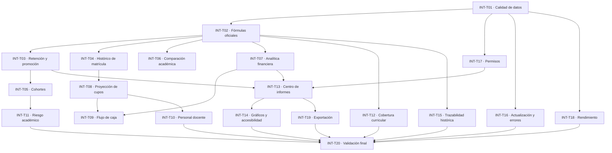

## TAREAS PENDIENTES

PLAN DE IMPLEMENTACIÓN DE HALLAZGOS: FASE 1, REGISTRO Y EXPEDIENTE DE ESTUDIANTES

Proyecto: Ecosistema Educativo New Generation Christian Academy
Origen: Informe de Auditoría Funcional Integral del Registro y Expediente de Estudiantes, Fase 1
Objetivo general: Resolver las brechas identificadas entre los servicios existentes y la interfaz administrativa, completar las operaciones de gestión del expediente que estén ausentes y establecer una herramienta de importación y exportación específica para este ámbito.

INSTRUCCIONES GENERALES PARA TODAS LAS TAREAS

Estas instrucciones se aplican a cada tarea de este documento.

1. Antes de modificar archivos, leer "METODOLOGIA_DESARROLLO.md" y revisar las instrucciones vigentes del proyecto, así como "README.md", "Pendientes.md" y los registros de cambios disponibles que sean pertinentes.
2. Inspeccionar el código actual de los archivos involucrados. No asumir que el informe de auditoría refleja necesariamente el estado actual del repositorio.
3. Identificar las funciones, componentes, servicios, estructuras de datos y controles existentes que puedan reutilizarse. No crear una segunda implementación de una función que ya exista y funcione correctamente.
4. Verificar las firmas, los parámetros, las respuestas y los permisos reales de cada operación antes de conectarla a la interfaz. Los nombres de funciones mencionados en el informe son referencias que deben comprobarse.
5. Limitar cada tarea al objetivo funcional indicado. No implementar tareas posteriores, reconstruir módulos ajenos ni modificar funciones independientes. Solo se permiten cambios auxiliares strictly necesarios para la integración directa, la seguridad, la compatibilidad o las pruebas de la tarea actual.
6. No alterar innecesariamente los contratos de los servicios existentes, la estructura de las hojas de Google Sheets, los identificadores institucionales, los datos históricos, los permisos ni las integraciones operativas.
7. No utilizar cambios directos en las hojas de Google Sheets como sustituto de las operaciones oficiales de la plataforma. Las modificaciones deben seguir los mecanismos autorizados del sistema.
8. No considerar funcional una operación por el mero hecho de que exista un botón, un formulario, una función de servidor o una respuesta simulada. Debe comprobarse el recorrido completo desde la interfaz hasta el almacenamiento y la consulta posterior.
9. Conservar el control de acceso en el servidor. Ocultar un botón en la interfaz no sustituye la autorización de cada operación.
10. Todas las etiquetas, instrucciones, mensajes de error, confirmaciones, notificaciones y ayudas visibles deben estar redactadas en español claro y no técnico. Deben explicar qué puede hacer el usuario, qué información necesita y cuáles serán las consecuencias de una acción.
11. Las pruebas deben utilizar datos de prueba identificables y controlados. No modificar ni eliminar expedientes reales para demostrar un resultado. No utilizar personas reales como datos ficticios ni dejar registros de prueba en la información institucional.
12. Ejecutar las pruebas pertinentes de forma real y registrar sus resultados. Si una prueba requiere credenciales, servicios externos, permisos o datos que no están disponibles, declararlo expresamente y no marcarla como aprobada.
13. Al terminar cada tarea, entregar un informe con los archivos modificados, el comportamiento implementado, las pruebas ejecutadas, los resultados observados, los problemas pendientes y cualquier cambio adicional necesario. No afirmar que se ejecutaron pruebas que no se realizaron.
14. No iniciar automáticamente la tarea siguiente. Cada tarea debe poder revisarse y aprobarse por separado.
15. Registrar los cambios en el lugar que establezca el procedimiento del proyecto, evitando duplicar entradas o modificar tareas ajenas.

---

TAREA REQ-EXP-001: CONSULTA Y VISUALIZACIÓN DEL EXPEDIENTE DIGITAL DEL ESTUDIANTE

1. Objetivo

Permitir que el personal institucional autorizado abra el expediente digital de un estudiante desde la lista administrativa y consulte su información mediante una vista organizada, utilizando los servicios existentes que hayan sido verificados.

Esta tarea constituye la base visual para las funciones de gestión posteriores. No debe implementar todavía la edición, la gestión de tutores, la carga de documentos, la fusión de expedientes, los retiros, los traslados, la importación ni la exportación.

2. Alcance

- Inspeccionar las listas de estudiantes y sus mecanismos actuales de selección.
- Verificar el servicio de consulta integral del expediente, identificado en el informe como "getStudentFile".
- Crear o reutilizar una ventana de consulta del expediente.
- Conectar la selección de un estudiante con la consulta del expediente correcto.
- Mostrar los datos personales disponibles, el identificador institucional y el estado actual.
- Mostrar información académica básica que ya devuelva el servicio, siempre que su inclusión sea pertinente para identificar al estudiante y no implique desarrollar otro módulo.
- Proporcionar estados de carga, ausencia de datos y error.
- Preparar una estructura ampliable para futuras secciones, sin presentar como funcionales pestañas que todavía no tengan comportamiento real.

3. Requisitos funcionales

RF-001. Apertura del expediente

Al seleccionar un estudiante en la lista administrativa, el sistema debe permitir abrir su expediente. Si existe un mecanismo de apertura apropiado, reutilizarlo. Si no existe, incorporarlo sin alterar innecesariamente la navegación actual.

RF-002. Identificación inequívoca

La consulta debe utilizar el identificador estable del expediente o un identificador institucional validado por el servicio oficial. No debe depender exclusivamente del nombre del estudiante ni del número de fila de una hoja.

RF-003. Consulta oficial

La interfaz debe obtener los datos mediante el servicio autorizado de consulta. No debe reconstruir el expediente a partir de fragmentos de la tabla visible cuando exista un servicio oficial que entregue la información completa.

RF-004. Información mostrada

Mostrar, cuando los datos estén disponibles y el usuario tenga autorización:

- Nombre completo.
- Código institucional.
- Identificador del expediente, cuando corresponda.
- Grado y sección actuales, si están disponibles.
- Estado del expediente.
- Fecha de nacimiento, nacionalidad, dirección y demás datos personales devueltos y autorizados para ese usuario.
- Indicadores comprensibles para campos que todavía no estén registrados.

No inventar valores, completar información mediante suposiciones ni mostrar identificadores internos innecesarios al usuario final.

RF-005. Organización visual

Organizar la información en secciones legibles. Reutilizar los estilos, componentes y patrones de navegación de la plataforma.

RF-006. Carga y errores

Mientras se consulta el expediente, mostrar un indicador de espera. Si la consulta falla, mostrar un mensaje comprensible y permitir reintentar sin recargar toda la aplicación.

RF-007. Datos inexistentes

Si el expediente no existe o el usuario no puede acceder a él, manejar la respuesta de forma segura. No mostrar datos parciales de otra persona ni confundir un error de permisos con un expediente válido.

RF-008. Cierre de la vista

Permitir cerrar la ventana y regresar a la lista sin alterar datos ni perder innecesariamente los filtros y la posición de navegación.

RF-009. Adaptación de pantalla

La vista debe ser utilizable en computadoras, tabletas y teléfonos compatibles con la plataforma.

4. Permisos y protección de datos

- Verificar las reglas reales de consulta de cada rol en el servidor.
- Un estudiante solo podrá consultar su propio expediente.
- Un padre o tutor solo podrá consultar los expedientes de estudiantes vinculados y autorizados.
- El personal institucional solo podrá consultar la información que le corresponda según sus permisos.
- No confiar en un identificador enviado por el navegador como prueba de autorización.
- No exponer contraseñas, hashes, credenciales, datos internos innecesarios ni información de terceros.
- No conceder acceso adicional a docentes, orientadores, familiares u otros roles para facilitar la implementación.

5. Criterios de aceptación

- La selección de un estudiante abre el expediente correcto.
- La información mostrada corresponde al resultado real del servicio autorizado.
- Los campos ausentes se presentan claramente, sin errores visuales.
- La carga, el error, el reintento y el cierre funcionan.
- Los usuarios no autorizados no pueden consultar expedientes ajenos.
- La interfaz funciona en los tamaños de pantalla admitidos.
- No se implementan acciones de edición ni operaciones de otras tareas.
- Las pruebas demuestran que no se mezclan los datos de dos estudiantes.

6. Pruebas obligatorias

1. Abrir un expediente válido.
2. Abrir otro expediente y comprobar que se sustituyen correctamente los datos.
3. Consultar un identificador inexistente.
4. Simular un fallo de conexión o una respuesta de error.
5. Intentar consultar un expediente sin autorización.
6. Verificar el acceso de un estudiante a su propio expediente.
7. Verificar el acceso de un padre o tutor a un estudiante no vinculado.
8. Cerrar la vista y comprobar que la lista sigue operativa.
9. Comprobar la adaptación a pantalla pequeña.
10. Confirmar que ninguna operación de escritura se ejecuta al consultar.

7. Entregables

- Vista funcional de consulta del expediente.
- Integración con el servicio real verificado.
- Archivos modificados identificados.
- Evidencia de las pruebas ejecutadas.
- Informe de resultados y limitaciones.

---

TAREA REQ-EXP-002: EDICIÓN DE DATOS PERSONALES DEL EXPEDIENTE

1. Objetivo

Permitir que los usuarios institucionales autorizados modifiquen los datos personales del estudiante mediante un formulario claro y validado, preservando toda la información que no hayan decidido cambiar.

2. Alcance

Esta tarea se limita a los datos personales del expediente. No incluye la modificación de tutores, documentos, matrículas, calificaciones, estados de movilidad ni información financiera.

3. Requisitos funcionales

RF-001. Acceso a la edición

Añadir la acción «Editar datos personales» en la vista del expediente. Mostrarla únicamente a los roles autorizados, sin depender de la ocultación visual como mecanismo de seguridad.

RF-002. Carga de valores actuales

El formulario debe mostrar los valores existentes obtenidos de la consulta oficial del expediente. No debe presentar campos vacíos cuando existen datos guardados.

RF-003. Campos editables

Verificar los campos realmente admitidos por el servicio existente. Incluir, cuando estén soportados:

- Nombres y apellidos.
- Fecha de nacimiento.
- Sexo, si el modelo institucional lo contempla.
- Nacionalidad.
- Dirección de residencia.
- Teléfono y correo de contacto, si pertenecen al expediente.
- Observaciones institucionales autorizadas.

Los campos no confirmados en el modelo de datos no deben incorporarse mediante suposiciones.

RF-004. Campos protegidos

Los identificadores estables del expediente y el código institucional no deben modificarse mediante el formulario ordinario. Si algún dato de identidad se gestiona en otra entidad oficial, respetar ese mecanismo y evitar duplicar su almacenamiento.

RF-005. Validación

Validar los campos obligatorios, las fechas, los formatos de correo y los demás valores admitidos. La validación del servidor debe seguir siendo definitiva.

RF-006. Guardado

Utilizar la operación oficial de actualización, identificada en el informe como "updateStudentFile" si se confirma su existencia y contrato. Enviar únicamente los campos que se pretende modificar.

RF-007. Preservación de datos

Los campos omitidos deben conservar sus valores. No convertir automáticamente campos omitidos en cadenas vacías, valores predeterminados o datos nulos.

RF-008. Cancelación

Permitir cancelar sin guardar. Si el usuario realizó cambios, solicitar confirmación antes de descartarlos.

RF-009. Confirmación del resultado

Mostrar un mensaje de éxito solo después de confirmar que el servidor aceptó y guardó la operación. Ante un error, conservar los cambios introducidos para que el usuario pueda corregirlos o reintentar.

RF-010. Actualización de la vista

Después de guardar, consultar de nuevo el expediente y mostrar los valores realmente almacenados.

4. Reglas de negocio y seguridad

- Solo los roles autorizados por las reglas institucionales pueden editar datos personales.
- El servidor debe validar el rol y la propiedad del expediente en cada solicitud.
- No permitir que un cambio de datos personales modifique indirectamente matrículas, estados, tutores o información académica.
- No registrar contraseñas ni datos confidenciales innecesarios en mensajes o registros de error.
- Si existen restricciones sobre cambios de identidad, respetarlas y explicar al usuario cómo proceder.

5. Criterios de aceptación

- El formulario carga los valores actuales.
- Los campos admitidos pueden modificarse y guardarse.
- Los datos omitidos permanecen intactos.
- Los identificadores protegidos no pueden alterarse.
- La cancelación descarta los cambios no guardados.
- Los errores de validación se muestran junto al campo o en un mensaje comprensible.
- La consulta posterior refleja los valores persistidos.
- Los usuarios no autorizados no pueden guardar cambios.

6. Pruebas obligatorias

1. Modificar un campo y comprobar su persistencia.
2. Modificar un solo campo y verificar que los demás permanecen intactos.
3. Introducir una fecha inválida.
4. Introducir un correo con formato incorrecto, si el campo admite correo.
5. Intentar guardar campos obligatorios vacíos.
6. Cancelar con cambios pendientes.
7. Simular un fallo de guardado.
8. Intentar actualizar mediante una solicitud no autorizada.
9. Intentar cambiar un identificador protegido.
10. Verificar la consulta posterior a una actualización correcta.

7. Entregables

- Formulario de edición funcional.
- Validaciones de cliente y servidor compatibles con el modelo existente.
- Pruebas documentadas.
- Relación de archivos modificados y resultados.

---

TAREA REQ-EXP-003: GESTIÓN DE PADRES, TUTORES Y RESPONSABLES

1. Objetivo

Permitir que Secretaría y los demás roles institucionales autorizados consulten, vinculen y administren correctamente las relaciones entre un estudiante y sus padres, tutores o responsables, utilizando los registros existentes.

2. Alcance

Esta tarea comprende la gestión de las relaciones estudiante-tutor y los datos necesarios para establecerlas. No incluye la implementación completa del portal familiar ni la gestión de cobros, aunque debe preservar los atributos que otros módulos autorizados utilizan.

3. Requisitos funcionales

RF-001. Consulta de responsables

Mostrar los responsables vinculados al expediente, incluyendo los datos de contacto que el usuario esté autorizado a consultar.

RF-002. Identificación del responsable

Permitir buscar un responsable existente por número de identidad, correo u otros identificadores admitidos por el sistema. Mostrar suficientes datos para distinguir coincidencias sin exponer información innecesaria.

RF-003. Reutilización de registros

Antes de crear un responsable nuevo, buscar coincidencias en el directorio oficial. Si existe un responsable válido, permitir vincularlo al estudiante en lugar de crear una ficha duplicada.

RF-004. Creación de responsable

Si no existe un registro coincidente y el usuario tiene autorización, permitir crear un responsable con los campos obligatorios definidos por el modelo vigente.

RF-005. Relación con el estudiante

Permitir establecer la relación de parentesco o responsabilidad utilizando los valores admitidos por el sistema.

RF-006. Atributos de la relación

Mostrar y permitir gestionar, cuando corresponda y esté autorizado:

- Representante legal.
- Contacto de emergencia.
- Responsable financiero.
- Autorización para retirar físicamente al estudiante.
- Acceso al portal familiar.

Estos atributos deben mantenerse independientes. No inferir que una persona autorizada para retirar al estudiante es automáticamente su representante legal o responsable financiero.

RF-007. Varios responsables y varios estudiantes

Permitir que un estudiante tenga varios responsables y que un responsable pueda estar vinculado a varios estudiantes, siempre que el modelo institucional lo permita.

RF-008. Actualización de vínculos

Permitir modificar los atributos de una relación existente sin crear otra relación duplicada.

RF-009. Desvinculación

Permitir desactivar o desvincular una relación cuando corresponda, utilizando la operación oficial. No eliminar físicamente registros históricos si la política vigente exige conservarlos.

RF-010. Confirmaciones

Solicitar confirmación antes de desvincular una relación o cambiar atributos de especial importancia. Informar claramente qué relación se modificará.

RF-011. Actualización posterior

Después de guardar, consultar de nuevo las relaciones y mostrar los datos confirmados por el servidor.

4. Reglas de negocio y permisos

- Respetar la autorización específica para crear, editar, vincular y desvincular responsables.
- No conceder automáticamente acceso al portal familiar solo por crear una relación.
- No crear cuentas de acceso sin seguir el proceso de identidad y autenticación vigente.
- No modificar registros de un responsable compartido de forma que se altere accidentalmente la información de otros estudiantes.
- No confundir la ficha personal del responsable con sus atributos particulares de relación con cada estudiante.
- No cambiar operaciones financieras, aunque se gestione el atributo de responsable financiero.
- Validar en el servidor la existencia del expediente, del responsable y de la relación antes de cada modificación.

5. Criterios de aceptación

- Se muestran los responsables vinculados al estudiante correcto.
- Es posible localizar y reutilizar un responsable existente.
- No se crean duplicados cuando se utiliza un responsable ya registrado.
- Se pueden gestionar los atributos admitidos de la relación.
- Un responsable compartido conserva sus vínculos con otros estudiantes.
- La desvinculación respeta las reglas de conservación histórica.
- Los permisos se aplican en el servidor.
- Los cambios se reflejan después de consultar de nuevo el expediente.

6. Pruebas obligatorias

1. Consultar un expediente con varios responsables.
2. Vincular un responsable existente.
3. Intentar crear un responsable con identidad o correo coincidente.
4. Crear y vincular un responsable nuevo.
5. Modificar un atributo de la relación y comprobar que los demás no cambian.
6. Verificar un responsable vinculado a dos estudiantes.
7. Desvincular una relación de prueba y comprobar la conservación histórica.
8. Intentar modificar relaciones con un rol no autorizado.
9. Verificar que crear una relación no concede acceso al portal automáticamente.
10. Comprobar que los errores no producen relaciones parciales o duplicadas.

7. Entregables

- Sección de responsables funcional.
- Búsqueda y reutilización de registros existentes.
- Operaciones de relación integradas con los servicios verificados.
- Evidencia de pruebas e informe de resultados.

---

TAREA REQ-EXP-004: GESTIÓN DE DOCUMENTOS Y FOTOGRAFÍAS DEL ESTUDIANTE

1. Objetivo

Permitir consultar los documentos asociados al expediente y realizar las operaciones de carga y actualización que estén autorizadas, con validación de archivos y acceso controlado a sus contenidos.

2. Alcance

Esta tarea cubre fotografías y documentos del expediente estudiantil. No incluye un editor general de documentos institucionales, reconocimiento óptico de caracteres, digitalización masiva ni importación de expedientes.

3. Requisitos funcionales

RF-001. Lista de documentos

Mostrar los documentos asociados al expediente mediante los metadatos reales disponibles, por ejemplo:

- Nombre del archivo.
- Tipo de documento.
- Fecha de recepción o carga.
- Estado de revisión, si existe.
- Acción disponible para visualizar o descargar.

RF-002. Clasificación

Utilizar los tipos documentales existentes en el sistema. No inventar categorías incompatibles con los valores almacenados.

RF-003. Selección de archivos

Incorporar un selector de archivos accesible. La función de arrastrar y soltar podrá añadirse si es compatible con los componentes y dispositivos admitidos, pero no debe ser la única forma de seleccionar archivos.

RF-004. Validación de archivos

Comprobar el tamaño máximo permitido, el tipo de archivo, la extensión y la consistencia del contenido antes de iniciar la carga. Confirmar en el código el límite real admitido por el servicio; no asumir que es de 10 MB únicamente porque el informe lo recomienda.

RF-005. Carga

Utilizar el servicio oficial de carga de documentos, identificado en el informe como "uploadStudentDocument" si se confirma su contrato. Asociar el archivo al expediente correcto y enviar únicamente los metadatos necesarios.

RF-006. Progreso y resultado

Mostrar el estado de la carga y confirmar el éxito solo cuando el servicio confirme que el archivo y sus metadatos fueron registrados correctamente.

RF-007. Fallos

Si la carga falla, informar al usuario y evitar que la interfaz presente el archivo como guardado. Si el servicio puede dejar archivos huérfanos o registros parciales, verificar y resolver ese comportamiento dentro del alcance directo de la operación.

RF-008. Visualización y descarga

Permitir abrir o descargar documentos mediante mecanismos compatibles con los permisos institucionales. No asumir que una URL de Google Drive es pública ni que conocerla autoriza el acceso.

RF-009. Fotografía

Mostrar la fotografía existente cuando esté disponible. Permitir sustituirla si el servicio y los permisos lo permiten. Mantener una imagen alternativa comprensible cuando no exista una fotografía o no pueda cargarse.

RF-010. Sustitución documental

Si se admite sustituir un documento, conservar el historial y los metadatos previos conforme a las reglas vigentes. No sobrescribir ni eliminar el documento anterior sin verificar la política institucional.

RF-011. Accesibilidad

Incluir nombres descriptivos, etiquetas de controles, estados de carga y mensajes de error comprensibles.

4. Reglas de almacenamiento e imágenes

- Verificar cómo se guardan actualmente los identificadores de Drive y las referencias de los archivos.
- No utilizar URLs públicas como sustituto de la autorización institucional.
- No introducir contraseñas, tokens ni credenciales en enlaces o registros visibles.
- Respetar la estrategia de imágenes del proyecto: las imágenes de la interfaz no deben servirse desde Google Apps Script. Cuando corresponda, reutilizar el mecanismo de conversión del frontend para construir las URLs de miniaturas de Google Drive a partir de las referencias almacenadas, sin inventar formatos de URL nuevos.
- Comprobar que la visualización de fotografías sea compatible con los permisos de acceso y la configuración real de Drive.
- No modificar la organización general del almacenamiento documental fuera de lo necesario para esta función.

5. Criterios de aceptación

- Los documentos del expediente correcto se muestran con sus metadatos.
- Los archivos válidos pueden cargarse y quedan asociados al expediente correcto.
- Los archivos no admitidos se rechazan con un mensaje comprensible.
- Los fallos no se presentan como cargas exitosas.
- Las fotografías pueden visualizarse y sustituirse cuando esté autorizado.
- Los enlaces no permiten eludir los controles de acceso.
- La sustitución conserva el historial exigido.
- No se exponen archivos de otros estudiantes.

6. Pruebas obligatorias

1. Consultar un expediente con documentos.
2. Consultar un expediente sin documentos.
3. Cargar un documento válido de prueba.
4. Intentar cargar un archivo que exceda el límite confirmado.
5. Intentar cargar un tipo no admitido.
6. Simular un fallo del servicio de almacenamiento.
7. Verificar la asociación del documento con el expediente correcto.
8. Abrir un documento como usuario autorizado.
9. Intentar acceder al documento como usuario no autorizado.
10. Visualizar un expediente sin fotografía.
11. Sustituir una fotografía de prueba y comprobar la referencia almacenada.
12. Verificar la conservación de versiones documentales, si está implementada.

7. Entregables

- Sección documental funcional.
- Carga y visualización integradas con los servicios existentes.
- Validaciones verificadas.
- Pruebas e informe de resultados.

---

TAREA REQ-EXP-005: CONSULTA DE LA LÍNEA DE TIEMPO E HISTORIAL DEL ESTUDIANTE

1. Objetivo

Mostrar en el expediente una secuencia cronológica de los eventos registrados en la trayectoria institucional del estudiante, sin alterar ni reconstruir artificialmente el historial.

2. Alcance

Esta tarea se limita a la consulta y presentación del historial disponible. No implementa operaciones para generar nuevos movimientos, cambiar secciones, retirar estudiantes ni procesar reingresos.

3. Requisitos funcionales

RF-001. Consulta del historial

Verificar y reutilizar el servicio existente, identificado como "getStudentTimeline" en el informe, o el mecanismo oficial que corresponda.

RF-002. Eventos

Mostrar los tipos de evento que realmente existan en los registros, por ejemplo:

- Apertura del expediente.
- Matrículas registradas.
- Cambios de sección.
- Recepción de documentos.
- Retiros.
- Traslados.
- Reingresos.

La lista no debe implicar que todos estos eventos están implementados o registrados si no se confirma su existencia.

RF-003. Información de cada evento

Mostrar, cuando estén disponibles y autorizados:

- Fecha del evento.
- Tipo de movimiento.
- Descripción comprensible.
- Estado o resultado.
- Autor responsable, cuando la política de permisos permita mostrarlo.

RF-004. Orden cronológico

Verificar el formato de las fechas y ordenar los eventos correctamente. El orden debe ser consistente incluso si existen fechas iguales o registros históricos incompletos.

RF-005. Ausencia de historial

Mostrar un mensaje de que no existen movimientos registrados cuando corresponda, sin confundirlo con un fallo de consulta.

RF-006. Integridad histórica

La interfaz debe ser de consulta. No debe permitir editar o eliminar eventos mediante esta tarea.

RF-007. Presentación

Utilizar una línea de tiempo o lista cronológica legible, adaptable a dispositivos y con distinción comprensible entre los tipos de evento.

4. Reglas de negocio y permisos

- Solo mostrar el historial que el usuario esté autorizado a consultar.
- No exponer notas internas restringidas ni datos personales innecesarios.
- No crear eventos ficticios para completar espacios en la secuencia.
- No interpretar un dato ausente como evidencia de que el evento nunca ocurrió.
- Si se detectan registros inconsistentes, documentarlos en el informe en lugar de modificarlos automáticamente.

5. Criterios de aceptación

- El historial corresponde al expediente consultado.
- Los eventos se presentan en orden cronológico correcto.
- Los datos faltantes se manejan sin errores.
- Los usuarios no autorizados no pueden consultar movimientos restringidos.
- La interfaz no permite alterar el historial.
- Las fechas y descripciones reflejan los registros reales.

6. Pruebas obligatorias

1. Consultar un expediente con varios eventos.
2. Verificar el orden de fechas.
3. Consultar un expediente sin movimientos.
4. Comprobar el manejo de fechas iguales o incompletas.
5. Verificar que no se mezclan movimientos de distintos expedientes.
6. Intentar consultar el historial con un rol no autorizado.
7. Confirmar que la consulta no modifica las hojas ni los registros históricos.

7. Entregables

- Vista de historial funcional.
- Integración con el servicio verificado.
- Pruebas documentadas.
- Informe de resultados y limitaciones.

---

TAREA REQ-EXP-006: PREVENCIÓN Y RESOLUCIÓN CONTROLADA DE DUPLICADOS

1. Objetivo

Incorporar a la interfaz administrativa la detección de posibles estudiantes duplicados antes de crear un nuevo expediente o convertir una solicitud de admisión, permitiendo revisar coincidencias y evitar registros redundantes.

2. Alcance

Esta tarea comprende la detección, la presentación de candidatos y la orientación al usuario para decidir cómo continuar. La fusión efectiva de expedientes debe tratarse como una operación crítica con sus propias verificaciones y confirmaciones.

3. Requisitos funcionales

RF-001. Consulta preventiva

Verificar y reutilizar el servicio existente de detección de duplicados, identificado en el informe como "findDuplicateStudents".

RF-002. Momento de comprobación

Ejecutar la comprobación antes de confirmar la creación de un expediente o convertir una solicitud de admisión, siempre que el flujo correspondiente invoque esta tarea.

RF-003. Criterios de coincidencia

Utilizar los criterios reales del servicio, como identificación exacta, correo electrónico y similitud de nombre, si están efectivamente implementados.

RF-004. Presentación de candidatos

Mostrar una lista de posibles coincidencias con los datos mínimos necesarios para que un usuario autorizado pueda distinguirlas, junto con el motivo de coincidencia cuando esté disponible.

RF-005. Diferenciación entre coincidencia exacta y aproximada

Distinguir claramente una coincidencia exacta de una similitud aproximada. Una similitud de nombre no debe tratarse automáticamente como prueba de que dos registros pertenecen a la misma persona.

RF-006. Decisión del usuario

Ofrecer opciones comprensibles para revisar un expediente existente, volver al formulario para corregir datos o continuar cuando la regla institucional permita hacerlo.

RF-007. Coincidencias inequívocas

Si el sistema ya impide crear duplicados inequívocos, conservar esa protección y verificar que la interfaz comunique el motivo del bloqueo.

RF-008. Revisión antes de continuar

No crear un expediente nuevo silenciosamente cuando se haya detectado una coincidencia que requiera revisión.

RF-009. Prevención de fusión accidental

No fusionar automáticamente expedientes por coincidencia de nombre, correo o identificación. La fusión requiere autorización, selección explícita de origen y destino, confirmación de consecuencias y validaciones del servidor.

RF-010. Registro del resultado

Si existe una bitácora oficial para estas decisiones, utilizarla conforme a sus reglas. No crear registros de auditoría paralelos sin necesidad.

4. Reglas de negocio y seguridad

- La comprobación preventiva no sustituye las validaciones definitivas del servidor.
- Las restricciones de creación y fusión deben seguir aplicándose en el backend.
- La fusión debe permanecer reservada a los roles autorizados por la política institucional confirmada.
- No mostrar a un usuario información de candidatos que no tenga permiso para consultar.
- No bloquear automáticamente una admisión legítima solo por similitud aproximada.
- No alterar expedientes existentes durante la búsqueda de coincidencias.

5. Criterios de aceptación

- La comprobación se realiza antes de confirmar las operaciones correspondientes.
- Las coincidencias se muestran con información suficiente y permisos correctos.
- Los motivos de coincidencia se distinguen correctamente.
- Los duplicados inequívocos siguen sujetos a las restricciones vigentes.
- La similitud aproximada no provoca una fusión ni un bloqueo automático injustificado.
- La interfaz no crea expedientes duplicados silenciosamente.
- No se ejecutan fusiones sin autorización y confirmación explícita.

6. Pruebas obligatorias

1. Buscar una coincidencia exacta de identificación.
2. Buscar una coincidencia exacta de correo.
3. Buscar un nombre parecido que corresponda a otra persona.
4. Comprobar el comportamiento sin coincidencias.
5. Intentar crear un duplicado inequívoco.
6. Verificar que una coincidencia aproximada permite revisión.
7. Intentar consultar candidatos sin permiso.
8. Comprobar que una comprobación no modifica expedientes.
9. Verificar que la fusión no se activa automáticamente.
10. Comprobar el tratamiento de errores del servicio de detección.

7. Entregables

- Flujo visual de prevención de duplicados.
- Integración con el servicio verificado.
- Pruebas de coincidencias exactas y aproximadas.
- Informe de resultados.

---

TAREA REQ-EXP-007: BÚSQUEDA INSTITUCIONAL DE EXPEDIENTES

1. Objetivo

Mejorar la búsqueda administrativa para localizar estudiantes y abrir sus expedientes sin depender exclusivamente de la lista actualmente cargada en memoria o de la sección seleccionada.

2. Alcance

Esta tarea comprende la búsqueda y presentación de resultados. No incluye la construcción de un motor de búsqueda general para todos los módulos de la plataforma.

3. Requisitos funcionales

RF-001. Inspección de la búsqueda actual

Revisar el funcionamiento real de "#student-search" y conservar los filtros que ya funcionen correctamente.

RF-002. Criterios de búsqueda

Permitir buscar por los identificadores y campos que el servicio institucional admita, por ejemplo:

- Nombre y apellidos.
- Código institucional.
- Identificador del expediente.
- Correo o número de identidad, únicamente cuando esté autorizado y el servicio lo soporte.

No enviar criterios que el servicio no pueda procesar.

RF-003. Alcance institucional

Permitir localizar estudiantes fuera de la lista local actual cuando el usuario tenga permiso para consultarlos.

RF-004. Integración con la consulta

Los resultados deben permitir abrir el expediente correcto mediante el mecanismo implementado en REQ-EXP-001.

RF-005. Resultados múltiples

Cuando existan varios resultados, mostrarlos de forma distinguible y permitir seleccionar el expediente correcto. No abrir automáticamente un candidato arbitrario.

RF-006. Estados de búsqueda

Mostrar estados claros de carga, resultados encontrados, ausencia de coincidencias y error. Evitar solicitudes repetidas innecesarias mientras el usuario escribe.

RF-007. Filtros existentes

Preservar los filtros actuales por grado, sección y estado cuando sigan siendo útiles. Definir claramente cómo se combinan con la búsqueda global.

RF-008. Rendimiento

Usar el mecanismo de consulta más apropiado que ya exista. Evitar descargar indiscriminadamente todos los expedientes si el servicio permite consultas específicas.

RF-009. Privacidad

No mostrar campos sensibles en la lista de resultados cuando no sean necesarios para identificar al estudiante.

RF-010. Navegación

Mantener el estado razonable de la lista y permitir regresar a los resultados después de consultar un expediente.

4. Reglas de negocio y permisos

- El servidor debe aplicar los permisos antes de devolver resultados.
- Los usuarios no deben poder consultar registros de otras personas mediante la modificación manual de parámetros.
- La búsqueda por datos personales sensibles debe limitarse a roles y finalidades autorizados.
- No confundir la búsqueda de duplicados con la búsqueda general de expedientes: son operaciones diferentes y deben conservar sus respectivas reglas.

5. Criterios de aceptación

- La búsqueda local existente sigue funcionando.
- Se pueden localizar estudiantes fuera de la lista cargada cuando el rol lo permite.
- Los códigos y los identificadores se procesan según el contrato del servicio.
- Los resultados múltiples son distinguibles.
- Es posible abrir el expediente desde los resultados.
- Los estados vacíos y los errores son comprensibles.
- No se exponen expedientes fuera del alcance de autorización.

6. Pruebas obligatorias

1. Buscar por nombre.
2. Buscar por código institucional.
3. Buscar por identificador de expediente.
4. Buscar un estudiante de otro grado o sección.
5. Buscar un registro inexistente.
6. Procesar varias coincidencias.
7. Combinar búsqueda con filtros existentes.
8. Simular un fallo del servicio.
9. Intentar una búsqueda con un rol limitado.
10. Verificar que se abre el expediente seleccionado y no otro.

7. Entregables

- Búsqueda institucional integrada.
- Preservación de filtros existentes.
- Pruebas de búsqueda y permisos.
- Informe de resultados.

---

TAREA REQ-EXP-008: ESTADOS Y MOVILIDAD DEL ESTUDIANTE

1. Objetivo

Proporcionar una interfaz administrativa para consultar y ejecutar los cambios de estado y los movimientos de estudiantes que estén implementados en el sistema, preservando el historial y la integridad de los registros.

2. Alcance

Esta tarea incluye las operaciones de estado, retiro, traslado y reingreso que se confirmen en el código. No incluye desarrollar el proceso completo de matrícula anual ni modificar los cálculos académicos o financieros asociados.

3. Requisitos funcionales

RF-001. Estado actual

Mostrar el estado vigente del expediente mediante etiquetas comprensibles, utilizando los valores reales admitidos por el sistema.

RF-002. Operaciones disponibles

Verificar qué operaciones oficiales existen, entre ellas:

- Inactivación.
- Retiro.
- Traslado.
- Reingreso.
- Consulta de movimientos históricos.

No asumir que estas operaciones son equivalentes ni sustituibles entre sí.

RF-003. Acciones según estado

Mostrar únicamente las acciones válidas para el estado actual del expediente y el rol del usuario.

RF-004. Datos obligatorios del movimiento

Solicitar los datos exigidos por cada operación, como motivo, fecha efectiva, destino del traslado u otra información definida por las reglas vigentes.

RF-005. Confirmación

Antes de ejecutar una operación crítica, presentar un resumen claro del estudiante, la operación y sus consecuencias. Exigir confirmación explícita.

RF-006. Procesamiento

Utilizar las operaciones oficiales existentes, verificando sus contratos. El informe menciona "recordStudentWithdrawal", "recordStudentTransfer" y "processStudentReentry"; confirmar su existencia y funcionamiento antes de utilizarlas.

RF-007. Conservación histórica

No eliminar físicamente expedientes ni movimientos históricos cuando la política vigente exige conservarlos.

RF-008. Reingreso

Antes de reactivar un expediente, comprobar las condiciones requeridas por el servicio oficial. No asumir que reactivar el expediente equivale a completar todas las operaciones de matrícula.

RF-009. Resultado

Mostrar el resultado confirmado por el servidor y actualizar el estado visible mediante una nueva consulta.

RF-010. Errores y operaciones repetidas

Evitar que un doble clic o una repetición accidental genere movimientos duplicados. Si el resultado es incierto por un fallo de comunicación, comprobar el estado antes de repetir la operación.

4. Reglas de negocio y permisos

- Mantener las restricciones institucionales sobre quién puede cambiar el estado.
- Verificar los estados previos y las transiciones permitidas en el servidor.
- No permitir retiros, traslados o reingresos por una simple modificación visual del estado.
- No borrar matrículas ni movimientos para ocultar una operación anterior.
- No modificar cobros, saldos o calificaciones como consecuencia indirecta, salvo que exista una dependencia explícita y autorizada. En ese caso, documentarla y limitarse a respetar el mecanismo existente.
- Si una transición no está definida en las reglas actuales, no inventarla: documentar el caso y solicitar aclaración antes de implementarlo.

5. Criterios de aceptación

- Se muestra el estado correcto.
- Las acciones disponibles dependen del estado y los permisos.
- Los movimientos requieren los datos obligatorios.
- Las operaciones críticas solicitan confirmación.
- El historial se conserva.
- Las acciones inválidas se rechazan.
- Los resultados se reflejan después de consultar el estado.
- Los fallos de comunicación no provocan operaciones duplicadas.

6. Pruebas obligatorias

1. Consultar expedientes en distintos estados existentes.
2. Ejecutar un movimiento válido sobre un expediente de prueba.
3. Intentar una transición no permitida.
4. Intentar una operación sin los datos obligatorios.
5. Cancelar una confirmación.
6. Intentar ejecutar una operación con un rol no autorizado.
7. Verificar la conservación del expediente y su historial.
8. Simular una repetición de la misma solicitud.
9. Simular una respuesta incierta y comprobar el estado antes de reintentar.
10. Verificar el estado y los movimientos después de cada operación.

7. Entregables

- Interfaz de estados y movimientos.
- Integración con los servicios oficiales confirmados.
- Pruebas de transiciones y permisos.
- Informe de resultados y dependencias detectadas.

---

TAREA REQ-EXP-009: EXPORTACIÓN AUTORIZADA DEL EXPEDIENTE A PDF

1. Objetivo

Permitir generar una copia legible del expediente de un estudiante en PDF, con la información autorizada y un formato adecuado para consulta, impresión y trámites institucionales.

2. Alcance

Esta tarea se limita a la exportación de un expediente individual. No incluye informes generales de rendimiento, certificados oficiales, plantillas documentales universales ni exportaciones masivas.

3. Requisitos funcionales

RF-001. Acción de exportación

Incorporar la opción «Exportar expediente a PDF» en la vista del expediente, disponible únicamente para los roles autorizados.

RF-002. Fuente de información

Generar el documento a partir de los datos oficiales consultados y autorizados. No construir el documento exclusivamente con datos parciales o modificables del navegador.

RF-003. Contenido

Incluir los apartados que la institución haya definido para la ficha general, por ejemplo:

- Identificación del estudiante.
- Datos personales autorizados.
- Grado, sección y estado actual, cuando corresponda.
- Información de responsables que el usuario pueda exportar.
- Fecha de generación del documento.

No incluir automáticamente documentos adjuntos completos, contraseñas, credenciales, notas internas restringidas ni datos de otros estudiantes.

RF-004. Formato

Producir un PDF legible, con títulos, identificación clara del estudiante, paginación cuando sea necesaria y tratamiento adecuado de textos largos.

RF-005. Datos ausentes

Representar los campos vacíos de forma clara, sin inventar valores.

RF-006. Identificación del documento

Incluir la fecha de generación y los datos institucionales que ya estén definidos en la plataforma. No inventar sellos, firmas, certificaciones ni declaraciones de validez oficial.

RF-007. Resultado

Permitir abrir o descargar el PDF. Informar si la generación falla y no presentar archivos incompletos como exitosos.

RF-008. Seguridad

Verificar los permisos en el servidor antes de generar o entregar el documento. Evitar que un usuario pueda modificar un identificador y exportar el expediente de otra persona.

RF-009. Reutilización

Inspeccionar el generador documental o motor de reportes existente antes de implementar una solución nueva. Reutilizarlo si satisface los requisitos sin alterar su comportamiento general.

4. Reglas de negocio y permisos

- La autorización para consultar un expediente no implica automáticamente autorización para exportar todos sus datos.
- La exportación debe respetar las mismas restricciones de privacidad aplicables a la consulta y las restricciones adicionales que existan.
- No publicar el archivo en una ubicación accesible sin autorización.
- No almacenar copias permanentes adicionales si el sistema no las necesita.
- No modificar la ficha original al generar el PDF.

5. Criterios de aceptación

- El PDF se genera a partir de los datos oficiales.
- El contenido corresponde al estudiante seleccionado.
- El formato es legible en pantalla e impresión.
- Los campos ausentes se manejan correctamente.
- No se incluyen datos restringidos.
- Los usuarios no autorizados no pueden exportar.
- Los errores se comunican correctamente.
- La generación no altera el expediente.

6. Pruebas obligatorias

1. Exportar un expediente de prueba completo.
2. Exportar un expediente con campos vacíos.
3. Comprobar la correspondencia de los datos del PDF con el expediente.
4. Verificar la paginación y los textos largos.
5. Intentar exportar con un rol no autorizado.
6. Intentar solicitar un expediente distinto mediante parámetros modificados.
7. Simular un error del generador.
8. Comprobar que no se modifican registros al exportar.
9. Verificar que el archivo puede abrirse con un lector de PDF.

7. Entregables

- Exportación individual a PDF.
- Reutilización documentada del mecanismo de generación.
- Pruebas e informe de resultados.

---

TAREA REQ-EXP-010: IMPORTACIÓN MASIVA DE EXPEDIENTES DESDE CSV Y XLSX

1. Objetivo

Diseñar e implementar una herramienta específica para importar expedientes de estudiantes desde archivos CSV y XLSX, con vista previa, correspondencia de columnas, validaciones, detección de duplicados y un informe de resultados.

La herramienta debe reducir la carga manual sin comprometer la integridad de los expedientes ni crear registros duplicados.

2. Alcance

Esta tarea se limita a la importación inicial o actualización controlada de datos personales de expedientes de estudiantes. No debe convertirse en un importador universal para matrículas, calificaciones, asistencia, tutores, pagos, inventarios u otros módulos.

No importar documentos binarios, fotografías ni archivos adjuntos como parte de esta tarea, salvo que el modelo existente disponga de una referencia documental compatible y la importación de esas referencias se autorice expresamente.

3. Requisitos funcionales

RF-001. Acceso restringido

Mostrar la herramienta únicamente a los roles institucionales autorizados para importar expedientes. Aplicar también la autorización en el servidor.

RF-002. Selección de archivo

Permitir seleccionar archivos CSV y XLSX dentro de los límites de tamaño confirmados por la plataforma. Rechazar archivos dañados, vacíos o de formato no admitido con mensajes comprensibles.

RF-003. Lectura inicial

Leer las cabeceras y las filas del archivo sin escribir todavía en las hojas oficiales.

RF-004. Vista previa

Mostrar una vista previa de las filas que se van a procesar, permitiendo al usuario comprobar si el archivo fue interpretado correctamente.

RF-005. Correspondencia de columnas

Permitir relacionar las columnas del archivo con los campos admitidos del expediente. Utilizar nombres claros para usuarios administrativos, aunque los nombres internos de los campos sean diferentes.

RF-006. Sugerencias de correspondencia

Cuando sea posible, sugerir correspondencias por similitud de nombre, pero requerir revisión del usuario antes de confirmar un mapeo ambiguo.

RF-007. Campos obligatorios

Identificar los campos obligatorios según las reglas reales del servicio de creación o actualización. No inventar requisitos ni aceptar registros que el servicio oficial rechazaría.

RF-008. Validación de filas

Validar, antes de escribir:

- Campos obligatorios.
- Formatos de fechas.
- Correos electrónicos, cuando correspondan.
- Identificadores institucionales y personales.
- Valores admitidos.
- Duplicados dentro del archivo.
- Coincidencias con los expedientes existentes.
- Datos que no pueden actualizarse por importación.

RF-009. Clasificación de resultados preliminares

Clasificar las filas, como mínimo, en:

- Válidas para creación.
- Válidas para actualización, cuando se permita.
- Requieren revisión.
- Duplicadas.
- Inválidas.

Mostrar el motivo de cada clasificación.

RF-010. Modo de validación

Ofrecer un modo que permita validar el archivo y descargar el resultado sin escribir registros en la base de datos.

RF-011. Confirmación de importación

Antes de ejecutar la importación, presentar un resumen con el número de filas válidas, rechazadas, duplicadas y pendientes de revisión. Requerir confirmación explícita.

RF-012. Creación y actualización

Utilizar los servicios oficiales de creación o actualización. No escribir directamente en Google Sheets si eso omite validaciones, identificadores, movimientos o reglas de integridad del sistema.

RF-013. Prevención de duplicados

No crear expedientes nuevos cuando exista una coincidencia inequívoca que deba resolverse. Las coincidencias aproximadas deben marcarse para revisión. No fusionar expedientes automáticamente durante una importación.

RF-014. Errores por fila

Si una fila falla, registrar su número de origen, el motivo del error y el resultado. No mostrar información confidencial de otros estudiantes en los informes.

RF-015. Resultado final

Al concluir, mostrar un resumen con:

- Filas procesadas.
- Expedientes creados.
- Expedientes actualizados, si la actualización está permitida.
- Filas rechazadas.
- Duplicados detectados.
- Filas que requieren revisión.
- Errores ocurridos durante la operación.

RF-016. Informe descargable

Permitir descargar un informe de validación o importación con el resultado por fila. No incluir contraseñas, credenciales ni datos sensibles innecesarios.

RF-017. Reintentos seguros

Evitar que repetir la importación cree duplicados. Si una operación se interrumpe, identificar qué filas se procesaron correctamente antes de permitir reanudarla o volver a ejecutarla.

RF-018. Perfil de mapeo

Si se implementan perfiles reutilizables de correspondencia, almacenarlos sin incorporar información personal del archivo a un perfil que deba ser reutilizable. Esta función solo se incluirá si no compromete el alcance ni la seguridad de la importación básica.

4. Reglas de negocio y seguridad

- Los identificadores estables del expediente no deben generarse mediante reglas improvisadas en el navegador.
- Utilizar el mecanismo institucional oficial para crear identificadores.
- No actualizar automáticamente un expediente solo porque coincida el nombre.
- No reemplazar datos existentes por celdas vacías del archivo sin una regla explícita y confirmada.
- No modificar matrículas, calificaciones, asistencia, tutores, pagos ni estados de movilidad.
- Si una fila requiere datos que pertenecen a otra herramienta, marcarla como pendiente de revisión y explicar el motivo.
- Preservar la estructura, las cabeceras y las reglas de las hojas oficiales. No recrear hojas ni cambiar sus formatos para adaptar el sistema al archivo importado.
- La importación debe respetar los controles de acceso, la trazabilidad y los mecanismos de concurrencia existentes.
- Si no es posible garantizar la reversión completa de una operación parcial, no prometer que la importación es transaccional. Definir y documentar cómo se identifican los registros procesados y cómo se recupera una operación interrumpida.
- No dejar importaciones de prueba en datos reales.
- La importación debe ser idempotente o contar con controles equivalentes para impedir duplicados por reintento.

5. Criterios de aceptación

- Se admiten CSV y XLSX válidos dentro de los límites confirmados.
- La vista previa no modifica datos.
- Las columnas pueden mapearse de manera explícita.
- Las validaciones identifican errores y duplicados antes de confirmar.
- El modo de validación no escribe en la base de datos.
- La confirmación muestra un resumen claro.
- Los registros se crean o actualizan mediante las operaciones oficiales.
- Los errores por fila quedan identificados.
- El informe final coincide con los resultados realmente almacenados.
- Los reintentos no generan duplicados.
- Las operaciones respetan los permisos institucionales.
- Los módulos ajenos permanecen intactos.

6. Pruebas obligatorias

1. Importar un CSV válido en un entorno de prueba.
2. Importar un XLSX válido.
3. Procesar un archivo con columnas desconocidas.
4. Procesar un archivo con campos obligatorios vacíos.
5. Procesar fechas y correos inválidos.
6. Detectar filas duplicadas dentro del archivo.
7. Detectar coincidencias con expedientes existentes.
8. Verificar que el modo de validación no escribe datos.
9. Cancelar antes de confirmar y comprobar que no se realizaron cambios.
10. Ejecutar una importación confirmada y verificar los registros almacenados.
11. Simular un fallo durante el procesamiento.
12. Repetir la operación y comprobar que no se crean duplicados.
13. Verificar que el informe descargable refleja los resultados reales.
14. Intentar importar con un rol no autorizado.
15. Verificar que no se modifican matrículas, calificaciones, asistencia, tutores ni pagos.

7. Entregables

- Herramienta de importación de expedientes.
- Vista previa y mapeo de columnas.
- Validación previa y detección de duplicados.
- Modo de validación sin escritura.
- Informe descargable por fila.
- Pruebas reales e informe de resultados.
- Documentación de límites, recuperación de fallos y dependencias.

---

CRITERIO GENERAL DE CIERRE DEL CONJUNTO DE TAREAS

Cada tarea debe completarse, probarse y revisarse de forma independiente. La implementación de una tarea no autoriza a marcar como terminadas las demás.

Al finalizar cada una, Jules debe entregar:

1. Resultado: qué comportamiento quedó implementado.
2. Estado previo confirmado: qué existía realmente antes de los cambios.
3. Archivos modificados: rutas y propósito de cada modificación.
4. Servicios reutilizados: funciones existentes verificadas y forma en que se integraron.
5. Pruebas: casos ejecutados, resultado esperado, resultado real y estado.
6. Seguridad: comprobaciones de permisos y protección de datos efectuadas.
7. Compatibilidad: efectos comprobados sobre las funciones existentes relacionadas.
8. Limitaciones: pruebas no ejecutadas, dependencias pendientes y problemas no resueltos.
9. Cambios de alcance: cualquier necesidad adicional detectada debe documentarse y quedar pendiente de autorización, sin implementarse automáticamente.
10. Cierre: indicar expresamente si la tarea está completa, parcialmente completa o bloqueada, justificando el estado con evidencia.

Orden de ejecución

1. REQ-EXP-001: Consulta y visualización del expediente.
2. REQ-EXP-002: Edición de datos personales.
3. REQ-EXP-003: Gestión de tutores y responsables.
4. REQ-EXP-004: Documentos y fotografías.
5. REQ-EXP-005: Línea de tiempo e historial.
6. REQ-EXP-006: Prevención y resolución de duplicados.
7. REQ-EXP-007: Búsqueda institucional.
8. REQ-EXP-008: Estados y movilidad estudiantil.
9. REQ-EXP-009: Exportación del expediente a PDF.
10. REQ-EXP-010: Importación masiva de expedientes.

Este orden es una propuesta inicial. Si la inspección del repositorio descubre una dependencia directa que impida ejecutar una tarea, Jules debe documentarla y proponer el ajuste mínimo al orden, sin ampliar automáticamente el alcance de las tareas.

Fin del plan de tareas derivadas de la Fase 1.

---

### [REQ-EXP-001] Interfaz de Usuario e Integración del Expediente Digital Unificado del Estudiante
- **Origen del Hallazgo:** Auditoría.txt (Mon Jul 6 2026 - Fase 1: Auditoría Funcional Integral del Registro y Expediente de Estudiantes)
- **Severidad/Clasificación:** Crítico
- **Archivos Involucrados:** `teacher-dashboard.html`, `student-dashboard.html`, `js/teacher.js`, `js/student.js`, `backend/academic-service/Code.gs`
- **Dependencias Expuestas:** `ExpedientesEstudiantes`, `SolicitudesAdmision`, `ResponsablesTutores`, `RelacionesEstudianteTutor`, `DocumentosEstudiante`, `MovimientosEstudiante`, `getStudentFile`, `updateStudentFile`, `findDuplicateStudents`, `mergeStudentFiles`, `saveStudentGuardian`, `uploadStudentDocument`
- **Descripción del Alcance:**
  1. Diseñar e implementar en `teacher-dashboard.html` y `js/teacher.js` el componente modal interactivo `#modal-student-file` (Expediente Digital Unificado) con las siguientes 5 pestañas funcionales:
     a) Ficha de Datos Personales (consulta y edición de fecha de nacimiento, nacionalidad, dirección, foto, observaciones y estado).
     b) Tutores y Responsables Legales (listado, vinculación, desvinculación y asignación de atributos como representante legal, contacto de emergencia, responsable financiero, autorización pick-up y acceso a portal).
     c) Expediente Documental (subida de archivos PDF e imágenes con almacenamiento directo en Google Drive Folder `New Generation/Documentos_Estudiantes`, generación de URLs de visualización directa y revisión de estado).
     d) Historial Académico y Movimientos (línea de tiempo unificada con fechas de creación, matrículas, cambios de sección, retiros, traslados y reingresos).
     e) Detección y Fusión de Duplicados (herramienta de búsqueda automática por ID/email/nombre e inicio del flujo de fusión auditada que re-vincula documentos y movimientos al expediente principal).
  2. Conectar el campo de búsqueda `#student-search` en `teacher-dashboard.html` para permitir abrir directamente el expediente digital completo mediante `getStudentFile` al seleccionar un estudiante de los resultados.
  3. Asegurar que las actualizaciones parciales conserven los campos no modificados y respeten la matriz RBAC del servidor.
- **Criterios de Aceptación:**
  - Modal `#modal-student-file` operativo en `teacher-dashboard.html` y manejado por `js/teacher.js`.
  - Invocación exitosa de los 23 endpoints de la Fase 4 sin duplicar funciones backend.
  - Subida de documentos adjuntos directo a Google Drive y generación de enlaces de vista previa.
  - Fusión de expediente re-vinculando documentos/movimientos y marcando expediente origen como "Fusionado".
  - Búsqueda `#student-search` integrada con apertura de expediente digital.
- **Estado:** [X] Completada

### [REQ-DASH-ADAPT-001] Adaptación Integral de Dashboards, Menús por Rol, Configuración Académica y Catálogo de Herramientas
- **Origen del Hallazgo:** Auditoria.txt (Mon Jul 6 2026 - Fase Adaptación Integral de Dashboards y Menús)
- **Severidad/Clasificación:** Crítico
- **Archivos Involucrados:** `index.html`, `student-dashboard.html`, `teacher-dashboard.html`, `dashboard-contabilidad.html`, `dashboard-recursos-humanos.html`, `dashboard-tienda.html`, `dashboard-cafeteria.html`, `exam.html`, `forgot-password.html`, `reset-password.html`, `results.html`, `js/ui-common.js`, `js/teacher.js`, `js/student.js`, `js/accounting.js`, `backend/user-service/Code.gs`, `backend/academic-service/Code.gs`
- **Dependencias Expuestas:** `ConfiguracionSistema`, `ConfiguracionDashboard`, `ROLE_PERMISSIONS`, `history.pushState`, `popstate`, `sw.js`
- **Descripción del Alcance:**
  1. Corregir títulos visibles: «Área de Contaduría» en contabilidad, «Secretaría» como título principal, y remover «Área de informática» de la UI general.
  2. Rediseñar el botón de reporte de problemas `#btn-global-report-issue` a un icono discreto sin texto visible con tooltip accesibilidad.
  3. Condicionar la aparición del carrusel de cafetería en `index.html` a la verificación de encargado activo + productos disponibles.
  4. Configuración editable e independiente de nombres para «Tiendita Escolar» y «Cafetería» persistida en backend.
  5. Implementar sistema de menús lateral de escritorio acordeón (auto-cierre de secciones hermanas) y menú hamburguesa móvil/PWA equivalente, conservando el menú inferior PWA.
  6. Prevenir bucles infinitos en el historial del navegador (`pushState` / `popstate`) y retroceso de Android.
  7. Configuración académica global (grados/niveles adaptables) y resolución de equivalencias de secciones (1/A, 2/B, 3/C) con identificadores estables.
  8. Auditar e integrar las 18 secciones del catálogo de referencia, construyendo la matriz completa de auditoría y la lista de funciones faltantes/parciales.
- **Criterios de Aceptación:**
  - Títulos corregidos en todas las vistas.
  - Botón de reporte de problemas discreto (solo icono + tooltip).
  - Carrusel de cafetería oculto automáticamente cuando falta encargado o productos.
  - Nombres de Tiendita Escolar y Cafetería editables y persistentes.
  - Panel lateral acordeón y menú hamburguesa funcional por rol sin afectar la barra PWA inferior.
  - Botón de retroceso opera sin ciclos ni bucles.
  - Equivalencias 1/A, 2/B, 3/C operativas en matrícula y reportes.
  - Matriz de auditoría de las 18 secciones del catálogo completada en el entregable.
- **Estado:** [X] Completada

## TAREAS PENDIENTES DE REVISIÓN

### [REQ-FAM-001] Gestión Familiar Multiestudiante y Sistema de Gráficas e Indicadores Configurables
- **Origen del Hallazgo:** Auditoria.txt (Mon Jul 6 2026 - Nueva Fase de Gestión Familiar Multiestudiante y Gráficas Configurables)
- **Severidad/Clasificación:** Crítico
- **Archivos Involucrados:** `student-dashboard.html`, `teacher-dashboard.html`, `dashboard-contabilidad.html`, `js/student.js`, `js/teacher.js`, `js/accounting.js`, `js/ui-common.js`, `backend/user-service/Code.gs`, `backend/academic-service/Code.gs`, `backend/accounting-service/Code.gs`
- **Dependencias Expuestas:** `ResponsablesTutores`, `RelacionesEstudianteTutor`, `PagosAbonos`, `TarifasPlanPago`, `CargosEstudiante`, `Chart.js`, `student-radar-chart`
- **Descripción del Alcance:**
  1. Permitir la gestión unificada de familias con múltiples estudiantes desde el Portal Familiar (`js/student.js`, `student-dashboard.html`). Selector de hijos visible con fotos, grado, sección, estado de matrícula e indicadores de pendientes.
  2. Implementar la Vista Familiar Consolidada (resumen general con recuento de tareas, saldos, notas, solicitudes y becas) manteniendo el origen individual de cada dato.
  3. Desglosar la gestión económica familiar: resumen consolidado, estados de cuenta individuales por estudiante, distribución explícita de pagos conjuntos sin duplicar saldos y consulta/solicitud de becas y descuentos familiares e individuales.
  4. Clasificar y separar las 5 categorías de gráficas (A. Minijuegos, B. Desempeño Académico, C. Participación, D. Asistencia y Comportamiento, E. Informes Administrativos).
  5. Preservar la funcionalidad del gráfico radial existente sin reemplazarlo ni duplicarlo.
  6. Crear un componente de gráficas e indicadores configurables reutilizable (`window.renderUniversalConfigurableChart`) con opciones de personalización de tipo, colores, escalas, vistas tabulares alternativas y controles responsive para móviles/escritorio.
  7. Aplicar permisos por rol (RBAC) en servidor y cliente para asegurar el aislamiento de datos.
- **Criterios de Aceptación:**
  - Selector de estudiante y resumen consolidado familiar operando sin mezclar expedientes individuales.
  - Pagos conjuntos multihijo distribuidos explícitamente sin duplicar importes en los estados de cuenta.
  - Becas y descuentos diferenciados por alcance (individual vs. familiar).
  - Componente de gráficas dinámicas con tipos múltiples (barras, líneas, áreas, sectores, radial), personalización de colores y alternativas tabulares.
  - Separación estricta entre estadísticas de minijuegos y notas oficiales.
  - Gráfico radial conservado e integrado.
  - Permisos por rol validados en backend.
- **Estado:** [/] Pendiente de Revisión

### [REQ-LEGAL-001] Términos y Condiciones de Uso v1.0 y Modal de Aceptación Obligatoria al Iniciar Sesión
- **Origen del Hallazgo:** Auditoria.txt (Mon Jul 6 2026 - Módulo de Términos y Condiciones de Uso)
- **Severidad/Clasificación:** Crítico
- **Archivos Involucrados:** `politica-de-uso.html`, `js/ui-common.js`, `js/auth.js`, `backend/user-service/Code.gs`
- **Dependencias Expuestas:** `AceptacionesPoliticas`, `acceptLegalDocument`, `modal-first-login-terms`
- **Descripción del Alcance:**
  1. Actualizar `politica-de-uso.html` con los 17 apartados legales completos de Términos y Condiciones de Uso de la Plataforma de New Generation Bilingual School and Institute y JyP Solutions (Versión 1.0).
  2. Implementar `#modal-first-login-terms` en `js/ui-common.js` que se muestra en el primer inicio de sesión o carga de dashboard si no existe evidencia de aceptación de la Versión 1.0.
  3. Incluir el enlace interactivo hacia `politica-de-uso.html`, permitiendo regresar al modal y cerrándose **únicamente** al presionar el botón "Aceptar Términos".
  4. Registrar la aceptación con timestamp, versión e IP en la hoja `AceptacionesPoliticas` del servidor y en `localStorage`.
- **Criterios de Aceptación:**
  - `politica-de-uso.html` contiene el texto legal completo estructurado.
  - El modal de primer inicio de sesión aparece de forma preventiva y no se puede cerrar sin presionar "Aceptar Términos".
  - El enlace a los términos abre la lectura completa y permite retornar.
  - La aceptación se registra en `AceptacionesPoliticas` mediante `acceptLegalDocument`.
- **Estado:** [/] Pendiente de Revisión

### [REQ-SCHED-001] Configuración del Año Escolar, Jornadas, Horarios, Control Laboral, Horas Extras y Actividades Institucionales
- **Origen del Hallazgo:** Auditoria.txt (Mon Jul 6 2026 - Nueva Fase de Configuración del Año Escolar, Horarios, Control Laboral y Actividades)
- **Severidad/Clasificación:** Crítico
- **Archivos Involucrados:** `backend/academic-service/Code.gs`, `backend/accounting-service/Code.gs`, `backend/user-service/Code.gs`, `js/teacher.js`, `js/student.js`, `js/ui-common.js`, `teacher-dashboard.html`, `student-dashboard.html`, `dashboard-recursos-humanos.html`
- **Dependencias Expuestas:** `AnosLectivos`, `CalendarioAcademico`, `HorariosClase`, `HorariosLaborales`, `MarcacionesPersonal`, `ROLE_PERMISSIONS`
- **Descripción del Alcance:**
  1. Configuración del Año Escolar con soporte para modelos de calendario (Sistema Americano, Año Calendario, Personalizado), fechas clave y validaciones de solapamiento.
  2. Gestión de Jornadas Académicas (Matutina, Vespertina, Nocturna, A Distancia, Mixta), horas-clase, recreos, almuerzos y transiciones.
  3. Malla Curricular con distribución semanal/diaria, bloques consecutivos y generador/editor de horarios con detección de colisiones de docentes/aulas/secciones.
  4. Horarios Laborales del Personal por departamento/empleado, franjas de almuerzo escalonadas, marcaciones de entrada/salida y motor de cálculo y aprobación de Horas Extras con fechas de corte de nómina.
  5. Programación de Actividades Institucionales con estrategias de afectación de clases (Desplazar, Reducir, Reemplazar, Reprogramar) y Actividades Extracurriculares con gestión de supervisores, estados y evidencias digitales en Drive.
  6. Integración del Calendario Institucional Unificado con filtrado por rol y permisos.
- **Criterios de Aceptación:**
  - Tipos de año escolar configurables con fechas clave validadas.
  - Jornadas múltiples con tiempos de clase, recreos y almuerzos parametrizados.
  - Generador/editor de horarios funcional con validación de conflictos de docentes y aulas.
  - Horarios laborales, marcaciones y flujo de aprobación de horas extras con corte de nómina.
  - Actividades institucionales y extracurriculares con afectación explícita de clases y evidencias.
  - Calendario unificado filtrado por rol en todos los dashboards.
- **Estado:** [/] Pendiente de Revisión

### [REQ-DESIGN-001] Renovación Visual Institucional, Personalización Global, Sistema de Tickets y Control de Versiones v1.0
- **Origen del Hallazgo:** Auditoria.txt (Mon Jul 6 2026 - Nueva Fase de Diseño, Personalización, Tickets y Versionado)
- **Severidad/Clasificación:** Crítico
- **Archivos Involucrados:** `css/style.css`, `js/ui-common.js`, `js/teacher.js`, `js/student.js`, `js/api.js`, `backend/user-service/Code.gs`, `index.html`, `login.html`, `teacher-dashboard.html`, `student-dashboard.html`, `README.md`
- **Dependencias Expuestas:** `ConfiguracionSistema`, `ROLE_PERMISSIONS`, `doPost`, `modal-dashboard-settings`, `style.css`
- **Descripción del Alcance:**
  1. Renovar el estilo visual con un sistema de diseño sobrio, profesional, accesible (WCAG 2.2 AA) y libre de tonos neón/infantiles.
  2. Implementar gestión de paletas institucionales con flujo de propuesta por Administrador y aprobación por Dirección antes de publicación global.
  3. Formatear la presentación del logotipo institucional en el inicio de sesión con fondo transparente, proporciones intactas y sombra sutil.
  4. Crear el botón global de reporte de problemas, modal de envío con validación >= 20 caracteres significativos y recopilación contextual automática.
  5. Implementar el módulo de tickets (`TICK-XXXXXX`) con seguimiento de estados ("Mis Reportes" para cliente, panel de gestión exclusiva con notas internas para Administrador/Desarrollador).
  6. Fijar la versión global en 1.0 con la regla estricta de incremento únicamente por solicitud explícita.
  7. Actualizar `README.md` con las funciones verificadas y especificaciones reales.
- **Criterios de Aceptación:**
  - Paletas con previsualización y aprobación por Dirección publicadas globalmente.
  - Logotipo de inicio de sesión con estilo transparente y sutil.
  - Formulario de reporte disponible globalmente con validación de 20 caracteres mínimos.
  - Tickets únicos con respuestas, notas internas y máquina de estados funcional en servidor.
  - Versión global confirmada en 1.0.
  - Permisos RBAC validados en servidor.
- **Estado:** [/] Pendiente de Revisión

### [UNIF-001] Unificación de Configuración Académica
- **Origen del Hallazgo:** Nueva Tarea Adicional.
- **Severidad:** Crítico.
- **Archivos Involucrados:** backend/user-service/Code.gs, js/config.js
- **Descripción:** Migrar ConfiguracionAcademica a estructura granular, eliminando redundancias con AsignaturasPorParcial.
- **Estado:** [X] Completada

### [FIX-001] Corrección DataError y Persistencia profesorId
- **Estado:** [X] Completada

### [HIST-001] Reestructuración de Historial Académico
- **Estado:** [X] Completada

### [AUTH-001] Filtrado de Asignaturas por Grado
- **Estado:** [X] Completada

### [PROF-001] Personalización por Docente e Integridad
- **Estado:** [X] Completada

### [NAV-001] Flujo de Navegación Contextual Docente
- **Estado:** [X] Completada

---

## TAREAS PENDIENTES (v7.8.6 Remediation)

### [CORS-001] Estabilización de Conexión (Red/CORS)
- **Origen del Hallazgo:** Auditoria.txt (Revisión v7.8.6)
- **Severidad/Clasificación:** Crítico
- **Archivos Involucrados:** `js/api.js`
- **Descripción del Alcance:** Cambiar Content-Type a 'text/plain' para evitar Preflight requests y bloqueos de CORS.
- **Criterios de Aceptación:** Las peticiones a USER/getAcademicConfig no deben fallar con 'TypeError: Failed to fetch'.
- **Estado:** [X] Completada

### [LOOP-001] Eliminación de Bucle Infinito en Dashboard
- **Origen del Hallazgo:** Auditoria.txt (Revisión v7.8.6)
- **Severidad/Clasificación:** Crítico
- **Archivos Involucrados:** `js/student.js`
- **Descripción del Alcance:** Implementar flag `isFetchingActivities` y remover llamada recursiva a `syncAcademicScope`.
- **Criterios de Aceptación:** La página no debe recargarse infinitamente ni saturar el microservicio.
- **Estado:** [X] Completada

### [UI-001] Eliminación de Navegación Residual por Pestañas
- **Origen del Hallazgo:** Auditoria.txt (Revisión v7.8.6)
- **Severidad/Clasificación:** Alto
- **Archivos Involucrados:** `student-dashboard.html`, `js/student.js`
- **Descripción del Alcance:** Remover `#subject-tabs-container` y lógica de tabs. Corregir filtrado por parcial activo.
- **Criterios de Aceptación:** Navegación exclusiva por tarjetas expandibles. Solo se muestran asignaturas del parcial vigente.
- **Estado:** [X] Completada

### [DB-001] Normalización Tabular 9/8 Columnas
- **Origen del Hallazgo:** Auditoria.txt (Revisión v7.8.6)
- **Severidad/Clasificación:** Alto
- **Archivos Involucrados:** `backend/user-service/Code.gs`
- **Descripción del Alcance:** Asegurar estructura de 9 columnas en `ConfiguracionAcademica` y 8 en `HistorialAcademico`. Producto cartesiano de temas.
- **Criterios de Aceptación:** Persistencia sin JSON. Columnas coinciden exactamente con el estándar definido.
- **Estado:** [X] Completada

---

## TAREAS PENDIENTES (Afinamiento Configuración v7.8.7)

### [CONF-001] Desacoplamiento Parcial/Unidad y Lógica Upsert
- **Origen del Hallazgo:** Auditoria.txt (v7.8.7)
- **Severidad/Clasificación:** Crítico
- **Archivos Involucrados:** `backend/user-service/Code.gs`
- **Descripción del Alcance:**
  1. Modificar `updateAcademicConfig` para tratar Parcial y Unidad como conceptos independientes.
  2. Implementar búsqueda por contexto (Parcial, Grado, Sección, Asignatura, Tema, Profesor) antes de crear registro.
  3. Si existe, actualizar fila; si no, crear nueva.
- **Criterios de Aceptación:** No se generan registros duplicados. Las unidades corresponden a la planificación real.
- **Estado:** [X] Completada

### [DATE-001] Ciclo de Vida Dinámico de Columna Fecha
- **Origen del Hallazgo:** Auditoria.txt (v7.8.7)
- **Severidad/Clasificación:** Medio
- **Archivos Involucrados:** `backend/user-service/Code.gs`
- **Descripción del Alcance:** Implementar lógica de fecha: nuevo parcial = mes actual; al configurar siguiente parcial = actualizar anterior con rango (inicio - fin).
- **Criterios de Aceptación:** Las filas reflejan periodos de vigencia automáticos según el mes de configuración.
- **Estado:** [X] Completada

### [NAV-002] Navegación Docente Basada en Configuración Vigente
- **Origen del Hallazgo:** Auditoria.txt (v7.8.7)
- **Severidad/Clasificación:** Alto
- **Archivos Involucrados:** `js/teacher.js`
- **Descripción del Alcance:** Restringir `renderGrados`, `renderSecciones` y `renderAsignaturas` para que utilicen exclusivamente `window.GLOBAL_SCOPE`.
- **Criterios de Aceptación:** Solo aparecen los grados y materias configurados por el docente para el periodo activo.
- **Estado:** [X] Completada

### [STUD-002] Actualización de Tarjeta Estudiante e Interfaz
- **Origen del Hallazgo:** Auditoria.txt (v7.8.7)
- **Severidad/Clasificación:** Alto
- **Archivos Involucrados:** `js/student.js`, `student-dashboard.html`
- **Descripción del Alcance:**
  1. Agregar Email y Teléfono (con link WhatsApp) a `renderStudentHeader`.
  2. Reemplazar texto "Vista Unificada de Asignaturas" por instrucción de selección.
  3. Asegurar filtrado estricto por parcial vigente.
- **Criterios de Aceptación:** La tarjeta muestra datos de contacto funcionales. El dashboard muestra la instrucción correcta.
- **Estado:** [X] Completada

---

## TAREAS PENDIENTES DE REVISIÓN (v7.8.7 POST-AUDIT)

### [POST-001] Validación de Rango de Fecha en Historial
- **Severidad:** Observación.
- **Descripción:** Verificar tras el próximo cambio de parcial real si el 'HistorialAcademico' también debe recibir la actualización de rango de fecha o si permanece como registro de hito (instantánea). Actualmente se guarda el mes de registro.
- **Estado:** [X] Completada

### [MOD-001] Modularización de Microservicio Académico
- **Origen del Hallazgo:** Nueva Revisión Post-Commit.
- **Severidad:** Alto.
- **Descripción:** Separación de lógica académica del microservicio de usuarios.
- **Estado:** [X] Completada

### [FIX-002] Resolución de Duplicidad en Historial
- **Origen del Hallazgo:** Incidencia crítica reportada.
- **Descripción:** Normalización estricta en validación de 5 factores.
- **Estado:** [X] Completada

### [FIX-003] Reparación de Filtrado de Asignaturas (matchParcial)
- **Origen del Hallazgo:** Error de consola detectado en auditoría.
- **Descripción:** Definición de variable matchParcial en student.js.
- **Estado:** [X] Completada

---

## REQUERIMIENTOS DE EXPANSIÓN Y DESARROLLO (New Generation Christian Academy)

### [REQ-EXP-001] Adopción de Metodología de Desarrollo y Auditoría (Sección 2)
- **Origen del Hallazgo:** Requerimientos de Desarrollo y Expansión (Sección 2).
- **Severidad/Clasificación:** Crítico
- **Archivos Involucrados:** `METODOLOGIA_DESARROLLO.md`, `Auditoria.txt`, `ChangesLogs.txt`, `Pendientes.md`, `MapaDependencias.md`
- **Dependencias Expuestas:** Todas las dependencias del proyecto.
- **Descripción del Alcance:** Establecer y cumplir estrictamente el procedimiento obligatorio de 8 fases para la organización, ejecución, verificación y documentación de cambios.
- **Criterios de Aceptación:** Toda modificación cumple el flujo de auditoría previo, respaldo, registro en auditoría/changeslogs y verificación funcional.
- **Estado:** [X] Completada

### [REQ-EXP-002] Auditoría de Hoja de Cálculo de Referencia e Inspección de Datos (Sección 3)
- **Origen del Hallazgo:** Requerimientos de Desarrollo y Expansión (Sección 3).
- **Severidad/Clasificación:** Alto
- **Archivos Involucrados:** `backend/Spreadsheet/AREA DE INFORMATICA IMA.xlsx`, `backend/academic-service/Code.gs`, `backend/user-service/Code.gs`
- **Dependencias Expuestas:** `ConfiguracionAcademica`, `HistorialAcademico`, `Tareas`, `Entregas`
- **Descripción del Alcance:** Auditar la estructura de tablas de referencia, normalizar entidades y establecer claves primarias e índices de relación de datos.
- **Criterios de Aceptación:** Esquema tabular de 9 columnas en `ConfiguracionAcademica` y 8 en `HistorialAcademico` operando sin redundancias JSON.
- **Estado:** [X] Completada

### [REQ-EXP-003] Estructura Académica Jerárquica y Separación Estricta (Sección 6)
- **Origen del Hallazgo:** Requerimientos de Desarrollo y Expansión (Sección 6).
- **Severidad/Clasificación:** Crítico
- **Archivos Involucrados:** `js/teacher.js`, `js/student.js`, `js/config.js`, `backend/academic-service/Code.gs`
- **Dependencias Expuestas:** `GLOBAL_SCOPE`, `GranularConfig`, `SUBJECT_GRADE_MAP`
- **Descripción del Alcance:** Enforzar la jerarquía Nivel -> Grado -> Sección -> Asignatura -> Asignación Docente. Impedir mezclas entre secciones y asignaturas de distintos grados.
- **Criterios de Aceptación:** Navegación en cascada obligatoria, salto automático en sección única, validación de unicidad de 4 factores en backend.
- **Estado:** [X] Completada

### [REQ-EXP-004] Consolidación del Módulo Académico, Evaluaciones y Tareas (Sección 7)
- **Origen del Hallazgo:** Requerimientos de Desarrollo y Expansión (Sección 7).
- **Severidad/Clasificación:** Alto
- **Archivos Involucrados:** `js/teacher.js`, `js/student.js`, `backend/task-service/Code.gs`, `backend/exam-service/Code.gs`
- **Dependencias Expuestas:** Módulo de entregas, tareas, exámenes y regla de penalización por entrega tardía (50%).
- **Criterios de Aceptación:** Expedientes, entregas, calificaciones, asistencia y evaluaciones operando bajo el alcance global sin modificar registros históricos retroactivamente.
- **Estado:** [X] Completada

### [REQ-EXP-005] Procedimiento de Cierre de Año Escolar y Purga de Drive (Sección 7 / 18)
- **Origen del Hallazgo:** Requerimientos de Desarrollo y Expansión (Sección 7 / 18 - Fase 3/9).
- **Severidad/Clasificación:** Crítico
- **Archivos Involucrados:** `backend/task-service/Code.gs`, `teacher-dashboard.html`, `js/teacher.js`
- **Dependencias Expuestas:** Google Drive API (DriveApp), Spreadsheets `Tareas`, `Entregas`, `ConfiguracionAcademica`.
- **Descripción del Alcance:** Ejecutar borrado físico en Google Drive (setTrashed) de archivos de entregas y resetear asignaciones docentes al cerrar el ciclo.
- **Criterios de Aceptación:** Confirmación explícita, eliminación de archivos en Drive y limpieza de asignaciones para inicio de nuevo año.
- **Estado:** [X] Completada

### [REQ-EXP-006] Dashboard de Estudiante e Integración de Contacto WhatsApp (Sección 13 / 16 / 18)
- **Origen del Hallazgo:** Requerimientos de Desarrollo y Expansión (Sección 13 / 16).
- **Severidad/Clasificación:** Alto
- **Archivos Involucrados:** `js/student.js`, `student-dashboard.html`, `js/index-ui.js`
- **Dependencias Expuestas:** `renderStudentHeader`, `renderSubjectNavigation`, `downloadContentData`
- **Descripción del Alcance:** Mostrar tarjetas por materia derivadas de `GranularConfig`, enlace directo WhatsApp (`wa.me/504...`), ordenamiento de tareas por fecha limite y filtrado de recursos por Unidad Activa.
- **Criterios de Aceptación:** Visualización permanente de materias autorizadas, tarjeta de contacto activa y filtrado dinámico por parcial y unidad.
- **Estado:** [X] Completada

### [REQ-EXP-007] Renombrado Institucional e Identidad Visual PWA (Sección 4)
- **Origen del Hallazgo:** Requerimientos de Desarrollo y Expansión (Sección 4).
- **Severidad/Clasificación:** Alto
- **Archivos Involucrados:** `index.html`, `login.html`, `register.html`, `student-dashboard.html`, `teacher-dashboard.html`, `manifest.json`, `imagenes/new-generation-logo.png`
- **Dependencias Expuestas:** Encabezados HTML, pies de página, manifiesto PWA, diálogos de login/registro.
- **Descripción del Alcance:** Reemplazar todas las menciones institucionales anteriores por "New Generation Christian Academy", renombrar recurso de logotipo a `new-generation-logo.png` y actualizar PWA manifest.
- **Criterios de Aceptación:** No existen referencias institucionales obsoletas en la UI pública. El logotipo carga correctamente en todas las vistas.
- **Estado:** [X] Completada

### [REQ-EXP-008] Sistema de Roles y Permisos Granulares Servidor/RBAC (Sección 5)
- **Origen del Hallazgo:** Requerimientos de Desarrollo y Expansión (Sección 5).
- **Severidad/Clasificación:** Crítico
- **Archivos Involucrados:** `backend/user-service/Code.gs`, `backend/academic-service/Code.gs`, `js/config.js`, `js/api.js`
- **Dependencias Expuestas:** Matriz de autorización por rol (Administrador, Director, Subdirector, Secretaría, Contador, Consejeros, Profesor, Asistente, Alumnos/Padres).
- **Descripción del Alcance:** Validar roles y permisos del lado del servidor en cada endpoint. Garantizar que ocultar botones en la interfaz no sea el único mecanismo de seguridad.
- **Criterios de Aceptación:** Rechazo explícito en backend (`AUTH_PERMISSION_DENIED`) ante peticiones no autorizadas para la responsabilidad del usuario.
- **Estado:** [X] Completada

### [REQ-EXP-009] Módulo de Matrícula y Control Financiero del Estudiante (Sección 8)
- **Origen del Hallazgo:** Requerimientos de Desarrollo y Expansión (Sección 8).
- **Severidad/Clasificación:** Alto
- **Archivos Involucrados:** `backend/user-service/Code.gs`, `js/student.js`, `student-dashboard.html`
- **Dependencias Expuestas:** Expediente del alumno, vinculación financiera-académica.
- **Descripción del Alcance:** Registrar matrículas/rematrículas por periodo, asociar cargos, becas, descuentos y exoneraciones sin duplicar cobros ni bloquear inapropiadamente la visualización académica autorizada.
- **Criterios de Aceptación:** Historial de matrícula independiente, cargos generados correctamente sin duplicaciones.
- **Estado:** [X] Completada

### [REQ-EXP-010] Módulo Contable y Financiero - Conceptos, Mensualidades y Cobros (Sección 9.1 - 9.3)
- **Origen del Hallazgo:** Requerimientos de Desarrollo y Expansión (Sección 9.1 - 9.3).
- **Severidad/Clasificación:** Crítico
- **Archivos Involucrados:** `backend/user-service/Code.gs`, `js/config.js`
- **Dependencias Expuestas:** Cuentas por cobrar, importes por nivel/grado, pagos parciales.
- **Descripción del Alcance:** Configurar conceptos de cobro (mensualidades, matrícula, libros, transporte), generar estados de cuenta y registrar pagos por múltiples métodos.
- **Criterios de Aceptación:** Control de saldos pendientes, registro de abonos y trazabilidad de ajustes.
- **Estado:** [X] Completada

### [REQ-EXP-011] Portal Estudiantil de Pagos y Recibos Únicos en PDF (Sección 9.4 - 9.5)
- **Origen del Hallazgo:** Requerimientos de Desarrollo y Expansión (Sección 9.4 - 9.5).
- **Severidad/Clasificación:** Alto
- **Archivos Involucrados:** `student-dashboard.html`, `js/student.js`, `backend/user-service/Code.gs`
- **Dependencias Expuestas:** Comprobantes adjuntos, numeración correlativa de recibos.
- **Descripción del Alcance:** Permitir consulta de vencimientos, carga de comprobantes de transferencia y generación/descarga de recibos PDF únicos correlativos.
- **Criterios de Aceptación:** Emisión de PDF de recibo con numeración correlativa no duplicable para pagos confirmados.
- **Estado:** [X] Completada

### [REQ-EXP-012] Módulo de Facturación Fiscal Hondureña (Sección 9.6 / 10.3)
- **Origen del Hallazgo:** Requerimientos de Desarrollo y Expansión (Sección 9.6 / 10.3).
- **Severidad/Clasificación:** Alto
- **Archivos Involucrados:** `backend/user-service/Code.gs`
- **Dependencias Expuestas:** Módulo fiscal independiente separado del recibo interno.
- **Descripción del Alcance:** Incorporar gestión de documentos fiscales tributarios aplicables en Honduras, con trazabilidad hacia cargos y cobros sin confundir el recibo interno con la factura fiscal.
- **Criterios de Aceptación:** Separación arquitectónica estricta entre control financiero interno y facturación fiscal.
- **Estado:** [X] Completada

### [REQ-EXP-013] Gestión de Caja, Bancos, Ingresos y Egresos (Sección 9.7 / 10.1 - 10.2)
- **Origen del Hallazgo:** Requerimientos de Desarrollo y Expansión (Sección 9.7 / 10.1 - 10.2).
- **Severidad/Clasificación:** Alto
- **Archivos Involucrados:** `backend/user-service/Code.gs`
- **Dependencias Expuestas:** Apertura/cierre de caja, conciliaciones bancarias, cuentas por pagar/cobrar.
- **Descripción del Alcance:** Registrar movimientos de caja chica, depósitos bancarios, proveedores, egresos e informes de conciliación periódica.
- **Criterios de Aceptación:** Cierres de caja cuadrados con trazabilidad completa de ingresos y gastos.
- **Estado:** [X] Completada

### [REQ-EXP-014] Módulo de Planillas, Deducciones y Asistencia de Personal (Sección 11)
- **Origen del Hallazgo:** Requerimientos de Desarrollo y Expansión (Sección 11).
- **Severidad/Clasificación:** Crítico
- **Archivos Involucrados:** `backend/user-service/Code.gs`
- **Dependencias Expuestas:** Expedientes laborales, salarios, deducciones de ley en Honduras (IHSS, RAP, ISR).
- **Descripción del Alcance:** Generar planillas periódicas, calcular horas extras, bonificaciones, deducciones, control de asistencia (entradas/salidas/tardanzas) e informes de costos laborales.
- **Criterios de Aceptación:** Comprobantes de pago de planilla generados y acceso restricted estrictamente por rol.
- **Estado:** [X] Completada

### [REQ-EXP-015] Módulo de Inventarios, Activos y Control de Proveedores (Sección 12)
- **Origen del Hallazgo:** Requerimientos de Desarrollo y Expansión (Sección 12).
- **Severidad/Clasificación:** Medio
- **Archivos Involucrados:** `backend/accounting-service/Code.gs`
- **Dependencias Expuestas:** Productos, materiales, mobiliario, existencias mínimas.
- **Descripción del Alcance:** Controlar entradas, salidas, préstamos, devoluciones, bajas y conteos físicos de consumibles y activos fijos de la institución.
- **Criterios de Aceptación:** Kardex de inventario actualizado y alertas de stock mínimo.
- **Estado:** [X] Completada

### [REQ-EXP-016] Módulo de Noticias y Comunicación Institucional por Secretaría (Sección 13)
- **Origen del Hallazgo:** Requerimientos de Desarrollo y Expansión (Sección 13).
- **Severidad/Clasificación:** Medio
- **Archivos Involucrados:** `backend/user-service/Code.gs`, `js/index-ui.js`
- **Dependencias Expuestas:** Banners de noticias, audiencia por nivel/grado/sección.
- **Descripción del Alcance:** Permitir al rol Secretaría publicar, editar y retirar noticias institucionales con vigencia de fechas y filtros de audiencia destinataria.
- **Criterios de Aceptación:** Publicación de avisos segmentada por público objetivo.
- **Estado:** [X] Completada

### [REQ-EXP-017] Consola de Administración Técnica, Panel de Estado y Health Checks Ping-Pong (Sección 14.1 - 14.3)
- **Origen del Hallazgo:** Requerimientos de Desarrollo y Expansión (Sección 14.1 - 14.3).
- **Severidad/Clasificación:** Crítico
- **Archivos Involucrados:** `teacher-dashboard.html`, `js/teacher.js`, `backend/academic-service/Code.gs`, `backend/user-service/Code.gs`
- **Dependencias Expuestas:** Monitoreo de microservicios (USER, ACADEMIC, TASK, EXAM).
- **Descripción del Alcance:** Construir panel de estado general para el rol Administrador con solicitudes ping-pong de salud real de los endpoints, tiempos de respuesta e indicadores visuales (En línea, Degradado, Fuera de línea).
- **Criterios de Aceptación:** Verificación real de conectividad sin estados simulados.
- **Estado:** [X] Completada

### [REQ-EXP-018] Sistema de Logs Estructurados por Servicio y Función (Sección 14.4 - 14.6)
- **Origen del Hallazgo:** Requerimientos de Desarrollo y Expansión (Sección 14.4 - 14.6).
- **Severidad/Clasificación:** Alto
- **Archivos Involucrados:** `backend/user-service/Code.gs`, `backend/academic-service/Code.gs`, `js/api.js`
- **Dependencias Expuestas:** Visor de logs en Consola Técnica.
- **Descripción del Alcance:** Registrar eventos con fecha, hora, severidad, servicio, función y códigos de error unívocos (ej. `AUTH_INVALID_CREDENTIALS`, `SHEETS_WRITE_FAILED`), con filtros por severidad y fecha.
- **Criterios de Aceptación:** Logs detallados sin exponer información sensible ni contraseñas.
- **Estado:** [X] Completada

### [REQ-EXP-019] Módulo de Copias de Seguridad, Verificación y Mantenimiento Seguro (Sección 14.7 - 14.8)
- **Origen del Hallazgo:** Requerimientos de Desarrollo y Expansión (Sección 14.7 - 14.8).
- **Severidad/Clasificación:** Crítico
- **Archivos Involucrados:** `backend/user-service/Code.gs`, `backend/academic-service/Code.gs`
- **Dependencias Expuestas:** Drive API, automatización de respaldos de datos de la institución.
- **Descripción del Alcance:** Crear respaldos manuales/programados, verificar integridad de archivos guardados, control de restauración protegida con confirmación doble y herramientas de mantenimiento seguro.
- **Criterios de Aceptación:** Generación exitosa de respaldos verificables con políticas de retención.
- **Estado:** [X] Completada

---

## REQUERIMIENTOS DE GESTIÓN DOCENTE, CONTENIDOS, GUÍAS Y TAREAS (New Generation Christian Academy)

### [REQ-DOC-001] Gestión de Guías de Estudio por Asignatura y Parcial (Sección 3)
- **Origen del Hallazgo:** Especificación de Gestión Docente y Tareas (Sección 3).
- **Severidad/Clasificación:** Alto
- **Archivos Involucrados:** `teacher-dashboard.html`, `js/teacher.js`, `js/student.js`, `backend/academic-service/Code.gs`
- **Dependencias Expuestas:** `getAcademicConfig`, subida de archivos, tipos MIME documentales autorizados (PDF, DOCX, TXT, XLSX, PPTX).
- **Descripción del Alcance:** Permitir a los docentes crear, publicar, sustituir, consultar y desactivar guías de estudio por asignatura, grado, sección y parcial, con sanitización de contenido y visualización en el dashboard estudiantil.
- **Criterios de Aceptación:** Las guías creadas se vinculan correctamente a la asignatura/parcial y se despliegan para alumnos autorizados.
- **Estado:** [X] Completada

### [REQ-DOC-002] Registro de Contenido de Clases y Presentaciones por Tema (Sección 4 / 13.1 - 13.2)
- **Origen del Hallazgo:** Especificación de Gestión Docente y Tareas (Sección 4 / 13.1 - 13.2).
- **Severidad/Clasificación:** Alto
- **Archivos Involucrados:** `js/teacher.js`, `js/config.js`, `teacher-dashboard.html`
- **Dependencias Expuestas:** `PRESENTATION_INDEX`, `GLOBAL_SCOPE.TemaActual`, integración con Google Drive.
- **Descripción del Alcance:** Organizar material pedagógico por tema (título, descripción, fecha de clase, contenido en editor enriquecido, presentación adjunta en Drive, documentos complementarios y tareas asociadas).
- **Criterios de Aceptación:** Asociación temas-presentaciones-recursos almacenada y persistida tras recarga de página.
- **Estado:** [X] Completada

### [REQ-DOC-003] Creación de Tareas Polimórficas y Validación de Contenido Obligatorio (Sección 5.1 - 5.3)
- **Origen del Hallazgo:** Especificación de Gestión Docente y Tareas (Sección 5.1 - 5.3).
- **Severidad/Clasificación:** Crítico
- **Archivos Involucrados:** `teacher-dashboard.html`, `js/teacher.js`, `backend/task-service/Code.gs`
- **Dependencias Expuestas:** Editor Quill, modal de creación de tareas, validaciones de adjuntos.
- **Descripción del Alcance:** Proveer tres modalidades de creación (A. Editor de texto enriquecido, B. Documento adjunto, C. Ejercicios a desarrollar). Validar que ninguna tarea se guarde sin contenido o sin fecha límite.
- **Criterios de Aceptación:** Bloqueo de guardado ante tareas vacías y almacenamiento de instrucciones/archivos en backend.
- **Estado:** [X] Completada

### [REQ-DOC-004] Desacoplamiento de Guías de Estudio vs Tareas Evaluables (Sección 5.4)
- **Origen del Hallazgo:** Especificación de Gestión Docente y Tareas (Sección 5.4).
- **Severidad/Clasificación:** Alto
- **Archivos Involucrados:** `js/teacher.js`, `js/student.js`, `backend/task-service/Code.gs`
- **Dependencias Expuestas:** Clasificación de tipo de recurso (`tipoRecurso`).
- **Descripción del Alcance:** Permitir indicar la función del material (tarea/actividad para entregar, ejercicios, guía de estudio, material de apoyo). Garantizar que las guías de estudio no aparezcan automáticamente como tareas pendientes.
- **Criterios de Aceptación:** Distinción visual y lógica clara entre guías informativas y actividades evaluables que requieren entrega.
- **Estado:** [X] Completada

### [REQ-DOC-005] Programación de Publicación Posterior a Clase y Fecha Predeterminada (Sección 6.1 - 6.2)
- **Origen del Hallazgo:** Especificación de Gestión Docente y Tareas (Sección 6.1 - 6.2).
- **Severidad/Clasificación:** Medio
- **Archivos Involucrados:** `js/teacher.js`, `teacher-dashboard.html`
- **Dependencias Expuestas:** Cálculo de fechas en el formulario de creación de tareas.
- **Descripción del Alcance:** Sugerir por defecto como fecha de entrega el día siguiente a la fecha de la clase impartida. Permitir al docente modificar la fecha y validar que la entrega no sea anterior a la fecha de clase.
- **Criterios de Aceptación:** La fecha por defecto se calcula a partir de la fecha de la clase vinculada.
- **Estado:** [X] Completada

### [REQ-DOC-006] Hora de Disponibilidad de Tareas Independiente de Fecha Límite (Sección 6.3 - 6.5)
- **Origen del Hallazgo:** Especificación de Gestión Docente y Tareas (Sección 6.3 - 6.5).
- **Severidad/Clasificación:** Crítico
- **Archivos Involucrados:** `js/teacher.js`, `js/student.js`, `backend/task-service/Code.gs`
- **Dependencias Expuestas:** Máquina de estados de la tarea (Borrador, Programada, Publicada, Disponible, Entregada, Vencida, Cerrada).
- **Descripción del Alcance:** Manejar hora de disponibilidad configurada desde el panel administrativo de desarrollador. Ocultar el botón de entrega si la tarea aún está programada para el futuro tras la clase.
- **Criterios de Aceptación:** Control de visibilidad y bloqueo de entregas antes de la hora de disponibilidad configurada.
- **Estado:** [X] Completada

### [REQ-DOC-007] Visualización de Tareas y Recursos en Dashboard Estudiantil (Sección 7)
- **Origen del Hallazgo:** Especificación de Gestión Docente y Tareas (Sección 7).
- **Severidad/Clasificación:** Alto
- **Archivos Involucrados:** `js/student.js`, `student-dashboard.html`
- **Dependencias Expuestas:** `renderSubjectNavigation`, tarjetas expandibles de asignatura.
- **Descripción del Alcance:** Mostrar tareas con título, asignatura, tema, parcial, fechas y estado (pendiente, entregada, vencida). Separar visualmente las guías de estudio de las tareas evaluables.
- **Criterios de Aceptación:** Tarjetas desplegables por materia mostrando claramente guías y tareas sin confusión de estados.
- **Estado:** [X] Completada

### [REQ-DOC-008] Estructura de Carpetas Jerárquica en Google Drive y Nomenclatura (Sección 8)
- **Origen del Hallazgo:** Especificación de Gestión Docente y Tareas (Sección 8).
- **Severidad/Clasificación:** Crítico
- **Archivos Involucrados:** `backend/task-service/Code.gs`, `backend/academic-service/Code.gs`
- **Dependencias Expuestas:** Google Drive API (`DriveApp`), jerarquía de carpetas por Asignatura/Año/Parcial.
- **Descripción del Alcance:** Almacenar archivos en la estructura estandarizada `Área/New Generation/Docentes/Asignaturas/[Nombre]/[Año]/Parcial I..IV/[Tipo]`, previniendo duplicación por variaciones triviales y sanitizando nombres.
- **Criterios de Aceptación:** Los archivos subidos se depositan en las subcarpetas correctas de Google Drive según el tipo y parcial.
- **Estado:** [X] Completada

### [REQ-DOC-009] Registro de Metadatos Documentales en Spreadsheet (Sección 9)
- **Origen del Hallazgo:** Especificación de Gestión Docente y Tareas (Sección 9).
- **Severidad/Clasificación:** Alto
- **Archivos Involucrados:** `backend/task-service/Code.gs`, `backend/academic-service/Code.gs`
- **Dependencias Expuestas:** Hoja de cálculo de metadatos documentales.
- **Descripción del Alcance:** Registrar metadatos completos por archivo (ID único, Título, Nombre original, Nombre físico, Tipo recurso, Asignatura, Grado, Sección, Parcial, Año, Tema, Tarea, Profesor, Fechas, Estado, Drive ID, Ruta, MIME, Tamaño).
- **Criterios de Aceptación:** Registros tabulares completos en Spreadsheet sin guardar datos binarios en celdas.
- **Estado:** [X] Completada

### [REQ-DOC-010] Panel Administrativo del Desarrollador, Consola Técnica y Exportación RAR/ZIP (Sección 10 / 11)
- **Origen del Hallazgo:** Especificación de Gestión Docente y Tareas (Sección 10 / 11).
- **Severidad/Clasificación:** Crítico
- **Archivos Involucrados:** `teacher-dashboard.html`, `js/teacher.js`, `backend/academic-service/Code.gs`
- **Dependencias Expuestas:** Consola técnica de administración, exportación documental por año lectivo.
- **Descripción del Alcance:** Configurar horas de publicación e intervalo post-clase, monitoreo de salud de microservicios, visor de logs y exportación comprimida (ZIP/RAR) de archivos del año escolar seleccionado.
- **Criterios de Aceptación:** Descarga de paquete comprimido respetando la estructura de carpetas sin bloquear la interfaz.
- **Estado:** [X] Completada

### [REQ-DOC-011] Optimización del Análisis de Desempeño Estudiantil e Índice de Asistencia (Sección 12)
- **Origen del Hallazgo:** Especificación de Gestión Docente/Tareas (Sección 12).
- **Severidad/Clasificación:** Alto
- **Archivos Involucrados:** `js/student.js`, `backend/user-service/Code.gs`
- **Dependencias Expuestas:** Algoritmos de promedios, ponderaciones y métricas psicométricas (ICR, GP, Mastery).
- **Descripción del Alcance:** Calcular rendimiento integral considerando notas por asignatura, tareas, proyectos, exámenes, entregas tardías (penalización 50%) e índice de asistencia por separado sin falsear datos ausentes como ceros.
- **Criterios de Aceptación:** Reporte analítico claro que diferencia desempeño académico de control de asistencia.
- **Estado:** [X] Completada

### [REQ-DOC-012] Seguridad en Servidor, Permisos y Trazabilidad de Contenidos (Sección 14)
- **Origen del Hallazgo:** Especificación de Gestión Docente y Tareas (Sección 14).
- **Severidad/Clasificación:** Crítico
- **Archivos Involucrados:** `backend/academic-service/Code.gs`, `backend/task-service/Code.gs`, `js/api.js`
- **Dependencias Expuestas:** Capa de autorización en microservicios backend.
- **Descripción del Alcance:** Enforzar permisos en el servidor para evitar que docentes publiquen en asignaturas/secciones no asignadas. Proteger credenciales de Drive y registrar trazabilidad de fechas de entrega.
- **Criterios de Aceptación:** Peticiones no autorizadas rechazadas en backend independientemente de la interfaz cliente.
- **Estado:** [X] Completada

---

## REQUERIMIENTO: DASHBOARDS INDEPENDIENTES Y CONTROL DE ACCESO POR ROLES (New Generation Bilingual School and Institute)

### [REQ-DASH-001] Dashboard de Administrador / Desarrollador con Supervisión Global Auditable (Sección 2)
- **Origen del Hallazgo:** Requerimiento: Dashboards Independientes y Control de Acceso por Roles (Sección 2).
- **Severidad/Clasificación:** Crítico
- **Archivos Involucrados:** `teacher-dashboard.html`, `js/teacher.js`, `js/ui-common.js`, `backend/user-service/Code.gs`, `backend/academic-service/Code.gs`
- **Dependencias Expuestas:** Capa de supervisión global, selector de vistas por rol, trazabilidad de logs.
- **Descripción del Alcance:** Proporcionar acceso de supervisión técnica a todos los dashboards y módulos (académico, contable, secretaría, dirección, docente, estudiante) sin permitir alteraciones accidentales. Registrar toda intervención en logs de auditoría.
- **Criterios de Aceptación:** Vista de supervisión funcional que distingue entre consulta/supervisión y modificación directa.
- **Estado:** [X] Completada

### [REQ-DASH-002] Dashboard Independiente de Dirección / Subdirección (Sección 3)
- **Origen del Hallazgo:** Requerimiento: Dashboards Independientes y Control de Acceso por Roles (Sección 3).
- **Severidad/Clasificación:** Alto
- **Archivos Involucrados:** `teacher-dashboard.html`, `js/teacher.js`, `backend/academic-service/Code.gs`
- **Dependencias Expuestas:** Gestión de periodos escolares, grados, secciones, pensum y cargas docentes.
- **Descripción del Alcance:** Crear panel exclusivo para Dirección y Subdirección para apertura/cierre de periodos, administración de pensum, asignación de docentes titulares/asistentes y supervisión de matrícula.
- **Criterios de Aceptación:** Navegación y permisos independientes para Director y Subdirector sin acceso a datos no autorizados.
- **Estado:** [X] Completada

### [REQ-DASH-003] Dashboard Independiente de Secretaría (Sección 4)
- **Origen del Hallazgo:** Requerimiento: Dashboards Independientes y Control de Acceso por Roles (Sección 4).
- **Severidad/Clasificación:** Alto
- **Archivos Involucrados:** `teacher-dashboard.html`, `js/teacher.js`, `backend/user-service/Code.gs`
- **Dependencias Expuestas:** Gestión de personal, matrículas, asignaciones autorizadas y noticias institucionales.
- **Descripción del Alcance:** Construir interfaz independiente de Secretaría para la creación de cuentas de personal, gestión de registros estudiantiles, asignaciones docentes autorizadas y publicación de avisos/noticias.
- **Criterios de Aceptación:** Interfaz de Secretaría restringida a sus competencias sin acceso a configuraciones de Dirección o Contabilidad.
- **Estado:** [X] Completada

### [REQ-DASH-004] Dashboard Independiente de Contabilidad y Módulos Financieros (Sección 5)
- **Origen del Hallazgo:** Requerimiento: Dashboards Independientes y Control de Acceso por Roles (Sección 5).
- **Severidad/Clasificación:** Crítico
- **Archivos Involucrados:** `teacher-dashboard.html`, `js/teacher.js`, `backend/user-service/Code.gs`
- **Dependencias Expuestas:** Planillas, facturación, cuentas por cobrar/pagar, ingresos/egresos, recibos y conciliaciones.
- **Descripción del Alcance:** Desarrollar interfaz independiente de Contabilidad para gestionar salarios, facturas, cobros de colegiaturas, proveedores, reportes financieros y cierres de caja con permisos de aprobación/anulación trazables.
- **Criterios de Aceptación:** Acceso financiero totalmente restringido para roles ajenos a Contabilidad/Administración.
- **Estado:** [X] Completada

### [REQ-DASH-005] Conservación e Integración del Dashboard del Profesor (Sección 6)
- **Origen del Hallazgo:** Requerimiento: Dashboards Independientes y Control de Acceso por Roles (Sección 6).
- **Severidad/Clasificación:** Alto
- **Archivos Involucrados:** `teacher-dashboard.html`, `js/teacher.js`
- **Dependencias Expuestas:** Asignaciones docentes, contenidos de clase, tareas, exámenes, calificaciones y asistencia.
- **Descripción del Alcance:** Mantener el dashboard docente existente, asegurando que las funciones académicas (clases, guías, tareas, exámenes, calificaciones) operen estrictamente dentro de sus asignaciones asignadas por Dirección/Secretaría.
- **Criterios de Aceptación:** El profesor no tiene acceso a módulos contables, planillas ni administración general.
- **Estado:** [X] Completada

### [REQ-DASH-006] Conservación e Integración del Dashboard del Estudiante (Sección 7)
- **Origen del Hallazgo:** Requerimiento: Dashboards Independientes y Control de Acceso por Roles (Sección 7).
- **Severidad/Clasificación:** Alto
- **Archivos Involucrados:** `student-dashboard.html`, `js/student.js`
- **Dependencias Expuestas:** Asignaturas asignadas, tareas, exámenes, notas, avisos, grupos de WhatsApp y comprobantes de pago propios.
- **Descripción del Alcance:** Garantizar que el estudiante acceda exclusivamente a su información académica y financiera propia, entregue tareas, consulte calificaciones y realice pagos autorizados.
- **Criterios de Aceptación:** Aislamiento estricto de expedientes y comprobantes entre estudiantes.
- **Estado:** [X] Completada

### [REQ-DASH-007] Enrutamiento Post-Login y Separación Estricta de Navegación por URL (Sección 8)
- **Origen del Hallazgo:** Requerimiento: Dashboards Independientes y Control de Acceso por Roles (Sección 8).
- **Severidad/Clasificación:** Crítico
- **Archivos Involucrados:** `js/auth.js`, `js/ui-common.js`, `login.html`
- **Dependencias Expuestas:** Redirección tras autenticación, validación de URLs y verificación de estado de sesión.
- **Descripción del Alcance:** Dirigir al usuario al dashboard específico de su rol activo tras iniciar sesión. Bloquear el acceso a dashboards ajenos mediante manipulación de la URL o reutilización de enlaces.
- **Criterios de Aceptación:** Redirección automática al dashboard autorizado y rechazo inmediato de navegación no autorizada.
- **Estado:** [X] Completada

### [REQ-DASH-008] Matriz Granular de Permisos Backend por Operación (Sección 9 - 10)
- **Origen del Hallazgo:** Requerimiento: Dashboards Independientes y Control de Acceso por Roles (Sección 9 - 10).
- **Severidad/Clasificación:** Crítico
- **Archivos Involucrados:** `backend/user-service/Code.gs`, `backend/academic-service/Code.gs`, `backend/task-service/Code.gs`, `backend/exam-service/Code.gs`
- **Dependencias Expuestas:** Matriz de permisos (Consultar, Crear, Editar, Eliminar, Aprobar, Anular, Exportar, Administrar).
- **Descripción del Alcance:** Extender el RBAC backend para verificar rol, permiso específico por operación y alcance de datos (ownership/assignment) en cada microservicio.
- **Criterios de Aceptación:** Peticiones directas no autorizadas al backend son rechazadas con error de permisos sin revelar datos sensibles.
- **Estado:** [X] Completada

### [REQ-DASH-009] Registro de Auditoría de Acciones Sensibles e Intervenciones (Sección 10 - 12)
- **Origen del Hallazgo:** Requerimiento: Dashboards Independientes y Control de Acceso por Roles (Sección 10 - 12).
- **Severidad/Clasificación:** Alto
- **Archivos Involucrados:** `backend/user-service/Code.gs`, `backend/academic-service/Code.gs`
- **Dependencias Expuestas:** Hoja de auditoría, logs de supervisión.
- **Descripción del Alcance:** Registrar automáticamente usuario, fecha, operación, módulo y resultado para todas las operaciones sensibles (aprobar, anular, modificar salario, cambiar rol, supervisión de desarrollador).
- **Criterios de Aceptación:** Hoja de auditoría con historial inmutable de acciones administrativas y financieras.
- **Estado:** [X] Completada

---

## AMPLIACIÓN DE REQUERIMIENTOS FUNCIONALES (New Generation Bilingual School and Institute)

### [REQ-AMP-001] Aislamiento Estricto de Datos entre Usuarios con el Mismo Rol (Sección 1)
- **Origen del Hallazgo:** Ampliación de Requerimientos Funcionales (Sección 1).
- **Severidad/Clasificación:** Crítico
- **Archivos Involucrados:** `backend/user-service/Code.gs`, `backend/academic-service/Code.gs`, `backend/task-service/Code.gs`, `backend/exam-service/Code.gs`, `js/api.js`
- **Dependencias Expuestas:** Capa de filtrado por asignación en backend (`profesorId`, `userId`, `grado`, `seccion`).
- **Descripción del Alcance:** Garantizar que cada usuario solo acceda a sus propias asignaciones, estudiantes, registros y documentos, aplicando validación en servidor y no solo filtros visuales.
- **Criterios de Aceptación:** Bloqueo en backend de consultas y modificaciones sobre recursos pertenecientes a otros docentes, estudiantes o empleados.
- **Estado:** [X] Completada

### [REQ-AMP-002] Módulo de Detección de Duplicados, Inconsistencias y Contradicciones (Sección 2)
- **Origen del Hallazgo:** Ampliación de Requerimientos Funcionales (Sección 2).
- **Severidad/Clasificación:** Alto
- **Archivos Involucrados:** `backend/academic-service/Code.gs`, `backend/user-service/Code.gs`, `teacher-dashboard.html`, `js/teacher.js`
- **Dependencias Expuestas:** Consola de auditoría de integridad para Dirección, Subdirección, Secretaría y Administrador/Desarrollador.
- **Descripción del Alcance:** Detectar cuentas, personas, matrículas, registros de personal, asignaciones dobles de profesores titulares, secciones o asignaturas duplicadas y generar panel de incidencias clasificadas por gravedad con corrección guiada segura.
- **Criterios de Aceptación:** Detección automática de duplicados/conflictos sin eliminación automática destructiva.
- **Estado:** [X] Completada

### [REQ-AMP-003] Gestión de Relevo Docente por Asignatura y Conservación Histórica (Sección 3)
- **Origen del Hallazgo:** Ampliación de Requerimientos Funcionales (Sección 3).
- **Severidad/Clasificación:** Alto
- **Archivos Involucrados:** `js/teacher.js`, `teacher-dashboard.html`, `backend/academic-service/Code.gs`
- **Dependencias Expuestas:** `ConfiguracionAcademica`, `HistorialAcademico`, autoría de entregas y notas históricas.
- **Descripción del Alcance:** Permitir el reemplazo de un profesor titular en una asignatura/sección especificando fecha efectiva y motivo, desactivando el acceso operativo del docente saliente mientras se preserva la autoría original de tareas, exámenes y notas anteriores.
- **Criterios de Aceptación:** Transferencia de acceso operativo al nuevo profesor preservando intactos los registros históricos del profesor anterior.
- **Estado:** [X] Completada

### [REQ-AMP-004] Configuración Dinámica de Parciales según Pensum Académico (Sección 4)
- **Origen del Hallazgo:** Ampliación de Requerimientos Funcionales (Sección 4).
- **Severidad/Clasificación:** Alto
- **Archivos Involucrados:** `teacher-dashboard.html`, `js/teacher.js`, `js/student.js`, `backend/academic-service/Code.gs`
- **Dependencias Expuestas:** `getAcademicConfig`, creación de tareas, guías, examentes, boletas y reportes de rendimiento.
- **Descripción del Alcance:** Permitir cantidades y nombres de parciales configurables por asignatura según el plan de estudios, reflejando automáticamente la estructura en dashboards de profesores y alumnos.
- **Criterios de Aceptación:** Estructuras de parciales adaptables por materia sin alterar retroactivamente registros históricos.
- **Estado:** [X] Completada

### [REQ-AMP-005] Matrículas con Identificadores Únicos y Separación de Entidad Persona/Cuenta (Sección 5)
- **Origen del Hallazgo:** Ampliación de Requerimientos Funcionales (Sección 5).
- **Severidad/Clasificación:** Crítico
- **Archivos Involucrados:** `backend/user-service/Code.gs`, `js/student.js`
- **Dependencias Expuestas:** Entidades `Personas`, `CuentasUsuarios`, `Matrículas`.
- **Descripción del Alcance:** Desacoplar la identidad de la persona, su cuenta de inicio de sesión y sus matrículas anuales con ID único, preservando el historial de reinscripciones, cambios de sección y egresos.
- **Criterios de Aceptación:** Historial de matrículas múltiple por alumno sin duplicar cuentas de usuario ni perder datos académicos tras cambios de sección.
- **Estado:** [X] Completada

### [REQ-AMP-006] Gestión de Personal de Planilla con o sin Cuenta de Acceso (Sección 6)
- **Origen del Hallazgo:** Ampliación de Requerimientos Funcionales (Sección 6).
- **Severidad/Clasificación:** Alto
- **Archivos Involucrados:** `backend/user-service/Code.gs`, `teacher-dashboard.html`, `js/teacher.js`
- **Dependencias Expuestas:** Entidad `Personal`, módulos de salarios, deducciones y nómina.
- **Descripción del Alcance:** Permitir el registro de empleados (mantenimiento, aseo, soporte) en el expediente laboral y sistema de planilla sin requerir una cuenta de usuario para ingresar a la plataforma.
- **Criterios de Aceptación:** Procesamiento de salarios y planillas para personal sin credenciales de inicio de sesión.
- **Estado:** [X] Completada

### [REQ-AMP-007] Envío Automático de Invitaciones Seguras para Establecer Contraseña (Sección 7)
- **Origen del Hallazgo:** Ampliación de Requerimientos Funcionales (Sección 7).
- **Severidad/Clasificación:** Alto
- **Archivos Involucrados:** `backend/user-service/Code.gs`, `login.html`, `js/auth.js`
- **Dependencias Expuestas:** SMS, Email, WhatsApp Integration API, generación de tokens de un solo uso con expiración.
- **Descripción del Alcance:** Despachar enlaces temporales HTTPS de un solo uso vía Email/SMS/WhatsApp para que los nuevos usuarios definan su clave inicial de forma segura sin transmitir contraseñas en texto plano.
- **Criterios de Aceptación:** Enlaces de invitación caducables y de un solo uso con registro de estado de entrega.
- **Estado:** [X] Completada

### [REQ-AMP-008] Protección Estricta de Privacidad de Datos Telefónicos y Comunicaciones (Sección 8)
- **Origen del Hallazgo:** Ampliación de Requerimientos Funcionales (Sección 8).
- **Severidad/Clasificación:** Crítico
- **Archivos Involucrados:** `backend/user-service/Code.gs`, `js/student.js`, `js/teacher.js`
- **Dependencias Expuestas:** Respuestas JSON de la API, listados de clase, tarjetas de perfil.
- **Descripción del Alcance:** Omitir números de teléfono privados de docentes y compañeros en las respuestas backend enviadas a estudiantes, canalizando comunicaciones institucionales exclusivamente vía grupos/canales autorizados.
- **Criterios de Aceptación:** Ocultamiento total de números privados en la API y vistas del dashboard estudiantil.
- **Estado:** [X] Completada

### [REQ-AMP-009] Módulo Contable Integral: Planillas, Deducciones, Cuentas por Cobrar/Pagar (Sección 9)
- **Origen del Hallazgo:** Ampliación de Requerimientos Funcionales (Sección 9).
- **Severidad/Clasificación:** Crítico
- **Archivos Involucrados:** `backend/user-service/Code.gs`, `teacher-dashboard.html`, `js/teacher.js`
- **Dependencias Expuestas:** Módulo financiero, cálculo de retenciones de ley, colegiaturas, cierres y conciliación.
- **Descripción del Alcance:** Centralizar cálculo de sueldos, deducciones, facturación de mensualidades, pagos a proveedores, registros de caja e historial inmutable con reversiones o anulaciones controladas auditables.
- **Criterios de Aceptación:** Módulo contable operativo con trazabilidad completa y separación estricta de permisos.
- **Estado:** [X] Completada

### [REQ-AMP-010] Motor de Plantillas Reutilizables de Facturas, Recibos y Comprobantes Imprimibles/PDF (Sección 10 - 11)
- **Origen del Hallazgo:** Ampliación de Requerimientos Funcionales (Sección 10 - 11).
- **Severidad/Clasificación:** Alto
- **Archivos Involucrados:** `teacher-dashboard.html`, `js/teacher.js`, `backend/user-service/Code.gs`
- **Dependencias Expuestas:** Generador de PDF/Impresión, numeración correlativa única, datos fiscales configurables.
- **Descripción del Alcance:** Disponer de diseños estandarizados con previsualización para emitir recibos de pago, facturas, comprobantes de salario y deducciones con numeración correlativa protegida e identidad visual institucional New Generation.
- **Criterios de Aceptación:** Generación e impresión de comprobantes en PDF sin reutilización de números correlativos ni pérdida de formato.
- **Estado:** [X] Completada

---

## AMPLIACIÓN DE REQUERIMIENTOS FUNCIONALES: CALENDARIO, DOCUMENTACIÓN DOCENTE, NOTIFICACIONES, CONTROL DE PAGOS Y ARCHIVO ANUAL (New Generation Bilingual School and Institute)

### [REQ-AMP2-001] Módulo de Calendario Académico, Exámenes y Fechas Institucionales (Sección 1)
- **Origen del Hallazgo:** Ampliación de Requerimientos Funcionales (Sección 1).
- **Severidad/Clasificación:** Crítico
- **Archivos Involucrados:** `teacher-dashboard.html`, `js/teacher.js`, `backend/academic-service/Code.gs`
- **Dependencias Expuestas:** Centralización de fechas en Secretaría/Dirección, alertas por falta de configuración de parciales, exámenes y actividades.
- **Descripción del Alcance:** Proporcionar interfaz administrativa en Secretaría, Dirección y Subdirección para configurar periodos, parciales, exámenes, días festivos y actividades con alertas preventivas por incompleitud sin asignar fechas ficticias.
- **Criterios de Aceptación:** Configuración de parciales y eventos por año lectivo con alertas por falta de fechas y sin alterar asignaciones personales.
- **Estado:** [X] Completada

### [REQ-AMP2-002] Sección de Documentación Académica Docente y Estructuración en Drive (Sección 2)
- **Origen del Hallazgo:** Ampliación de Requerimientos Funcionales (Sección 2).
- **Severidad/Clasificación:** Alto
- **Archivos Involucrados:** `teacher-dashboard.html`, `js/teacher.js`, `backend/academic-service/Code.gs`
- **Dependencias Expuestas:** Almacenamiento en Drive `New Generation/Docentes/[Docente]/[Año]/[Asignatura]/[Grado_Sección]/[Periodo]/`.
- **Descripción del Alcance:** Permitir a profesores subir sílabos, guiones, jornalizaciones y planificaciones, guardando metadatos en base de datos y organizando carpetas privadas en Google Drive sin sobreescritura accidental ni exposición pública.
- **Criterios de Aceptación:** Almacenamiento organizado en Drive con validación de tipo/tamaño y registro de metadatos en base de datos.
- **Estado:** [X] Completada

### [REQ-AMP2-003] Sistema de Notificaciones y Seguimiento de Obligaciones Docentes (Sección 3)
- **Origen del Hallazgo:** Ampliación de Requerimientos Funcionales (Sección 3).
- **Severidad/Clasificación:** Alto
- **Archivos Involucrados:** `teacher-dashboard.html`, `js/teacher.js`, `backend/academic-service/Code.gs`
- **Dependencias Expuestas:** Recordatorios de entrega de jornalizaciones, guías, exámenes y calificaciones.
- **Descripción del Alcance:** Habilitar desde Secretaría recordatorios automáticos de fechas límite dirigidos a docentes responsables, deteniendo las notificaciones al cumplir la obligación y generando reportes de cumplimiento administrativo.
- **Criterios de Aceptación:** Notificaciones de cumplimiento docente configurables con cese de alertas ante entregas completadas.
- **Estado:** [X] Completada

### [REQ-AMP2-004] Sistema Centralizado de Notificaciones Estudiantiles con Campana e Indicadores (Sección 4)
- **Origen del Hallazgo:** Ampliación de Requerimientos Funcionales (Sección 4).
- **Severidad/Clasificación:** Alto
- **Archivos Involucrados:** `student-dashboard.html`, `js/student.js`, `backend/user-service/Code.gs`
- **Dependencias Expuestas:** Campana de notificaciones, código de colores por prioridad (Amarillo, Verde, Rojo).
- **Descripción del Alcance:** Implementar un centro de notificaciones discreto con campana para estudiantes, mostrando avisos de exámenes, tareas, eventos, avisos institucionales y vencimientos de pago ordenados por prioridad y leídos/no leídos.
- **Criterios de Aceptación:** Lista de notificaciones con estados de lectura, indicadores accesibles por color/icono y sin duplicidades.
- **Estado:** [X] Completada

### [REQ-AMP2-005] Configuración Institucional de Fechas de Pago y Estado Financiero (Sección 5)
- **Origen del Hallazgo:** Ampliación de Requerimientos Funcionales (Sección 5).
- **Severidad/Clasificación:** Crítico
- **Archivos Involucrados:** `teacher-dashboard.html`, `js/teacher.js`, `backend/user-service/Code.gs`
- **Dependencias Expuestas:** Módulo financiero, vencimiento de mensualidades/matrícula, estados de cuenta.
- **Descripción del Alcance:** Habilitar a Secretaría la configuración de fechas de vencimiento y periodos de pago, clasificando el estado del alumno (Al día, Próximo a vencer, Vencido, En revisión, Exonerado/Beca) provisto desde el módulo financiero.
- **Criterios de Aceptación:** Clasificación financiera exacta del estudiante sin duplicar cálculos arbitrarios en el dashboard académico.
- **Estado:** [X] Completada

### [REQ-AMP2-006] Restricción de Visualización de Calificaciones por Pagos Pendientes (Sección 6)
- **Origen del Hallazgo:** Ampliación de Requerimientos Funcionales (Sección 6).
- **Severidad/Clasificación:** Crítico
- **Archivos Involucrados:** `student-dashboard.html`, `js/student.js`, `backend/academic-service/Code.gs`, `backend/task-service/Code.gs`
- **Dependencias Expuestas:** Máscara visual de notas `- -` con aviso "Pago pendiente".
- **Descripción del Alcance:** Ocultar visualmente y proteger en backend el valor numérico de calificaciones y promedios cuando existan saldos vencidos, **sin bloquear jamás** el ingreso al sistema, la asistencia a clases, la consulta de contenidos ni la entrega de tareas.
- **Criterios de Aceptación:** Calificaciones reemplazadas por `- -` en frontend y backend sin alterar las notas reales almacenadas ni impedir entregas de tareas.
- **Estado:** [X] Completada

### [REQ-AMP2-007] Separación Estricta entre Administración Personal e Institucional (Sección 7)
- **Origen del Hallazgo:** Ampliación de Requerimientos Funcionales (Sección 7).
- **Severidad/Clasificación:** Alto
- **Archivos Involucrados:** `js/ui-common.js`, `teacher-dashboard.html`, `student-dashboard.html`
- **Dependencias Expuestas:** Opciones de perfil personal vs. Configuración de parámetros institucionales (Secretaría/Dirección/Desarrollador).
- **Descripción del Alcance:** Distinguir claramente en la interfaz las opciones de preferencias personales del usuario de las herramientas de administración institucional y global (desarrollador) para evitar la alteración accidental de parámetros compartidos.
- **Criterios de Aceptación:** Modificación de parámetros institucionales restringida estrictamente a los roles autorizados.
- **Estado:** [X] Completada

### [REQ-AMP2-008] Archivado Íntegro del Año Escolar en Nueva Spreadsheet Independiente (Sección 8)
- **Origen del Hallazgo:** Ampliación de Requerimientos Funcionales (Sección 8).
- **Severidad/Clasificación:** Crítico
- **Archivos Involucrados:** `backend/academic-service/Code.gs`, `teacher-dashboard.html`, `js/teacher.js`
- **Dependencias Expuestas:** Generación de copia histórica independiente en Google Sheets `New Generation - Archivo Académico - [Año]`.
- **Descripción del Alcance:** Crear una función adicional para duplicar e integrar los registros del año escolar finalizado en una nueva Spreadsheet con hoja de índice/manifiesto, verificando integridad de filas/valores y permitiendo descarga `.xlsx` **sin modificar ni borrar la spreadsheet operativa**.
- **Criterios de Aceptación:** Spreadsheet histórica de copia estática generada y verificada sin alterar la base de datos operativa activa.
- **Estado:** [X] Completada

### [REQ-AMP2-009] Seguridad, Permisos y Trazabilidad del Archivado Anual (Sección 9)
- **Origen del Hallazgo:** Ampliación de Requerimientos Funcionales (Sección 9).
- **Severidad/Clasificación:** Alto
- **Archivos Involucrados:** `backend/academic-service/Code.gs`, `backend/user-service/Code.gs`
- **Dependencias Expuestas:** Restricción de descarga de spreadsheets archivadas por rol y logs de auditoría.
- **Descripción del Alcance:** Garantizar que la solicitud, generación y descarga de spreadsheets archivadas esté limitada a Dirección, Secretaría, Contabilidad y Desarrollador, registrando cada operación en hojas de auditoría.
- **Criterios de Aceptación:** Acceso a respaldos históricos restringido por rol con trazabilidad inmutable de descargas y solicitudes.
- **Estado:** [X] Completada

---

## REQUERIMIENTO: SUPERVISIÓN Y CONSULTA DE DOCUMENTACIÓN DOCENTE (New Generation Christian Academy)

### [REQ-SUP-001] Acceso al Perfil Docente y Consulta Documental (Sección 1)
- **Origen del Hallazgo:** Requerimiento: Supervisión y Consulta de Documentación Docente (Sección 1).
- **Severidad/Clasificación:** Alto
- **Archivos Involucrados:** `teacher-dashboard.html`, `js/teacher.js`, `backend/academic-service/Code.gs`
- **Dependencias Expuestas:** Módulo de perfil docente, consulta de sílabos, jornalizaciones, planificaciones y exámenes.
- **Descripción del Alcance:** Permitir a Dirección, Subdirección y Secretaría visualizar la documentación pedagógica entregada por el profesor, con opciones para previsualizar, imprimir y descargar.
- **Criterios de Aceptación:** Vista de perfil docente con panel de documentos filtrables e imprimibles.
- **Estado:** [X] Completada

### [REQ-SUP-002] Organización Jerárquica y Filtrado Preciso (Sección 2)
- **Origen del Hallazgo:** Requerimiento: Supervisión y Consulta de Documentación Docente (Sección 2).
- **Severidad/Clasificación:** Crítico
- **Archivos Involucrados:** `teacher-dashboard.html`, `js/teacher.js`, `backend/academic-service/Code.gs`
- **Dependencias Expuestas:** Árbol de navegación `Docentes -> Profesor -> Año -> Parcial -> Grado -> Sección -> Asignatura -> TipoDoc`.
- **Descripción del Alcance:** Garantizar que los documentos estén asociados exactamente al tuple (Año, Profesor, Parcial, Grado, Sección, Asignatura) e impedir que un documento se aplique erróneamente a otras secciones del mismo grado.
- **Criterios de Aceptación:** Navegación en cascada y filtrado estricto por sección y asignatura.
- **Estado:** [X] Completada

### [REQ-SUP-003] Impresión, Previsualización y Descarga Segura sin Alteración en Drive (Sección 3)
- **Origen del Hallazgo:** Requerimiento: Supervisión y Consulta de Documentación Docente (Sección 3).
- **Severidad/Clasificación:** Alto
- **Archivos Involucrados:** `teacher-dashboard.html`, `js/teacher.js`, `backend/academic-service/Code.gs`
- **Dependencias Expuestas:** Generación de PDF/Impresión, previsualización de archivos en Drive.
- **Descripción del Alcance:** Generar vistas de impresión con membrete institucional e identificación completa sin modificar los archivos almacenados en Google Drive ni sobreescribir versiones originales.
- **Criterios de Aceptación:** Impresión y vista previa que mantienen intactos los archivos almacenados en Drive.
- **Estado:** [X] Completada

### [REQ-SUP-004] Acceso Restringido a Docentes Suplentes y Relevos Temporales (Sección 4)
- **Origen del Hallazgo:** Requerimiento: Supervisión y Consulta de Documentación Docente (Sección 4).
- **Severidad/Clasificación:** Crítico
- **Archivos Involucrados:** `backend/academic-service/Code.gs`, `js/teacher.js`
- **Dependencias Expuestas:** Asignaciones temporales, relevo de profesor titular, revocación automática.
- **Descripción del Alcance:** Impedir que los profesores accedan a documentos privados de otros colegas, habilitando acceso temporal únicamente ante asignaciones de suplencia con revocación automática al vencer la fecha.
- **Criterios de Aceptación:** Acceso temporal concedido exclusivamente por asignación explícita y revocado automáticamente al expirar la suplencia.
- **Estado:** [X] Completada

### [REQ-SUP-005] Seguridad Backend y Enlaces Autenticados de Drive (Sección 5)
- **Origen del Hallazgo:** Requerimiento: Supervisión y Consulta de Documentación Docente (Sección 5).
- **Severidad/Clasificación:** Crítico
- **Archivos Involucrados:** `backend/academic-service/Code.gs`, `js/api.js`
- **Dependencias Expuestas:** Servidor de archivos, permisos en Google Drive API.
- **Descripción del Alcance:** Enforzar permisos en el backend para evitar que usuarios abran o descarguen archivos privados mediante enlaces directos de Drive fuera de la interfaz autorizada.
- **Criterios de Aceptación:** Rechazo backend de solicitudes directas no autorizadas a recursos en Drive.
- **Estado:** [X] Completada

### [REQ-SUP-006] Resumen Administrativo de Cumplimiento Documental (Sección 6)
- **Origen del Hallazgo:** Requerimiento: Supervisión y Consulta de Documentación Docente (Sección 6).
- **Severidad/Clasificación:** Alto
- **Archivos Involucrados:** `teacher-dashboard.html`, `js/teacher.js`, `backend/academic-service/Code.gs`
- **Dependencias Expuestas:** Indicadores de cumplimiento docente, integración con notificaciones.
- **Descripción del Alcance:** Construir panel de control para Dirección y Secretaría indicando documentos solicitados, entregados, pendientes, atrasados y aprobados, deteniendo recordatorios al completar las entregas.
- **Criterios de Aceptación:** Reporte de cumplimiento en tiempo real integrado con el cese automático de avisos.
- **Estado:** [X] Completada

---

## REQUERIMIENTO TÉCNICO: ESTADOS Y TRANSICIONES DOCUMENTALES (New Generation Christian Academy)

### [REQ-FLOW-001] Definición de Estados Oficiales y Muestra Polimórfica (Sección 3)
- **Origen del Hallazgo:** Requerimiento Técnico: Estados y Transiciones Documentales (Sección 3).
- **Severidad/Clasificación:** Crítico
- **Archivos Involucrados:** `backend/academic-service/Code.gs`, `teacher-dashboard.html`, `js/teacher.js`
- **Dependencias Expuestas:** Máquina de estados (Solicitado, En preparación, Entregado, En revisión, Requiere correcciones, Reentregado, Aprobado, Rechazado, Vencido, Anulado, Archivado).
- **Descripción del Alcance:** Implementar los 11 estados documentales oficiales con diferenciación clara entre decisiones formales (Aprobado/Rechazado) y solicitudes de ajuste (Requiere correcciones).
- **Criterios de Aceptación:** Persistencia y visualización exacta de cada estado del ciclo de vida documental.
- **Estado:** [X] Completada

### [REQ-FLOW-002] Matriz de Transiciones Permitidas y Validación en Backend (Sección 4)
- **Origen del Hallazgo:** Requerimiento Técnico: Estados y Transiciones Documentales (Sección 4).
- **Severidad/Clasificación:** Crítico
- **Archivos Involucrados:** `backend/academic-service/Code.gs`
- **Dependencias Expuestas:** Capa de validación de transiciones por rol.
- **Descripción del Alcance:** Validar en el servidor que cada cambio de estado cumpla la matriz de transiciones permitidas (ej. impedir que un docente apruebe sus propios documentos o cambie a estados no permitidos).
- **Criterios de Aceptación:** Rechazo backend de cualquier cambio de estado fuera de la matriz autorizada.
- **Estado:** [X] Completada

### [REQ-FLOW-003] Desacoplamiento entre Estado Operativo, Cumplimiento y Vencimiento (Sección 5)
- **Origen del Hallazgo:** Requerimiento Técnico: Estados y Transiciones Documentales (Sección 5).
- **Severidad/Clasificación:** Crítico
- **Archivos Involucrados:** `backend/academic-service/Code.gs`, `js/teacher.js`
- **Dependencias Expuestas:** Cálculo tridimensional (Estado Operativo, Cumplimiento, Vencimiento).
- **Descripción del Alcance:** Manejar de forma independiente el estado del documento, la condición de cumplimiento (Entregado a tiempo, Entregado tarde, Incumplido) y el vencimiento por fecha límite sin sobrescribir el estado operativo.
- **Criterios de Aceptación:** Reportes y vistas que reflejan simultáneamente la fase operativa del documento y su estatus de cumplimiento en el tiempo.
- **Estado:** [X] Completada

### [REQ-FLOW-004] Control Estricto de Versiones e Inmutabilidad de Entregas (Sección 6)
- **Origen del Hallazgo:** Requerimiento Técnico: Estados y Transiciones Documentales (Sección 6).
- **Severidad/Clasificación:** Crítico
- **Archivos Involucrados:** `backend/academic-service/Code.gs`
- **Dependencias Expuestas:** Historial de entregas, versiones en Google Drive.
- **Descripción del Alcance:** Asignar un ID de versión único a cada entrega/reentrega, conservando las versiones anteriores, sus fechas reales y las observaciones de revisión sin sobreescritura silenciosa.
- **Criterios de Aceptación:** Trazabilidad inmutable de todas las versiones entregadas por el profesor con acceso al historial completo.
- **Estado:** [X] Completada

### [REQ-FLOW-005] Asignación Granular de Permisos por Rol en el Flujo Documental (Sección 7)
- **Origen del Hallazgo:** Requerimiento Técnico: Estados y Transiciones Documentales (Sección 7).
- **Severidad/Clasificación:** Alto
- **Archivos Involucrados:** `backend/academic-service/Code.gs`
- **Dependencias Expuestas:** Restricciones de revisión por rol (Docente, Suplente, Secretaría, Dirección, Desarrollador).
- **Descripción del Alcance:** Enforzar permisos de modo que el docente prepare/entregue, la Secretaría y Dirección revisen/aprueben/rechacen y el Administrador supervise sin sustituir las decisiones pedagógicas.
- **Criterios de Aceptación:** El backend valida el rol activo para cada operación del flujo documental.
- **Estado:** [X] Completada

### [REQ-FLOW-006] Gestión de Fechas Límite, Notificaciones y Recálculo (Sección 8)
- **Origen del Hallazgo:** Requerimiento Técnico: Estados y Transiciones Documentales (Sección 8).
- **Severidad/Clasificación:** Alto
- **Archivos Involucrados:** `backend/academic-service/Code.gs`, `js/teacher.js`
- **Dependencias Expuestas:** Notificaciones programadas, reprogramación de fechas límite.
- **Descripción del Alcance:** Activar recordatorios antes y después del vencimiento, deteniéndolos al cumplirse la obligación y registrando el historial de cambios de fecha sin borrar la fecha originalmente establecida.
- **Criterios de Aceptación:** Sincronización automática de alertas ante entregas o reprogramaciones autorizadas.
- **Estado:** [X] Completada

### [REQ-FLOW-007] Registro Inmutable de Auditoría por Transición Documental (Sección 10 - 11)
- **Origen del Hallazgo:** Requerimiento Técnico: Estados y Transiciones Documentales (Sección 10 - 11).
- **Severidad/Clasificación:** Alto
- **Archivos Involucrados:** `backend/academic-service/Code.gs`
- **Dependencias Expuestas:** Hoja de auditoría de transiciones documentales.
- **Descripción del Alcance:** Registrar automáticamente ID de expediente, estados de origen/destino, usuario, rol, fecha, hora, observaciones y versión en un log de solo lectura inmutable.
- **Criterios de Aceptación:** Log de auditoría completo y protegido ante eliminaciones o modificaciones.
- **Estado:** [X] Completada

### [REQ-FLOW-008] Diseñador de Flujos de Aprobación Institucionales (Fase 25)
- **Origen del Hallazgo:** Especificación Fase 25: Flujos de Aprobación, Revisión y Firma Institucional.
- **Severidad/Clasificación:** Alto
- **Archivos Involucrados:** `backend/user-service/Code.gs`, `teacher-dashboard.html`, `js/teacher.js`
- **Dependencias Expuestas:** Hoja `FlujosAprobacion`, `#modal-workflow-builder`.
- **Descripción del Alcance:** Constructor visual para definir secuencias de etapas de revisión, roles asignados y requisitos de conformidad por departamento.
- **Criterios de Aceptación:** Creación, edición, versionado y publicación de flujos multietapa persistidos en backend.
- **Estado:** [X] Completada

### [REQ-FLOW-009] Registro Inmutable de Decisiones de Revisión (Fase 25)
- **Origen del Hallazgo:** Especificación Fase 25: Flujos de Aprobación, Revisión y Firma Institucional.
- **Severidad/Clasificación:** Crítico
- **Archivos Involucrados:** `backend/user-service/Code.gs`, `js/teacher.js`
- **Dependencias Expuestas:** Hoja `RevisionesDecisionesTramite`, `processWorkflowDecision`.
- **Descripción del Alcance:** Registrar formalmente decisiones de revisión (Aprobar, Rechazar, Devolver, Derivar) con observaciones públicas e internas.
- **Criterios de Aceptación:** Trazabilidad completa por solicitud sin permitir sobreescritura silenciosa de historial.
- **Estado:** [X] Completada

### [REQ-FLOW-010] Conformidad Digital e Integridad de Firma Institucional (Fase 25)
- **Origen del Hallazgo:** Especificación Fase 25: Flujos de Aprobación, Revisión y Firma Institucional.
- **Severidad/Clasificación:** Crítico
- **Archivos Involucrados:** `backend/user-service/Code.gs`, `js/teacher.js`
- **Dependencias Expuestas:** Hoja `FirmasConformidades`, `registerDocumentSignature`.
- **Descripción del Alcance:** Emitir tokens únicos de verificación (`VERIF-XXXXXX`) vinculados a decisiones oficiales y documentos firmados.
- **Criterios de Aceptación:** Firma registrada con timestamp, rol e IP de auditoría sin exponer claves secretas.
- **Estado:** [X] Completada

---

## NUEVOS REQUERIMIENTOS TÉCNICOS: MODULARIZACIÓN Y MIGRACIÓN DE MICROSERVICIOS DEL BACKEND (New Generation Bilingual School and Institute)

### [REQ-MOD-001] Auditoría y Mapeo Obligatorio del Backend Existente (Sección 2)
- **Origen del Hallazgo:** Nuevos Requerimientos Técnicos: Modularización y Migración (Sección 2).
- **Severidad/Clasificación:** Crítico
- **Archivos Involucrados:** `backend/user-service/Code.gs`, `backend/academic-service/Code.gs`, `backend/task-service/Code.gs`, `backend/exam-service/Code.gs`, `MapaDependencias.md`
- **Dependencias Expuestas:** Inventario de funciones backend, Google Sheets, Google Drive API, contratos de comunicación.
- **Descripción del Alcance:** Auditar exhaustivamente funciones backend, integraciones con Google Sheets/Drive, llamadas desde dashboards y procesos automáticos antes de la migración masiva.
- **Criterios de Aceptación:** Inventario de funciones backend indexado y verificado sin duplicidades ni vacíos.
- **Estado:** [X] Completada

### [REQ-MOD-002] Microservicio de Contabilidad y Planillas - Contabilidad General (Sección 3.2.A)
- **Origen del Hallazgo:** Nuevos Requerimientos Técnicos: Modularización y Migración (Sección 3.2.A).
- **Severidad/Clasificación:** Crítico
- **Archivos Involucrados:** `backend/user-service/Code.gs`, `js/config.js`
- **Dependencias Expuestas:** Ingresos, egresos, cuentas por cobrar/pagar, movimientos financieros, categorías contables.
- **Descripción del Alcance:** Centralizar la contabilidad general, clasificación de operaciones, reportes financieros y registros de ajustes autorizados.
- **Criterios de Aceptación:** Lógica contable operando mediante contratos de comunicación sin escrituras directas externas.
- **Estado:** [X] Completada

### [REQ-MOD-003] Microservicio de Contabilidad y Planillas - Mensualidades y Obligaciones de Pago (Sección 3.2.B)
- **Origen del Hallazgo:** Nuevos Requerimientos Técnicos: Modularización y Migración (Sección 3.2.B).
- **Severidad/Clasificación:** Crítico
- **Archivos Involucrados:** `backend/user-service/Code.gs`, `js/student.js`
- **Dependencias Expuestas:** Conceptos de cobro, mensualidades, becas, descuentos, estados de cuenta.
- **Descripción del Alcance:** Administrar la creación, seguimiento, liquidación y conciliación de obligaciones financieras de estudiantes.
- **Criterios de Aceptación:** Cálculo atómico de saldos y seguimiento de mensualidades sin duplicidad de cobros.
- **Estado:** [X] Completada

### [REQ-MOD-004] Microservicio de Contabilidad y Planillas - Pagos, Pasarelas y Conciliación (Sección 3.2.C)
- **Origen del Hallazgo:** Nuevos Requerimientos Técnicos: Modularización y Migración (Sección 3.2.C).
- **Severidad/Clasificación:** Alto
- **Archivos Involucrados:** `backend/user-service/Code.gs`, `js/api.js`
- **Dependencias Expuestas:** Comprobantes, pasarelas de pago, verificación de transferencias, estado de pagos.
- **Descripción del Alcance:** Gestionar pagos reportados, en revisión, confirmados, rechazados y validados con control de idempotencia.
- **Criterios de Aceptación:** Trazabilidad completa de estados de pago e imposibilidad de confirmación duplicada.
- **Estado:** [X] Completada

### [REQ-MOD-005] Microservicio de Contabilidad y Planillas - Facturación y Documentos Financieros (Sección 3.2.D - 3.2.E)
- **Origen del Hallazgo:** Nuevos Requerimientos Técnicos: Modularización y Migración (Sección 3.2.D - 3.2.E).
- **Severidad/Clasificación:** Alto
- **Archivos Involucrados:** `backend/user-service/Code.gs`
- **Dependencias Expuestas:** Generación de facturas, recibos, plantillas contables/salariales, exportación PDF/Drive.
- **Descripción del Alcance:** Centralizar la emisión de facturas, recibos, comprobantes, plantillas configurables y almacenamiento en Drive.
- **Criterios de Aceptación:** Emisión documental unificada con control de plantillas y numeraciones correlativas.
- **Estado:** [X] Completada

### [REQ-MOD-006] Microservicio de Contabilidad y Planillas - Planillas y Gestión Laboral (Sección 3.2.F)
- **Origen del Hallazgo:** Nuevos Requerimientos Técnicos: Modularización y Migración (Sección 3.2.F).
- **Severidad/Clasificación:** Crítico
- **Archivos Involucrados:** `backend/user-service/Code.gs`
- **Dependencias Expuestas:** Expedientes laborales, salarios, deducciones, nómina, boletas de pago.
- **Descripción del Alcance:** Administrar expedientes laborales, componentes salariales, cálculo de planillas de pago y boletas salariales.
- **Criterios de Aceptación:** Separación estricta entre expediente laboral y autenticación con conservación histórica.
- **Estado:** [X] Completada

### [REQ-MOD-007] Microservicio Académico - Matrículas y Reinscripciones (Sección 4.2.A)
- **Origen del Hallazgo:** Nuevos Requerimientos Técnicos: Modularización y Migración (Sección 4.2.A).
- **Severidad/Clasificación:** Crítico
- **Archivos Involucrados:** `backend/academic-service/Code.gs`, `backend/user-service/Code.gs`
- **Dependencias Expuestas:** Matrículas históricas, vinculación estudiante-cuenta, ID único de matrícula.
- **Descripción del Alcance:** Administrar matrículas anuales, cambios de grado/sección y estado académico con ID único de matrícula.
- **Criterios de Aceptación:** Historial de matrículas desacoplado de la cuenta de usuario sin duplicación de cuentas.
- **Estado:** [X] Completada

### [REQ-MOD-008] Microservicio Académico - Grados, Secciones, Asignaturas y Pensum (Sección 4.2.B - 4.2.C)
- **Origen del Hallazgo:** Nuevos Requerimientos Técnicos: Modularización y Migración (Sección 4.2.B - 4.2.C).
- **Severidad/Clasificación:** Crítico
- **Archivos Involucrados:** `backend/academic-service/Code.gs`, `js/config.js`
- **Dependencias Expuestas:** Grados, secciones, catálogo de asignaturas, pensum, periodos evaluativos.
- **Descripción del Alcance:** Centralizar catálogo de asignaturas, asignaciones por grado/sección, pensum y periodos evaluativos.
- **Criterios de Aceptación:** Fuente de verdad académica unificada sin configuraciones redundantes en frontend.
- **Estado:** [X] Completada

### [REQ-MOD-009] Microservicio Académico - Asignaciones Docentes y Relevos (Sección 4.2.D)
- **Origen del Hallazgo:** Nuevos Requerimientos Técnicos: Modularización y Migración (Sección 4.2.D).
- **Severidad/Clasificación:** Crítico
- **Archivos Involucrados:** `backend/academic-service/Code.gs`, `js/teacher.js`
- **Dependencias Expuestas:** Docentes titulares, asistentes, suplencias, periodos de vigencia de asignación.
- **Descripción del Alcance:** Definir la autoridad de asignaciones docentes (titulares/suplentes), vigencias y revocación de acceso.
- **Criterios de Aceptación:** Control de asignaciones dinámicas y revocación de acceso operativo al expirar el periodo.
- **Estado:** [X] Completada

### [REQ-MOD-010] Matriz de Propiedad Funcional, Inventario y Contratos de Comunicación (Sección 5 - 7)
- **Origen del Hallazgo:** Nuevos Requerimientos Técnicos: Modularización y Migración (Sección 5 - 7).
- **Severidad/Clasificación:** Crítico
- **Archivos Involucrados:** `Pendientes.md`, `MapaDependencias.md`, `backend/user-service/Code.gs`, `backend/academic-service/Code.gs`
- **Dependencias Expuestas:** Matriz de propiedad de datos, inventario de funciones, contratos de API versionados.
- **Descripción del Alcance:** Garantizar que cada entidad tenga una sola autoridad de escritura y contratos de comunicación documentados e idempotentes.
- **Criterios de Aceptación:** Cero escrituras cruzadas directas y contratos de interfaz explícitos para cada microservicio.
- **Estado:** [X] Completada

### [REQ-MOD-011] Prevención de Duplicidad, Adaptadores y Tratamiento de Errores (Sección 8 - 9)
- **Origen del Hallazgo:** Nuevos Requerimientos Técnicos: Modularización y Migración (Sección 8 - 9).
- **Severidad/Clasificación:** Crítico
- **Archivos Involucrados:** `backend/user-service/Code.gs`, `backend/academic-service/Code.gs`, `js/api.js`
- **Dependencias Expuestas:** Adaptadores de retrocompatibilidad, manejo de errores, reintentos, prevención de dependencias circulares.
- **Descripción del Alcance:** Implementar adaptadores temporales, evitar la eliminación prematura de endpoints públicos y prevenir dependencias circulares o ejecuciones duplicadas.
- **Criterios de Aceptación:** Transición sin ruptura de clientes, sin llamadas a funciones deprecadas y con manejo de errores resiliente.
- **Estado:** [X] Completada

---

## REQUERIMIENTOS FASE 3: EXPERIENCIA DE USUARIO, NAVEGACIÓN UNIFICADA Y DISEÑO CENTRADO EN LAS PERSONAS (New Generation Christian Academy)

### [REQ-FASE3-001] Sistema de Diseño Institucional Unificado y Tokens de Diseño
- **Origen del Hallazgo:** Fase 3. Experiencia de usuario, navegación unificada y diseño centrado en las personas.
- **Severidad/Clasificación:** Alto
- **Archivos Involucrados:** `css/style.css`, `student-dashboard.html`, `teacher-dashboard.html`, `index.html`
- **Dependencias Expuestas:** Paleta institucional, botones, tarjetas, modales, badges y estados visuales.
- **Descripción del Alcance:** Unificar colores, tipografías, botones, campos de texto, modales, alertas y estados visuales en toda la plataforma mediante tokens de diseño reusables.
- **Criterios de Aceptación:** Interfaz visual coherente en todos los dashboards con componentes reusables y respuesta adaptable en escritorio, tableta y móvil.
- **Estado:** [X] Completada

### [REQ-FASE3-002] Navegación Global Unificada y Menús Personalizados por Rol
- **Origen del Hallazgo:** Fase 3. Experiencia de usuario, navegación unificada y diseño centrado en las personas.
- **Severidad/Clasificación:** Crítico
- **Archivos Involucrados:** `js/ui-common.js`, `js/student.js`, `js/teacher.js`, `student-dashboard.html`, `teacher-dashboard.html`
- **Dependencias Expuestas:** Enrutamiento por rol (Padres, Alumnos, Docentes, Secretaría, Contabilidad, Dirección).
- **Descripción del Alcance:** Proporcionar una navegación global unificada que presente exactamente las opciones que corresponden al rol activo del usuario, preservando el contexto al navegar.
- **Criterios de Aceptación:** Menús diferenciados por rol, navegación SPA con `pushState` e imposibilidad de pérdida de contexto al retroceder.
- **Estado:** [X] Completada

### [REQ-FASE3-003] Portal Familiar Prioritario y Selección de Estudiantes Vinculados
- **Origen del Hallazgo:** Fase 3. Experiencia de usuario, navegación unificada y diseño centrado en las personas.
- **Severidad/Clasificación:** Crítico
- **Archivos Involucrados:** `student-dashboard.html`, `js/student.js`, `js/ui-common.js`
- **Dependencias Expuestas:** Selección entre hijos vinculados, lenguaje sencillo, estados financieros y trámites.
- **Descripción del Alcance:** Permitir a padres con múltiples hijos cambiar de estudiante sin cerrar sesión, presentando sus calificaciones, tareas, asistencia, pagos y trámites en un lenguaje humano no técnico.
- **Criterios de Aceptación:** Selector de estudiante funcional en el portal familiar y estados claros orientados a la acción.
- **Estado:** [X] Completada

### [REQ-FASE3-004] Experiencia del Alumno Centrada en Asignaturas, Tareas y Entregas
- **Origen del Hallazgo:** Fase 3. Experiencia de usuario, navegación unificada y diseño centrado en las personas.
- **Severidad/Clasificación:** Alto
- **Archivos Involucrados:** `student-dashboard.html`, `js/student.js`
- **Dependencias Expuestas:** Tarjetas por asignatura, entregas multimodales, calendario y avisos.
- **Descripción del Alcance:** Guiar al estudiante mediante una organización clara por asignatura, proceso paso a paso para la entrega de tareas, comprobante de recepción e indicadores visuales de vencimiento.
- **Criterios de Aceptación:** Tarjetas desplegables por materia, modal de entrega paso a paso con token de confirmación y vista de progreso clara.
- **Estado:** [X] Completada

### [REQ-FASE3-005] Formularios Unificados, Confirmaciones Comprensibles y Ayudas Contextuales
- **Origen del Hallazgo:** Fase 3. Experiencia de usuario, navegación unificada y diseño centrado en las personas.
- **Severidad/Clasificación:** Alto
- **Archivos Involucrados:** `student-dashboard.html`, `teacher-dashboard.html`, `js/student.js`, `js/teacher.js`, `js/ui-common.js`
- **Dependencias Expuestas:** Explicaciones de campos (tooltips), confirmación en dos pasos para acciones sensibles y prevención de pérdida de datos.
- **Descripción del Alcance:** Incorporar ayudas contextuales al pasar el cursor o al tocar en móviles, mensajes de confirmación claros para operaciones sensibles y validaciones cerca del campo afectado.
- **Criterios de Aceptación:** Explicaciones comprensibles en formularios clave y diálogo de confirmación para acciones críticas.
- **Estado:** [X] Completada

### [REQ-FASE3-006] Centro Unificado de Notificaciones, Tareas Pendientes y Vistas Guardadas
- **Origen del Hallazgo:** Fase 3. Experiencia de usuario, navegación unificada y diseño centrado en las personas.
- **Severidad/Clasificación:** Alto
- **Archivos Involucrados:** `student-dashboard.html`, `teacher-dashboard.html`, `js/student.js`, `js/teacher.js`
- **Dependencias Expuestas:** Bandeja de notificaciones multicanal, filtros por parcial/grado y lista de tareas urgentes.
- **Descripción del Alcance:** Unificar las notificaciones de los módulos en un centro de avisos con marcas de lectura y accesos directos a los registros correspondientes.
- **Criterios de Aceptación:** Centro de notificaciones operativo con estados leídos/no leídos e indicadores de prioridad.
- **Estado:** [X] Completada

---

## REQUERIMIENTOS FASE 2: ARQUITECTURA INSTITUCIONAL, IDENTIDAD, INTEROPERABILIDAD Y COMUNICACIÓN (New Generation Christian Academy)

### [REQ-FASE2-001] Desacoplamiento de Entidad Persona y Identidad de Cuenta de Usuario
- **Origen del Hallazgo:** Fase 2. Arquitectura institucional, identidad, interoperabilidad y comunicación entre servicios.
- **Severidad/Clasificación:** Crítico
- **Archivos Involucrados:** `backend/user-service/Code.gs`, `js/api.js`, `MapaDependencias.md`
- **Dependencias Expuestas:** Tablas `Personas`, `Usuarios`, `RelacionesFamiliares`.
- **Descripción del Alcance:** Distinguir la persona humana de sus cuentas de inicio de sesión y registros operativos, permitiendo múltiples cuentas históricas o relaciones sin duplicar datos personales.
- **Criterios de Aceptación:** Funciones de búsqueda de coincidencias, creación de persona, vinculación y estados granulares de cuenta operativos en backend.
- **Estado:** [X] Completada

### [REQ-FASE2-002] Matriz de Propiedad de Datos y Regla de Escritura Única entre Microservicios
- **Origen del Hallazgo:** Fase 2. Arquitectura institucional, identidad, interoperabilidad y comunicación entre servicios.
- **Severidad/Clasificación:** Crítico
- **Archivos Involucrados:** `backend/*/Code.gs`, `MapaDependencias.md`
- **Dependencias Expuestas:** Los 5 microservicios (USER, ACADEMIC, ACCOUNTING, TASK, EXAM).
- **Descripción del Alcance:** Asignar una única autoridad de escritura para cada entidad y prohibir escrituras directas cruzadas entre tablas de distintos dominios.
- **Criterios de Aceptación:** Matriz de propiedad de datos mapeada y verificada en el backend.
- **Estado:** [X] Completada

### [REQ-FASE2-003] Resolutor Central de Fuentes de Datos y Definición de Identificadores Estables
- **Origen del Hallazgo:** Fase 2. Arquitectura institucional, identidad, interoperabilidad y comunicación entre servicios.
- **Severidad/Clasificación:** Alto
- **Archivos Involucrados:** `js/config.js`, `js/api.js`, `backend/*/Code.gs`
- **Dependencias Expuestas:** Mapeo de microservicios y generación de identificadores `PER-`, `USR-`, `EXP-`, `MAT-`, `CRG-`, `PAG-`, `FAC-`.
- **Descripción del Alcance:** Resolver dinámicamente endpoints y hojas de datos mediante el catálogo central, utilizando claves internas estables desacopladas de las etiquetas visibles.
- **Criterios de Aceptación:** Enrutamiento central de servicios mediante `SERVICE_URLS` e identificadores estables desacoplados de referencias estéticas.
- **Estado:** [X] Completada

### [REQ-FASE2-004] Estandarización de Contratos de API, Manejo de Errores e Idempotencia
- **Origen del Hallazgo:** Fase 2. Arquitectura institucional, identidad, interoperabilidad y comunicación entre servicios.
- **Severidad/Clasificación:** Crítico
- **Archivos Involucrados:** `js/api.js`, `backend/*/Code.gs`
- **Dependencias Expuestas:** Transporte JSON, taxonomía de códigos de error y prevención de ejecuciones duplicadas.
- **Descripción del Alcance:** Implementar sobres de petición/respuesta uniformes, códigos de error estándar (VALIDATION_ERROR, UNAUTHORIZED, CONFLICT, etc.) e idempotencia con bloqueos para operaciones críticas.
- **Criterios de Aceptación:** Ingesta de errores estandarizada, timeout de 60s, reintentos progresivos y prevención de registros duplicados en backend.
- **Estado:** [X] Completada

### [REQ-FASE2-005] Seguridad RBAC en Servidor y Trazabilidad de Auditoría Estructurada
- **Origen del Hallazgo:** Fase 2. Arquitectura institucional, identidad, interoperabilidad y comunicación entre servicios.
- **Severidad/Clasificación:** Crítico
- **Archivos Involucrados:** `backend/*/Code.gs`, `js/api.js`
- **Dependencias Expuestas:** Matriz `ROLE_PERMISSIONS` y tabla `LogsSistema`.
- **Descripción del Alcance:** Validar roles y permisos del lado del servidor para cada acción recibida y registrar eventos estructurados sanitizando claves sensibles.
- **Criterios de Aceptación:** Rechazo explícito `AUTH_PERMISSION_DENIED` para acciones no autorizadas y enmascaramiento automático de secretos en `LogsSistema`.
- **Estado:** [X] Completada

---

## REQUERIMIENTOS FASE 1: AUDITORÍA Y PLANIFICACIÓN DE LA EXPANSIÓN (New Generation Christian Academy)

### [REQ-FASE1-001] Inventario Exhaustivo de Módulos, Pantallas y Servicios Backend (Fundación)
- **Origen del Hallazgo:** Fase 1. Auditoría y planificación de la expansión (Plan General de Implementación).
- **Severidad/Clasificación:** Crítico
- **Archivos Involucrados:** `Auditoria.txt`, `Pendientes.md`, `MapaDependencias.md`, `backend/*/Code.gs`
- **Dependencias Expuestas:** Todos los microservicios y vistas frontend existentes.
- **Descripción del Alcance:** Inventariar detalladamente los módulos, servicios, pantallas, hojas de cálculo, bases de datos, permisos e integraciones existentes.
- **Criterios de Aceptación:** Documentación completa en `Auditoría.txt` del inventario de funciones y estado operativo.
- **Estado:** [X] Completada

### [REQ-FASE1-002] Matriz Maestra de Cobertura Funcional y Control de Requerimientos
- **Origen del Hallazgo:** Fase 1. Auditoría y planificación de la expansión (Plan General de Implementación).
- **Severidad/Clasificación:** Crítico
- **Archivos Involucrados:** `Pendientes.md`
- **Dependencias Expuestas:** Matriz de trazabilidad de las 30 fases de la expansión.
- **Descripción del Alcance:** Crear y mantener la matriz maestra de cobertura funcional para controlar cada requerimiento de la expansión institucional.
- **Criterios de Aceptación:** Registro e indexación de requerimientos con estados actualizados e identificadores unívocos en `Pendientes.md`.
- **Estado:** [X] Completada

### [REQ-FASE1-003] Mapa de Interoperabilidad y Secuencia de Implementación por Fases
- **Origen del Hallazgo:** Fase 1. Auditoría y planificación de la expansión (Plan General de Implementación).
- **Severidad/Clasificación:** Alto
- **Archivos Involucrados:** `MapaDependencias.md`
- **Dependencias Expuestas:** Contratos de comunicación y dependencias entre módulos.
- **Descripción del Alcance:** Definir las dependencias entre módulos y el orden de implementación por etapas de trabajo (Fundamentos, Núcleo académico, Administración/finanzas, Operaciones, Automatización, Robustez, Validación).
- **Criterios de Aceptación:** Mapeo de dependencias de entidades y servicios actualizado en `MapaDependencias.md`.
- **Estado:** [X] Completada

### [REQ-FASE1-004] Criterios de Calidad, Pruebas, Seguridad y Aceptación de la Expansión
- **Origen del Hallazgo:** Fase 1. Auditoría y planificación de la expansión (Plan General de Implementación).
- **Severidad/Clasificación:** Crítico
- **Archivos Involucrados:** `METODOLOGIA_DESARROLLO.md`, `Auditoria.txt`
- **Dependencias Expuestas:** Flujo de trabajo, pruebas de regresión, seguridad RBAC y calidad de código.
- **Descripción del Alcance:** Establecer y verificar los criterios de calidad, rendimiento, seguridad RBAC en servidor y pruebas de aceptación para evitar reconstrucciones innecesarias o cambios fuera de alcance.
- **Criterios de Aceptación:** Aprobación de criterios de prueba, verificación de seguridad y metodología de desarrollo respetada al 100%.
- **Estado:** [X] Completada

---

## REQUERIMIENTOS DE CONTABILIDAD, COBROS Y CONTROL FINANCIERO (FASE 9)
- [X] `[REQ-FIN-001]` Parametrización institucional centralizada de zona horaria, moneda y formato de fecha/hora.
- [X] `[REQ-FIN-002]` Tarifas y planes de pago fraccionados por nivel académico, grado y año lectivo.
- [X] `[REQ-FIN-003]` Generación idempotente de cargos a estudiantes con descuentos y recargos por mora.
- [X] `[REQ-FIN-004]` Transacciones de pago consolidadas y carga/revisión de comprobantes de transferencia.
- [X] `[REQ-FIN-005]` Facturación fiscal SAR (CAI, Rango Autorizado, ISV 15%, RTN) y notas de crédito.
- [X] `[REQ-FIN-006]` Integración de pasarelas de pago externas con credenciales y pruebas de conexión.
- [X] `[REQ-FIN-007]` Apertura, movimientos de caja chica, conteo físico y cierres de caja equilibrados.
- [X] `[REQ-FIN-008]` Extractos y conciliación bancaria automatizada.
- [X] `[REQ-FIN-009]` Cuentas por pagar, compras a proveedores y gastos operativos.
- [X] `[REQ-FIN-010]` Plan de cuentas jerárquico y generación de asientos contables por partida doble.

---

## REQUERIMIENTOS DE RECURSOS HUMANOS, PLANILLAS, POLÍTICAS Y CONFIGURACIÓN FISCAL (FASE 10)
- [X] `[REQ-RH-001]` Expedientes laborales y ciclo de vida de empleados con estados de vinculación.
- [X] `[REQ-RH-002]` Contratos laborales, vigencias, cargos, puestos y departamentos organizativos.
- [X] `[REQ-RH-003]` Asistencia de personal, tardanzas, ausencias y solicitudes de vacaciones/permisos.
- [X] `[REQ-RH-004]` Motor de cálculo de planillas salariales con deducciones de ley en Honduras (IHSS, RAP, ISR).
- [X] `[REQ-RH-005]` Opciones avanzadas del Contador: políticas de impuestos, retenciones, comisiones y redondeo determinista.
- [X] `[REQ-RH-006]` Páginas institucionales de Política de Privacidad, Uso/Condiciones y Política Financiera.
- [X] `[REQ-RH-007]` Registro de lectura y evidencia de aceptación de políticas institucionales por usuario.
- [X] `[REQ-RH-008]` Segregación estricta de funciones y matriz RACI entre Recursos Humanos, Planillas, Contabilidad y Tesorería.
- [X] `[REQ-RH-009]` Integración idempotente de obligaciones de nómina con cuentas por pagar de la Fase 9.
- [X] `[REQ-RH-010]` Recibos individuales de pago para consulta privada por parte de cada empleado.

---

## REQUERIMIENTOS DE ANALÍTICA AVANZADA, DASHBOARDS Y SERVICIOS COMPLEMENTARIOS (FASE 11)
- [X] `[REQ-ANL-001]` Dashboards e indicadores unificados por rol (Administrador, Dirección, Secretaría, Contador, Docente, Estudiante).
- [X] `[REQ-ANL-002]` Centro de informes y analítica institucional con filtros comparativos multivariables.
- [X] `[REQ-ANL-003]` Exportación, generación e impresión de reportes y documentos en PDF, XLSX y CSV.
- [X] `[REQ-ANL-004]` Módulo de biblioteca y recursos educativos con control de ejemplares, préstamos y reservas.
- [X] `[REQ-ANL-005]` Control de inventario institucional con trazabilidad de movimientos y alertas de existencias mínimas.
- [X] `[REQ-ANL-006]` Gestión de activos patrimoniales, asignaciones, custodios y estados de conservación.
- [X] `[REQ-ANL-007]` Módulo de transporte escolar con unidades, rutas, paradas, conductores y control de capacidad.
- [X] `[REQ-ANL-008]` Repositorio de plantillas administrativas y biblioteca documental institucional.
- [X] `[REQ-ANL-009]` Configuración de integraciones externas (Google Drive, pasarelas, SMS/WhatsApp) y opciones avanzadas.
- [X] `[REQ-ANL-010]` Informes oficiales y reportes institucionales aprobados con trazabilidad de emisión.

---

## REQUERIMIENTOS DE DOCUMENTOS ESCOLARES, MIGRACIÓN, SPREADSHEETS Y SACE (FASE 12)
- [X] `[REQ-DOC2-001]` Diseñador de plantillas documentales y gestión de constancias, excusas, justificaciones y permisos.
- [X] `[REQ-DOC2-002]` Llenado multimodal: formularios interactivos en línea y descarga de plantillas vacías o precargadas.
- [X] `[REQ-DOC2-003]` Motor de importación y migración con mapeo dinámico de columnas y vista previa sin desplazamiento de filas.
- [X] `[REQ-DOC2-004]` Validación previa estricta y prevención de colisiones por nombre mediante identificadores únicos.
- [X] `[REQ-DOC2-005]` Catálogo central de spreadsheets distribuidas por año lectivo (2026, 2027, 2028) y área funcional.
- [X] `[REQ-DOC2-006]` Desacoplamiento entre datos permanentes del estudiante y registros académicos/financieros anuales.
- [X] `[REQ-DOC2-007]` Lector y completador automático de archivos oficiales de SACE preservando fórmulas, hojas auxiliares y formato.
- [X] `[REQ-DOC2-008]` Generación y verificación de archivos SACE con notas ordinarias, recuperaciones y promedios finales.
- [X] `[REQ-DOC2-009]` Auditoría de ejecuciones de importación, logs por fila y procedimientos de reversión lógica.
- [X] `[REQ-DOC2-010]` Seguridad, permisos en servidor (RBAC) y restricciones de acceso para spreadsheets y documentos exportados.

---

## REQUERIMIENTOS DE DISEÑADOR UNIVERSAL DE DOCUMENTOS Y PLANTILLAS (FASE 22)
- [X] `[REQ-DOC3-001]` Catálogo centralizado de plantillas institucionales con metadatos completos y RBAC por departamento.
- [X] `[REQ-DOC3-002]` Gestión del ciclo de vida de plantillas (Borrador, En revisión, Publicada, Suspendida, Archivada) con versionado inmutable.
- [X] `[REQ-DOC3-003]` Editor interactivo de plantillas con formateo de página, orientación, márgenes y selector de variables dinámicas `{{...}}`.
- [X] `[REQ-DOC3-004]` Resolución de campos dinámicos en backend, previsualización con resaltado de marcas pendientes e importación de bases documentales.
- [X] `[REQ-DOC3-005]` Generación de documentos oficiales con código inmutable de verificación (`VERIF-XXXXXX`) e indexación en Google Drive.
- [X] `[REQ-DOC3-006]` Trazabilidad total de emisiones, desvinculación retroactiva y desacoplamiento de datos sensibles.

---

## REQUERIMIENTOS DE EDITOR VISUAL DE PDF Y CAMPOS SUPERPUESTOS (FASE 23)
- [X] `[REQ-PDF-001]` Importación y Carga de PDF Base para Diseñador (Selección local o Drive, preservación del original).
- [X] `[REQ-PDF-002]` Visor Multipágina e Interfaz de Capas Superpuestas con renderizado PDF interactivo y controles de zoom/ancho.
- [X] `[REQ-PDF-003]` Sistema de Coordenadas Normalizadas `(xRatio, yRatio, wRatio, hRatio)` para alineación perfecta e independiente del visor.
- [X] `[REQ-PDF-004]` Panel de Propiedades y Vinculación con Fuentes Institucionales Autorizadas (`{{estudiante.nombreCompleto}}`, etc.).
- [X] `[REQ-PDF-005]` Estampado y Generación Oficial de PDF con Datos Reales, Token `VERIF-XXXXXX` e indexación en Google Drive.
- [X] `[REQ-PDF-006]` Trazabilidad total, auditoría backend, gestión de versiones y resiliencia ante errores de almacenamiento.

---

## REQUERIMIENTOS DE CONTROL ACADÉMICO, HISTORIAL DE CALIFICACIONES, ROLES, HORARIOS, IMPORTACIÓN DE EXCEL E INTEGRACIÓN FINANCIERA (FASE 28)
- [X] `[REQ-F28-001]` Conservación y archivado anual de contenido operativo (.zip) con manifiesto de integridad sin alterar el libro de notas oficial.
- [X] `[REQ-F28-002]` Inalterabilidad absoluta de calificaciones de años escolares anteriores en backend para todos los roles de la plataforma.
- [X] `[REQ-F28-003]` Bloqueo de calificaciones al cerrar periodos de evaluación y protección de edición para cuentas con doble rol (Docente + Padre).
- [X] `[REQ-F28-004]` Protección estricta de la privacidad de la cuenta del Administrador/Desarrollador principal frente a consultas de usuarios ordinarios.
- [X] `[REQ-F28-005]` Módulo y dashboard de Coordinación Académica para asignación docente (límite 1 sección principal por profesor por año lectivo) y maestro guía.
- [X] `[REQ-F28-006]` Generador y validador de horarios de clase con distribución de unidades consecutivas, prevención de colisiones de docentes/aulas y eventos especiales.
- [X] `[REQ-F28-007]` Importador universal de archivos Excel (.xlsx) con flujo de mapeo de columnas, vista previa pre-validada y verificación en servidor.
- [X] `[REQ-F28-008]` Idempotencia en transacciones financieras para evitar cobros o abonos duplicados en reintentos o eventos repetidos.
- [X] `[REQ-F28-009]` Aplicación obligatoria de la Política de Lenguaje Comprensible (Plain Language) en todos los textos e interfaces visibles para el usuario final.

---

## REQUERIMIENTOS DE INFORMES INSTITUCIONALES, AUDITORÍA, COPIAS DE SEGURIDAD Y RECUPERACIÓN DE DATOS (FASE 29)
- [X] `[REQ-F29-001]` Centro Unificado de Informes Institucionales por departamento (Académica, Secretaría, Asistencia, Contabilidad, Tienda, Cafetería, Recursos Humanos, Plataforma).
- [X] `[REQ-F29-002]` Regla de cálculo financiero estricto: exclusión obligatoria de valores pendientes o cancelados en ingresos y totales confirmados.
- [X] `[REQ-F29-003]` Registro de auditoría estructurado (`getStructuredLogs`, `getAuditReport`) con protección backend contra alteraciones o purgas no autorizadas.
- [X] `[REQ-F29-004]` Copias de seguridad y restauración del sistema (`createSystemBackup`, `verifyBackupIntegrity`, `restoreSystemBackup`) con preservación explícita de calificaciones históricas oficiales (`CalificacionesEstudiantes`, `RecuperacionesEstudiante`).
- [X] `[REQ-F29-005]` Motor de guías interactivas y tutoriales paso a paso (`window.startInteractiveGuide`) para estudiantes (entregas) y profesores (calificación/revisión), persistiendo avance en `localStorage`.
- [X] `[REQ-F29-006]` Visor integrado de documentos (PDF, Word, Imágenes) en modal para revisión sin descargas obligatorias.
- [X] `[REQ-F29-007]` Herramienta de comparación de entregas ("Comparar con otra tarea") lado a lado o en pila con notas pedagógicas y asignación de calificaciones.
- [X] `[REQ-F29-008]` Importador universal de Excel potenciado por rol con reconocimiento de encabezados multinivel/agrupados y asistente de mapeo.
- [X] `[REQ-F29-009]` Aplicación integral de la Política de Lenguaje Comprensible en todas las guías, mensajes y centros de informes.

---

## REQUERIMIENTOS DE VISUALIZACIÓN DE DOCUMENTOS ANTIGUOS, CARGAS REANUDABLES Y RECUPERACIÓN SEGURA DE ARCHIVOS (FASE 30)
- [X] `[REQ-F30-001]` Lectura y extracción estructurada de documentos de Word y oficina antiguos (`.doc`, `.docx`, `.rtf`, `.txt`, `.odt`).
- [X] `[REQ-F30-002]` Visor unificado de documentos grandes fragmentados presentados de forma continua sin fisuras visuales.
- [X] `[REQ-F30-003]` Protocolo backend de carga reanudable (`initiateResumableUpload`, `uploadChunk`, `getUploadProgress`, `cancelUploadSession`, `reconstructFileParts`) por punto de control.
- [X] `[REQ-F30-004]` Regla de reemplazo progresivo en "Empezar de nuevo" preservando los archivos antiguos hasta confirmar la subida de los nuevos bloques.
- [X] `[REQ-F30-005]` Ordenamiento numérico natural estricto para partes fragmentadas (`Parte 1`, `Parte 2`, ..., `Parte 10`).
- [X] `[REQ-F30-006]` Cliente JS unificado (`window.uploadResumableFile`) con estimación de tiempo restante (ETA), porcentaje de avance real y diálogo de reanudación.
- [X] `[REQ-F30-007]` Prevención de pérdida de progreso ante cambios de pestaña y avisos al usuario.
- [X] `[REQ-F30-008]` Integración de la carga reanudable en entregas de tareas, materiales docentes, comprobantes financieros y formularios.
- [X] `[REQ-F30-009]` Mensajes de error en lenguaje claro sin exposición de rutas ni detalles técnicos.

---

## REQUERIMIENTOS DE INTEGRACIÓN TRANSVERSAL, EXPERIENCIA DE USUARIO, ACCESIBILIDAD Y VALIDACIÓN INTEGRAL (FASE 31)
- [X] `[REQ-F31-001]` Coherencia e integración transversal completa entre los microservicios de la plataforma (USER, ACADEMIC, ACCOUNTING, EXAM, TASK).
- [X] `[REQ-F31-002]` Validación server-side estricta de permisos RBAC mediante `getUserVerifiedRole` en backend.
- [X] `[REQ-F31-003]` Autonomía 100% nativa de la mensajería interna y notificaciones en bandeja sin dependencia obligatoria de proveedores externos.
- [X] `[REQ-F31-004]` Inalterabilidad garantizada de calificaciones históricas de estudiantes en todos los módulos y operaciones del sistema.
- [X] `[REQ-F31-005]` Accesibilidad universal con anillos de foco visibles, alto contraste, etiquetas ARIA y navegación completa por teclado (escuchador global ESC).
- [X] `[REQ-F31-006]` Diseño adaptable y responsivo para dispositivos móviles, tabletas y computadoras en todos los paneles.
- [X] `[REQ-F31-007]` Aplicación integral de la Política de Lenguaje Comprensible en todas las interfaces, guías y avisos de la plataforma.
- [X] `[REQ-F31-008]` Verificación end-to-end de recorridos completos por rol (Estudiante, Docente, Coordinación, Dirección, Contabilidad, Secretaría, Recursos Humanos).
- [X] `[REQ-F31-009]` Preservación de la privacidad de cuentas de administración/desarrollo frente a consultas de usuarios ordinarios.
- [X] `[REQ-F31-010]` Idempotencia en transacciones financieras para evitar cobros o abonos duplicados en reintentos.

---

## REQUERIMIENTOS DE CIERRE DEL PLAN MAESTRO, CONDICIONES LEGALES, PROPIEDAD INTELECTUAL Y ASISTENCIA CONTEXTUAL (FASE 32)
- [X] `[REQ-F32-001]` Acuerdo de condiciones de uso con declaración explícita de propiedad intelectual del software a favor de JyP Solutions S. de R.L. de C.V. y propiedad de datos/expedientes para el cliente.
- [X] `[REQ-F32-002]` Aviso de condiciones de uso e identificación del proveedor (Sede: San Pedro Sula, Cortés, Honduras. Tel: 33900758).
- [X] `[REQ-F32-003]` Política de privacidad y tratamiento seguro de información personal, académica y financiera.
- [X] `[REQ-F32-004]` Política de seguridad y uso responsable con inalterabilidad de registros oficiales.
- [X] `[REQ-F32-005]` Aviso de propiedad intelectual y alcance de la licencia de uso.
- [X] `[REQ-F32-006]` Apartado "Contáctanos" con datos confirmados y enlace telefónico interactivo.
- [X] `[REQ-F32-007]` Preguntas Frecuentes oficiales dirigidas a usuarios finales organizadas por categorías.
- [X] `[REQ-F32-008]` Gestión de versiones de documentos legales y registro de aceptaciones en backend (`AceptacionesPoliticas`).
- [X] `[REQ-F32-009]` Sistema de asistencia contextual interactiva (`window.openContextualHelpModal`) con guías paso a paso filtradas por rol y panel.
- [X] `[REQ-F32-010]` Garantía de inalterabilidad de archivos originales en el diseñador de plantillas y generación documental.

---

## REQUERIMIENTOS DE MODO SIN CONEXIÓN, ALMACENAMIENTO LOCAL Y SINCRONIZACIÓN (FASE ADICIONAL)
- [X] `[REQ-OFF-001]` Aplicación Web Progresiva (PWA) con Service Worker (`sw.js`) y precaché estático offline para inicio sin internet.
- [X] `[REQ-OFF-002]` Navegación y consulta de documentos guardados localmente sin solicitudes innecesarias al servidor.
- [X] `[REQ-OFF-003]` Almacén privado IndexedDB (`ngca_offline_db`) con catálogos de documentos, configuraciones, cola de acciones y preguntas frecuentes.
- [X] `[REQ-OFF-004]` Cola de sincronización de operaciones pendientes (`window.queueOfflineAction`, `window.syncOfflineQueue`) al detectar reconexión.
- [X] `[REQ-OFF-005]` Detección de conflictos de concurrencia y modal interactivo de resolución de versiones (`window.openConflictResolutionModal`).
- [X] `[REQ-OFF-006]` Distintivos visibles de estado de sincronización (`Local`, `En línea`, `Sincronizado`, `Pendiente`, `Conflicto`).
- [X] `[REQ-OFF-007]` Preservación de la copia en línea en Google Drive manteniendo el procedimiento de respaldo institucional.
- [X] `[REQ-OFF-008]` Indicador dinámico de estado de red (`#online-status-badge`).
- [X] `[REQ-OFF-009]` Módulo de Preguntas Frecuentes Institucionales (`window.renderFAQSection`) con 32 preguntas y respuestas completas.
- [X] `[REQ-OFF-010]` Sincronización automática de configuraciones globales y preferencias por rol.

---

FASE 2. LMS AVANZADO Y APRENDIZAJE DIGITAL

Ampliación de la Fase 5 de la Plataforma Integral de Gestión Educativa

Objetivo general

Completar y ampliar las capacidades de aprendizaje digital de la plataforma New Generation Christian Academy, aprovechando las funciones existentes de aulas virtuales, materiales educativos, tareas, entregas, exámenes, rúbricas, calificaciones y seguimiento académico.

Las implementaciones deben integrarse con el funcionamiento actual de la plataforma. No deben duplicar servicios, reemplazar herramientas que ya funcionan ni modificar módulos ajenos al alcance de cada tarea.

Requisitos generales de implementación

- Seguir el procedimiento de desarrollo establecido en "METODOLOGIA_DESARROLLO.md".
- Revisar "Pendientes.md" para respetar las tareas, dependencias e identificadores existentes.
- Reutilizar las funciones, servicios, estructuras de datos y componentes existentes cuando sean adecuados.
- Verificar los contratos de las operaciones que se utilicen antes de modificarlas o ampliarlas.
- Aplicar los permisos tanto en las operaciones que proporcionan o modifican datos como en las interfaces.
- Mantener la compatibilidad con los cursos, tareas, entregas, exámenes y calificaciones existentes.
- No eliminar información académica histórica como consecuencia de una modificación de estructura, curso, rúbrica o evaluación.
- Evitar cambios innecesarios en las hojas de cálculo, los servicios compartidos y las interfaces ajenas a cada tarea.
- Mantener los textos visibles en español claro, comprensible para estudiantes, familias y docentes.
- Implementar estados de carga, confirmación, ausencia de resultados y errores recuperables cuando correspondan.
- No presentar como terminada una función que únicamente tenga una interfaz visual sin operaciones funcionales.
- Ejecutar pruebas reales de los cambios y comunicar los archivos modificados, los resultados obtenidos y las limitaciones pendientes.

---

REQ-LMS-001. Organización jerárquica de unidades, temas y lecciones

Prioridad: Alta.

Objetivo: Sustituir la organización limitada a etiquetas de texto por una estructura visual y funcional que permita organizar el contenido de los cursos y controlar el avance de los estudiantes.

Alcance funcional

Implementar una estructura jerárquica de aprendizaje:

Curso → Unidad → Tema → Lección → Recursos y actividades.

La estructura debe integrarse con las aulas virtuales y los materiales educativos existentes.

Requisitos

1. Permitir que los docentes autorizados creen, editen, ordenen y publiquen unidades, temas y lecciones dentro de sus cursos.
2. Permitir cambiar el orden de los elementos sin perder sus materiales, actividades ni relaciones existentes.
3. Mostrar la estructura en un árbol desplegable, acordeón u otro componente de navegación equivalente que funcione en teléfonos y computadoras.
4. Permitir agregar a una lección los materiales y actividades que ya admite la plataforma, incluidos documentos, enlaces, videos, imágenes, tareas y evaluaciones compatibles.
5. Diferenciar claramente los elementos publicados de los borradores.
6. Permitir que el estudiante consulte únicamente el contenido al que tiene acceso.
7. Mantener la relación con el curso, la asignatura, el grado, la sección y el período académico cuando esos datos formen parte del modelo existente.
8. Permitir reordenar y editar contenidos sin alterar las entregas ni las calificaciones históricas.
9. Mantener la compatibilidad con los materiales existentes que solo tengan unidad y tema como etiquetas. Los registros anteriores deben seguir siendo accesibles y no deben desaparecer por la incorporación de la nueva estructura.
10. Si se necesita convertir materiales antiguos a la nueva organización, utilizar una asociación controlada que preserve su identificador y contenido original.
11. Incorporar una vista previa del contenido antes de publicarlo.
12. Mostrar mensajes comprensibles cuando una lección todavía no esté publicada, no esté disponible o haya sido retirada.

Requisitos de disponibilidad secuencial

13. Permitir configurar prerrequisitos para una lección, cuando el docente necesite que se complete una actividad o lección anterior.
14. Permitir que el docente decida si una lección es de acceso libre o requiere completar un prerrequisito.
15. Impedir que el estudiante acceda anticipadamente a una lección restringida, comprobando esta condición en la operación que entrega el contenido.
16. Evitar bloqueos permanentes cuando un prerrequisito haya sido eliminado, sustituido o dejado de ser válido. En esos casos debe mostrarse un estado comprensible y permitir que el docente autorizado corrija la configuración.
17. No considerar completado un prerrequisito solo porque el estudiante haya abierto el material.

Seguimiento de finalización

18. Incorporar una acción para marcar una lección como completada cuando las condiciones de la actividad lo permitan.
19. Guardar la finalización por estudiante y por lección, evitando duplicar registros cuando se repita la acción.
20. Mostrar el progreso individual y el avance del curso.
21. Diferenciar entre contenido no iniciado, en progreso, completado y no disponible.
22. Si una actividad requiere una entrega o una calificación, respetar las reglas correspondientes antes de considerarla completada.
23. Permitir que el docente consulte el progreso de sus estudiantes autorizados.

Permisos

- Administrador y dirección: según los permisos institucionales existentes.
- Docentes: gestionar el contenido de sus cursos asignados.
- Estudiantes: consultar el contenido disponible y registrar su progreso.
- Padres o tutores: consultar el progreso de los estudiantes vinculados, cuando sus permisos lo permitan.

Criterios de aceptación

- Un docente puede crear una unidad, agregar temas y lecciones, ordenar los elementos y publicarlos.
- El estudiante ve la estructura correcta de su curso y no accede a lecciones restringidas.
- La finalización se conserva al volver a entrar a la plataforma.
- El progreso mostrado coincide con los registros reales.
- Los materiales existentes continúan disponibles después de incorporar la nueva estructura.
- Un usuario sin autorización no puede modificar la organización del curso ni acceder a contenido restringido.

Pruebas

Probar creación, edición, publicación, reordenamiento, acceso por rol, prerrequisitos, finalización duplicada, contenido no disponible, errores de guardado y compatibilidad con materiales anteriores.

---

REQ-LMS-002. Ampliación del banco de preguntas y de los tipos de evaluación

Prioridad: Alta.

Objetivo: Ampliar el banco de preguntas existente, que actualmente utiliza preguntas de opción múltiple, para permitir evaluaciones con distintos formatos y combinar corrección automática y manual.

Alcance funcional

Ampliar el banco de preguntas y los componentes de evaluación existentes sin reemplazar el catálogo actual ni invalidar exámenes anteriores.

Tipos de preguntas requeridos

1. Opción múltiple con una respuesta correcta.
2. Verdadero o falso.
3. Respuesta corta.
4. Respuesta extensa o ensayo con calificación manual.
5. Emparejamiento de elementos.
6. Ordenamiento de elementos.
7. Completar espacios, cuando el formato de respuesta pueda validarse de manera inequívoca.

Cada tipo debe tener una configuración apropiada, controles de respuesta, validaciones y reglas de calificación.

Requisitos del banco

8. Permitir crear, editar, clasificar y reutilizar preguntas.
9. Conservar la clasificación por asignatura, tema y nivel de dificultad existente.
10. Permitir relacionar preguntas con unidades, competencias u objetivos de aprendizaje cuando estén disponibles.
11. Validar que una pregunta tenga los campos obligatorios para su tipo.
12. Permitir configurar puntuación, respuesta correcta, criterios de corrección y retroalimentación según el tipo.
13. Mantener las 771 preguntas existentes, sin cambiar sus respuestas correctas durante la ampliación.
14. Evitar que la edición de una pregunta cambie retroactivamente el resultado de un examen que ya haya sido realizado.
15. Mantener la protección de respuestas correctas y explicaciones que no deban mostrarse antes de la entrega o publicación de resultados.

Requisitos de evaluación

16. Adaptar el creador de exámenes para seleccionar los tipos de preguntas que admite cada evaluación.
17. Permitir combinar preguntas de corrección automática y manual.
18. Aplicar corrección automática únicamente a los tipos cuya respuesta pueda evaluarse con reglas definidas.
19. En las respuestas cortas, permitir establecer criterios explícitos de comparación y normalización, cuando proceda. No considerar equivalentes respuestas distintas sin una regla definida.
20. Las respuestas extensas deben quedar pendientes de calificación hasta que un docente autorizado las evalúe.
21. Mostrar la puntuación obtenida y la puntuación máxima de cada pregunta según las reglas de publicación configuradas.
22. Evitar publicar una nota final como definitiva mientras existan preguntas obligatorias pendientes de calificación manual, salvo que el sistema existente contemple expresamente una nota provisional.
23. Conservar el detalle de las respuestas entregadas y de la puntuación asignada.

Compatibilidad

24. Los exámenes existentes deben continuar funcionando con sus preguntas de opción múltiple.
25. Los formatos nuevos deben identificarse de forma inequívoca para que la interfaz no interprete una pregunta de un tipo como si perteneciera a otro.
26. Si una pregunta utiliza un formato que una pantalla antigua no admite, debe mostrarse un mensaje comprensible y evitar la pérdida de la respuesta.
27. Los resultados históricos deben conservar la puntuación y la versión de la pregunta utilizada en el momento de la evaluación.

Permisos

- Administrador y dirección: según los permisos institucionales.
- Docentes autorizados: crear preguntas y configurar evaluaciones.
- Estudiantes: responder evaluaciones disponibles y consultar los resultados publicados.
- Ningún estudiante debe poder consultar la clave de respuestas antes del momento permitido.

Criterios de aceptación

- Se pueden crear, guardar y utilizar preguntas de cada tipo implementado.
- Las preguntas objetivas se corrigen conforme a sus reglas.
- Las preguntas que requieren criterio docente quedan pendientes de calificación.
- Las preguntas existentes siguen funcionando.
- Las respuestas correctas no quedan expuestas en las consultas destinadas al estudiante.
- Las notas históricas no cambian por editar el banco.

Pruebas

Probar cada tipo de pregunta, validaciones, puntuación parcial si está soportada, respuestas inválidas, publicación de resultados, permisos, edición posterior de preguntas y compatibilidad con exámenes anteriores.

---

REQ-LMS-003. Recuperación de exámenes interrumpidos y políticas de intentos

Prioridad: Alta.

Objetivo: Permitir que los exámenes administren de forma controlada los intentos, el guardado de respuestas y la recuperación ante interrupciones, sin alterar la integridad de las evaluaciones.

Requisitos de configuración

1. Permitir configurar el número de intentos de una evaluación.
2. Mantener el comportamiento de intento único en los exámenes existentes, salvo que un docente autorizado cambie expresamente su configuración.
3. Permitir definir la política de calificación entre las opciones que se implementen, como nota más alta o promedio de intentos.
4. Definir cuándo se permite iniciar otro intento: después de entregar el anterior, después de publicar la nota o en otro momento configurado.
5. Respetar la fecha de apertura, fecha de cierre y duración del examen.
6. No permitir que una modificación de configuración amplíe retroactivamente un plazo vencido sin una acción autorizada.

Guardado y recuperación

7. Guardar periódicamente las respuestas durante un intento activo.
8. Indicar claramente al estudiante si las respuestas están guardadas o si existe un problema de conexión.
9. Recuperar las respuestas guardadas cuando el estudiante vuelva a entrar, siempre que el intento siga siendo válido.
10. Registrar el intento y asociarlo de forma inequívoca con el estudiante y el examen.
11. Evitar la creación de intentos duplicados por doble clic, recarga o reintento de una solicitud.
12. Conservar las respuestas entregadas y la hora efectiva de finalización.
13. Si el plazo vence, aplicar la regla de cierre definida para el examen y comunicar el resultado al estudiante.
14. No permitir que el estudiante altere manualmente el tiempo oficial ni reabra un intento cerrado.
15. Cuando se pierda la conexión, conservar localmente las respuestas pendientes de envío solo si la solución puede implementarse de forma segura; al recuperar la conexión, sincronizarlas sin duplicar ni sobrescribir respuestas más recientes.
16. Informar al estudiante si no es posible recuperar una respuesta y qué opciones autorizadas tiene.

Integridad de las evaluaciones

17. Diferenciar los estados de intento en curso, entregado, vencido, pendiente de calificación y calificado, según corresponda.
18. Evitar que una respuesta guardada después del cierre sea aceptada como válida sin cumplir las reglas del examen.
19. Mantener el historial de intentos y sus puntuaciones.
20. Calcular la nota final según la política seleccionada y las reglas de calificación manual aplicables.

Criterios de aceptación

- Un examen configurado con un intento no permite iniciar intentos adicionales.
- Un examen configurado con varios intentos respeta su límite.
- Una interrupción recuperable no provoca la pérdida de respuestas ya guardadas.
- La nota final corresponde a la política configurada.
- No se crean intentos ni entregas duplicadas por acciones repetidas.
- El vencimiento del examen se aplica de forma consistente.

Pruebas

Probar pérdida de conexión, recarga, cierre de sesión, vencimiento del tiempo, doble envío, intentos máximos, cambios de política, preguntas pendientes de corrección y recuperación de respuestas.

---

REQ-LMS-004. Programación de clases virtuales

Prioridad: Media.

Objetivo: Incorporar un calendario funcional para programar sesiones virtuales asociadas con cursos, asignaturas, docentes y estudiantes.

Requisitos funcionales

1. Permitir a los docentes autorizados crear, editar, consultar y cancelar sesiones virtuales de sus cursos.
2. Registrar el título, descripción, curso, asignatura, docente responsable, fecha, hora de inicio, hora de finalización y enlace de acceso.
3. Mostrar las próximas sesiones en las vistas del docente y del estudiante.
4. Mostrar los horarios según la zona horaria institucional configurada.
5. Permitir modificar el horario y notificar a los participantes afectados cuando el sistema de notificaciones existente lo permita.
6. Impedir que una sesión termine antes de comenzar y validar los campos obligatorios.
7. Diferenciar entre sesión programada, realizada y cancelada, cuando esos estados sean necesarios.
8. Mantener el historial de cambios relevantes.
9. Permitir enlaces manuales para proveedores externos cuando no exista una integración automática.
10. Validar que el enlace tenga un formato aceptable y que solo lo consulten usuarios autorizados.
11. Evitar que un estudiante consulte enlaces de clases de cursos a los que no pertenece.

Integración con videoconferencias

12. Preparar la programación para utilizar el proveedor de videoconferencias que la institución autorice.
13. Si se requiere Google Meet, utilizar una integración oficial compatible con la cuenta institucional y los permisos concedidos.
14. No simular la creación automática de reuniones guardando simplemente un enlace manual.
15. Si se requiere Zoom u otro proveedor, mantener su integración separada y documentar los requisitos de autorización.
16. No almacenar credenciales privadas en archivos públicos del frontend.
17. Si no hay autorización o configuración disponible, permitir el uso de enlaces manuales y mostrar el estado real de la integración.

Asistencia y grabaciones

18. No marcar automáticamente a un estudiante como presente solo porque haya abierto el enlace.
19. Incorporar asistencia automatizada únicamente si el proveedor autorizado ofrece datos fiables y existe permiso para utilizarlos.
20. Gestionar grabaciones únicamente cuando el proveedor, las licencias y la configuración institucional lo permitan.

Criterios de aceptación

- Un docente puede programar una sesión y los estudiantes autorizados pueden verla.
- Los cambios de horario se reflejan en las pantallas correspondientes.
- Las sesiones canceladas no aparecen como próximas clases activas.
- Los enlaces están restringidos a los participantes autorizados.
- El sistema distingue claramente entre enlaces manuales y reuniones creadas mediante una integración real.

Pruebas

Probar creación, edición, cancelación, zona horaria, permisos, horarios inválidos, enlaces incorrectos, notificaciones y comportamiento cuando el proveedor no está disponible.

---

REQ-LMS-005. Guardado de borradores de tareas y recuperación de entregas

Prioridad: Alta.

Objetivo: Permitir que los estudiantes preparen una entrega sin enviarla inmediatamente y recuperen el trabajo guardado antes de la entrega definitiva.

Requisitos funcionales

1. Incorporar un estado de borrador para las entregas de tareas, diferenciándolo de una entrega enviada.
2. Permitir guardar texto y los datos que la actividad admita sin finalizar la entrega.
3. Permitir continuar editando un borrador mientras la tarea y el período de entrega lo permitan.
4. Indicar claramente la fecha y hora del último guardado.
5. Evitar que un borrador se publique o se califique como entrega definitiva.
6. Permitir que el estudiante revise el contenido antes de confirmar el envío.
7. Solicitar confirmación antes de enviar una entrega definitiva cuando la acción no pueda deshacerse libremente.
8. Mantener las reglas existentes para archivos, enlaces y entregas multimodales.
9. Conservar la compatibilidad con el historial de versiones de entregas.
10. Evitar que un borrador nuevo sobrescriba una entrega ya enviada sin seguir el procedimiento de sustitución permitido.
11. Aplicar las fechas límite de la tarea y definir el comportamiento de los borradores al vencer el plazo.
12. Restringir los borradores al estudiante propietario y al personal autorizado que deba gestionarlos.
13. Informar si el guardado falla y evitar mostrar un borrador como guardado cuando la operación no se haya confirmado.
14. Si se implementa almacenamiento temporal en el dispositivo, protegerlo frente a la exposición de información a otros usuarios del mismo dispositivo.

Criterios de aceptación

- Un estudiante puede guardar un borrador, salir y recuperarlo.
- El borrador no aparece como entrega definitiva.
- El envío definitivo genera una versión identificable y conserva la fecha de entrega.
- Un error de guardado no borra silenciosamente el contenido que el estudiante todavía tiene disponible.
- Las entregas históricas siguen consultándose correctamente.

Pruebas

Probar guardado, edición, cierre y reapertura, pérdida de conexión, envío definitivo, vencimiento del plazo, sustitución de entregas y permisos.

---

REQ-LMS-006. Políticas configurables para entregas tardías

Prioridad: Media.

Objetivo: Permitir que los docentes definan reglas explícitas para las entregas posteriores a la fecha límite.

Requisitos

1. Incorporar una configuración de entrega tardía por tarea, respetando las reglas institucionales que se definan.
2. Permitir habilitar o deshabilitar penalizaciones.
3. Permitir definir una tasa de deducción por período de retraso, con un límite máximo de descuento.
4. Permitir definir si se acepta la entrega después del vencimiento y hasta qué momento.
5. Diferenciar una entrega tardía aceptada de una entrega no permitida.
6. Calcular la penalización a partir de la fecha límite y la fecha de recepción confirmada.
7. Definir cómo se redondea la penalización y cómo se calcula la nota final.
8. Evitar que el descuento produzca una nota inferior al mínimo permitido por la regla configurada.
9. No aplicar una penalización a tareas cuya política la desactive.
10. Mostrar al estudiante la fecha límite y la política de retraso antes de la entrega.
11. Mostrar al docente la hora efectiva de recepción y el cálculo de la penalización.
12. Conservar la puntuación original, la penalización y la nota final por separado cuando sea necesario para explicar el resultado.
13. Registrar los cambios en la política y evitar que se alteren silenciosamente las notas históricas.
14. Permitir excepciones autorizadas y justificadas si las reglas institucionales lo requieren.

Criterios de aceptación

- Una tarea sin penalización no aplica descuentos.
- Una tarea con penalización calcula el descuento de acuerdo con su configuración.
- El mismo envío no recibe penalizaciones duplicadas.
- El docente puede explicar cómo se obtuvo la nota final.
- Las modificaciones posteriores no alteran resultados históricos sin un procedimiento autorizado.

Pruebas

Probar entregas puntuales, tardías, vencidas, rechazadas, excepciones autorizadas, límites de descuento y redondeo.

---

REQ-LMS-007. Estados de evaluación y registro de cambios de calificaciones

Prioridad: Alta.

Objetivo: Mejorar la claridad de los resultados y conservar la trazabilidad de las calificaciones publicadas y modificadas.

Estados de evaluación

1. Diferenciar al menos entre pendiente, calificada, ausente y exento/no aplicable, siempre que estos estados sean compatibles con las reglas académicas institucionales.
2. Diferenciar un cero obtenido de una ausencia de entrega y de una evaluación pendiente.
3. Evitar que los estados se conviertan automáticamente en una nota numérica sin una regla institucional expresa.
4. Mostrar etiquetas comprensibles en las vistas de docentes, estudiantes y tutores autorizados.
5. Asegurar que los cálculos de promedios respeten el tratamiento definido para cada estado.
6. Mantener la compatibilidad con las calificaciones oficiales existentes.

Historial de modificaciones

7. Registrar cada modificación relevante de una nota previamente guardada o publicada.
8. Conservar el valor anterior, el nuevo valor, la fecha, el usuario responsable y el motivo cuando sea obligatorio.
9. Restringir la modificación a usuarios autorizados.
10. Solicitar una justificación cuando se modifique una nota ya publicada, según las reglas institucionales.
11. Actualizar los resultados derivados cuando corresponda, sin eliminar el historial anterior.
12. Evitar que el registro histórico sea editable por usuarios que solo pueden consultar calificaciones.
13. Permitir que el personal autorizado consulte el historial de cambios.
14. No exponer al estudiante información interna que no corresponda a su perfil.

Criterios de aceptación

- La plataforma distingue cero, pendiente, ausente y exento.
- Los promedios respetan las reglas definidas para cada estado.
- Cada modificación de una nota publicada deja un registro consultable por usuarios autorizados.
- La nota vigente y el historial de cambios son coherentes.
- Los estudiantes solo ven los resultados y comentarios autorizados para ellos.

Pruebas

Probar cada estado, cálculo de promedios, modificación de notas, justificación, permisos, publicación y consulta del historial.

---

REQ-LMS-008. Visor de rúbricas y conservación de versiones

Prioridad: Media.

Objetivo: Permitir que los estudiantes consulten las rúbricas de sus actividades y garantizar que las evaluaciones históricas conserven los criterios utilizados originalmente.

Visor para estudiantes

1. Mostrar la rúbrica asociada a una tarea o evaluación antes de la entrega cuando el docente haya autorizado su publicación.
2. Mostrar criterios, niveles de desempeño, descripciones y puntuaciones de forma legible.
3. Adaptar la presentación a dispositivos móviles.
4. Mostrar la rúbrica utilizada en una evaluación ya calificada.
5. Diferenciar la rúbrica informativa de la puntuación efectivamente asignada al estudiante.
6. Restringir la consulta a las actividades y cursos a los que el estudiante tenga acceso.

Conservación de versiones

7. Conservar una versión identificable de la rúbrica aplicada cuando una entrega sea evaluada.
8. Evitar que una edición posterior de la plantilla cambie los criterios de una evaluación histórica.
9. Registrar los cambios relevantes en las rúbricas.
10. Permitir reutilizar una rúbrica sin alterar las versiones que ya están vinculadas a evaluaciones anteriores.
11. Cuando una rúbrica se modifique durante una actividad activa, definir si los cambios aplican solo a nuevas evaluaciones o si requieren una actualización autorizada y documentada.

Criterios de aceptación

- El estudiante puede consultar la rúbrica cuando está habilitada.
- La puntuación se puede relacionar con los criterios aplicados.
- Una rúbrica editada posteriormente no altera evaluaciones históricas.
- Los usuarios sin permisos no pueden modificar las rúbricas.

Pruebas

Probar publicación, acceso por rol, edición de plantillas, evaluación histórica, reutilización y cambios durante actividades activas.

---

REQ-LMS-009. Proyectos grupales y entregas colaborativas

Prioridad: Media.

Objetivo: Permitir la creación de grupos de trabajo, la entrega de proyectos compartidos y la evaluación individual o grupal.

Gestión de grupos

1. Permitir a docentes autorizados crear grupos dentro de sus cursos.
2. Permitir asignar integrantes manualmente.
3. Mantener la relación de cada grupo con su curso, actividad y período académico.
4. Evitar que un estudiante pertenezca a grupos incompatibles para la misma actividad, salvo que la configuración lo permita.
5. Permitir cambios autorizados de integrantes conservando el historial.
6. Restringir la consulta y edición del grupo a sus integrantes y al personal autorizado.

Entregas grupales

7. Permitir que una actividad se configure como individual o grupal.
8. Permitir que un integrante autorizado envíe la entrega en nombre del grupo.
9. Vincular la entrega con el grupo y registrar quién realizó el envío.
10. Mostrar la entrega compartida a los integrantes autorizados.
11. Conservar versiones, archivos, comentarios y fechas de entrega.
12. Evitar duplicar la misma entrega cuando varios integrantes intenten enviarla simultáneamente.
13. Respetar las fechas límite y las políticas de entrega tardía de la actividad.

Evaluación

14. Permitir calificación común del grupo.
15. Permitir calificaciones individuales diferenciadas cuando el docente lo necesite.
16. Permitir comentarios generales y comentarios individuales.
17. No asumir que todos los integrantes reciben la misma nota si se ha configurado una evaluación individual.
18. Si se incorpora evaluación entre compañeros, permitir que el docente configure la actividad y controlar quién puede consultar cada valoración.
19. No publicar evaluaciones entre compañeros sin las reglas de visibilidad correspondientes.

Criterios de aceptación

- Un docente puede crear un grupo y asignar integrantes.
- Un integrante autorizado puede entregar un proyecto grupal.
- La entrega queda vinculada al grupo y a su autor de envío.
- El docente puede calificar al grupo y, cuando corresponda, individualmente.
- Los estudiantes no pueden modificar grupos ni entregas ajenos sin autorización.

Pruebas

Probar creación, cambios de integrantes, envío simultáneo, entrega tardía, calificación grupal e individual, permisos y conservación del historial.

---

REQ-LMS-010. Portafolio de evidencias del estudiante

Prioridad: Media.

Objetivo: Crear un espacio organizado donde los estudiantes puedan reunir evidencias de aprendizaje y seleccionar trabajos destacados de sus cursos.

Requisitos funcionales

1. Incorporar una sección de portafolio en el panel del estudiante.
2. Permitir agregar evidencias a partir de trabajos, proyectos y recursos que el estudiante esté autorizado a utilizar.
3. Mantener la referencia al trabajo original, cuando corresponda, para evitar duplicar archivos innecesariamente.
4. Permitir agregar una descripción y organizar las evidencias por asignatura, curso, unidad, período o competencia cuando esos datos estén disponibles.
5. Permitir seleccionar y retirar trabajos destacados.
6. Diferenciar los trabajos privados, compartidos con docentes y visibles para tutores autorizados.
7. Permitir que docentes autorizados añadan comentarios o valoraciones cuando el flujo pedagógico lo requiera.
8. Conservar las evidencias históricas cuando finalice un curso o cambie la matrícula.
9. Evitar que la retirada de una evidencia del portafolio elimine el trabajo original de la tarea.
10. Respetar los permisos de acceso a archivos y documentos.
11. Si se permite compartir el portafolio con padres o tutores, limitar la consulta a las relaciones familiares autorizadas.
12. Proporcionar una vista organizada y adaptable a dispositivos móviles.

Criterios de aceptación

- El estudiante puede seleccionar evidencias y organizarlas en su portafolio.
- Retirar una evidencia no elimina la entrega original.
- Los docentes y tutores solo ven el contenido que sus permisos permiten.
- El portafolio conserva sus referencias y organización después de cerrar el curso.

Pruebas

Probar incorporación, retiro, selección de destacados, permisos, cambio de curso, archivos no disponibles y conservación de evidencias.

---

REQ-LMS-011. Duplicación de cursos y cierre de períodos

Prioridad: Media.

Objetivo: Facilitar la reutilización de cursos y mantener ordenados los contenidos de períodos académicos anteriores.

Duplicación de cursos

1. Permitir a usuarios autorizados crear un curso nuevo a partir de un curso anterior.
2. Permitir seleccionar qué elementos se copiarán: estructura, unidades, temas, lecciones, materiales, tareas, rúbricas y configuraciones compatibles.
3. No copiar automáticamente calificaciones, entregas, intentos de examen, comentarios privados ni datos personales de los estudiantes del curso original.
4. No reutilizar fechas vencidas sin advertirlo y permitir que el responsable las actualice.
5. Mantener identificadores nuevos para las entidades que deban ser independientes.
6. Preservar los vínculos con recursos compartidos cuando sea seguro y correcto hacerlo.
7. Evitar duplicaciones accidental mediante confirmación y controles de identidad del curso de destino.
8. Mostrar un resumen de los elementos seleccionados antes de confirmar la copia.
9. Informar del resultado y de cualquier elemento que no se haya podido copiar.

Cierre y archivo

10. Permitir cerrar o archivar un curso cuando finalice el período académico.
11. Diferenciar el archivo del curso de su eliminación.
12. Conservar el acceso histórico que corresponda a docentes, estudiantes y personal autorizado.
13. Evitar que un curso archivado reciba nuevas entregas o modificaciones ordinarias, salvo que se reabra mediante una acción autorizada.
14. Mantener las calificaciones, entregas y reportes históricos.
15. Permitir que el personal autorizado consulte los cursos archivados.

Criterios de aceptación

- Un curso puede copiarse sin copiar las calificaciones ni las entregas personales.
- El curso nuevo tiene sus propias relaciones y configuración.
- Archivar un curso no elimina su contenido ni su historial.
- Las reglas de acceso cambian de acuerdo con el estado del curso.

Pruebas

Probar duplicación parcial y completa, recursos compartidos, fechas, cursos duplicados, archivo, consulta histórica y permisos.

---

REQ-LMS-012. Profesores colaboradores y sustitutos

Prioridad: Media.

Objetivo: Permitir asignar más de un docente a un aula virtual con permisos diferenciados.

Requisitos

1. Permitir a los usuarios institucionales autorizados añadir o retirar profesores colaboradores de un curso.
2. Permitir asignar un docente sustituto durante un período determinado, si la institución lo necesita.
3. Registrar la función del docente en el curso y, cuando corresponda, las fechas de inicio y finalización de su participación.
4. Definir permisos diferenciados para consultar, publicar materiales, crear tareas, calificar y modificar evaluaciones.
5. Impedir que un colaborador realice operaciones que no estén incluidas en sus permisos.
6. Evitar asignaciones duplicadas.
7. Aplicar los cambios de permisos en las operaciones que entregan o modifican los datos.
8. Conservar el historial de las actividades y calificaciones realizadas por cada docente.
9. Al finalizar una sustitución, retirar los permisos temporales sin borrar el trabajo realizado.
10. Informar cuando un usuario no esté autorizado para gestionar un curso.

Criterios de aceptación

- Se pueden asignar colaboradores autorizados.
- Cada docente solo realiza las acciones permitidas.
- La sustitución temporal finaliza en las condiciones configuradas.
- Los registros históricos conservan el autor real de cada acción.

Pruebas

Probar asignación, retirada, fechas de vigencia, permisos diferenciados, operaciones prohibidas y conservación del historial.

---

REQ-LMS-013. Competencias y objetivos de aprendizaje

Prioridad: Alta.

Objetivo: Relacionar las actividades y evaluaciones del LMS con las competencias y los objetivos de aprendizaje para ofrecer un seguimiento pedagógico más completo.

Catálogo de competencias

1. Permitir gestionar competencias y objetivos de aprendizaje según las atribuciones institucionales.
2. Organizar las competencias por asignatura, nivel educativo, grado o programa cuando corresponda.
3. Registrar descripciones y criterios observables de logro.
4. Permitir asociar competencias y objetivos con unidades, lecciones, tareas, preguntas y evaluaciones.
5. Evitar crear catálogos duplicados si la plataforma ya cuenta con registros reutilizables.
6. Mantener la relación entre los objetivos y las asignaturas oficiales.

Evidencias y seguimiento

7. Registrar las evidencias de aprendizaje que respaldan la evaluación de una competencia.
8. Permitir que los docentes consulten los resultados de las competencias de sus estudiantes.
9. Mostrar el progreso por estudiante, curso, asignatura y período, según los datos disponibles.
10. Diferenciar entre competencia no evaluada, sin evidencia suficiente y no alcanzada.
11. Permitir definir niveles de logro con criterios explícitos, sin imponer una escala institucional no aprobada.
12. Si se utiliza una taxonomía educativa como Bloom, tratarla como una clasificación complementaria de objetivos, no como una calificación automática del estudiante.
13. Mantener el historial de las evidencias y evaluaciones de períodos anteriores.
14. Evitar inferir que una competencia está dominada solo porque el estudiante completó una lección.
15. Relacionar los resultados con las evaluaciones y actividades que los originaron.

Criterios de aceptación

- Una actividad puede vincularse con competencias y objetivos definidos.
- El seguimiento muestra las evidencias reales disponibles.
- Se distinguen competencias no evaluadas de competencias no alcanzadas.
- Las modificaciones al catálogo no alteran indebidamente los registros históricos.
- Solo usuarios autorizados pueden modificar el catálogo o las valoraciones.

Pruebas

Probar creación de competencias, asociación con actividades, evaluación, consultas por período, datos insuficientes y permisos.

---

REQ-LMS-014. Alertas automáticas de refuerzo académico

Prioridad: Alta.

Objetivo: Identificar situaciones que requieren atención docente a partir de reglas explícitas y de los datos académicos disponibles.

Configuración de reglas

1. Permitir definir reglas institucionales para generar alertas académicas.
2. Incluir como posibles indicadores el promedio de evaluaciones válidas, las tareas omitidas y las competencias no alcanzadas.
3. Permitir configurar los umbrales, el período de cálculo y las condiciones de aplicación según las atribuciones institucionales.
4. No fijar permanentemente el 70 % de promedio ni tres tareas omitidas como reglas universales.
5. Definir qué evaluaciones entran en el cálculo y cómo se tratan las actividades pendientes, ausencias, exenciones y tareas anuladas.
6. Evitar que una tarea no vencida se cuente como omitida.
7. No generar una alerta por un promedio provisional cuando todavía falten evaluaciones necesarias, salvo que la regla indique expresamente que debe advertirse esa situación.

Generación y seguimiento

8. Generar alertas cuando se cumplan las reglas activas.
9. Indicar el motivo concreto de cada alerta y los datos que la originaron.
10. Asociar la alerta con el estudiante, el curso, la asignatura y el período que correspondan.
11. Evitar crear alertas duplicadas para la misma condición mientras siga activa.
12. Permitir que los usuarios autorizados revisen, atiendan, actualicen y cierren alertas.
13. Permitir registrar acciones de apoyo, observaciones, responsables y fechas de seguimiento cuando exista ese flujo.
14. Actualizar la alerta si la situación mejora o deja de cumplir la condición.
15. Conservar el historial de alertas atendidas.
16. No convertir automáticamente una alerta en un diagnóstico ni en una etiqueta permanente del estudiante.
17. Restringir la información según el rol y la relación autorizada con el estudiante.
18. Utilizar las herramientas existentes de seguimiento y planes de apoyo cuando sean compatibles.

Notificaciones

19. Integrar las alertas con el sistema de notificaciones existente si corresponde.
20. Evitar notificaciones repetidas por la misma alerta.
21. Definir quién recibe cada tipo de aviso según las reglas institucionales.
22. No divulgar información académica sensible a usuarios que no tengan autorización.

Criterios de aceptación

- Una regla activa genera una alerta cuando se cumple su condición.
- La alerta muestra el motivo y los datos que la originaron.
- Las tareas no vencidas no se cuentan como omitidas.
- Las alertas dejan de estar activas cuando la condición ya no se cumple, según la política configurada.
- Los responsables autorizados pueden registrar y consultar las acciones de apoyo.
- No se duplican alertas ni notificaciones por la misma condición.

Pruebas

Probar umbrales, cambios de notas, tareas vencidas, actividades pendientes, cierre de alertas, notificaciones, permisos y cambios de período.

---

REQ-LMS-015. Compatibilidad con SCORM y otros estándares educativos

Prioridad: Pendiente de decisión institucional.

Objetivo: Preparar una solución compatible con paquetes educativos externos únicamente si existe una necesidad institucional confirmada.

Requisitos de planificación

1. No incorporar un procesador SCORM ni dependencias de ejecución sin confirmar la necesidad de la institución.
2. Si se autoriza su implementación, definir previamente las versiones y características que deben admitirse.
3. Determinar los requisitos de almacenamiento, extracción segura de archivos, ejecución de contenido y comunicación de resultados.
4. Evaluar el tratamiento del manifiesto "imsmanifest.xml" y la estructura de los paquetes.
5. Definir los datos de seguimiento que se deben conservar, como estado, progreso, puntuación y tiempo, según el estándar admitido.
6. Definir cómo se relacionará el contenido externo con cursos, estudiantes, actividades y calificaciones.
7. Aislar la ejecución de contenido externo para evitar que pueda acceder a información o funciones no autorizadas.
8. Validar los archivos antes de procesarlos y establecer límites apropiados.
9. Definir cómo se manejarán los paquetes inválidos, incompatibles o incompletos.
10. Evitar que un paquete externo modifique calificaciones oficiales sin pasar por las reglas institucionales autorizadas.
11. Documentar las licencias, los costos, los servicios externos y las dependencias de infraestructura.
12. Evaluar otros formatos o estándares solo si responden a una necesidad educativa real.

Criterios de aceptación para una futura implementación autorizada

- La institución ha aprobado el estándar y el alcance requerido.
- Se han definido las versiones y los datos que deben conservarse.
- Los paquetes se validan y se ejecutan bajo condiciones de seguridad apropiadas.
- El progreso se asocia al estudiante y al curso correctos.
- Los resultados no alteran las calificaciones oficiales sin autorización.
- La compatibilidad se demuestra con paquetes de prueba representativos.

Esta tarea no autoriza por sí sola a incorporar SCORM. Su implementación queda condicionada a la decisión institucional y a la aprobación de los requisitos correspondientes.

---

REQ-LMS-016. Integridad de la integración entre el LMS y las calificaciones oficiales

Prioridad: Alta.

Objetivo: Garantizar que las actividades, evaluaciones y notas digitales se relacionen correctamente con el registro académico institucional, sin duplicar ni alterar datos oficiales de forma indebida.

Requisitos

1. Mantener la relación entre estudiantes, asignaturas, cursos, grados, secciones y períodos utilizando los identificadores institucionales disponibles.
2. Diferenciar las calificaciones de actividades formativas de las notas oficiales cuando no tengan el mismo propósito.
3. Definir qué evaluaciones pueden alimentar el libro de calificaciones oficial y bajo qué condiciones.
4. Evitar que una evaluación se registre más de una vez por reintentos de envío o sincronización.
5. Conservar la relación entre la nota oficial y la actividad que la originó.
6. Respetar los permisos para crear, publicar, modificar y consultar notas.
7. No reemplazar una nota oficial con una calificación provisional o una evaluación todavía pendiente de corrección.
8. Tratar explícitamente las evaluaciones anuladas, exentas y no aplicables.
9. Mantener las notas históricas cuando un estudiante cambie de grado, sección o período.
10. Evitar que los cambios de matrícula concedan acceso a cursos anteriores que el estudiante no esté autorizado a consultar.
11. Informar los errores de sincronización y permitir su resolución por personal autorizado.
12. Conservar un historial de las modificaciones relevantes.
13. Si la actualización de varias operaciones no puede realizarse de manera conjunta, establecer un procedimiento seguro de recuperación para evitar resultados parcialmente aplicados.
14. Mantener coherencia con las reglas institucionales de ponderación, redondeo y cierre de notas.

Criterios de aceptación

- Una evaluación autorizada puede relacionarse con su nota institucional sin generar duplicados.
- Las actividades formativas no alteran las notas oficiales sin una regla expresa.
- Los cambios de matrícula no borran las calificaciones históricas.
- Los errores de sincronización pueden identificarse y resolverse sin duplicar registros.
- Las consultas respetan los permisos y la relación actual del estudiante con el curso.

Pruebas

Probar publicación de notas, envíos repetidos, errores de sincronización, cambios de sección, cierre de períodos, evaluaciones pendientes y permisos.

---

REQ-LMS-017. Accesibilidad y uso móvil de las herramientas de aprendizaje

Prioridad: Media.

Objetivo: Garantizar que las nuevas funciones del LMS puedan utilizarse correctamente desde teléfonos, tabletas y computadoras.

Requisitos

1. Adaptar las nuevas pantallas, formularios, árboles de contenidos, rúbricas, evaluaciones y portafolios a los tamaños de pantalla admitidos por la plataforma.
2. Mantener textos legibles y controles suficientemente accesibles para su uso táctil.
3. Incorporar etiquetas comprensibles para los campos, botones y controles.
4. Permitir la navegación mediante teclado donde corresponda.
5. Mantener indicadores visibles de carga, guardado, envío y error.
6. Evitar que un error recuperable borre silenciosamente información introducida por el usuario.
7. Solicitar confirmación antes de acciones que puedan provocar pérdida de datos o cerrar una entrega.
8. Mantener consistencia con los componentes y estilos ya utilizados por la plataforma.
9. Redactar todos los mensajes para usuarios finales en español claro y no técnico.
10. No exponer nombres internos de funciones, detalles de servicios, claves, credenciales ni información privada en los mensajes visibles.

Criterios de aceptación

- Las funciones nuevas pueden utilizarse en pantallas móviles y de escritorio.
- Los controles esenciales se pueden identificar y utilizar de forma accesible.
- Los errores indican qué ocurrió y qué puede hacer el usuario.
- Los datos introducidos se conservan cuando sea posible recuperarlos de forma segura.

Pruebas

Probar tamaños de pantalla representativos, teclado, navegación, mensajes, formularios extensos, pérdida de conexión y acciones que requieren confirmación.

---

REQ-LMS-018. Informes de progreso y seguimiento del aprendizaje

Prioridad: Media.

Objetivo: Mejorar los informes del LMS para que representen fielmente el progreso de los estudiantes, las entregas, las evaluaciones y las competencias.

Requisitos

1. Utilizar los datos reales de cursos, tareas, entregas, evaluaciones y finalización de recursos.
2. Mostrar el progreso por estudiante, curso, asignatura y período según la información disponible.
3. Diferenciar tareas entregadas, pendientes, tardías y no aceptadas.
4. Mostrar resultados de evaluaciones y estados de calificación sin confundir un cero con una actividad pendiente.
5. Mostrar el progreso de las lecciones cuando exista seguimiento de finalización.
6. Incorporar resultados por competencia cuando el modelo de competencias esté disponible.
7. Permitir consultar los detalles que originan un indicador agregado.
8. Mostrar el período y los criterios que se utilizaron para calcular los resultados.
9. Evitar sumar registros duplicados o incluir actividades que no correspondan al estudiante.
10. Mantener las restricciones de acceso según el rol.
11. Permitir exportar informes únicamente mediante los formatos y permisos admitidos por la plataforma.
12. No incluir información personal innecesaria en los informes exportados.
13. Aprovechar el generador de informes y los componentes de gráficas existentes cuando sean compatibles.
14. No mostrar indicadores de progreso que todavía no estén respaldados por registros reales.

Criterios de aceptación

- Los indicadores coinciden con los registros que los originan.
- Los filtros por período, curso y estudiante funcionan correctamente.
- El usuario puede entender cómo se obtuvo un resultado.
- Los informes respetan los permisos y no mezclan estudiantes o cursos.
- Las exportaciones contienen los datos correspondientes a los filtros seleccionados.

Pruebas

Probar filtros, totales, porcentajes, datos faltantes, registros duplicados, períodos históricos, exportaciones y permisos.

---

REQ-LMS-019. Gestión de contenidos, recursos y enlaces educativos

Prioridad: Media.

Objetivo: Mejorar la administración de los recursos educativos existentes y evitar que los estudiantes encuentren materiales inaccesibles o publicados en condiciones incorrectas.

Requisitos

1. Mantener la compatibilidad con los materiales educativos existentes.
2. Permitir clasificar los recursos por curso, unidad, tema y lección cuando esa estructura esté disponible.
3. Validar los campos obligatorios y el formato de los enlaces.
4. Mostrar al docente el estado del recurso y su disponibilidad.
5. Permitir retirar o sustituir un recurso sin borrar el historial de las actividades que lo utilizaron.
6. Informar cuando un enlace o archivo no esté disponible, sin exponer información interna.
7. Respetar las restricciones de acceso al curso y al material.
8. Evitar que una modificación de recurso cambie retroactivamente una entrega o evaluación ya completada.
9. Permitir que los recursos se reutilicen en diferentes cursos cuando el diseño existente lo permita.
10. Mantener la organización y los permisos de los archivos institucionales.
11. No convertir el hecho de abrir un enlace en prueba automática de que el estudiante completó o comprendió el recurso.
12. Integrar la disponibilidad del recurso con las reglas de publicación y prerrequisitos definidas en "REQ-LMS-001".

Criterios de aceptación

- Los recursos pueden organizarse y consultarse desde los cursos correspondientes.
- Los enlaces inválidos producen mensajes claros.
- Retirar un recurso no elimina el historial académico.
- Los materiales restringidos no son accesibles desde cuentas no autorizadas.

Pruebas

Probar recursos existentes, enlaces inválidos, archivos retirados, restricciones de acceso, reutilización y conservación del historial.

---

REQ-LMS-020. Gestión de notificaciones del aprendizaje digital

Prioridad: Media.

Objetivo: Garantizar que los avisos del LMS se generen a partir de acontecimientos reales y lleguen únicamente a las personas autorizadas.

Requisitos

1. Reutilizar el sistema de notificaciones existente.
2. Generar avisos para eventos relevantes, como nuevas tareas, evaluaciones programadas, cambios de horario, entregas devueltas y calificaciones publicadas.
3. Incorporar avisos sobre progreso o refuerzo académico cuando la configuración institucional lo permita.
4. Definir los destinatarios según el curso, la actividad y los permisos.
5. Evitar notificaciones duplicadas por reintentos de una misma operación.
6. No enviar una notificación de calificación publicada antes de que el resultado sea realmente visible para el estudiante.
7. Respetar las preferencias y canales de notificación que admita el sistema existente.
8. Evitar incluir notas, comentarios privados u otros datos sensibles en mensajes visibles para destinatarios no autorizados.
9. Manejar fallos de envío sin invalidar la operación académica que originó el aviso.
10. Mostrar el estado de lectura cuando esa función esté disponible.

Criterios de aceptación

- Los avisos se originan en acontecimientos reales.
- Los destinatarios corresponden a los usuarios autorizados.
- No se duplican avisos por una misma operación.
- Los errores de notificación no provocan pérdida de tareas, notas o entregas.

Pruebas

Probar eventos, destinatarios, duplicados, publicación de calificaciones, fallos de envío y permisos.

---

REQ-LMS-021. Mejoras de consulta y navegación del LMS por rol

Prioridad: Media.

Objetivo: Mantener una navegación coherente entre cursos, contenidos, tareas, exámenes, rúbricas y progreso, de acuerdo con las responsabilidades de cada usuario.

Requisitos

1. Integrar las nuevas funciones con las vistas existentes del docente y del estudiante.
2. Evitar crear pantallas duplicadas para funciones que ya tengan una ubicación adecuada.
3. Mostrar a los docentes únicamente los cursos y estudiantes que pueden gestionar.
4. Mostrar a los estudiantes únicamente los cursos, contenidos, tareas y resultados a los que tienen acceso.
5. Mantener la consulta de hijos vinculados para padres y tutores, de acuerdo con los permisos existentes.
6. Mantener las funciones administrativas según las atribuciones institucionales.
7. Facilitar el acceso a tareas pendientes, evaluaciones disponibles, próximas clases y contenidos en progreso.
8. Mantener filtros y navegación al volver desde el detalle de una actividad, cuando sea posible.
9. Mostrar estados vacíos comprensibles cuando no haya cursos, tareas o resultados disponibles.
10. Evitar que ocultar un botón sea la única medida de seguridad.
11. Mantener el comportamiento de navegación existente que ya funcione correctamente.

Criterios de aceptación

- Cada rol ve las opciones que le corresponden.
- La navegación entre curso, contenido, tarea y evaluación conserva el contexto necesario.
- Los usuarios no autorizados no pueden acceder a datos mediante operaciones directas.
- Las nuevas funciones se integran en la navegación actual sin duplicaciones innecesarias.

Pruebas

Probar los flujos principales de docente, estudiante, tutor y administrador; acceso directo a pantallas; filtros; navegación de regreso y permisos.

---

REQ-LMS-022. Validación de archivos y recuperación de operaciones de aprendizaje

Prioridad: Alta.

Objetivo: Reducir la pérdida de información y los registros incompletos durante la subida de archivos, entrega de tareas y guardado de respuestas.

Requisitos

1. Reutilizar los mecanismos de subida reanudable existentes cuando sean adecuados.
2. Mantener los límites de tamaño y formatos admitidos por el servicio real.
3. Validar archivos antes de procesarlos y mostrar al usuario los formatos admitidos.
4. Informar el progreso de la subida y su resultado.
5. Diferenciar una subida en curso de una subida completada.
6. Evitar crear entregas duplicadas por reintentos.
7. Permitir recuperar una operación interrumpida cuando el mecanismo existente lo admita.
8. No eliminar archivos ya confirmados debido a un error posterior en una operación diferente.
9. Mantener las referencias entre archivos, entregas, estudiantes y tareas.
10. Restringir la descarga de archivos según los permisos.
11. Evitar enlaces públicos no autorizados a entregas o materiales privados.
12. Manejar fallos de almacenamiento sin mostrar una entrega como completada si el archivo no se guardó correctamente.
13. Conservar las versiones anteriores cuando una nueva entrega sustituya a otra.
14. Evitar introducir límites nuevos que contradigan los servicios actuales sin una justificación funcional.

Criterios de aceptación

- Los archivos válidos se almacenan y vinculan con la actividad correcta.
- Los archivos no admitidos generan un mensaje claro.
- Las interrupciones recuperables no generan entregas duplicadas.
- Los errores no producen entregas falsas ni referencias rotas.
- Los archivos privados no quedan accesibles públicamente sin autorización.

Pruebas

Probar archivos válidos e inválidos, límites, interrupciones, reintentos, sustitución de entregas, permisos y fallos de almacenamiento.

---

REQ-LMS-023. Cierre funcional y pruebas de aceptación de las ampliaciones

Prioridad: Alta.

Objetivo: Verificar que las funciones implementadas en las tareas de esta fase operen de manera integrada sin regresiones en las herramientas existentes.

Esta tarea no sustituye las pruebas individuales obligatorias de cada requisito. Su alcance se limita a las funciones LMS modificadas en esta ampliación.

Requisitos

1. Preparar pruebas de aceptación para las funciones implementadas y sus dependencias directas.
2. Comprobar los flujos de creación y publicación de contenido, consulta del estudiante, entrega de tareas, realización de evaluaciones, corrección y seguimiento.
3. Verificar la conservación de los datos y las relaciones históricas.
4. Comprobar los permisos de lectura y modificación para cada rol implicado.
5. Verificar que los cambios no rompan el banco de preguntas, exámenes, tareas, rúbricas y aulas virtuales existentes.
6. Probar los estados de error, las operaciones repetidas y las interrupciones recuperables.
7. Verificar el funcionamiento desde dispositivos móviles y de escritorio.
8. Confirmar que los indicadores de progreso y las calificaciones se calculan con datos reales.
9. Registrar los errores encontrados y corregir los que estén dentro del alcance de las tareas implementadas.
10. No ampliar la revisión a módulos ajenos a la Fase 2 salvo cuando exista una dependencia directa y necesaria.

Criterios de aceptación

- Todas las pruebas de aceptación asociadas con las tareas terminadas tienen un resultado documentado.
- No quedan errores críticos conocidos en los flujos modificados.
- Los datos históricos y las funciones existentes permanecen operativos.
- Los permisos se verifican tanto en las interfaces como en las operaciones correspondientes.
- Se informa de cualquier prueba no ejecutada y del motivo.
- El informe final diferencia claramente los cambios implementados, las pruebas realmente realizadas y las limitaciones pendientes.

---

Dependencias y orden recomendado de implementación

1. REQ-LMS-001: organización de contenidos y seguimiento de finalización.
2. REQ-LMS-019: gestión de recursos, coordinada con la estructura de contenidos.
3. REQ-LMS-002: nuevos tipos de preguntas.
4. REQ-LMS-003: recuperación de exámenes y políticas de intentos.
5. REQ-LMS-005: borradores de tareas y recuperación de entregas.
6. REQ-LMS-006: políticas de entregas tardías.
7. REQ-LMS-007: estados de evaluación e historial de calificaciones.
8. REQ-LMS-008: rúbricas visibles y versiones históricas.
9. REQ-LMS-013: competencias y objetivos de aprendizaje.
10. REQ-LMS-014: alertas de refuerzo académico.
11. REQ-LMS-016: integración con calificaciones oficiales.
12. REQ-LMS-004: programación de clases virtuales.
13. REQ-LMS-009: proyectos grupales.
14. REQ-LMS-010: portafolios estudiantiles.
15. REQ-LMS-011: duplicación y archivo de cursos.
16. REQ-LMS-012: profesores colaboradores y sustitutos.
17. REQ-LMS-018: informes de progreso.
18. REQ-LMS-020: notificaciones de aprendizaje.
19. REQ-LMS-021: navegación integrada por rol.
20. REQ-LMS-022: validación y recuperación de operaciones con archivos.
21. REQ-LMS-017: accesibilidad y experiencia móvil, aplicadas durante todo el desarrollo y completadas en esta etapa.
22. REQ-LMS-015: estándares educativos externos, únicamente después de una decisión institucional.
23. REQ-LMS-023: pruebas de aceptación de las ampliaciones implementadas.

El orden es orientativo. Las dependencias reales deben respetarse cuando una tarea requiera que otra esté implementada. No es necesario retrasar una tarea independiente solo porque aparezca después en esta lista.

Condiciones de finalización de la Fase 2

La ampliación se considerará terminada cuando las tareas aprobadas hayan cumplido sus criterios de aceptación, las pruebas correspondientes se hayan ejecutado y los flujos afectados sigan funcionando correctamente.

Las funciones condicionadas a decisiones institucionales, como SCORM o la creación automática de reuniones mediante proveedores externos, deben permanecer identificadas como pendientes de aprobación y no deben declararse implementadas.

Cada entrega debe informar los archivos modificados, las funciones incorporadas, las pruebas ejecutadas y sus resultados reales, así como cualquier limitación que siga pendiente.

---

PLAN DE IMPLEMENTACIÓN DETALLADO: FASE 3. PLANIFICACIÓN ACADÉMICA Y HORARIOS

Proyecto: Ecosistema Educativo New Generation Christian Academy
Área: Planificación académica, horarios y control de horas lectivas
Objetivo: Completar las funciones faltantes identificadas en la auditoría de la Fase 3, integrar las capacidades existentes y garantizar que los horarios, las asignaciones docentes, los espacios físicos y las horas impartidas se administren de manera coherente.

INSTRUCCIONES GENERALES PARA JULES

Antes de comenzar, lee "METODOLOGIA_DESARROLLO.md" y los documentos de instrucciones vigentes del proyecto. Inspecciona el código existente y utiliza la auditoría de la Fase 3 como referencia de los hallazgos, pero verifica las dependencias directamente en el código antes de modificarlo.

Aplica las siguientes reglas:

1. Conserva las funciones existentes que ya trabajan correctamente, especialmente "createClassSchedule", "getClassSchedules", "deleteClassSchedule", "checkScheduleConflict", "getStudentSchedule", "getClassroomResources", "saveClassroomResource" y "createTeacherSubstitution".
2. No crees implementaciones duplicadas si ya existe una función, tabla o componente que pueda ampliarse correctamente.
3. No supongas que los nombres de hojas, columnas, funciones o parámetros del informe son definitivos. Confírmalos en el proyecto.
4. Integra las nuevas capacidades con "OfertaAcademica", "MallaCurricular", "AnosLectivos", "HorariosClase", "SedesAulas", "AsignacionesDocentes", "CalendarioAcademico" y las matrículas existentes, cuando corresponda.
5. Respeta los permisos por rol tanto en la interfaz como en el servidor. Ocultar una opción en pantalla no sustituye la validación de permisos del servidor.
6. Mantén la compatibilidad con los registros históricos y las funciones existentes. No elimines ni reinicies información académica para facilitar una implementación.
7. No uses datos simulados para declarar una tarea completada. Las pruebas deben distinguir entre resultados reales, pruebas controladas y verificaciones pendientes.
8. Todo texto visible para estudiantes, docentes, tutores y personal administrativo debe estar redactado en español claro, sin exponer detalles de programación o funcionamiento interno.
9. Si una función depende de otra tarea aún no completada, documenta la dependencia y respeta el orden de implementación.
10. No alteres módulos ajenos a la planificación académica, salvo las modificaciones estrictamente necesarias para integrar las funciones de esta fase.

---

BLOQUE A. INTEGRIDAD DE LOS HORARIOS Y REGLAS ACADÉMICAS

[X] TAREA 3.1. Validación integral de horarios académicos

Objetivo: Ampliar las validaciones actuales para impedir que se guarden horarios que incumplan restricciones académicas, docentes, temporales o físicas.

Situación de partida: La función "checkScheduleConflict" ya identifica solapamientos de docentes, aulas y ofertas académicas. Debe conservarse y ampliarse sin duplicar sus validaciones.

Requisitos funcionales

1. Validar que la hora de inicio sea anterior a la hora de finalización.
2. Rechazar bloques con días, horarios, ofertas, docentes o espacios inválidos o inexistentes.
3. Comprobar que el docente esté asignado a la oferta académica correspondiente.
4. Detectar solapamientos de docentes, secciones, aulas y recursos compartidos.
5. Excluir correctamente el horario actual cuando se edite un bloque, sin ignorar los demás conflictos.
6. Verificar las restricciones de disponibilidad docente definidas en la tarea 3.4.
7. Verificar la capacidad de los espacios conforme a la tarea 3.5.
8. Comprobar las restricciones del calendario lectivo definidas en la tarea 3.6.
9. Cuando exista una malla curricular aplicable, comprobar la cantidad de sesiones y horas semanales exigidas para la oferta.
10. Volver a validar las restricciones cuando se edite un horario o se modifique una asignación que pueda afectarlo.
11. Antes de publicar una matriz de horarios, validar el conjunto completo y señalar todos los conflictos detectados.
12. Diferenciar los errores que impiden guardar de las advertencias que requieren una decisión administrativa explícita.

Reglas de negocio

- Un mismo docente no puede impartir dos clases simultáneamente.
- Una misma sección no puede tener dos clases simultáneas.
- Un mismo espacio físico no puede reservarse para actividades incompatibles que coincidan en el tiempo.
- Las restricciones deben aplicarse tanto al crear como al editar y publicar horarios.
- No se deben omitir conflictos simplemente porque un horario ya esté publicado.
- Las excepciones autorizadas, si el proyecto las contempla, deben quedar registradas con su justificación y responsable.

Criterios de aceptación

- Una clase que contradiga una restricción obligatoria se rechaza en el servidor.
- El usuario recibe un mensaje claro que identifica el conflicto y permite localizar el bloque afectado.
- La edición de un horario no genera falsos conflictos consigo mismo.
- La publicación se bloquea cuando existen conflictos que no pueden autorizarse.
- Las pruebas demuestran que los controles existentes siguen funcionando.

---

[X] TAREA 3.2. Copia de horarios entre años lectivos

Objetivo: Reducir el trabajo repetitivo al preparar el horario de un nuevo año lectivo, reutilizando una matriz anterior sin alterar los registros originales.

Requisitos funcionales

1. Incorporar una opción administrativa para copiar la matriz de horarios de un año lectivo a otro.
2. Permitir seleccionar el año lectivo de origen y el año lectivo de destino.
3. Mostrar un resumen previo de los horarios que se copiarán, las ofertas relacionadas, los docentes, las aulas y los bloques que podrían requerir ajustes.
4. Comprobar que las ofertas del año de destino existan y correspondan a las asignaturas, grados y secciones apropiados.
5. Identificar docentes, aulas o asignaturas que ya no estén disponibles o no tengan una correspondencia válida.
6. No copiar identificadores únicos de los horarios originales como si fueran identificadores de registros nuevos.
7. Crear los registros nuevos en estado de borrador.
8. Ejecutar las validaciones de conflictos antes de finalizar la copia.
9. Presentar los registros que no puedan copiarse y explicar la causa.
10. Permitir cancelar la operación antes de confirmar los cambios.
11. Registrar quién realizó la copia, cuándo se hizo y entre qué años lectivos.
12. Evitar que la repetición accidental de la operación duplique toda la matriz.

Criterios de aceptación

- El horario original permanece intacto.
- Los registros copiados quedan vinculados al año lectivo de destino.
- Los bloques inválidos no se publican automáticamente.
- El sistema muestra un resumen de los bloques copiados, omitidos y pendientes de revisión.
- La copia respeta los permisos administrativos y puede revisarse antes de su publicación.

---

BLOQUE B. DISPONIBILIDAD DOCENTE, AULAS Y CALENDARIO

[X] TAREA 3.3. Gestión de aulas, laboratorios y recursos desde la interfaz

Objetivo: Conectar la gestión de espacios físicos con la interfaz administrativa, aprovechando las funciones existentes de consulta y guardado.

Requisitos funcionales

1. Incorporar una pantalla o sección administrativa para consultar, registrar, editar y desactivar aulas, laboratorios, auditorios, canchas y otros espacios autorizados.
2. Utilizar "getClassroomResources" y "saveClassroomResource", o sus equivalentes existentes, en lugar de crear servicios duplicados.
3. Mostrar, como mínimo:
   - Código del espacio.
   - Nombre.
   - Sede, si aplica.
   - Tipo de espacio.
   - Capacidad.
   - Estado de disponibilidad.
4. Validar que los códigos no se dupliquen.
5. Impedir la desactivación de un espacio cuando existan reservas futuras incompatibles, salvo que se resuelvan o cancelen explícitamente.
6. Mantener los espacios existentes y sus identificadores.
7. Permitir filtrar espacios por sede, tipo y estado.
8. Mostrar mensajes claros cuando un espacio esté ocupado o no pueda utilizarse.
9. Restringir las modificaciones a los roles autorizados.
10. Integrar el catálogo con el formulario de planificación de horarios.

Criterios de aceptación

- El personal autorizado puede gestionar los espacios sin modificar hojas de cálculo manualmente.
- Los cambios aparecen en la selección de aulas al crear o editar un horario.
- Los espacios desactivados no se ofrecen para nuevas reservas.
- No se eliminan registros históricos asociados a espacios previamente utilizados.

---

TAREA 3.4. Disponibilidad horaria personalizada por docente

Objetivo: Registrar las franjas en las que cada docente puede impartir clases y aplicar esas restricciones a la asignación y generación de horarios.

Requisitos funcionales

1. Incorporar una pantalla administrativa para registrar la disponibilidad semanal de cada docente.
2. Permitir definir días de la semana, hora de inicio y hora de finalización de cada franja disponible.
3. Permitir registrar franjas no disponibles, descansos u otras restricciones necesarias, sin confundirlas con clases ya asignadas.
4. Admitir múltiples franjas por día.
5. Validar que las franjas tengan horarios válidos y no se contradigan.
6. Permitir actualizar la disponibilidad sin borrar el historial de horarios previamente impartidos.
7. Aplicar las restricciones al crear, editar, copiar y generar horarios.
8. Comprobar en el servidor que un horario solicitado esté dentro de la disponibilidad autorizada.
9. Informar qué restricción impide la asignación.
10. Permitir que los usuarios administrativos autorizados mantengan estos datos.
11. Si el proyecto dispone de un flujo para que el docente comunique su disponibilidad, integrarlo respetando los permisos de aprobación existentes. No conceder aprobación automática sin una regla institucional definida.

Datos que deben conservarse

Cada registro debe poder asociarse al docente y contener los días y franjas aplicables, su estado y los datos de auditoría necesarios. La estructura definitiva debe adaptarse al modelo real del proyecto.

Criterios de aceptación

- Un docente no puede recibir nuevas clases fuera de su disponibilidad autorizada.
- La restricción se valida en el servidor, no únicamente en la interfaz.
- El generador automático respeta las mismas restricciones.
- La actualización de disponibilidad no modifica retroactivamente las clases ya impartidas.
- Las restricciones pueden consultarse y modificarse por los roles autorizados.

---

TAREA 3.5. Validación de capacidad de aulas y matrícula

Objetivo: Evitar asignaciones que superen la capacidad registrada de los espacios.

Requisitos funcionales

1. Obtener la matrícula activa correspondiente a la sección o grupo de cada oferta académica.
2. Comparar el número de estudiantes matriculados con la capacidad del espacio asignado.
3. Ejecutar la validación al crear, editar, copiar y publicar horarios.
4. Mostrar la capacidad del espacio y la cantidad de estudiantes utilizada para la comparación.
5. Cuando el número de estudiantes exceda la capacidad, impedir la asignación ordinaria o solicitar una autorización explícita, únicamente si existe una política institucional válida para permitir excepciones.
6. Registrar las excepciones autorizadas, con responsable, motivo y fecha.
7. Si la matrícula todavía no está disponible o no puede determinarse, informar que la capacidad no ha podido verificarse. No asumir que el espacio cumple la condición.
8. Volver a identificar posibles sobrecupos cuando cambie la matrícula de una sección.
9. Mantener diferenciadas las capacidades de aulas ordinarias, laboratorios, auditorios y demás espacios.

Criterios de aceptación

- Una sección de 40 estudiantes no se asigna silenciosamente a un aula con capacidad de 25.
- La advertencia identifica la sección, el espacio, la matrícula y la capacidad.
- Las excepciones, cuando estén permitidas, requieren autorización y dejan trazabilidad.
- El sistema vuelve a evaluar la capacidad si aumenta la matrícula.

---

TAREA 3.6. Integración de los horarios con el calendario académico

Objetivo: Evitar que se programen o impartan clases ordinarias en fechas declaradas no lectivas y permitir el tratamiento correcto de los días especiales.

Requisitos funcionales

1. Consultar el "CalendarioAcademico" y las fechas correspondientes al año lectivo.
2. Identificar días lectivos, feriados, vacaciones, suspensiones, actividades institucionales y demás tipos de día contemplados por el modelo existente.
3. Validar la fecha correspondiente al día de la semana de cada horario y el intervalo de fechas del año lectivo.
4. Impedir la publicación de clases ordinarias en días no lectivos, salvo que exista una excepción institucional expresamente autorizada.
5. Distinguir entre un horario semanal recurrente y una sesión correspondiente a una fecha concreta.
6. Permitir que una actividad extraordinaria se registre como tal sin alterar automáticamente el horario recurrente.
7. Mostrar las fechas afectadas por suspensiones o cambios del calendario.
8. Identificar las clases programadas que deban revisarse cuando se registre posteriormente un día no lectivo.
9. Conectar los días no lectivos con el flujo de recuperación de clases de la tarea 3.10.

Criterios de aceptación

- Un horario ordinario no se publica en un día declarado no lectivo sin la autorización correspondiente.
- Los cambios del calendario permiten identificar las sesiones afectadas.
- Una clase extraordinaria no modifica por accidente la matriz semanal recurrente.
- Las clases suspendidas pueden derivarse al proceso de recuperación sin duplicar su contabilización.

---

BLOQUE C. CONTROL DE CARGA ACADÉMICA Y GENERACIÓN AUTOMÁTICA

TAREA 3.7. Control de carga lectiva máxima por docente

Objetivo: Controlar la cantidad de horas y sesiones asignadas a cada docente, separando la carga académica frente a grupo del control laboral existente.

Requisitos funcionales

1. Obtener las asignaciones docentes y los horarios vigentes correspondientes al año lectivo.
2. Calcular las horas semanales asignadas a cada docente considerando la duración real de los bloques.
3. Distinguir, cuando corresponda, entre:
   - Horas frente a grupo.
   - Horas de planificación u otras actividades no lectivas.
   - Horas extraordinarias.
   - Horas impartidas y pendientes.
4. Permitir configurar los límites de carga docente según las reglas institucionales autorizadas.
5. Detectar cuando una asignación nueva o modificada supera el límite aplicable.
6. Mostrar la carga actual, la carga resultante y el límite establecido.
7. Impedir la asignación que exceda un límite obligatorio, salvo que la institución disponga de un procedimiento formal de excepción.
8. Registrar las excepciones autorizadas y su justificación.
9. Recalcular la carga cuando se editen horarios, asignaciones, sustituciones o límites.
10. Evitar contabilizar dos veces un mismo bloque o sumar automáticamente las horas extraordinarias laborales como si fueran horas frente a grupo.
11. Mantener separado el cálculo de horas laborales existente en "backend/accounting-service/Code.gs", salvo las integraciones justificadas.

Criterios de aceptación

- El sistema identifica cuándo una asignación sobrepasa el límite del docente.
- Los cálculos corresponden a la duración de los bloques y al periodo académico aplicable.
- Los cambios en los horarios actualizan los totales.
- Las excepciones autorizadas quedan registradas y son consultables.
- No se confunden horas programadas, impartidas y extraordinarias.

---

TAREA 3.8. Generador automático de horarios académicos

Objetivo: Permitir generar una propuesta de matriz semanal de horarios a partir de las ofertas académicas, la malla curricular, las asignaciones docentes, la disponibilidad de los docentes, las aulas y las restricciones institucionales.

Dependencias: Tareas 3.1, 3.4, 3.5, 3.6 y 3.7. Antes de implementar el generador, confirma que los datos necesarios para todas las restricciones estén disponibles y sean consistentes.

Requisitos funcionales

1. Incorporar una opción administrativa para generar automáticamente una propuesta de horarios para un año lectivo.
2. Permitir seleccionar el año lectivo y las ofertas académicas que deben incluirse.
3. Obtener las sesiones y horas semanales requeridas a partir de la malla curricular y la oferta académica aplicables.
4. Consultar las asignaciones de docentes y sus disponibilidades.
5. Consultar las aulas y los recursos que pueden utilizarse.
6. Aplicar las restricciones de capacidad, calendario, disponibilidad, carga docente y ausencia de solapamientos.
7. Permitir configurar las franjas horarias disponibles y los bloques lectivos permitidos, de acuerdo con la configuración institucional existente.
8. Intentar distribuir las sesiones de una asignatura a lo largo de la semana respetando las restricciones académicas que realmente estén definidas.
9. Diferenciar las restricciones obligatorias de las preferencias, como la distribución deseada de sesiones, cuando estas preferencias estén configuradas.
10. Si no existe una solución completa, generar un informe que identifique las ofertas sin asignar y explique las restricciones que impiden programarlas.
11. No crear horarios que incumplan silenciosamente restricciones obligatorias para conseguir una matriz aparentemente completa.
12. Permitir revisar la propuesta antes de guardarla.
13. Guardar el resultado como borrador sin sustituir ni publicar automáticamente los horarios existentes.
14. Ejecutar nuevamente las validaciones de la tarea 3.1 antes de guardar la propuesta.
15. Permitir generar una propuesta nueva sin duplicar registros de ejecuciones anteriores.
16. Conservar la matriz existente hasta que un usuario autorizado confirme la aplicación de la nueva propuesta.
17. Mostrar un resumen con ofertas programadas, sesiones asignadas, aulas utilizadas, carga por docente, conflictos y sesiones pendientes.
18. Registrar quién generó la propuesta, cuándo se generó y qué año lectivo se seleccionó.

Requisitos de implementación

- Utiliza un método de resolución de restricciones apropiado para el volumen y las capacidades reales del proyecto.
- No presentes una asignación aleatoria o una secuencia de bloques manuales como si fuera generación automática completa.
- Si el generador requiere datos que no existen o no son confiables, identifica esa dependencia y evita inventar valores académicos.
- Evita operaciones excesivamente largas o incompatibles con los límites de ejecución de Google Apps Script. Si es necesario dividir el procesamiento, conserva la integridad de los resultados y permite informar su estado real.
- No incorpores dependencias externas innecesarias ni alteres la arquitectura general sin una justificación técnica verificable.

Criterios de aceptación

- La propuesta se genera utilizando datos académicos reales.
- Los horarios generados no contienen choques de docente, sección, aula o recurso.
- Se respetan las disponibilidades docentes, capacidades físicas, calendario y límites obligatorios.
- Las sesiones requeridas por la malla curricular se cumplen o quedan identificadas como pendientes.
- Una propuesta incompleta no se presenta como plenamente válida.
- El usuario puede revisar y descartar una propuesta sin afectar el horario publicado.
- Las pruebas incluyen escenarios en los que existe una solución y escenarios en los que no existe una solución completa.

---

BLOQUE D. REGISTRO DE CLASES IMPARTIDAS Y RECUPERACIONES

TAREA 3.9. Registro y confirmación de horas lectivas impartidas

Objetivo: Establecer un registro verificable de cada sesión programada para determinar si fue impartida, cancelada, pendiente o recuperada.

Requisitos funcionales

1. Definir un registro de sesiones concretas asociado a los horarios recurrentes y a sus ofertas académicas.
2. Distinguir la matriz semanal de horarios de las sesiones que corresponden a fechas específicas.
3. Identificar cada sesión mediante un identificador único para evitar registros duplicados.
4. Permitir que el docente autorizado confirme el resultado de una sesión.
5. Contemplar, como mínimo, los estados:
   - Programada.
   - Impartida.
   - Cancelada.
   - Pendiente de confirmar.
   - Reprogramada.
   - Recuperada.
6. Registrar fecha, hora, duración, docente responsable, oferta académica y sección correspondiente.
7. Cuando una sesión se confirme como impartida, registrar la fecha y el usuario que realizó la confirmación.
8. Permitir observaciones o un motivo cuando una sesión sea cancelada o no pueda impartirse.
9. Restringir la confirmación a docentes asignados y a los roles administrativos autorizados.
10. Permitir que los roles autorizados corrijan registros erróneos mediante un procedimiento trazable, sin eliminar silenciosamente el historial anterior.
11. Diferenciar una confirmación docente de una revisión o aprobación administrativa, si el procedimiento institucional requiere ambas.
12. Relacionar la sesión con los registros de asistencia existentes, reutilizando "openAttendanceSession" y "saveClassAttendance" cuando su funcionamiento lo permita.
13. No asumir que registrar asistencia de estudiantes equivale automáticamente a confirmar que la clase se impartió.
14. Calcular las horas programadas, impartidas, canceladas y pendientes por docente, sección, asignatura y periodo.
15. Evitar contar dos veces una sesión recuperada y conservar el vínculo con la sesión original.
16. Permitir consultar el historial de sesiones por fecha, docente, sección y asignatura.

Criterios de aceptación

- Cada sesión tiene un resultado identificable y verificable.
- Las horas impartidas se calculan a partir de sesiones confirmadas y sus duraciones.
- Las sesiones pendientes de confirmar no se contabilizan como impartidas.
- La asistencia estudiantil permanece integrada sin convertirse en el único criterio de confirmación.
- Las correcciones y cambios de estado quedan registrados.
- Una sesión recuperada no se contabiliza como si fueran dos sesiones impartidas independientes cuando se calculan las horas correspondientes a la obligación curricular original.

---

TAREA 3.10. Recuperación y reprogramación de clases canceladas

Objetivo: Permitir reprogramar las sesiones canceladas o pendientes y controlar el cumplimiento de las horas lectivas sin duplicaciones.

Dependencia: Tarea 3.9. La recuperación debe operar sobre sesiones concretas, no solamente sobre bloques recurrentes de la matriz semanal.

Requisitos funcionales

1. Permitir identificar las sesiones canceladas o pendientes que requieren recuperación.
2. Mostrar la fecha original, la asignatura, la sección, el docente responsable y la duración pendiente.
3. Permitir proponer una fecha y franja horaria alternativa.
4. Validar la disponibilidad del docente, del aula, de la sección y de los recursos necesarios.
5. Comprobar las restricciones del calendario académico y de capacidad del espacio.
6. Permitir asignar un docente sustituto cuando las reglas institucionales lo autoricen.
7. Impedir que una recuperación genere conflictos de horario.
8. Vincular la sesión recuperada con la sesión original.
9. Conservar la fecha original y el motivo de cancelación.
10. Diferenciar la fecha originalmente programada de la fecha efectiva de recuperación.
11. Permitir revisar y confirmar la reprogramación antes de comunicarla a los usuarios afectados.
12. Actualizar los calendarios correspondientes después de confirmar el cambio.
13. Notificar a los usuarios pertinentes mediante los mecanismos de comunicación existentes, si están disponibles.
14. Actualizar los contadores de horas programadas, impartidas y pendientes sin contabilizar dos veces la misma obligación curricular.
15. Permitir consultar las recuperaciones pendientes, programadas y completadas.
16. Registrar quién solicitó, autorizó y confirmó la recuperación, según los permisos definidos.

Criterios de aceptación

- Una clase cancelada puede reprogramarse en una fecha válida.
- El sistema impide recuperar una sesión en una franja que produzca conflictos.
- La sesión original conserva su historial y queda vinculada a la recuperación.
- Los calendarios muestran la información actualizada.
- Los indicadores de cumplimiento reflejan correctamente las horas recuperadas.
- No se marca una recuperación como completada hasta que la sesión se confirme como impartida.

---

BLOQUE E. PUBLICACIÓN Y CALENDARIOS POR ROL

TAREA 3.11. Validación y publicación segura de horarios

Objetivo: Garantizar que solamente se publiquen matrices revisadas, coherentes y autorizadas, manteniendo la distinción entre borradores y horarios vigentes.

Requisitos funcionales

1. Revisar el funcionamiento actual de los estados "Borrador", "Activo" e "Inactivo".
2. Definir las transiciones válidas entre esos estados sin romper los registros existentes.
3. Incorporar una revisión integral antes de publicar una matriz.
4. Validar los conflictos de docentes, secciones, espacios, capacidades, disponibilidad, calendario y carga académica.
5. Mostrar un resumen de los errores que impiden publicar y de las advertencias que requieren revisión.
6. Impedir la publicación cuando existan incumplimientos obligatorios.
7. Permitir que solamente los roles autorizados publiquen o desactiven horarios.
8. Registrar quién publicó o modificó la matriz y cuándo.
9. Cuando una modificación afecte a un horario publicado, volver a ejecutar las validaciones pertinentes.
10. Evitar que una modificación parcial deje una matriz publicada en un estado incoherente.
11. Permitir consultar el horario vigente y conservar los datos históricos de las versiones anteriores, cuando corresponda.
12. Si el proyecto no cuenta con versionado formal, incorporar una solución compatible con el modelo actual, sin eliminar el historial disponible.

Criterios de aceptación

- Un borrador no se muestra como horario definitivo a los estudiantes.
- Una matriz con conflictos obligatorios no puede publicarse.
- Las publicaciones y modificaciones quedan registradas.
- La edición de una matriz no destruye el historial anterior.
- Los calendarios consultan la versión vigente correspondiente al año lectivo seleccionado.

---

TAREA 3.12. Calendarios individuales de estudiantes, docentes y secciones

Objetivo: Consolidar los horarios en vistas coherentes para los usuarios de la institución, reutilizando las consultas existentes y mostrando los cambios autorizados.

Requisitos funcionales

1. Conservar el horario semanal existente del estudiante en "#weekly-timetable-container".
2. Conservar la consulta actual "getStudentSchedule" y ampliarla solamente cuando sea necesario.
3. Proporcionar vistas por:
   - Estudiante.
   - Docente.
   - Sección o grupo.
   - Aula o espacio.
   - Tutor o encargado autorizado, para el estudiante que tenga permitido consultar.
4. Mostrar día, hora de inicio, hora de finalización, asignatura, sección, aula y docente.
5. Identificar las sustituciones docentes vigentes de forma clara.
6. Mostrar las sesiones recuperadas, las cancelaciones y los cambios temporales en la fecha correspondiente.
7. Diferenciar el horario semanal habitual de los eventos extraordinarios de una fecha concreta.
8. Permitir navegar entre días y semanas cuando sea pertinente.
9. Aplicar filtros por año lectivo y sección, respetando las relaciones académicas existentes.
10. Evitar mostrar a los estudiantes información administrativa o personal que no les corresponda.
11. Restringir la consulta de los calendarios familiares al estudiante o estudiantes autorizados para el tutor.
12. Actualizar las vistas cuando se publique un horario nuevo o se confirme una sustitución, cancelación o recuperación.
13. Mostrar un estado comprensible cuando no existan clases programadas para un periodo.
14. Mantener la compatibilidad con dispositivos móviles y con las interfaces actuales.

Criterios de aceptación

- Cada usuario consulta el calendario que le corresponde.
- Los tutores no pueden consultar horarios de estudiantes no autorizados.
- Los cambios temporales se muestran en la fecha correcta.
- Las sustituciones se reflejan sin alterar innecesariamente el horario recurrente.
- Las vistas utilizan datos reales y no contienen bloques de demostración presentados como horarios oficiales.

---

BLOQUE F. INTEGRACIÓN, SEGURIDAD Y TRAZABILIDAD

TAREA 3.13. Integración coherente de horarios, asignaciones y sesiones

Objetivo: Mantener sincronizados los horarios, las asignaciones docentes, las sesiones impartidas, las recuperaciones y los calendarios, sin duplicar datos ni perder relaciones.

Requisitos funcionales

1. Identificar las funciones existentes que deben compartir datos entre los componentes de esta fase.
2. Mantener las relaciones entre horarios, ofertas, docentes, secciones, aulas, sesiones y recuperaciones.
3. Evitar que una sustitución temporal modifique permanentemente la asignación del docente titular.
4. Evitar que una modificación del horario recurrente altere automáticamente las sesiones históricas ya impartidas.
5. Definir el tratamiento de las sesiones futuras cuando se edite o desactive un horario.
6. Garantizar que la desactivación de un bloque no borre las sesiones históricas asociadas.
7. Evitar duplicaciones al reintentar una operación de guardado o generación.
8. Aplicar mecanismos de control de concurrencia en las operaciones que modifiquen datos compartidos, respetando los mecanismos existentes.
9. Asegurar que los errores parciales no dejen relaciones inconsistentes entre horarios y sesiones.
10. Registrar las operaciones relevantes mediante los mecanismos de auditoría existentes, incluido "logStructuredEvent" cuando corresponda.

Criterios de aceptación

- Las relaciones académicas se conservan durante las modificaciones.
- Una sustitución no sobrescribe la asignación titular.
- Los cambios futuros no alteran silenciosamente las clases ya impartidas.
- Las operaciones repetidas no crean registros duplicados.
- Las modificaciones relevantes pueden rastrearse.

---

TAREA 3.14. Permisos y trazabilidad de operaciones académicas

Objetivo: Asegurar que las nuevas funciones respeten los permisos institucionales y que las acciones relevantes puedan revisarse posteriormente.

Requisitos funcionales

1. Revisar las reglas actuales de "validateRolePermission" y las autorizaciones de los servicios académicos.
2. Definir permisos específicos para gestionar disponibilidad, aulas, carga docente, generar propuestas, publicar horarios, confirmar clases y autorizar recuperaciones.
3. Aplicar las comprobaciones en el servidor a todas las operaciones que modifiquen información.
4. Evitar que un estudiante o tutor pueda crear horarios, cambiar asignaciones o confirmar sesiones docentes.
5. Permitir que los docentes consulten sus horarios y confirmen las sesiones que tienen autorizadas.
6. Limitar las modificaciones administrativas a los roles institucionales que tengan esa responsabilidad.
7. Registrar la identidad del usuario, la fecha, la acción y el registro afectado en las operaciones relevantes.
8. No registrar contraseñas, credenciales ni datos sensibles innecesarios en los registros de auditoría.
9. Mostrar mensajes de error claros sin revelar detalles internos.
10. Mantener las restricciones de acceso a los calendarios familiares y a la información de otros docentes.

Criterios de aceptación

- Las operaciones no autorizadas se rechazan en el servidor.
- Las pruebas cubren tanto usuarios autorizados como no autorizados.
- Las acciones importantes dejan registros consultables por los roles autorizados.
- Los cambios de permisos no exponen información académica a usuarios que no corresponda.

---

ORDEN RECOMENDADO DE IMPLEMENTACIÓN

El siguiente orden responde a las dependencias funcionales y no implica que todas las tareas deban desarrollarse en un único cambio.

1. Tarea 3.1: Validación integral de horarios académicos.
2. Tarea 3.3: Gestión de aulas, laboratorios y recursos desde la interfaz.
3. Tarea 3.4: Disponibilidad horaria personalizada por docente.
4. Tarea 3.5: Validación de capacidad de aulas y matrícula.
5. Tarea 3.6: Integración con el calendario académico.
6. Tarea 3.7: Control de carga lectiva máxima por docente.
7. Tarea 3.2: Copia de horarios entre años lectivos.
8. Tarea 3.8: Generador automático de horarios, una vez disponibles y comprobadas sus dependencias.
9. Tarea 3.9: Registro y confirmación de horas lectivas impartidas.
10. Tarea 3.10: Recuperación y reprogramación de clases canceladas.
11. Tarea 3.11: Validación y publicación segura de horarios.
12. Tarea 3.12: Calendarios individuales y por sección.
13. Tarea 3.13: Integración coherente de horarios, asignaciones y sesiones.
14. Tarea 3.14: Permisos y trazabilidad de operaciones académicas.

Las tareas de seguridad e integración deben acompañar el desarrollo de cada función; su ubicación al final de la lista no autoriza a posponer las comprobaciones de permisos o consistencia de datos.

REQUISITOS DE ENTREGA PARA CADA TAREA

Para cada tarea implementada, entrega:

1. Resumen funcional: qué se añadió o corrigió y cómo se utiliza.
2. Archivos modificados: rutas reales y propósito de cada cambio.
3. Funciones existentes reutilizadas: identifica cuáles se conservaron y ampliaron.
4. Datos afectados: hojas, columnas, relaciones o registros modificados.
5. Permisos: roles autorizados y controles aplicados en el servidor.
6. Pruebas ejecutadas: escenarios, datos utilizados, resultado esperado y resultado observado.
7. Criterios de aceptación: indica cuáles se cumplen y cuáles siguen pendientes.
8. Limitaciones: identifica dependencias ausentes o escenarios que no pudieron verificarse.
9. Compatibilidad: explica cómo se preservaron los registros y las funciones existentes.
10. Documentación: actualiza los documentos del proyecto que correspondan al cambio realizado.

No declares una tarea terminada solamente porque se añadieron botones, formularios o funciones. Debe existir una conexión funcional entre la interfaz, las validaciones, los datos y los permisos.

No marques pruebas como aprobadas si no fueron ejecutadas. Cuando una prueba requiera acceso institucional, datos reales o autorización externa que no esté disponible, indica exactamente qué falta para completarla.

RESULTADO FINAL ESPERADO DE LA FASE 3

Al completar estas tareas, la institución deberá poder preparar horarios mediante asignación manual o generación automática, detectar conflictos antes de publicar, controlar la disponibilidad y carga de los docentes, validar las capacidades de los espacios, consultar calendarios por rol, registrar las clases efectivamente impartidas y recuperar sesiones canceladas con trazabilidad.

Las funciones existentes deben seguir operativas y los cambios deben conservar la integridad de los datos académicos, los permisos y el historial institucional.

Importante: implementa las tareas individualmente y respeta sus dependencias. No declares completa toda la Fase 3 cuando solamente se haya terminado una parte. Informa el estado real de cada tarea y de sus criterios de aceptación.

---

PLAN DE IMPLEMENTACIÓN: FASE 4 - ERP FINANCIERO Y PRESUPUESTARIO COMPLETO

Plataforma: Ecosistema Educativo New Generation Christian Academy
Fase: 4. ERP financiero y presupuestario completo
Ampliación del plan general: Fase 9
Documento de referencia: Informe de Auditoría Funcional Integral de la Fase 4
Objetivo: Completar las funciones parciales e implementar las mejoras identificadas, reutilizando los módulos existentes y preservando la compatibilidad con la plataforma actual.

INSTRUCCIONES GENERALES PARA JULES

Antes de comenzar, consulta "METODOLOGIA_DESARROLLO.md", las instrucciones vigentes del proyecto y los documentos de seguimiento existentes. Examina el código real relacionado con cada tarea antes de decidir cómo implementarla.

La auditoría informa que el sistema ya dispone de funciones operativas para presupuestos anuales, cuentas por cobrar, becas, recargos, comprobantes de pago, facturación fiscal, conciliación bancaria, cierres de caja, compras, inventarios, proveedores, contabilidad de partida doble y consultas financieras por ejercicio. Estas funciones deben conservarse y aprovecharse.

No reconstruyas módulos que ya están implementados ni sustituyas funciones existentes sin una justificación técnica verificable. No asumas que una función está correctamente conectada a la interfaz solo porque existe en el servidor.

Reglas obligatorias

1. Cada tarea debe implementarse de forma independiente, con sus propias pruebas y criterios de aceptación.
2. No modificar módulos ajenos a la tarea, salvo dependencias directas necesarias para su funcionamiento.
3. Mantener la compatibilidad con las hojas de Google Sheets, las funciones del servidor, los controladores JavaScript y las interfaces existentes.
4. Mantener las validaciones de permisos en el servidor. Ocultar un botón no constituye una medida de seguridad suficiente.
5. Preservar la partida doble, la trazabilidad de los movimientos, la integridad de los saldos y la prevención de operaciones duplicadas.
6. No efectuar cobros, pagos, transferencias ni operaciones financieras reales durante las pruebas.
7. No inventar integraciones bancarias ni conexiones con servicios fiscales externos que no existan. Distinguir entre generar un documento fiscal y transmitirlo o validarlo ante una autoridad externa.
8. Toda operación financiera que afecte saldos debe validar los datos antes de guardar y evitar registros parciales o duplicados.
9. La interfaz debe utilizar español claro para personal administrativo y familias, sin exponer términos de programación, procesos internos ni detalles técnicos innecesarios.
10. Registrar los resultados reales de las pruebas y declarar cualquier limitación que impida verificar una función.

---

TAREA 1. REESTRUCTURACIÓN DE CONVENIOS Y PLANES DE PAGO FAMILIARES

Prioridad: Alta
Área: Contabilidad, cuentas por cobrar y gestión de familias.

Situación identificada

El sistema permite consultar las autorizaciones y los movimientos de crédito familiar mediante "getFamilyCreditAuthorizations" y las estructuras "CreditoFamiliarAutorizaciones" y "CreditoFamiliarMovimientos". Sin embargo, la auditoría señala que falta una interfaz para reestructurar deudas mediante cuotas mensuales personalizadas.

Objetivo

Permitir al personal autorizado consultar, crear y modificar convenios de pago individuales con condiciones explícitas, calendario de cuotas y seguimiento del cumplimiento, utilizando los saldos existentes como base.

Requisitos funcionales

1. Incorporar en la interfaz financiera una opción para consultar los convenios de una familia o cuenta de estudiante.
2. Mostrar el saldo pendiente que puede incluirse en el convenio, los pagos registrados y los recargos o descuentos aplicables.
3. Permitir crear un convenio con:
   - Familia y estudiantes incluidos, según los permisos y las reglas vigentes.
   - Saldo inicial sujeto al convenio.
   - Fecha de formalización.
   - Cantidad de cuotas.
   - Importe de cada cuota.
   - Fecha de vencimiento de cada cuota.
   - Observaciones y condiciones autorizadas.
4. Permitir una distribución personalizada de cuotas, siempre que la suma de las cuotas corresponda al importe acordado y las diferencias de redondeo se resuelvan de forma explícita.
5. Mostrar una vista previa del calendario de pagos antes de confirmar el convenio.
6. Registrar el convenio aprobado y generar sus cuotas sin duplicar los cargos originales.
7. Identificar cuotas pendientes, pagadas, vencidas y parcialmente abonadas.
8. Aplicar los pagos a las cuotas correspondientes sin duplicar abonos ni alterar el historial contable.
9. Definir qué ocurre cuando se registra un pago parcial, un pago anticipado o una cuota vencida. Reutilizar las reglas de cobro existentes y no inventar penalizaciones nuevas.
10. Si se modifica un convenio con cuotas pendientes, conservar el historial anterior y registrar quién autorizó el cambio, cuándo se realizó y cuáles fueron las condiciones anteriores y nuevas.
11. No permitir que una modificación borre pagos ya recibidos o reduzca artificialmente el saldo de la cuenta.
12. Restringir las operaciones según los permisos financieros existentes.

Criterios de aceptación

- Un usuario autorizado puede crear un convenio con varias cuotas y visualizar su calendario completo.
- La suma de las cuotas coincide con el importe convenido, con tratamiento explícito de cualquier ajuste de redondeo.
- Los pagos se reflejan en las cuotas y en el saldo correspondiente sin registrarse dos veces.
- Un usuario sin autorización no puede crear ni modificar convenios mediante llamadas directas al servidor.
- Los cambios conservan el historial y la trazabilidad.
- Se prueban cuotas pagadas, pendientes, vencidas, pagos parciales y modificaciones de convenios.
- La operación no altera indebidamente los cargos originales ni los asientos contables.

---

TAREA 2. PROYECCIONES PRESUPUESTARIAS PLURIANUALES

Prioridad: Media
Área: Presupuesto institucional.

Situación identificada

"getBudgets", "saveBudgetPlan" y "getBudgetExecutionReport" gestionan presupuestos por departamento y centro de costo, pero la auditoría no identifica una herramienta de proyección para varios años fiscales.

Objetivo

Incorporar una herramienta que permita planificar escenarios presupuestarios de varios ejercicios sin modificar los presupuestos oficiales ni los registros contables históricos.

Requisitos funcionales

1. Permitir seleccionar un ejercicio fiscal de referencia y uno o varios años futuros.
2. Organizar las proyecciones por departamento, centro de costo y partida presupuestaria, según las estructuras existentes.
3. Permitir introducir estimaciones futuras de ingresos, gastos y asignaciones presupuestarias.
4. Permitir utilizar un importe manual o un porcentaje de variación sobre un ejercicio anterior.
5. Mostrar claramente los importes históricos, el presupuesto aprobado, la ejecución disponible y las cifras proyectadas, sin confundirlos.
6. Permitir comparar escenarios diferentes, por ejemplo, conservador, esperado y de crecimiento, si estos se pueden implementar reutilizando la estructura existente.
7. Calcular las variaciones absolutas y porcentuales entre ejercicios.
8. Mostrar alertas informativas cuando las estimaciones superen límites presupuestarios definidos o generen saldos proyectados negativos.
9. Permitir guardar, consultar y actualizar escenarios sin convertirlos automáticamente en presupuestos aprobados.
10. Permitir que el personal autorizado apruebe formalmente un presupuesto futuro cuando corresponda, conservando el escenario original y el historial de cambios.
11. No modificar asientos, pagos, compromisos ni saldos históricos como consecuencia de crear o editar una proyección.

Criterios de aceptación

- Se pueden generar y guardar proyecciones para varios ejercicios fiscales.
- Los escenarios se distinguen visualmente de los presupuestos aprobados y de los importes ejecutados.
- Los cálculos de variación coinciden con los datos de prueba.
- Editar una proyección no modifica la contabilidad ni los presupuestos históricos.
- Los escenarios pueden consultarse posteriormente por ejercicio, departamento y centro de costo.
- Se prueban valores nulos, porcentajes negativos, presupuestos sin ejecución previa y cifras que produzcan saldos negativos.

---

TAREA 3. ALERTAS POR VENCIMIENTO DE CONTRATOS DE PROVEEDORES

Prioridad: Media
Área: Proveedores y compromisos institucionales.

Situación identificada

"ProveedoresActivos" permite gestionar proveedores y condiciones de pago. La auditoría identifica la ausencia de alertas automáticas por vencimiento de contratos de servicios.

Objetivo

Permitir registrar fechas de vigencia contractual y avisar con anticipación al personal autorizado cuando un contrato esté próximo a vencer o haya vencido.

Requisitos funcionales

1. Examinar primero si existe una estructura para contratos de proveedores. Reutilizarla si está disponible; crear una nueva únicamente si es necesario.
2. Registrar o consultar, como mínimo:
   - Proveedor.
   - Descripción del contrato.
   - Fecha de inicio.
   - Fecha de vencimiento.
   - Responsable institucional.
   - Estado contractual.
   - Observaciones.
3. Permitir configurar anticipaciones de aviso, con valores predeterminados razonables que puedan modificarse.
4. Mostrar los contratos próximos a vencer, vencidos y vigentes en una vista accesible para los responsables autorizados.
5. Evitar avisos duplicados para el mismo contrato y período de anticipación.
6. Identificar contratos renovados, terminados o sustituidos para evitar alertas que ya no correspondan.
7. Integrar las alertas con el sistema de notificaciones existente, si resulta compatible.
8. Si no existe un mecanismo de ejecución programada disponible, implementar primero una consulta de vencimientos al abrir el módulo y documentar esa limitación, sin afirmar que existen avisos automáticos en segundo plano.
9. Registrar los cambios de fechas, renovaciones y estados contractuales.

Criterios de aceptación

- Un contrato con fecha de vencimiento futura aparece cuando entra en el período de aviso configurado.
- Un contrato vencido se identifica correctamente.
- Un contrato renovado deja de generar avisos correspondientes a su vencimiento anterior.
- Los avisos no se duplican de forma injustificada.
- Solo el personal autorizado puede consultar información contractual restringida o modificarla.
- Se prueban fechas límite, contratos sin fecha de vencimiento y cambios de estado.

---

TAREA 4. PROYECCIÓN DEL FLUJO DE CAJA A SEIS MESES

Prioridad: Alta
Área: Tesorería y planificación financiera.

Situación identificada

"getCashBankSummary", "getFinancialSummary" y "getAccountsReceivablePayableSummary" permiten consultar liquidez y obligaciones actuales. No se identifica un motor para proyectar escenarios de flujo de caja a seis meses.

Objetivo

Crear una herramienta de previsión que estime la evolución futura de la liquidez institucional a partir de los saldos y obligaciones registrados, distinguiendo los datos confirmados de las estimaciones.

Requisitos funcionales

1. Consultar los saldos iniciales disponibles y los movimientos existentes mediante las funciones financieras actuales.
2. Organizar la proyección por mes durante un horizonte de seis meses.
3. Incluir, cuando los datos estén disponibles:
   - Saldos iniciales.
   - Cobros previstos de cuentas por cobrar.
   - Pagos previstos a proveedores.
   - Gastos recurrentes.
   - Compromisos aprobados.
   - Ingresos y egresos extraordinarios introducidos por usuarios autorizados.
4. Evitar contabilizar dos veces un mismo ingreso o egreso al combinar cargos, cuentas por cobrar, movimientos bancarios, órdenes de compra y cuentas por pagar.
5. Diferenciar los movimientos confirmados de los previstos, estimados o sujetos a aprobación.
6. Permitir modificar supuestos de proyección sin alterar los registros oficiales.
7. Calcular el saldo de caja proyectado por mes y señalar los períodos en que pueda existir déficit.
8. Permitir comparar al menos un escenario base con escenarios alternativos, siempre que los datos disponibles permitan sustentarlos.
9. Mostrar la fecha de actualización y explicar de forma comprensible los supuestos que afectan el resultado.
10. No presentar estimaciones como garantías de cobro o pago.
11. No alterar movimientos bancarios, asientos contables ni saldos reales al guardar escenarios.

Criterios de aceptación

- La herramienta muestra seis meses consecutivos de proyección.
- Los cálculos parten del saldo inicial correcto y aplican cada entrada y salida una sola vez.
- Las estimaciones se identifican claramente y pueden distinguirse de los movimientos confirmados.
- Los escenarios pueden modificarse sin alterar la contabilidad oficial.
- Se genera una advertencia cuando un saldo proyectado es negativo.
- Las pruebas incluyen meses sin movimientos, cuentas por cobrar vencidas, compromisos de compra, pagos extraordinarios y escenarios con déficit.

---

TAREA 5. BITÁCORA DE GESTIONES DE COBRO

Prioridad: Alta
Área: Morosidad y cuentas por cobrar.

Situación identificada

"calculateLateFeesForAccount" permite calcular recargos por mora y clasificar cuentas según antigüedad de la deuda. Falta una bitácora visual para registrar las gestiones realizadas con familias o responsables de pago.

Objetivo

Incorporar un historial organizado de las acciones de seguimiento de cobro, vinculado a las cuentas correspondientes y sin sustituir los registros financieros oficiales.

Requisitos funcionales

1. Incorporar una sección de gestiones de cobro en la ficha financiera autorizada de cada cuenta.
2. Registrar:
   - Cuenta o estudiante relacionado.
   - Fecha y hora de la gestión.
   - Responsable de la gestión.
   - Medio utilizado, como llamada, correo, reunión o comunicación escrita.
   - Motivo de contacto.
   - Resultado de la gestión.
   - Compromiso de pago, cuando exista.
   - Fecha acordada para el seguimiento.
   - Observaciones necesarias.
3. Permitir consultar el historial cronológico de gestiones.
4. Mostrar compromisos de pago pendientes de seguimiento.
5. Relacionar la gestión con las deudas existentes sin modificar automáticamente el saldo.
6. Registrar el cumplimiento, incumplimiento o modificación de un compromiso.
7. Restringir el acceso según los permisos financieros y de protección de datos existentes.
8. No guardar datos sensibles innecesarios ni incluir detalles personales ajenos a la finalidad de cobro.
9. Registrar modificaciones relevantes para mantener trazabilidad.

Criterios de aceptación

- Un usuario autorizado puede registrar y consultar gestiones de cobro.
- El historial aparece ordenado cronológicamente.
- Los compromisos pendientes pueden identificarse por su fecha de seguimiento.
- Registrar una gestión no genera por sí solo un pago, cargo, recargo o asiento contable.
- Los usuarios no autorizados no pueden consultar ni modificar la bitácora mediante llamadas directas al servidor.
- Se prueban registros incompletos, fechas inválidas, compromisos cumplidos y compromisos vencidos.

---

TAREA 6. COMPARACIÓN FINANCIERA VISUAL ENTRE EJERCICIOS FISCALES

Prioridad: Media
Área: Informes contables y consolidación fiscal.

Situación identificada

"getFinancialSummary" permite consultar información de distintos ejercicios fiscales, pero la auditoría identifica que no existe una vista comparativa que presente varios ejercicios lado a lado.

Objetivo

Facilitar la comparación financiera entre ejercicios fiscales sin alterar los datos históricos ni cambiar las reglas contables existentes.

Requisitos funcionales

1. Incorporar una vista comparativa en el panel financiero.
2. Permitir seleccionar dos o más ejercicios fiscales disponibles.
3. Mostrar, según la información existente:
   - Ingresos.
   - Gastos.
   - Resultado del ejercicio.
   - Cuentas por cobrar.
   - Cuentas por pagar.
   - Saldos de caja y bancos.
   - Presupuesto aprobado y ejecución.
4. Mostrar variaciones absolutas y porcentuales cuando existan datos comparables.
5. Diferenciar claramente los ejercicios completos de los que aún están en curso.
6. Evitar comparar períodos de distinta duración sin advertirlo.
7. Mantener los criterios de inclusión de movimientos y clasificación contable de los informes originales.
8. Permitir consultar el detalle que sustenta cada total mediante los informes existentes.
9. Respetar los filtros por año fiscal, centro de costo y permisos de acceso cuando sean aplicables.
10. No modificar balances ni consolidar ejercicios mediante la alteración de registros históricos.

Criterios de aceptación

- Se pueden seleccionar y comparar al menos dos ejercicios.
- Los totales coinciden con los informes financieros individuales para los mismos criterios.
- Las variaciones porcentuales se calculan correctamente y se muestran de manera apropiada cuando el valor de referencia es cero.
- Los períodos incompletos se identifican como tales.
- La comparación no modifica registros contables.
- Se prueban ejercicios sin movimientos, ejercicios en curso y variaciones negativas.

---

TAREA 7. PROYECCIONES PRESUPUESTARIAS Y FINANCIERAS: COHERENCIA ENTRE INFORMES

Prioridad: Media
Área: Integración entre presupuesto, tesorería y contabilidad.

Situación identificada

La auditoría identifica funciones separadas para presupuesto, ejecución, liquidez y cuentas por cobrar y pagar. Las nuevas proyecciones deben aprovechar estos datos sin duplicarlos ni confundir sus significados.

Objetivo

Garantizar que las proyecciones presupuestarias y de caja presenten cifras coherentes y que el usuario pueda distinguir los montos aprobados, comprometidos, ejecutados y previstos.

Requisitos funcionales

1. Documentar el significado de los importes existentes antes de conectarlos a las nuevas vistas.
2. Mantener diferenciados:
   - Presupuesto aprobado.
   - Monto comprometido.
   - Monto ejecutado.
   - Saldo disponible.
   - Flujo de caja real.
   - Flujo de caja proyectado.
3. Verificar que una orden de compra aprobada no se contabilice como egreso de efectivo antes de que corresponda según el estado de pago.
4. Verificar que una recepción de bienes, una factura de proveedor y su pago no se sumen como tres gastos independientes.
5. Verificar que los cobros previstos no se presenten como efectivo recibido.
6. Reutilizar las funciones existentes de presupuesto, contabilidad y tesorería en lugar de duplicar reglas de cálculo.
7. Documentar las limitaciones de los datos que no permitan calcular una proyección fiable.
8. Si una cifra no puede obtenerse con suficiente respaldo, mostrarla como no disponible en lugar de inventarla.

Criterios de aceptación

- Los informes mantienen una distinción inequívoca entre presupuesto, ejecución y caja.
- Los compromisos y los pagos no se contabilizan dos veces.
- Los valores reales coinciden con las fuentes financieras originales.
- Las estimaciones quedan identificadas como estimaciones.
- Las pruebas cubren órdenes aprobadas, recepciones parciales, facturas pendientes y pagos efectuados.

---

TAREA 8. VERIFICACIÓN DE INTEGRIDAD CONTABLE EN LAS NUEVAS FUNCIONES

Prioridad: Crítica
Área: Seguridad financiera y consistencia de datos.

Objetivo

Garantizar que las nuevas funciones de convenios, proyecciones, gestiones de cobro y comparaciones no alteren indebidamente los movimientos financieros existentes ni debiliten las protecciones contables.

Requisitos funcionales

1. Conservar la validación de partida doble en "recordAccountingJournalEntry", incluyendo el rechazo de asientos desequilibrados y la tolerancia monetaria que el sistema ya aplique.
2. Conservar los controles de autorización del servidor para todas las operaciones nuevas.
3. Mantener los mecanismos existentes de prevención de solicitudes duplicadas, incluido el tratamiento de reintentos idempotentes donde corresponda.
4. Verificar el tratamiento de importes monetarios, redondeos, valores nulos y datos inválidos.
5. Evitar que una operación que falle deje pagos, cuotas, convenios o asientos parcialmente registrados.
6. Mantener trazabilidad de las operaciones que cambien información financiera.
7. Garantizar que una consulta o una proyección no genere movimientos contables por el mero hecho de ejecutarse.
8. No modificar ni eliminar registros históricos para hacer coincidir los resultados de los nuevos informes.
9. Utilizar bloqueos y controles de concurrencia existentes cuando una operación pueda modificar simultáneamente el mismo saldo o registro.
10. Verificar las relaciones entre cargos, abonos, convenios y asientos contables antes de habilitar nuevas operaciones financieras.

Criterios de aceptación

- Las nuevas funciones rechazan solicitudes no autorizadas.
- Los reintentos no duplican operaciones financieras.
- Los fallos no dejan registros parciales ni saldos inconsistentes.
- Los informes y las proyecciones no crean movimientos contables inesperados.
- Las pruebas de partida doble siguen aprobándose para asientos equilibrados y rechazándose para asientos desequilibrados.
- Las operaciones concurrentes no duplican pagos ni alteran indebidamente los saldos.
- Las pruebas se realizan con datos controlados, sin ejecutar transacciones financieras reales.

---

ORDEN RECOMENDADO DE IMPLEMENTACIÓN

1. Tarea 8: Verificación de integridad contable en las nuevas funciones, como requisito transversal de seguridad.
2. Tarea 1: Convenios y planes de pago familiares.
3. Tarea 5: Bitácora de gestiones de cobro.
4. Tarea 4: Proyección del flujo de caja a seis meses.
5. Tarea 2: Proyecciones presupuestarias plurianuales.
6. Tarea 6: Comparación financiera visual entre ejercicios.
7. Tarea 3: Alertas por vencimiento de contratos.
8. Tarea 7: Verificación de coherencia entre informes y proyecciones.

Este orden es una propuesta de implementación, no una autorización para ejecutar todas las tareas en una sola modificación. Cada tarea debe completarse, probarse y documentarse antes de continuar con la siguiente, salvo que la metodología del proyecto establezca una secuencia diferente.

ENTREGABLES POR TAREA

Para cada tarea implementada, Jules debe proporcionar:

- Resumen de lo implementado y su ubicación.
- Archivos y funciones modificados o creados.
- Cambios realizados en las estructuras de datos, si fueron necesarios.
- Validaciones de permisos y reglas financieras incorporadas.
- Pruebas ejecutadas, con datos controlados, resultado esperado y resultado observado.
- Resultado de las pruebas de regresión pertinentes.
- Limitaciones pendientes, si las hubiera.
- Confirmación de que no se realizaron operaciones financieras reales.

No marcar una tarea como completada si solo se creó la interfaz, si únicamente se añadieron funciones sin conectarlas o si no se verificó el comportamiento real.

CONDICIÓN FINAL

Implementar únicamente las tareas definidas en este documento, respetando el alcance de cada una. Conservar las capacidades existentes que la auditoría calificó como funcionales y evitar modificaciones no relacionadas.

No afirmar que existe una integración, una alerta automática, una validación o una prueba si no se implementó y verificó realmente.

---

FASE 5. RECURSOS HUMANOS AVANZADO

Plan de implementación derivado de la auditoría

Plataforma: Ecosistema Educativo New Generation Christian Academy
Módulo ampliado: Fase 10, Recursos Humanos
Objetivo: Completar las funciones de gestión laboral, conectar las interfaces con los servicios existentes y desarrollar los submódulos ausentes identificados durante la auditoría.

Instrucciones generales para Jules

Antes de comenzar, lee "METODOLOGIA_DESARROLLO.md" y la documentación de desarrollo disponible. Revisa también los resultados de la auditoría de la Fase 5.

Trabaja directamente sobre la implementación existente. No reconstruyas el módulo de Recursos Humanos desde cero ni crees servicios, hojas de cálculo o funciones duplicadas cuando ya existan componentes reutilizables.

La auditoría identificó como componentes relevantes:

- "backend/accounting-service/Code.gs"
- "backend/user-service/Code.gs"
- "dashboard-recursos-humanos.html"
- "js/accounting.js"
- "js/teacher.js"
- "js/ui-common.js"
- "ExpedientesLaborales"
- "ContratosLaborales"
- "SolicitudesVacaciones"
- "IncapacidadesMedicas"
- "PlanillasNomenclatura"
- "AnticiposPrestamosEmpleado"
- "AprobacionHorasExtras"
- "DocumentosLaborales"

Esta lista es el punto de partida de la auditoría, no una autorización para asumir que los componentes siguen exactamente como se describieron. Comprueba los nombres, las funciones, los argumentos, las respuestas y las dependencias en el código actual antes de utilizarlos.

Reglas obligatorias

1. Mantener la compatibilidad con los módulos existentes y la arquitectura actual de la plataforma.
2. Reutilizar los servicios y las estructuras de datos existentes siempre que satisfagan los requisitos.
3. No modificar los cálculos de nómina, las retenciones, las vacaciones ni las reglas contables por conveniencia. Si se detecta una deficiencia normativa, documentarla y verificar la fuente oficial vigente antes de cambiar las reglas.
4. Validar los permisos en las operaciones del servidor, no solamente ocultando botones en la interfaz.
5. Proteger la información de salarios, documentos personales, incapacidades médicas, evaluaciones e incidencias disciplinarias.
6. Utilizar el idioma español y explicaciones comprensibles para personal administrativo y empleados. No mostrar nombres de funciones, errores internos ni términos de programación en la interfaz.
7. No declarar una función terminada hasta comprobar su funcionamiento mediante pruebas apropiadas.
8. No realizar cambios ajenos a esta fase, salvo correcciones indispensables para completar sus dependencias directas.
9. Si una tarea descubre que una función descrita en la auditoría no existe o funciona de manera diferente, detenerse en el punto afectado, documentar la discrepancia y adaptar la implementación sin inventar capacidades.
10. Al terminar cada tarea, entregar un resumen de archivos modificados, comportamiento implementado, pruebas ejecutadas y problemas pendientes.

---

TAREA RH-01. Conectar el panel de Recursos Humanos con los servicios existentes

Prioridad: Crítica para completar la experiencia administrativa.
Dependencia: Ninguna. Debe ser la primera tarea.

Objetivo

Conectar "dashboard-recursos-humanos.html" con las funciones de Recursos Humanos que ya existen en los servicios de la plataforma.

La auditoría informa que el backend permite gestionar expedientes, contratos, vacaciones, nómina y otros procesos, pero que la interfaz no invoca correctamente varias de estas funciones.

Alcance

Inspeccionar los controladores actuales y conectar, según corresponda y previa verificación, las siguientes operaciones:

- Consulta y registro de expedientes laborales mediante "getEmployeeRecords" y "createEmployeeRecord".
- Consulta y gestión de contratos mediante "getEmployeeContracts" y "manageEmployeeContract".
- Solicitudes y revisión de vacaciones mediante "submitVacationRequest" y "reviewVacationRequest".
- Consulta de boletas de pago mediante "getStaffPayrollReceipt".
- Gestión de horas extra mediante las funciones existentes de cálculo, solicitud y revisión.
- Consulta y gestión de documentos laborales.
- Consulta de incidencias y licencias médicas con acceso restringido.
- Consulta de horarios y registros de asistencia cuando estén disponibles para este panel.

No crear automáticamente una interfaz para cada función del servidor. Determinar primero cuáles son necesarias para los procesos que corresponden al rol de Recursos Humanos.

Requisitos funcionales

1. Las tablas deben cargar datos reales del servicio correspondiente.
2. Los formularios existentes deben guardar los datos mediante las operaciones autorizadas.
3. Después de crear, modificar, aprobar o rechazar un registro, la pantalla debe reflejar el resultado real.
4. Mostrar estados de carga, confirmaciones, errores comprensibles y pantallas vacías cuando no existan registros.
5. Validar los campos obligatorios y las fechas antes de enviar una solicitud.
6. Evitar que los usuarios ejecuten varias veces una misma operación por hacer clic repetidamente.
7. Respetar los permisos de cada rol tanto en la interfaz como en el servidor.
8. No permitir que el panel de Recursos Humanos exponga información médica o salarial a usuarios que no estén autorizados.
9. Mantener los datos históricos y evitar duplicar registros al conectar la interfaz.
10. No reemplazar servicios funcionales por datos ficticios ni valores estáticos.

Criterios de aceptación

- El personal autorizado puede consultar los expedientes registrados.
- Puede crear un expediente válido y consultarlo después de guardarlo.
- Los formularios de contratos y vacaciones utilizan las funciones existentes.
- Los errores de validación se presentan de forma comprensible.
- Un usuario sin permisos no puede consultar ni modificar información restringida.
- Los registros guardados permanecen disponibles después de recargar la pantalla.
- Las operaciones no generan duplicados al repetir una solicitud.
- Las pruebas demuestran que la interfaz y los servicios trabajan con los mismos datos.

---

TAREA RH-02. Implementar avisos de vencimiento de contratos y documentos laborales

Prioridad: Alta.
Dependencia: RH-01 para la integración con el panel.

Objetivo

Permitir que Recursos Humanos identifique oportunamente los contratos y documentos laborales que están próximos a vencer o que ya han vencido.

Requisitos funcionales

1. Aprovechar los registros existentes de "ContratosLaborales" y "DocumentosLaborales".
2. Consultar las fechas de inicio, finalización y vencimiento disponibles.
3. Identificar al menos los siguientes estados:
   - Vigente.
   - Próximo a vencer.
   - Vencido.
   - Renovado o cerrado, cuando corresponda al modelo existente.
4. Permitir consultar los vencimientos por periodo, empleado, tipo de documento y estado.
5. Permitir configurar anticipaciones de aviso, por ejemplo, 30, 15 y 7 días, si estas opciones son compatibles con la configuración actual.
6. Identificar a la persona responsable de dar seguimiento a cada vencimiento.
7. Registrar si el aviso fue generado, atendido o resuelto.
8. Evitar avisos duplicados para el mismo documento y periodo de notificación.
9. Cuando exista un mecanismo compatible de notificaciones automáticas, integrarlo sin crear un sistema paralelo.
10. Si no existe un mecanismo de ejecución automática, identificar la limitación y proponer la integración mínima compatible con la plataforma.

Seguridad e integridad

- Los avisos no deben revelar salarios ni datos personales innecesarios.
- No modificar contratos automáticamente por el hecho de que venzan.
- No interpretar una alerta como una renovación, una terminación contractual ni una decisión legal.
- Mantener el historial de las acciones realizadas sobre cada aviso.

Criterios de aceptación

- Los contratos próximos a vencer aparecen en el listado correspondiente.
- Los contratos vencidos se distinguen de los vigentes.
- Los documentos con fechas de expiración se incluyen cuando corresponda.
- Los avisos se generan según la configuración establecida.
- Las notificaciones no se duplican de manera injustificada.
- Las renovaciones o cierres actualizan el estado mostrado.
- Las pruebas verifican los límites de fechas, incluidos los días exactos de vencimiento.

---

TAREA RH-03. Crear el módulo de reclutamiento y selección de personal

Prioridad: Alta.
Dependencia: RH-01 para la integración con Recursos Humanos.

Objetivo

Implementar un proceso para administrar las vacantes de la institución y dar seguimiento a las personas candidatas hasta la decisión final de selección.

Requisitos funcionales

1. Crear, consultar, modificar, publicar internamente, cerrar y archivar vacantes.
2. Registrar el puesto, departamento, requisitos, cantidad de plazas, fecha de publicación, fecha límite y responsable de selección.
3. Permitir registrar candidatos y asociarlos a las vacantes correspondientes.
4. Registrar la información necesaria para evaluar cada candidatura sin solicitar datos personales innecesarios.
5. Permitir adjuntar currículos y documentos de respaldo cuando proceda.
6. Definir y mantener un estado para cada candidatura, por ejemplo:
   - Recibida.
   - En revisión.
   - Preseleccionada.
   - En proceso de entrevista.
   - Seleccionada.
   - No seleccionada.
   - Retirada.
7. Registrar observaciones de selección con acceso restringido.
8. Detectar posibles candidaturas duplicadas sin fusionar registros automáticamente.
9. Consultar el historial de cada candidato y sus postulaciones.
10. Restringir el acceso a las vacantes y candidaturas al personal autorizado.

Conversión de candidato a empleado

Cuando una persona sea seleccionada:

- Permitir iniciar su incorporación como empleado.
- Reutilizar los datos que ya se hayan registrado y que sean pertinentes.
- Crear el expediente laboral mediante el procedimiento existente.
- Evitar duplicar personas o cuentas de usuario.
- Solicitar los datos laborales que falten para completar el expediente.
- No activar automáticamente cuentas, salarios ni contratos sin las validaciones y autorizaciones correspondientes.

Criterios de aceptación

- Es posible crear una vacante y asociarle candidatos.
- El estado de cada candidatura puede actualizarse y consultarse.
- Una vacante cerrada no admite nuevas postulaciones salvo que un usuario autorizado la reabra.
- Los documentos de los candidatos no quedan expuestos a usuarios no autorizados.
- La incorporación de una persona seleccionada reutiliza los registros existentes sin generar duplicados.
- El historial de selección permanece disponible según las políticas de conservación aprobadas.

---

TAREA RH-04. Implementar la agenda y el seguimiento de entrevistas

Prioridad: Alta.
Dependencia: RH-03.

Objetivo

Administrar las entrevistas asociadas al proceso de selección y registrar sus resultados.

Requisitos funcionales

1. Programar entrevistas vinculadas a una candidatura y una vacante.
2. Registrar fecha, hora, modalidad, participantes y responsable.
3. Permitir reprogramar y cancelar entrevistas con un motivo.
4. Detectar conflictos de horario cuando existan datos suficientes de disponibilidad.
5. Registrar si el candidato asistió, no asistió o solicitó reprogramación.
6. Permitir a los evaluadores autorizados registrar comentarios y resultados.
7. Mantener un historial de las entrevistas y sus modificaciones.
8. Actualizar el seguimiento de la candidatura sin eliminar su historial.
9. Integrar las notificaciones disponibles para comunicar cambios a las personas autorizadas.
10. No exponer las observaciones privadas de los evaluadores al candidato ni a otros usuarios sin permiso.

Criterios de aceptación

- Cada entrevista está asociada a una candidatura válida.
- No se aceptan fechas u horarios inválidos.
- Los conflictos detectados se muestran antes de confirmar una cita.
- Las reprogramaciones y cancelaciones conservan el historial.
- Los resultados de las entrevistas solo son visibles para usuarios autorizados.
- El estado de la candidatura refleja correctamente el avance del proceso.

---

TAREA RH-05. Implementar la evaluación del desempeño de los empleados

Prioridad: Media-alta.
Dependencia: RH-01.

Objetivo

Crear un módulo para planificar, registrar, revisar y consultar evaluaciones del desempeño laboral.

Requisitos funcionales

1. Permitir definir periodos de evaluación.
2. Configurar criterios según el puesto o la familia de puestos.
3. Asociar evaluaciones a empleados y evaluadores autorizados.
4. Permitir registrar calificaciones, observaciones, fortalezas y aspectos por mejorar.
5. Permitir registrar objetivos y compromisos de seguimiento.
6. Diferenciar evaluaciones en preparación, pendientes de revisión y cerradas.
7. Permitir corregir una evaluación mediante un proceso autorizado y trazable.
8. Registrar quién realizó, revisó o modificó cada evaluación.
9. Conservar el historial de periodos anteriores.
10. Generar resúmenes e informes para los responsables autorizados.
11. Permitir registrar la revisión o conformidad del empleado cuando la política institucional lo contemple.
12. Evitar que una calificación o comentario se modifique silenciosamente después del cierre.

Reglas

- No utilizar criterios idénticos para todos los puestos sin permitir la configuración necesaria.
- No convertir automáticamente una evaluación en una sanción, despido, cambio salarial o decisión laboral.
- Mantener separadas las observaciones de acceso restringido y la información que corresponda compartir con el empleado.
- No inventar escalas de calificación institucionales: permitir su configuración o documentar las decisiones pendientes.

Criterios de aceptación

- Se puede crear un periodo de evaluación y asignar evaluadores.
- Los criterios pueden adaptarse al puesto.
- Las evaluaciones quedan vinculadas al expediente correcto.
- Las evaluaciones cerradas conservan su historial.
- Los informes solo son accesibles para los roles autorizados.
- Se puede consultar la evolución del desempeño sin alterar evaluaciones anteriores.

---

TAREA RH-06. Implementar el registro de capacitación y desarrollo profesional

Prioridad: Media.
Dependencia: RH-01.

Objetivo

Gestionar las actividades formativas de los empleados y mantener un historial de su capacitación profesional.

Requisitos funcionales

1. Crear un catálogo de cursos, talleres y actividades formativas.
2. Registrar proveedor o responsable, fechas, duración, modalidad y requisitos.
3. Asociar capacitaciones a puestos, departamentos o empleados.
4. Gestionar inscripciones y listas de participantes.
5. Registrar asistencia, finalización y resultados cuando correspondan.
6. Adjuntar certificados y documentos de respaldo.
7. Registrar fechas de emisión y vencimiento de certificados cuando existan.
8. Consultar el historial de capacitación de cada empleado.
9. Identificar capacitaciones pendientes y certificados próximos a vencer.
10. Permitir definir objetivos de desarrollo profesional y registrar su seguimiento.
11. Generar informes por empleado, departamento, curso y periodo.
12. Restringir el acceso a los documentos y registros de cada persona.

Criterios de aceptación

- Se pueden registrar cursos y asignar participantes.
- La asistencia y finalización se distinguen de una simple inscripción.
- Los certificados quedan asociados al empleado y a la actividad correspondiente.
- Los vencimientos se detectan cuando el certificado dispone de una fecha válida.
- El historial formativo se consulta desde el expediente laboral sin duplicar información.
- Los informes coinciden con los registros guardados.

---

TAREA RH-07. Completar el registro de incidencias laborales y medidas disciplinarias

Prioridad: Alta por la sensibilidad de la información.
Dependencia: RH-01.

Objetivo

Completar el requisito RH-08 creando un registro específico de incidencias laborales y medidas disciplinarias autorizadas, sin confundirlo con las incapacidades médicas existentes.

Requisitos funcionales

1. Revisar primero los registros de incidencias que ya existan. Si hay una estructura reutilizable, ampliarla en lugar de crear otra innecesariamente.
2. Permitir registrar fecha, categoría, descripción objetiva, empleado relacionado y responsable del registro.
3. Distinguir incidencias registradas, casos en revisión, actuaciones realizadas y casos cerrados.
4. Permitir adjuntar documentación pertinente con acceso restringido.
5. Registrar las acciones de seguimiento y las personas responsables.
6. Cuando corresponda, registrar medidas disciplinarias aprobadas, con su fecha, fundamento documentado, responsable de aprobación y estado.
7. Diferenciar una alegación o reporte inicial de una decisión formal.
8. Permitir agregar correcciones o aclaraciones sin borrar silenciosamente el historial.
9. Mantener trazabilidad de consultas y modificaciones cuando la infraestructura actual lo permita.
10. Restringir el acceso a Recursos Humanos y a los responsables expresamente autorizados.
11. Evitar que las incapacidades médicas, diagnósticos o datos clínicos aparezcan en los informes disciplinarios, salvo que exista una necesidad legítima y una autorización válida.
12. Definir reglas de conservación y archivo conforme a las políticas institucionales y obligaciones aplicables.

Criterios de aceptación

- Una incapacidad médica no se registra automáticamente como falta disciplinaria.
- Se puede registrar una incidencia sin afirmar que la responsabilidad ya está establecida.
- Las medidas disciplinarias requieren el flujo de autorización correspondiente.
- Las consultas y modificaciones respetan los permisos.
- Los cambios quedan trazables.
- Un docente, estudiante u otro usuario sin autorización no puede consultar estos registros.
- Los informes no muestran información médica confidencial innecesaria.

---

TAREA RH-08. Implementar la planificación de necesidades de personal

Prioridad: Media-alta.
Dependencias: RH-01 y acceso de consulta a los datos académicos y de horarios pertinentes.

Objetivo

Permitir a la dirección y a Recursos Humanos comparar la plantilla disponible con las necesidades de personal de la institución para cada periodo.

Requisitos funcionales

1. Consultar los empleados activos y sus puestos, departamentos y asignaciones relevantes.
2. Obtener, cuando existan permisos e integraciones disponibles, los datos académicos necesarios: matrícula, secciones, asignaturas y horarios.
3. Permitir registrar necesidades de personal por puesto, área y periodo.
4. Comparar las necesidades previstas con los recursos disponibles.
5. Identificar plazas vacantes, posibles déficits y excedentes de cobertura.
6. Considerar la disponibilidad, los horarios y las asignaciones de los empleados cuando existan datos confiables.
7. Permitir comparar diferentes escenarios de matrícula o crecimiento institucional.
8. Mostrar los datos y criterios utilizados para producir cada resultado.
9. Generar informes que permitan justificar necesidades de contratación.
10. Vincular las necesidades identificadas con las vacantes existentes, sin publicar automáticamente una plaza.
11. Diferenciar los datos reales de las estimaciones y proyecciones.
12. Indicar cuándo faltan datos suficientes para calcular una necesidad con fiabilidad.

Reglas

- No inventar una cantidad óptima universal de docentes por estudiante.
- No utilizar una proyección como si fuera un dato real de matrícula.
- No crear automáticamente contratos ni vacantes como consecuencia de una estimación.
- No modificar horarios académicos existentes desde este módulo sin pasar por los procesos autorizados.

Criterios de aceptación

- Se puede consultar la plantilla por departamento y puesto.
- Las necesidades de personal se comparan con los recursos disponibles.
- Los informes identifican los datos faltantes.
- Los resultados pueden reproducirse con los mismos datos y criterios.
- Las proyecciones se identifican claramente como estimaciones.
- Los datos académicos se consultan mediante las integraciones existentes y con permisos adecuados.

---

TAREA RH-09. Completar la gestión visual de turnos y sustituciones

Prioridad: Media-alta.
Dependencia: RH-01.

Objetivo

Completar la experiencia administrativa para consultar y gestionar los turnos, las horas extra y las sustituciones, reutilizando las funciones que la auditoría identificó como existentes.

Requisitos funcionales

1. Inspeccionar las funciones existentes para horarios, sustituciones y horas extra antes de añadir nuevas operaciones.
2. Crear una vista que permita consultar los turnos por empleado, departamento y periodo.
3. Mostrar las sustituciones registradas con empleado sustituido, sustituto, fechas y estado.
4. Mostrar las solicitudes de horas extra y su estado de aprobación.
5. Permitir las acciones autorizadas de creación, revisión, aprobación y cancelación cuando correspondan al proceso existente.
6. Detectar conflictos de horario utilizando los datos disponibles.
7. Evitar asignar al mismo empleado a actividades incompatibles en el mismo periodo.
8. Mostrar diferencias entre una solicitud pendiente y una asignación confirmada.
9. Mantener el historial de cambios.
10. Preparar información consistente para los procesos de asistencia y nómina existentes.

Criterios de aceptación

- Los turnos y sustituciones reflejan los datos reales del sistema.
- Los conflictos se detectan antes de confirmar una asignación cuando los datos permiten comprobarlos.
- Las solicitudes de horas extra respetan el flujo de aprobación existente.
- Los cambios se reflejan en las consultas posteriores.
- No se generan asignaciones duplicadas ni se altera la nómina sin pasar por sus operaciones autorizadas.

---

TAREA RH-10. Verificar y completar el portal de autoservicio del empleado

Prioridad: Alta.
Dependencia: RH-01.

Objetivo

Asegurar que los empleados puedan consultar sus propios documentos y realizar sus trámites laborales mediante las interfaces disponibles, sin acceder a la información de otros trabajadores.

Requisitos funcionales

1. Inspeccionar las interfaces existentes para el empleado y determinar cuáles están conectadas realmente.
2. Permitir consultar la propia boleta de pago mediante la función existente "getStaffPayrollReceipt", si se confirma su contrato de uso.
3. Permitir consultar los contratos propios mediante las funciones existentes.
4. Consultar el estado de solicitudes de vacaciones y otros trámites autorizados.
5. Presentar los turnos, sustituciones, capacitaciones y avisos que correspondan al empleado cuando estas funciones estén integradas.
6. Permitir descargar recibos y documentos autorizados.
7. Mostrar estados claros: pendiente, en revisión, aprobado, rechazado o cerrado, según el proceso.
8. Integrar las notificaciones existentes cuando estén disponibles.
9. Evitar mostrar información confidencial de otros empleados incluso si se modifica manualmente un identificador en una solicitud.
10. Aplicar los permisos del servidor a cada consulta y descarga.

Criterios de aceptación

- Cada empleado consulta únicamente sus propios datos, salvo acceso adicional expresamente autorizado.
- Los documentos descargados corresponden a su expediente.
- Las solicitudes muestran el estado registrado en el servicio.
- Los cambios realizados por personal autorizado aparecen correctamente en el portal.
- Los intentos de consultar información ajena son rechazados por el servidor.
- El portal no presenta enlaces a documentos que el usuario no tenga autorización para abrir.

---

TAREA RH-11. Verificar la preparación de información laboral y fiscal

Prioridad: Alta para la confiabilidad de la información.
Dependencia: RH-01.

Objetivo

Verificar que los datos generados por los procesos laborales y de nómina puedan utilizarse de forma consistente para preparar informes y obligaciones aplicables en Honduras.

Esta tarea no consiste en reemplazar el motor de nómina existente ni en declarar automáticamente que cumple con toda la normativa.

Requisitos funcionales

1. Inspeccionar "calculatePayrollPeriod", "PlanillasNomenclatura", las funciones de generación de recibos y la integración con "AsientosContables".
2. Verificar la correspondencia entre los importes de nómina, las deducciones, los registros contables y los recibos generados.
3. Identificar los informes y exportaciones existentes.
4. Determinar qué datos faltan para los informes laborales o fiscales que realmente correspondan a la institución.
5. Verificar las reglas de cálculo con fuentes oficiales hondureñas vigentes y documentar las fechas de referencia de los parámetros legales.
6. No inventar tasas, límites, formularios ni fechas límite.
7. No cambiar las fórmulas existentes sin pruebas de regresión y justificación documentada.
8. Registrar las diferencias entre los resultados calculados y los resultados esperados con casos de prueba verificables.
9. Permitir identificar datos faltantes o inconsistencias antes de preparar un informe.
10. Distinguir claramente los informes internos de los documentos presentados oficialmente ante una autoridad.
11. No afirmar que existe transmisión electrónica oficial si no se ha implementado y verificado.

Criterios de aceptación

- Los totales de nómina pueden conciliarse con los registros contables correspondientes.
- Los recibos reflejan los importes guardados.
- Los parámetros legales utilizados están identificados y cuentan con una fuente de verificación.
- Las discrepancias detectadas se documentan.
- Las pruebas de regresión demuestran que las correcciones no alteran indebidamente los cálculos existentes.
- El sistema no presenta como presentado oficialmente un informe que solo ha sido generado internamente.

---

TAREA RH-12. Pruebas de integración y regresión de Recursos Humanos

Prioridad: Obligatoria antes de dar por concluida la fase.
Dependencias: Todas las tareas anteriores que se hayan implementado.

Objetivo

Comprobar que las nuevas funciones y las conexiones de interfaz trabajan correctamente junto con los procesos de Recursos Humanos que ya existían.

Pruebas mínimas

1. Crear un empleado y consultar su expediente desde el panel.
2. Registrar y consultar un contrato.
3. Detectar un contrato próximo a vencer y verificar su aviso.
4. Crear una vacante, registrar una candidatura y programar una entrevista.
5. Registrar y cerrar una evaluación de desempeño.
6. Registrar una capacitación y asociar un certificado.
7. Registrar una incidencia y verificar sus restricciones de acceso.
8. Generar un informe de necesidades de personal utilizando datos de prueba.
9. Consultar una boleta de pago desde el portal del empleado.
10. Presentar y aprobar una solicitud de vacaciones.
11. Registrar y revisar horas extra.
12. Consultar una sustitución y comprobar los conflictos de horario pertinentes.
13. Verificar que los procesos de nómina y sus asientos contables siguen funcionando.
14. Intentar consultar información de otro empleado y confirmar el rechazo.
15. Intentar ejecutar operaciones con roles no autorizados.
16. Repetir operaciones para comprobar que no se generan registros duplicados.
17. Verificar que los errores de guardado no dejan información inconsistente.
18. Comprobar la trazabilidad de cambios y aprobaciones.

Evidencia requerida

Para cada prueba, registrar:

- Identificador.
- Objetivo.
- Datos utilizados.
- Pasos ejecutados.
- Resultado esperado.
- Resultado observado.
- Estado: aprobado, fallido, bloqueado o no ejecutado.
- Evidencia y limitaciones.

No utilizar datos personales reales para pruebas destructivas. No declarar aprobada una prueba que solo haya sido revisada estáticamente.

Criterios de aceptación

- Los procesos existentes de Recursos Humanos siguen funcionando.
- Las interfaces nuevas no duplican los registros de los servicios existentes.
- Los permisos se aplican en las operaciones del servidor.
- Las integraciones con asistencia, nómina y contabilidad mantienen la coherencia de los datos.
- Las pruebas fallidas se documentan y no se ocultan mediante resultados simulados.
- Los problemas pendientes se identifican antes de declarar finalizada la fase.

---

Orden recomendado de ejecución

Orden| Tarea| Motivo
1| RH-01. Conectar el panel existente| Habilita las funciones laborales ya implementadas.
2| RH-02. Avisos de vencimiento| Aprovecha los contratos y documentos existentes.
3| RH-03. Reclutamiento| Crea el flujo de vacantes y candidaturas.
4| RH-04. Entrevistas| Completa el seguimiento de selección.
5| RH-05. Evaluación del desempeño| Añade el ciclo de evaluación laboral.
6| RH-06. Capacitación| Añade el historial de desarrollo profesional.
7| RH-07. Incidencias laborales| Completa el registro confidencial y su trazabilidad.
8| RH-08. Planificación de personal| Aprovecha los datos laborales y académicos existentes.
9| RH-09. Turnos y sustituciones| Mejora la gestión visual de procesos existentes.
10| RH-10. Portal del empleado| Completa las operaciones de autoservicio pendientes.
11| RH-11. Información laboral y fiscal| Comprueba la consistencia de los datos y los informes.
12| RH-12. Pruebas de integración| Verifica el conjunto antes de dar la fase por terminada.

El orden puede ajustarse si Jules descubre dependencias reales que lo justifiquen. Cualquier cambio debe explicarse y no debe utilizarse para omitir las pruebas.

Entrega final de la Fase 5

Al concluir las tareas, entregar:

1. Resumen de las funciones implementadas.
2. Lista de archivos y estructuras de datos modificados.
3. Descripción de las integraciones realizadas.
4. Resultados reales de las pruebas funcionales, de seguridad y de regresión.
5. Lista de incidencias pendientes y limitaciones conocidas.
6. Confirmación de qué funciones existentes se conservaron sin cambios.
7. Documentación actualizada conforme a la metodología del proyecto.

No declarar completada una tarea solo porque sus archivos o interfaces hayan sido creados. La finalización requiere evidencia del comportamiento esperado y de la compatibilidad con los procesos existentes.

---

# PLAN DE IMPLEMENTACIÓN DETALLADO - FASE 6: OPERACIONES FÍSICAS DEL INSTITUTO

### REQ-OP-001: Módulo UI de Transporte Escolar y Rutas
- **Objetivo:** Construir la interfaz completa de usuario para la administración de transporte escolar, vehículos, conductores, rutas, paradas y asignación de estudiantes.
- **Backend Reutilizado:** `manageTransportRoute`, `getTransportRoutes`, `assignStudentTransport`, `getTransportAssignments` en `backend/accounting-service/Code.gs`.
- **Archivos a Modificar:** `js/accounting.js`, `dashboard-contabilidad.html`, `teacher-dashboard.html`, `student-dashboard.html`.
- **Tareas Concretas:**
  1. Crear la pestaña de UI "Transporte Escolar" dentro del módulo operativo.
  2. Implementar formulario para creación/edición de rutas con paradas en formato JSON interactivo, asignación de vehículo y conductor.
  3. Crear selector de estudiantes para asignación de ruta y parada específica con control de capacidad disponible por vehículo.
  4. Agregar vista de consulta de transporte escolar para estudiantes y padres en `student-dashboard.html`.

### REQ-OP-002: Portal de Auto-Servicio para Reporte de Reparaciones y Fallas por Docentes
- **Objetivo:** Permitir a docentes y personal administrativo reportar fallas en instalaciones o activos directamente desde su panel sin requerir permisos de contabilidad.
- **Backend Reutilizado:** `manageMaintenanceOrder`, `getMaintenanceOrders` en `backend/accounting-service/Code.gs`.
- **Archivos a Modificar:** `teacher-dashboard.html`, `js/teacher.js`.
- **Tareas Concretas:**
  1. Añadir botón y modal "Reportar Incidencia de Infraestructura / Equipo" en `teacher-dashboard.html`.
  2. Diseñar formulario con selección de aula/activo, categoría de falla, nivel de prioridad y descripción de la incidencia.
  3. Vincular el formulario con la creación de una orden en estado `Pendiente_Revision` en `MantenimientoOrdenes`.
  4. Renderizar bandeja "Mis Reportes de Mantenimiento" con seguimiento del estado de la reparación en tiempo real.

### REQ-OP-003: Panel UI de Reservas e Incidencias de Biblioteca
- **Objetivo:** Completar la interfaz de usuario para reservación previa de ejemplares, registro de daños/pérdidas e incidencias bibliográficas.
- **Backend Reutilizado:** `reserveLibraryBook`, `getLibraryReservations`, `recordLibraryIncident`, `getLibraryIncidents` en `backend/accounting-service/Code.gs`.
- **Archivos a Modificar:** `dashboard-contabilidad.html`, `js/accounting.js`, `student-dashboard.html`.
- **Tareas Concretas:**
  1. Crear modal y pestaña de "Reservas de Biblioteca" para gestionar cola de espera con expiración automática.
  2. Implementar panel de "Incidencias de Biblioteca" para reportar libros extraviados o deteriorados con opción de cobro o reposición.
  3. Permitir a estudiantes en `student-dashboard.html` buscar libros en el catálogo y solicitar reservas online.

### REQ-OP-004: Vinculación Automática de Recepción de Compras con Activos Patrimoniales
- **Objetivo:** Automatizar la creación de registros de activos patrimoniales cuando se recibe una compra de equipos o bienes duraderos.
- **Backend Reutilizado:** `recordPurchaseReceipt`, `manageAssetItem` en `backend/accounting-service/Code.gs`.
- **Archivos a Modificar:** `backend/accounting-service/Code.gs`, `js/accounting.js`.
- **Tareas Concretas:**
  1. Modificar `recordPurchaseReceipt` para detectar si la categoría del artículo recibido corresponde a "Equipo/Activo Fijo".
  2. Generar automáticamente un borrador de Activo Patrimonial en estado `por_etiquetar` con su código provisional.
  3. Crear vista de validación en la pestaña de Activos para asignar número de serie, modelo definitivo y custodio inicial.

### REQ-OP-005: Integración de Custodia, Biblioteca y Transporte en el Expediente Digital del Estudiante
- **Objetivo:** Reflejar en el expediente unificado del estudiante sus préstamos activos de biblioteca, ruta de transporte asignada y activos custodiados.
- **Backend Reutilizado:** `getLibraryLoans`, `getTransportAssignments`, `getAssetAssignments` en `backend/accounting-service/Code.gs`.
- **Archivos a Modificar:** `teacher-dashboard.html`, `js/teacher.js`.
- **Tareas Concretas:**
  1. Agregar la pestaña "Recursos & Operaciones Físicas" dentro del modal de Expediente del Estudiante.
  2. Consolidar la información de libros prestados, estado de devoluciones, ruta de bus asignada con parada/horario y equipos/tablets entregados en custodia.

---

PLAN DE IMPLEMENTACIÓN: FASE 6. OPERACIONES FÍSICAS DEL INSTITUTO

Plataforma: Ecosistema Educativo New Generation Christian Academy
Fase: 6. Operaciones físicas del instituto
Base: Informe de auditoría funcional integral de la Fase 6
Objetivo: Completar las funciones pendientes, conectar las capacidades existentes con sus interfaces correspondientes y asegurar que los procesos de biblioteca, inventario, activos, mantenimiento, espacios y transporte funcionen de manera integrada.

1. INSTRUCCIONES GENERALES PARA JULES

Implementa las tareas descritas en este documento utilizando el repositorio actual como fuente de verdad.

Antes de modificar archivos:

1. Lee "METODOLOGIA_DESARROLLO.md" y los archivos de instrucciones, documentación y registro de cambios aplicables al proyecto.
2. Comprueba el estado actual del repositorio y las funciones existentes en "backend/accounting-service/Code.gs", "backend/academic-service/Code.gs", "js/accounting.js", "js/teacher.js", "js/student.js", "dashboard-contabilidad.html", "teacher-dashboard.html" y "student-dashboard.html".
3. Revisa las firmas, parámetros, respuestas, permisos y efectos secundarios de los servicios identificados en la auditoría. No des por hecho que una función hace algo solo por su nombre.
4. Identifica qué componentes, tablas, estilos, modales, mecanismos de navegación, validaciones y controles de acceso pueden reutilizarse.
5. Ejecuta las tareas en orden de prioridad, respetando las dependencias entre ellas.

Reglas obligatorias

- No reconstruyas los módulos que la auditoría calificó como funcionales.
- No dupliques hojas, endpoints, funciones de negocio ni registros que ya existan.
- No reemplaces datos históricos ni cambies nombres de columnas, contratos de servicios o estructuras compartidas sin demostrar que el cambio es necesario y compatible.
- No crees una segunda fuente de verdad cuando los datos ya estén almacenados en Google Sheets.
- Conserva la separación entre las funciones de contabilidad, biblioteca, mantenimiento, administración académica y transporte.
- Los controles de permisos deben aplicarse en el servidor. Ocultar botones en la interfaz no constituye una autorización suficiente.
- Utiliza los mecanismos de protección frente a solicitudes duplicadas que ya existan y agrega controles de concurrencia cuando sean necesarios.
- No registres información sensible de estudiantes, familias o empleados en mensajes de error, registros de depuración ni notificaciones dirigidas a usuarios no autorizados.
- Toda la interfaz visible debe utilizar español claro y comprensible para personal administrativo, docentes, estudiantes y familias. No mostrar términos de programación, nombres de funciones, tokens, estructuras internas ni mensajes técnicos.
- No afirmes que una prueba pasó si no la ejecutaste. Distingue las pruebas automatizadas, las verificaciones manuales y las pruebas que requieren acceso real al entorno.
- No inventes resultados ni presentes simulaciones como operaciones reales.
- No elimines funciones existentes para simplificar una implementación.
- Si una tarea depende de un dato, permiso o servicio que no está disponible, documenta el impedimento y continúa con las tareas independientes.

2. ORDEN DE PRIORIDAD

Prioridad crítica

- OP-08: Transporte escolar y asignación de rutas.
- OP-05: Portal de solicitudes de reparación y mantenimiento para docentes.

Prioridad alta

- OP-01: Catálogo, ejemplares, reservas e incidencias de biblioteca.
- OP-09: Entrega y devolución de activos con comprobantes.
- OP-11 y OP-12: Permisos e integración con los expedientes de estudiantes.

Prioridad media

- OP-02: Alertas de reorden y unidades fraccionarias.
- OP-03 y OP-06: Compras, activos patrimoniales y garantías.
- OP-04: Programación recurrente de mantenimiento y costos acumulados.
- OP-07: Reservas de espacios y cierres por mantenimiento.
- OP-10: Concurrencia y protección de movimientos de inventario.

---

3. TAREAS DE IMPLEMENTACIÓN

OP-IMP-01. Crear el módulo de transporte escolar

Prioridad: Crítica
Problema: El servidor ya permite registrar rutas y asignar estudiantes, pero no existe una interfaz funcional para utilizar estos servicios.

Archivos de referencia: "backend/accounting-service/Code.gs", "js/accounting.js", "js/teacher.js", "js/student.js", "dashboard-contabilidad.html", "teacher-dashboard.html", "student-dashboard.html".

Trabajo requerido

1. Crear una sección de transporte escolar en el dashboard administrativo adecuado, reutilizando los componentes de navegación, tablas, formularios y modales existentes.
2. Implementar las vistas necesarias para:
   - Consultar las rutas registradas.
   - Crear y editar rutas, respetando los permisos.
   - Registrar y consultar vehículos, conductores, capacidad y paradas, de acuerdo con las capacidades reales del servicio existente.
   - Consultar las asignaciones de estudiantes.
   - Asignar estudiantes a rutas y paradas.
   - Cambiar o retirar una asignación cuando esté permitido, conservando el historial.
   - Consultar la ocupación de cada ruta y advertir cuando se alcance su capacidad.
3. Conectar la interfaz con "manageTransportRoute", "assignStudentTransport" y los servicios de consulta que ya existan. Antes de agregar un endpoint, comprueba si existe una función equivalente.
4. Añadir búsqueda y filtros por ruta, estudiante, estado y otros campos que realmente estén disponibles.
5. Incorporar estados vacíos, mensajes de confirmación, errores comprensibles y prevención de envíos repetidos.
6. En el dashboard del estudiante, mostrar su ruta y parada asignadas, únicamente si existe una asignación vigente.
7. En el dashboard del docente, mostrar únicamente la información de transporte que corresponda a sus responsabilidades y permisos. No conceder acceso administrativo al transporte por el mero hecho de ser docente.
8. Preparar la consulta de información para familias o responsables legales si el sistema dispone de ese rol. Si no existe una identidad o autorización verificable para ellos, documentar la dependencia en vez de exponer información mediante un acceso improvisado.

Validaciones obligatorias

- No permitir asignar estudiantes a rutas inexistentes o inactivas.
- Impedir que la capacidad se exceda mediante asignaciones concurrentes.
- Evitar asignaciones duplicadas para el mismo estudiante y periodo.
- Validar las paradas y la pertenencia de cada parada a la ruta correspondiente.
- Verificar permisos tanto en la interfaz como en el servidor.
- No exponer listas completas de estudiantes, teléfonos, direcciones u otros datos personales a usuarios sin autorización.
- Conservar el historial cuando se cambia una ruta o una asignación.

Criterios de aceptación

- El personal autorizado puede administrar rutas y asignaciones desde la interfaz.
- Los estudiantes autorizados pueden consultar su propia asignación.
- Los cambios persisten correctamente y se reflejan en las consultas posteriores.
- Los usuarios no autorizados reciben una respuesta de acceso denegado.
- Las asignaciones respetan capacidad, estado y restricciones existentes.

---

OP-IMP-02. Crear el portal de solicitudes de reparación para docentes

Prioridad: Crítica
Problema: Las solicitudes de mantenimiento están concentradas en el panel contable, por lo que un docente no puede reportar una avería mediante un flujo sencillo y autorizado.

Archivos de referencia: "backend/accounting-service/Code.gs", "js/accounting.js", "js/teacher.js", "teacher-dashboard.html".

Trabajo requerido

1. Incorporar en el dashboard docente una opción visible para reportar un problema.
2. Crear un formulario sencillo con los campos que admita el modelo existente:
   - Aula, espacio o ubicación afectada.
   - Equipo o activo relacionado, cuando corresponda.
   - Categoría del problema.
   - Descripción de la falla.
   - Prioridad sugerida.
   - Fecha y hora, si son necesarias y compatibles con el servicio.
   - Fotografías o archivos adjuntos únicamente si existe un mecanismo seguro y compatible para gestionarlos.
3. Reutilizar "MantenimientoOrdenes", "MaterialesSolicitudes" y "manageMaintenanceOrder" cuando correspondan, sin registrar dos veces la misma solicitud.
4. Permitir al docente consultar el estado de sus propios reportes y las respuestas que tenga autorización para ver.
5. Incorporar estados comprensibles, por ejemplo: recibida, en revisión, asignada, en proceso, resuelta o rechazada. Adapta los nombres al modelo real para evitar incompatibilidades.
6. En el panel de mantenimiento, permitir que el personal autorizado revise, clasifique, asigne y actualice las solicitudes.
7. Registrar quién creó, asignó y cerró cada solicitud cuando el modelo actual lo permita o pueda ampliarse de forma compatible.

Validaciones obligatorias

- El docente no necesita permisos de contabilidad para reportar una falla.
- El docente no puede aprobar compras, consumir existencias, asignar técnicos ni cerrar órdenes administrativas si su rol no lo permite.
- No aceptar ubicaciones inexistentes cuando el sistema pueda validarlas.
- Evitar la creación accidental de solicitudes duplicadas.
- No permitir que un docente consulte reportes privados de otros docentes sin autorización.
- Si la solicitud requiere un cambio de estado que corresponde al personal de mantenimiento, impedir que el solicitante lo ejecute.

Criterios de aceptación

- Un docente puede crear un reporte desde su dashboard.
- El personal autorizado puede recibirlo y gestionarlo en el módulo existente.
- El solicitante puede consultar el estado de su propio reporte.
- La resolución conserva el historial y, cuando proceda, descuenta los repuestos utilizados mediante la lógica existente del Kardex.

---

OP-IMP-03. Completar el catálogo y los préstamos de biblioteca

Prioridad: Alta
Problema: La biblioteca registra ejemplares físicos, pero no separa formalmente los títulos bibliográficos de sus copias. Además, faltan interfaces para reservas e incidencias.

Archivos de referencia: "backend/accounting-service/Code.gs", "js/accounting.js", "dashboard-contabilidad.html".

Trabajo requerido

1. Revisar "manageLibraryBook", "getLibraryBooks", "processLibraryLoan", "reserveLibraryBook" y "recordLibraryIncident".
2. Separar conceptualmente:
   - Catálogo: título, autor, ISBN, editorial, edición y demás metadatos bibliográficos disponibles.
   - Ejemplar: código individual, ubicación, estado físico, disponibilidad y vínculo con el título.
3. Antes de crear nuevas hojas, verificar si se puede ampliar de forma compatible el esquema actual. Si hace falta separar catálogo y ejemplares, diseñar una migración que conserve los identificadores y los préstamos históricos.
4. Crear o adaptar las pantallas para:
   - Buscar títulos por nombre, autor, ISBN y otros campos disponibles.
   - Ver cuántos ejemplares existen y su disponibilidad.
   - Registrar nuevos títulos y ejemplares.
   - Prestar y devolver ejemplares.
   - Reservar títulos o ejemplares.
   - Consultar y administrar reservas.
   - Registrar daños, pérdidas y otras incidencias.
   - Consultar el historial de préstamos e incidencias según permisos.
5. Diferenciar claramente el título bibliográfico de cada copia física en la interfaz.
6. Incorporar estados vacíos, validaciones, confirmaciones y mensajes claros.
7. Respetar el comportamiento existente que impide prestar dos veces un ejemplar que ya está prestado.

Validaciones obligatorias

- Cada ejemplar debe tener un identificador único.
- Cada ejemplar debe estar asociado a un título válido.
- No prestar ejemplares dañados, perdidos, retirados o reservados para otra persona cuando las reglas existentes lo impidan.
- Evitar reservas duplicadas incompatibles.
- Definir y aplicar un orden consistente para atender las reservas.
- Evitar inconsistencias cuando dos personas intenten reservar o prestar el mismo ejemplar al mismo tiempo.
- Registrar quién realizó el préstamo, devolución o modificación.
- Mantener los préstamos históricos y no reemplazar identificadores existentes durante la migración.

Criterios de aceptación

- Un título puede tener múltiples ejemplares sin duplicar sus metadatos bibliográficos.
- El personal autorizado puede administrar reservas e incidencias desde la interfaz.
- Los préstamos y devoluciones actualizan los estados correspondientes.
- Las operaciones concurrentes no permiten prestar dos veces el mismo ejemplar.
- Los datos históricos continúan consultables.

---

OP-IMP-04. Incorporar alertas de reorden para consumibles

Prioridad: Media
Problema: El inventario registra existencias, pero no genera alertas operativas cuando un artículo llega al nivel mínimo de reposición.

Archivos de referencia: "backend/accounting-service/Code.gs", "js/accounting.js", "dashboard-contabilidad.html".

Trabajo requerido

1. Revisar el modelo de artículos, las ubicaciones, el Kardex y las requisiciones existentes.
2. Comprobar si ya existe un campo para stock mínimo, punto de reorden o cantidad de reposición.
3. Si no existe, ampliar el modelo de manera compatible y permitir configurar el umbral por artículo y ubicación cuando sea necesario.
4. Mostrar alertas en el módulo de almacenes para artículos con existencias iguales o inferiores al umbral configurado.
5. Permitir revisar el saldo disponible, las solicitudes pendientes y las compras en curso antes de sugerir una reposición.
6. Ofrecer una acción para iniciar una requisición o solicitud de compra mediante los servicios existentes. La alerta no debe generar compras automáticamente sin una autorización explícita.
7. Evitar alertas repetitivas sin cambios relevantes. Si el sistema cuenta con notificaciones, reutilizarlas; de lo contrario, implementar un registro mínimo y compatible del estado de la alerta.

Unidades fraccionarias

- Inspeccionar cómo se almacenan y validan las cantidades actuales.
- Admitir cantidades fraccionarias únicamente para artículos cuyas unidades lo permitan, como litros o kilogramos.
- Mantener unidades enteras para artículos que se cuentan individualmente, como computadoras, sillas o paquetes indivisibles.
- Validar que las conversiones entre unidades no provoquen pérdidas de precisión ni saldos negativos.
- No cambiar la interpretación de movimientos históricos.

Criterios de aceptación

- Los artículos por debajo del umbral se identifican correctamente.
- Las alertas consideran la ubicación y las unidades del artículo.
- El personal puede iniciar una reposición desde la alerta.
- No se crean órdenes de compra ni movimientos de inventario sin autorización.

---

OP-IMP-05. Vincular compras con activos patrimoniales y garantías

Prioridad: Media
Problema: La recepción de una compra actualiza el inventario, pero no ofrece un flujo completo para convertir los bienes duraderos recibidos en activos patrimoniales.

Archivos de referencia: "backend/accounting-service/Code.gs", "js/accounting.js", "dashboard-contabilidad.html".

Trabajo requerido

1. Revisar "createPurchaseOrder", "recordPurchaseReceipt", "manageAssetItem" y el modelo de activos existente.
2. Añadir una clasificación de recepción que permita distinguir entre consumibles y bienes duraderos, siempre que la orden o el artículo no cuenten ya con una clasificación equivalente.
3. Para bienes duraderos, ofrecer la creación de un borrador de activo patrimonial a partir de los datos de la recepción.
4. Permitir al personal autorizado completar el código patrimonial, ubicación, custodio, serie, marca, modelo, fecha de adquisición y demás datos que correspondan.
5. Incorporar los datos de garantía disponibles: proveedor, fecha de inicio, vencimiento, cobertura y referencia documental.
6. Si la compra contiene varios bienes físicos, permitir generar un registro individual por unidad cuando el control patrimonial lo requiera.
7. Relacionar el activo con la orden y la recepción de origen para facilitar la trazabilidad.
8. Mantener la recepción contable y el Kardex existentes sin crear movimientos duplicados.

Validaciones obligatorias

- Crear borradores de activos no debe registrar nuevamente la recepción ni duplicar asientos contables.
- Evitar la creación repetida de activos desde una misma unidad recibida.
- No asignar automáticamente un custodio si no está definido o autorizado.
- Permitir corregir o cancelar un borrador antes de confirmar el alta definitiva.
- Mantener una referencia verificable a la compra de origen.

Criterios de aceptación

- Una compra de bienes duraderos puede convertirse en uno o varios borradores de activos.
- Los activos confirmados se consultan en el módulo patrimonial.
- Las garantías pueden consultarse y vincularse al activo.
- El Kardex y los asientos contables conservan el comportamiento actual.

---

OP-IMP-06. Completar mantenimiento preventivo y costos acumulados

Prioridad: Media
Problema: Se pueden crear órdenes de mantenimiento, pero no se ha verificado un sistema completo de recurrencia automática ni un resumen fiable del costo acumulado.

Archivos de referencia: "backend/accounting-service/Code.gs", "js/accounting.js", "dashboard-contabilidad.html".

Trabajo requerido

1. Revisar el modelo de órdenes y el comportamiento real de "manageMaintenanceOrder" y "getMaintenanceOrders".
2. Incorporar, si no existe, una programación preventiva por activo o espacio, con frecuencia, próxima fecha, responsable y estado.
3. Reutilizar los mecanismos de tareas programadas disponibles en el proyecto si existen. Si no existe un mecanismo fiable para ejecutar procesos periódicos, documentar la dependencia y evitar afirmar que la recurrencia es automática.
4. Prevenir la creación de varias órdenes para el mismo activo y periodo de mantenimiento.
5. Registrar los costos de mano de obra, repuestos y otros conceptos que el modelo pueda justificar.
6. Calcular el costo acumulado por activo y permitir consultar el historial de órdenes.
7. Mostrar las órdenes vencidas, próximas y completadas mediante filtros comprensibles.
8. Conservar el descuento de repuestos del Kardex que ya se realiza al cerrar órdenes, evitando descontarlos más de una vez.

Criterios de aceptación

- Las programaciones preventivas permiten identificar los próximos mantenimientos.
- Las órdenes se generan con el periodo correcto y sin duplicaciones.
- Los costos se calculan a partir de registros verificables, sin inventar importes.
- Los repuestos consumidos se reflejan correctamente en el inventario.
- Las órdenes correctivas y su historial no se pierden.

---

OP-IMP-07. Completar la gestión de aulas y espacios físicos

Prioridad: Media
Problema: El sistema académico controla choques de horarios, pero no existe una herramienta completa para reservar temporalmente espacios no académicos ni registrar cierres por mantenimiento.

Archivos de referencia: "backend/academic-service/Code.gs", "js/accounting.js", vistas administrativas existentes.

Trabajo requerido

1. Revisar "SedesAulas", "getSedesAulas" y "checkScheduleConflict".
2. Reutilizar el catálogo actual de espacios en lugar de crear una lista independiente.
3. Implementar reservas temporales para espacios que puedan utilizarse fuera de la programación académica ordinaria, como auditorios, canchas, laboratorios y salas de reuniones.
4. Registrar responsable, finalidad, fecha, hora de inicio, hora de finalización y estado de la reserva, según el modelo de datos disponible.
5. Verificar los conflictos con las reservas existentes y con los horarios académicos.
6. Incorporar cierres temporales por mantenimiento, daños, seguridad u otras causas autorizadas.
7. Evitar nuevas reservas durante un cierre vigente.
8. Permitir consultar las reservas y cierres según el rol del usuario.

Validaciones obligatorias

- La hora de finalización debe ser posterior al inicio.
- No aceptar reservas incompatibles para el mismo espacio y periodo.
- Verificar conflictos de forma consistente en el servidor.
- Evitar que una reserva sobrescriba horarios académicos.
- Conservar el historial de cancelaciones y cierres.

Criterios de aceptación

- El personal autorizado puede reservar espacios no académicos.
- El sistema detecta los conflictos relevantes.
- Los espacios cerrados no pueden reservarse durante el periodo de cierre.
- Los horarios académicos continúan funcionando sin regresiones.

---

OP-IMP-08. Completar la entrega y devolución de activos

Prioridad: Alta
Problema: El sistema conserva registros de custodia, pero no dispone de un proceso completo de devolución que registre el estado físico y genere un comprobante descargable.

Archivos de referencia: "backend/accounting-service/Code.gs", "js/accounting.js", "dashboard-contabilidad.html".

Trabajo requerido

1. Revisar "assignAssetCustody", "getAssetAssignments" y "registerAssetDisposal". No utilizar la baja patrimonial como sustituto de una devolución.
2. Crear o adaptar un flujo explícito de entrega y devolución de activos.
3. Al entregar, registrar el activo, la persona responsable, la fecha, la ubicación y las observaciones correspondientes.
4. Al devolver, incluir una lista de comprobación de condición física:
   - Estado general.
   - Accesorios entregados y devueltos.
   - Daños observados.
   - Faltantes.
   - Observaciones.
5. Permitir registrar la confirmación de entrega o devolución mediante los mecanismos de aceptación disponibles.
6. Si existe un componente de firma digital compatible, reutilizarlo. En caso contrario, evaluar una captura de firma manuscrita dibujada en pantalla, con consentimiento y almacenamiento seguro.
7. Generar un comprobante PDF cuando las capacidades existentes lo permitan, con identificador del movimiento, activo, responsables, fechas, observaciones y confirmaciones.
8. Vincular cada comprobante al historial de custodia.

Validaciones obligatorias

- Un activo no puede tener custodios incompatibles simultáneamente.
- Una devolución no debe marcar el activo como dado de baja.
- Los daños deben quedar documentados sin alterar automáticamente el historial anterior.
- No presentar una firma dibujada como firma electrónica certificada.
- Restringir el acceso a comprobantes que contengan datos personales.
- Impedir que una solicitud duplicada genere dos devoluciones o dos movimientos de custodia.

Criterios de aceptación

- El personal autorizado puede registrar entregas y devoluciones.
- El retorno conserva el estado físico y las observaciones.
- El historial muestra la cadena de custodia.
- Los comprobantes se generan correctamente cuando se habilite esa capacidad.
- La baja patrimonial sigue siendo una operación independiente.

---

OP-IMP-09. Integrar la información operativa con el expediente del estudiante

Prioridad: Alta
Problema: La información sobre préstamos de biblioteca, transporte y activos bajo custodia no está reunida en una vista del expediente del estudiante.

Archivos de referencia: "backend/accounting-service/Code.gs", "backend/academic-service/Code.gs", "js/student.js", "student-dashboard.html" y los servicios de expedientes existentes.

Trabajo requerido

1. Identificar la fuente oficial del identificador del estudiante y comprobar cómo se relaciona con préstamos, asignaciones de transporte y custodias de activos.
2. Incorporar una sección de información operativa en el expediente administrativo o en la vista del estudiante, según el rol y los permisos.
3. Mostrar, cuando corresponda:
   - Libros prestados, fecha de devolución prevista y estado.
   - Reservas de biblioteca propias.
   - Ruta y parada de transporte asignadas.
   - Equipos bajo custodia.
   - Historial de entrega y devolución que el usuario tenga autorización para consultar.
4. En la vista administrativa, permitir consultar los datos necesarios para la gestión institucional.
5. En la vista del estudiante, mostrar solamente sus propios datos.
6. Si existen roles de padres o responsables legales, aplicar la relación de tutela y los permisos existentes antes de mostrar datos del estudiante.
7. Evitar almacenar copias redundantes de los datos operativos en el expediente.

Criterios de aceptación

- Los datos se obtienen de sus fuentes oficiales.
- Los cambios de préstamos, rutas y custodias se reflejan en la consulta posterior.
- Un estudiante no puede consultar información de otro.
- Los usuarios administrativos solo acceden a los datos necesarios para su función.
- No se rompe el formato actual del expediente.

---

OP-IMP-10. Completar la separación de permisos por área

Prioridad: Alta
Problema: Las funciones operativas están concentradas en el panel contable, aunque biblioteca, bodega, mantenimiento y transporte pueden necesitar responsables diferentes.

Trabajo requerido

1. Revisar "checkAuthorization_" y los roles disponibles en el sistema.
2. Identificar si ya existen permisos específicos para biblioteca, almacén, activos, mantenimiento y transporte.
3. Reutilizar el sistema de roles y permisos existente. No crear un sistema paralelo.
4. Organizar las pantallas según las responsabilidades:
   - Biblioteca: catálogo, ejemplares, préstamos, reservas e incidencias.
   - Almacén: existencias, movimientos y requisiciones.
   - Mantenimiento: reportes, órdenes, asignaciones y cierre de reparaciones.
   - Activos: registro, ubicación, custodia, devolución y baja.
   - Transporte: rutas, capacidad y asignaciones.
5. Mantener el panel contable para las funciones financieras y los procesos que le correspondan.
6. Aplicar permisos por operación, no únicamente por pantalla.
7. Verificar las llamadas directas a los servicios desde usuarios sin autorización.

Criterios de aceptación

- Los usuarios autorizados acceden a las funciones de su área.
- Los docentes pueden reportar fallas sin obtener permisos contables.
- Los responsables de biblioteca o bodega no reciben permisos financieros innecesarios.
- Las llamadas no autorizadas son rechazadas en el servidor.
- Los cambios no alteran los permisos de módulos ajenos a esta fase.

---

OP-IMP-11. Reforzar la integridad de los movimientos de inventario

Prioridad: Alta
Problema: La auditoría recomienda revisar las transferencias concurrentes para evitar que dos operaciones simultáneas alteren los saldos de forma inconsistente.

Trabajo requerido

1. Revisar el uso actual de "LockService", la validación de idempotencia y las funciones de transferencia, recepción y entrega de materiales.
2. Determinar en qué operaciones puede producirse una actualización concurrente del mismo artículo o ubicación.
3. Aplicar el bloqueo más específico compatible con la arquitectura existente, liberándolo correctamente incluso ante errores.
4. Mantener las validaciones de existencias, unidades y permisos dentro del área protegida por el mecanismo de concurrencia cuando corresponda.
5. Verificar que las operaciones repetidas con la misma clave de idempotencia no dupliquen movimientos.
6. Revisar las consecuencias de errores parciales entre Kardex, existencias y asientos contables.
7. No presentar varias escrituras en Google Sheets como una transacción atómica si no existe una garantía real que lo respalde.

Criterios de aceptación

- Las transferencias y salidas no generan saldos negativos por concurrencia.
- Las solicitudes duplicadas no producen movimientos adicionales.
- Los errores no dejan estados incoherentes sin detectar.
- Se conserva el historial de movimientos.
- Las funciones contables existentes continúan operativas.

---

OP-IMP-12. Completar las notificaciones y consultas operativas

Prioridad: Media
Objetivo: Facilitar el seguimiento de tareas sin duplicar los mecanismos de notificación del sistema.

Trabajo requerido

Revisar si existen servicios de notificaciones, tareas programadas y preferencias de usuario. Reutilizarlos para avisar a los usuarios autorizados sobre:

- Artículos que alcanzan el nivel mínimo de existencias.
- Órdenes de mantenimiento preventivo próximas o vencidas.
- Solicitudes de reparación recibidas, asignadas o resueltas.
- Garantías de activos próximas a vencer.
- Reservas de biblioteca disponibles o próximas a expirar, si se define esa regla.
- Cambios relevantes en rutas o asignaciones de transporte, cuando corresponda.

Las notificaciones deben llevar al usuario a la sección adecuada, no exponer datos personales ni información de otras áreas.

Si el proyecto no cuenta con un servicio de correo o notificaciones programadas, documentar la dependencia y ofrecer inicialmente avisos dentro de la plataforma cuando sea viable. No afirmar que se envían correos si no existe una integración real.

Criterios de aceptación

- Las alertas se generan a partir de condiciones verificables.
- No se envían notificaciones repetidas sin control.
- Cada usuario recibe únicamente avisos autorizados.
- El estado de las notificaciones se gestiona mediante mecanismos existentes cuando estén disponibles.

---

4. PRUEBAS DE ACEPTACIÓN Y REGRESIÓN

Jules debe ejecutar las pruebas que permita el entorno y documentar por separado las que requieran acceso al sistema desplegado.

Transporte escolar

- Crear una ruta y consultar sus datos desde la interfaz.
- Asignar un estudiante válido a una ruta y parada.
- Intentar asignar un estudiante a una ruta inexistente.
- Intentar exceder la capacidad.
- Intentar crear una asignación duplicada.
- Comprobar que el estudiante solo puede consultar su propia asignación.
- Verificar que un usuario sin permisos no puede administrar rutas.

Solicitudes de reparación

- Crear una solicitud desde el dashboard docente.
- Consultar el reporte con una cuenta de mantenimiento autorizada.
- Cambiar el estado y comprobar que se conserva el historial.
- Intentar consultar el reporte desde otra cuenta docente sin autorización.
- Resolver una orden con repuestos y comprobar que el Kardex se actualiza una sola vez.

Biblioteca

- Crear un título con varios ejemplares.
- Prestar un ejemplar y comprobar que no se puede prestar de nuevo.
- Registrar una devolución.
- Crear y cancelar una reserva.
- Registrar un daño y verificar que afecta únicamente al ejemplar correspondiente.
- Verificar la conservación de los préstamos históricos tras cualquier migración.

Inventario y compras

- Configurar un nivel mínimo y comprobar la alerta.
- Recibir una compra y verificar Kardex y asiento contable.
- Crear un borrador de activo desde una recepción y confirmar que no se duplica la compra.
- Comprobar las unidades fraccionarias permitidas y rechazar las inválidas.
- Ejecutar transferencias concurrentes y verificar los saldos resultantes.

Mantenimiento y espacios

- Programar un mantenimiento preventivo.
- Comprobar que se identifica la próxima fecha.
- Intentar generar una orden duplicada para el mismo periodo.
- Reservar un espacio y detectar una reserva incompatible.
- Cerrar temporalmente un espacio y comprobar que no se reserva durante el cierre.

Activos y expedientes

- Entregar un activo y registrar su custodio.
- Devolverlo con observaciones de estado físico.
- Comprobar que una devolución no ejecuta una baja patrimonial.
- Consultar el historial y el comprobante generado.
- Verificar que los datos operativos del estudiante corresponden al expediente correcto.
- Probar accesos con roles distintos.

Regresión obligatoria

Volver a comprobar, como mínimo:

- Préstamo y devolución de biblioteca.
- Entradas y salidas del Kardex.
- Recepción de compras y cuentas por pagar.
- Integración de compras con asientos contables.
- Registro y asignación de activos.
- Órdenes de mantenimiento y consumo de repuestos.
- Detección de choques de horarios académicos.
- Restricciones de acceso por rol.

---

5. ENTREGA Y DOCUMENTACIÓN FINAL

Al finalizar, entregar:

1. Resumen de cambios: qué se implementó y qué archivos se modificaron.
2. Trazabilidad: relación entre cada tarea OP-IMP-01 a OP-IMP-12 y los cambios realizados.
3. Pruebas: comandos o procedimientos ejecutados, resultados observados y limitaciones.
4. Seguridad: permisos comprobados y casos de acceso denegado.
5. Persistencia: hojas reutilizadas, columnas añadidas y migraciones realizadas, si las hubo.
6. Compatibilidad: confirmación de que se preservaron las funciones anteriores y los contratos compartidos.
7. Pendientes: tareas bloqueadas, dependencias externas y funciones que aún no están completas.
8. Evidencias: referencias a archivos, funciones y pruebas concretas que respalden las afirmaciones.

No marques una tarea como terminada únicamente porque existe un formulario o porque el backend responde. Debe comprobarse el flujo completo: interfaz, autorización, validación, persistencia, actualización de estado y consulta posterior.

6. DEFINICIÓN DE FINALIZACIÓN DE LA FASE

La Fase 6 se considerará implementada cuando:

- El transporte escolar pueda gestionarse desde una interfaz real y segura.
- Los docentes puedan reportar fallas sin permisos contables.
- La biblioteca permita administrar títulos, ejemplares, préstamos, reservas e incidencias.
- El inventario tenga alertas de reorden y mantenga saldos consistentes.
- Las compras puedan vincularse con los activos patrimoniales sin duplicar movimientos contables.
- El mantenimiento preventivo tenga seguimiento verificable.
- Los espacios admitan reservas y cierres sin conflictos.
- La entrega y devolución de activos conserve un historial completo.
- El expediente del estudiante muestre los datos operativos que correspondan a cada usuario autorizado.
- Los permisos se apliquen tanto en la interfaz como en el servidor.
- Las pruebas de regresión no revelen daños en las funciones previamente operativas.

Si alguna condición no puede completarse por falta de infraestructura o de servicios existentes, debe quedar identificada como pendiente con evidencia y explicación concreta. No debe declararse finalizada toda la fase mientras queden brechas críticas sin resolver.

---

# PLAN DE IMPLEMENTACIÓN DETALLADO - FASE 7: BIENESTAR ESTUDIANTIL Y ORIENTACIÓN

### REQ-BS-001: Módulo UI de Orientación y Bienestar Estudiantil
- **Objetivo:** Construir el panel interfaz principal para orientadores y docentes para gestionar el expediente psicopedagógico, incidencias de conducta y casos de seguimiento.
- **Backend Reutilizado:** `getAttendanceFollowupCases`, `saveAttendanceFollowupCase`, `addCaseFollowUpNote` en `backend/academic-service/Code.gs`.
- **Archivos a Modificar:** `js/teacher.js`, `teacher-dashboard.html`.
- **Tareas Concretas:**
  1. Crear la pestaña "Bienestar & Orientación" en `teacher-dashboard.html`.
  2. Implementar vista de lista de casos activos con filtros por estado (`Abierto`, `En_Proceso`, `Cerrado`), nivel de prioridad y motivo de apertura.
  3. Diseñar modal de detalle de caso con historial cronológico de notas de seguimiento, fecha de revisión y responsable.
  4. Agregar formulario para registro de incidentes de conducta graduados por gravedad (`Leve`, `Grave`, `Muy Grave`) con adjuntos y evidencias.

### REQ-BS-002: Motor de Alertas Preventivas de Ausentismo, Rendimiento y Riesgo de Deserción
- **Objetivo:** Implementar la lógica automatizada backend para detectar patrones de faltas, materias reprobadas y riesgo de abandono escolar.
- **Backend Reutilizado:** `getStudentAttendanceSummary` en `backend/academic-service/Code.gs`, `getStudentAcademicReport` en `backend/exam-service/Code.gs`.
- **Archivos a Modificar:** `backend/academic-service/Code.gs`, `js/teacher.js`.
- **Tareas Concretas:**
  1. Crear función `evaluateStudentRiskAlerts` para analizar faltas injustificadas consecutivas (> 3) o acumuladas en el periodo (> 5).
  2. Evaluar estudiantes con 2 o más asignaturas con promedio menor a 70% para disparar alerta de bajo rendimiento.
  3. Generar la alerta preventiva de riesgo de deserción en la hoja `AlertasBienestar` e informar en el panel del orientador.

### REQ-BS-003: Módulo de Derivaciones Psicopedagógicas y Flujo de Remisión
- **Objetivo:** Permitir a docentes remitir un estudiante al equipo de Orientación o Psicología Escolar con acuse de recibo y seguimiento.
- **Backend Reutilizado:** `saveAttendanceFollowupCase` en `backend/academic-service/Code.gs`.
- **Archivos a Modificar:** `backend/academic-service/Code.gs`, `js/teacher.js`, `teacher-dashboard.html`.
- **Tareas Concretas:**
  1. Crear la función backend `submitGuidanceReferral` para registrar la solicitud de derivación enviada por un docente.
  2. Implementar la bandeja "Derivaciones Recibidas" para el rol de Orientación con acciones de `Aceptar`, `Solicitar_Informacion` o `Reasignar`.
  3. Notificar al docente sobre la aceptación de la derivación y la apertura del caso de seguimiento correspondiente.

### REQ-BS-004: Gestión de Planes de Acompañamiento y Evaluación de Progreso
- **Objetivo:** Permitir la edición, actualización y medición del porcentaje de cumplimiento de los objetivos de un plan de acompañamiento.
- **Backend Reutilizado:** `saveSupportPlan`, `getSupportPlans` en `backend/user-service/Code.gs`.
- **Archivos a Modificar:** `backend/user-service/Code.gs`, `js/teacher.js`, `teacher-dashboard.html`.
- **Tareas Concretas:**
  1. Refactorizar `saveSupportPlan` para actualizar el plan existente por `planId` en lugar de duplicar filas.
  2. Agregar interfaz interactiva para marcar objetivos cumplidos y registrar el porcentaje de avance global.
  3. Permitir adjuntar actas de compromiso y firmas digitales de estudiantes y padres de familia.

### REQ-BS-005: Reforzar Privacidad, Cifrado y Control RBAC de Expedientes Confidenciales
- **Objetivo:** Garantizar que las notas psicopedagógicas sensibles solo sean accesibles por usuarios con el rol `Orientador`, `Psicologo` o `Director`.
- **Backend Reutilizado:** `checkAuthorization_` en `backend/academic-service/Code.gs`.
- **Archivos a Modificar:** `backend/academic-service/Code.gs`, `backend/user-service/Code.gs`.
- **Tareas Concretas:**
  1. Filtrar las notas confidenciales en `getAttendanceFollowupCases` si el usuario no posee el permiso especial `VIEW_CONFIDENTIAL_NOTES`.
  2. Registrar en la bitácora de auditoría estructurada (`RegistrosAuditoria`) cada acceso o consulta realizada a expedientes confidenciales de bienestar.

---

PLAN DE IMPLEMENTACIÓN FUNCIONAL: FASE 7

Bienestar estudiantil y orientación

Plataforma: Ecosistema Educativo New Generation Christian Academy
Fase: 7. Bienestar estudiantil y orientación
Base: Informe de auditoría funcional integral de la Fase 7
Objetivo: Completar las herramientas de bienestar estudiantil una por una, corregir los defectos comprobados, proteger los expedientes confidenciales y establecer criterios verificables para cada función.

1. INSTRUCCIÓN PRINCIPAL PARA JULES

Implementa las tareas de este documento respetando el orden indicado y trabajando una herramienta o función por ejecución.

No intentes implementar toda la fase en un solo cambio. Cada tarea tiene un alcance delimitado y debe completarse, probarse y documentarse antes de iniciar la siguiente.

En cada ejecución:

1. Lee "METODOLOGIA_DESARROLLO.md" y las instrucciones pertinentes del repositorio.
2. Inspecciona la implementación real de la función específica que vas a modificar.
3. Revisa sus dependencias directas y reutiliza los componentes existentes.
4. Implementa únicamente la tarea seleccionada y los cambios estrictamente necesarios para que funcione.
5. Ejecuta las pruebas pertinentes y comprueba que los datos persisten correctamente.
6. Comprueba los permisos y la protección de datos cuando corresponda.
7. Entrega un informe con los archivos modificados, pruebas realizadas, resultados, limitaciones y pendientes.
8. Detente al terminar esa tarea. No avances automáticamente a la siguiente.

La primera tarea es BS-IMP-01: corregir el acceso no autorizado a los expedientes confidenciales de bienestar. Este problema debe resolverse antes de construir interfaces que permitan consultar o modificar esos registros.

Si una tarea no puede completarse, explica qué la bloquea y aporta evidencia. No la marques como terminada ni la sustituyas por una solución visual que no resuelva el problema real.

Reglas generales

- No reconstruyas servicios que ya funcionan.
- No dupliques funciones, hojas, registros ni mecanismos de permisos.
- Conserva los datos históricos y los identificadores existentes.
- No alteres módulos académicos, de asistencia o matrícula fuera de los cambios estrictamente necesarios para la función seleccionada.
- No cambies las calificaciones oficiales ni las reglas académicas para implementar alertas de bienestar.
- No conviertas automáticamente una alerta en una sanción, un diagnóstico o una decisión definitiva sobre un estudiante.
- No expongas información sensible en notificaciones, mensajes de error, registros técnicos o interfaces que no tengan autorización.
- Toda interfaz visible debe usar español claro y comprensible para personal escolar y familias.
- No declares que una función está operativa por el simple hecho de que exista un botón, un formulario o una función de servidor.
- No afirmes que ejecutaste pruebas que no se realizaron.
- Si un servicio externo, mecanismo de cifrado o proceso programado no existe, verifica primero las capacidades disponibles y documenta la dependencia en lugar de simular su funcionamiento.

---

2. ORDEN DE IMPLEMENTACIÓN

Orden| ID| Herramienta| Prioridad
1| BS-IMP-01| Privacidad y aislamiento de expedientes sensibles| Crítica
2| BS-IMP-02| Corrección y actualización de planes de acompañamiento| Alta
3| BS-IMP-03| Interfaz de registro de incidencias de conducta| Alta
4| BS-IMP-04| Gestión y seguimiento de casos| Alta
5| BS-IMP-05| Registro de actuaciones y resultados| Alta
6| BS-IMP-06| Planes de apoyo, objetivos y compromisos| Alta
7| BS-IMP-07| Derivaciones a orientación escolar| Alta
8| BS-IMP-08| Alertas preventivas de ausentismo| Alta
9| BS-IMP-09| Alertas preventivas de bajo rendimiento| Alta
10| BS-IMP-10| Alertas de riesgo de abandono escolar| Alta
11| BS-IMP-11| Reuniones con responsables y actas| Media
12| BS-IMP-12| Citas y agenda de orientación| Media
13| BS-IMP-13| Auditoría de accesos y modificaciones sensibles| Alta
14| BS-IMP-14| Integración del panel de bienestar y orientación| Alta
15| BS-IMP-15| Pruebas finales de aceptación y regresión| Alta

Las tareas pueden tener dependencias directas. Jules debe respetarlas, pero no ampliar cada tarea para modificar todas las herramientas relacionadas.

---

3. TAREAS DE IMPLEMENTACIÓN

BS-IMP-01. Corregir el acceso a expedientes confidenciales

Prioridad: Crítica
Herramienta: BS-10 y BS-11
Archivos de referencia: "backend/academic-service/Code.gs", "backend/user-service/Code.gs" y los controladores que consulten casos o planes de acompañamiento.

Problema confirmado

La auditoría indica que "getAttendanceFollowupCases" devuelve notas confidenciales sin aplicar un filtro específico de confidencialidad. El acceso general a los casos no distingue adecuadamente entre docentes ordinarios y personal autorizado de orientación.

Trabajo requerido

1. Inspecciona "checkAuthorization_", "getAttendanceFollowupCases", "getSupportPlans", "saveAttendanceFollowupCase", "addCaseFollowUpNote" y cualquier otra función que permita consultar o modificar los mismos registros.
2. Identifica todos los puntos de entrada que pueden revelar información confidencial. No te limites a corregir una sola función si existen otras rutas de acceso al mismo contenido.
3. Determina qué roles existen realmente y cómo se verifican en el servidor. Comprueba si puede utilizarse el sistema de permisos actual para definir un rol de orientación o permisos equivalentes.
4. Implementa autorización en el servidor para cada operación sensible:
   - Consultar información confidencial.
   - Crear un registro sensible.
   - Añadir notas privadas.
   - Modificar un caso.
   - Asignar o reasignar responsables.
   - Cerrar o reabrir un caso.
   - Consultar archivos o documentos asociados.
5. Separa la información general de seguimiento de las notas confidenciales cuando la estructura actual permita que se filtren juntas.
6. Define qué información mínima puede consultar un docente ordinario y qué información queda restringida al personal de orientación autorizado.
7. Comprueba la identidad y los permisos de la persona que realiza cada solicitud en el servidor. No confíes en el "userId", rol o identificador de estudiante enviado desde la interfaz sin validarlo.
8. Evita que un usuario pueda acceder a un expediente confidencial cambiando manualmente el identificador del estudiante o del caso.
9. Inspecciona las exportaciones, consultas generales y respuestas de los servicios para comprobar que no revelen notas privadas indirectamente.
10. Evalúa la protección de los datos almacenados. No afirmes que existe cifrado si los datos están guardados en texto legible. Si se requiere cifrado, determina primero qué mecanismo es compatible con la infraestructura actual, cómo se administrarán las claves y cómo se mantendrá el acceso autorizado a los datos existentes.
11. Conserva los registros históricos. No elimines ni sobrescribas las notas existentes para solucionar el problema de permisos.

Criterios de aceptación

- Un docente ordinario no puede leer notas privadas de orientación mediante "getAttendanceFollowupCases" ni mediante otro acceso equivalente.
- Un usuario sin permisos no puede consultar ni modificar datos sensibles mediante llamadas directas al servidor.
- El personal de orientación autorizado puede acceder a la información necesaria para su función.
- Las autorizaciones se comprueban en el servidor.
- La respuesta de un servicio no incluye campos confidenciales que el usuario no esté autorizado a consultar.
- Los registros existentes continúan disponibles para los usuarios autorizados.
- Las pruebas incluyen intentos de acceso con identificadores de estudiantes y casos ajenos.
- Los resultados y limitaciones del mecanismo de protección de datos quedan documentados.

No advances a la siguiente tarea hasta haber corregido y probado este problema.

---

BS-IMP-02. Corregir la actualización de planes de acompañamiento

Prioridad: Alta
Herramienta: BS-04
Archivo principal: "backend/user-service/Code.gs"

Problema confirmado

Según la auditoría, "saveSupportPlan" inserta una nueva fila al guardar cambios en un plan existente. Esto provoca duplicados y dificulta conservar la continuidad de las revisiones.

Trabajo requerido

1. Inspecciona "saveSupportPlan", "getSupportPlans" y la estructura de "PlanesAcompanamiento".
2. Define claramente la diferencia entre crear un plan nuevo y actualizar uno existente.
3. Cuando se proporcione un "PlanID" válido, localiza el plan existente y actualiza el registro correspondiente, en lugar de insertar otro.
4. Cuando se cree un plan nuevo, genera un identificador único siguiendo las convenciones existentes.
5. Conserva el historial de modificaciones mediante un mecanismo compatible con el proyecto. No sobrescribas información histórica que deba permanecer disponible.
6. Comprueba los permisos para crear, actualizar, consultar y cerrar planes.
7. Valida los objetivos, el responsable, las fechas y el estado antes de guardar.
8. Evita que un identificador inexistente provoque la actualización accidental de otro registro.
9. Revisa el comportamiento de solicitudes repetidas para evitar duplicados.
10. Si los registros históricos ya contienen duplicados, identifícalos y documenta cómo deben tratarse. No los elimines automáticamente.

Criterios de aceptación

- Crear un plan genera un único registro.
- Actualizar un plan conserva su "PlanID" y modifica el plan correcto.
- El historial de revisiones se mantiene de acuerdo con el diseño existente.
- Las consultas devuelven los planes correspondientes sin duplicados generados por las actualizaciones.
- Un usuario sin autorización no puede modificar un plan.
- Los registros históricos se conservan.

---

BS-IMP-03. Crear la interfaz de registro de incidencias de conducta

Prioridad: Alta
Herramienta: BS-01
Archivos de referencia: "backend/academic-service/Code.gs", "js/teacher.js", "teacher-dashboard.html".

Trabajo requerido

1. Revisa "saveAttendanceIncident" y "IncidenciasAsistencia" antes de modificar el modelo de datos.
2. Determina si la función actual sirve realmente para incidencias de conducta o si solo admite incidentes relacionados con asistencia.
3. Conserva la función de asistencia existente y evita convertirla en un registro genérico que mezcle información incompatible.
4. Diseña un formulario de incidencias de conducta con los campos necesarios, según las capacidades reales del sistema:
   - Estudiante.
   - Fecha y ubicación.
   - Categoría del incidente.
   - Descripción objetiva de lo observado.
   - Persona que registra el incidente.
   - Personas involucradas y testigos, si corresponde.
   - Gravedad inicial.
   - Documentos o evidencias, únicamente si existe un mecanismo seguro.
   - Estado de revisión.
5. Permite consultar el historial de incidencias únicamente a usuarios autorizados.
6. Distingue entre una incidencia reportada, una incidencia en revisión y una conclusión confirmada.
7. Si se requieren nuevas categorías o campos, amplía la estructura de forma compatible y conserva los datos existentes.
8. Incorpora validaciones, mensajes claros y prevención de registros duplicados.

Criterios de aceptación

- El usuario autorizado puede registrar una incidencia y consultarla posteriormente.
- Los campos obligatorios se validan.
- Las incidencias de conducta no se confunden con las incidencias de asistencia.
- Las modificaciones relevantes conservan trazabilidad.
- Los usuarios sin permisos no pueden consultar la información confidencial.
- La interfaz no convierte automáticamente una denuncia en una sanción.

---

BS-IMP-04. Completar la gestión de casos de seguimiento

Prioridad: Alta
Herramienta: BS-02
Archivo principal: "backend/academic-service/Code.gs".

Trabajo requerido

1. Reutiliza "saveAttendanceFollowupCase", "getAttendanceFollowupCases" y "addCaseFollowUpNote".
2. Crea una interfaz para que el personal autorizado consulte y gestione los casos de seguimiento.
3. Permite buscar y filtrar por estado, responsable, fecha y prioridad cuando esos campos estén disponibles.
4. Implementa la asignación y reasignación de responsables, respetando los permisos.
5. Permite cambiar el estado del caso mediante transiciones válidas.
6. Muestra la cronología de actuaciones y las fechas relevantes.
7. Incorpora la próxima acción y la fecha prevista de seguimiento, si no existen ya.
8. Permite registrar el motivo de cierre y reabrir casos cuando esté autorizado.
9. Evita duplicar casos cuando se actualiza un registro existente.
10. Aplica los controles de confidencialidad de BS-IMP-01 en todas las consultas y modificaciones.

Criterios de aceptación

- Los casos pueden consultarse, asignarse, actualizarse y cerrarse según los permisos.
- Los cambios de estado quedan registrados.
- El historial no desaparece al cambiar de responsable.
- Las consultas aplican los filtros y permisos correctos.
- Los datos privados no aparecen en vistas generales de usuarios no autorizados.

---

BS-IMP-05. Completar el registro de actuaciones y resultados

Prioridad: Alta
Herramienta: BS-09
Archivo de referencia: "backend/academic-service/Code.gs".

Trabajo requerido

1. Revisa "AccionesJSON" y "addCaseFollowUpNote".
2. Determina qué actuaciones ya pueden registrarse y qué información se pierde al almacenarlas como texto plano.
3. Amplía el modelo, si resulta necesario, para registrar cada actuación con campos definidos:
   - Identificador.
   - Caso relacionado.
   - Tipo de actuación.
   - Fecha.
   - Responsable.
   - Descripción.
   - Resultado observado.
   - Próxima acción.
   - Fecha prevista de revisión.
   - Estado de cumplimiento.
4. Conserva las notas históricas existentes y garantiza que puedan consultarse.
5. Evita almacenar el mismo evento tanto en el historial del caso como en un registro independiente sin una relación clara.
6. Permite consultar la cronología de actuaciones desde la gestión del caso.
7. Aplica los permisos de confidencialidad existentes.

Criterios de aceptación

- Las actuaciones pueden registrarse con fechas y responsables.
- Las próximas revisiones pueden identificarse y consultarse.
- Las actuaciones permanecen vinculadas al caso correcto.
- Los registros históricos continúan disponibles.
- Las actuaciones no autorizadas no pueden crearse ni modificarse.

---

BS-IMP-06. Completar los planes de apoyo y compromisos

Prioridad: Alta
Herramienta: BS-04
Dependencia directa: BS-IMP-02.

Trabajo requerido

1. Reutiliza la estructura y los servicios de "PlanesAcompanamiento".
2. Añade una interfaz de consulta y edición de planes.
3. Permite gestionar objetivos individuales, responsables, fechas y estados.
4. Define un método verificable para registrar el progreso de cada objetivo.
5. Muestra los objetivos pendientes, en progreso, cumplidos o que requieren revisión, adaptando los estados al modelo existente.
6. Permite documentar compromisos y responsables.
7. Incorpora fechas de revisión y resultados observados.
8. Permite ajustar un plan sin borrar las revisiones anteriores.
9. Distingue los compromisos del estudiante, los de la familia y los del personal institucional cuando corresponda.
10. No exijas una firma digital certificada si el proyecto no dispone de esa capacidad. Si se requiere una confirmación, registra de forma precisa qué persona confirmó qué acuerdo y mediante qué mecanismo.

Criterios de aceptación

- Los planes pueden consultarse y actualizarse sin generar duplicados.
- El avance de los objetivos se puede verificar.
- Las revisiones anteriores permanecen disponibles.
- Los responsables y las fechas son visibles para los usuarios autorizados.
- Los compromisos no se presentan como aceptados si no existe una confirmación real.

---

BS-IMP-07. Implementar las derivaciones a orientación escolar

Prioridad: Alta
Herramienta: BS-05.

Trabajo requerido

1. Comprueba los roles y permisos existentes antes de incorporar un flujo nuevo.
2. Implementa un procedimiento para que un docente u otro usuario autorizado remita una situación a orientación.
3. Registra la información mínima necesaria para explicar el motivo de la derivación.
4. Permite asignar la derivación a un orientador autorizado.
5. Implementa estados claros: enviada, recibida, en revisión, requiere información adicional, atendida y cerrada, adaptados al flujo real.
6. Registra la confirmación de recepción.
7. Permite devolver una derivación para aclaraciones sin perder su historial.
8. Vincula la derivación al caso de seguimiento cuando corresponda.
9. Restringe las notas internas del orientador al personal autorizado.
10. No expongas el expediente completo al remitente cuando solo necesite conocer el estado de la derivación.

Criterios de aceptación

- El remitente puede crear una derivación autorizada.
- El orientador puede recibirla y gestionarla.
- El remitente puede conocer el estado permitido, sin acceder automáticamente a las notas confidenciales.
- La derivación conserva su historial.
- Las operaciones se autorizan en el servidor.

---

BS-IMP-08. Implementar alertas preventivas de ausentismo

Prioridad: Alta
Herramienta: BS-07
Dependencia directa: registros de asistencia existentes.

Trabajo requerido

1. Identifica la fuente oficial de asistencia y cómo distingue las ausencias justificadas, injustificadas, los registros pendientes y los días sin actividad académica.
2. No utilices "resumenAsistencia" como única fuente si no permite comprobar el detalle y el periodo de las ausencias.
3. Define reglas configurables para identificar patrones de ausentismo. No impongas un umbral institucional arbitrario sin documentar que debe ser validado por la institución.
4. Permite detectar, según las reglas aprobadas, ausencias injustificadas consecutivas o recurrentes.
5. Registra el motivo de cada alerta, el periodo analizado y la fecha de generación.
6. Evita generar alertas duplicadas por el mismo patrón mientras no haya un cambio relevante.
7. Permite revisar, clasificar y cerrar alertas.
8. Registra las acciones de seguimiento asociadas a una alerta.
9. Determina si existe un mecanismo de ejecución periódica. Si no existe, documenta la dependencia antes de afirmar que las alertas se generan automáticamente.
10. Evita modificar o corregir automáticamente los registros oficiales de asistencia.

Criterios de aceptación

- Las alertas se generan conforme a reglas explícitas y verificables.
- Las ausencias justificadas y los periodos sin clases se tratan correctamente.
- Cada alerta explica por qué se generó.
- El personal autorizado puede revisar y documentar el seguimiento.
- La ejecución repetida no crea alertas duplicadas sin justificación.
- Los registros oficiales de asistencia permanecen intactos.

---

BS-IMP-09. Implementar alertas preventivas de bajo rendimiento

Prioridad: Alta
Herramienta: BS-08
Dependencia directa: fuentes oficiales de calificaciones y evaluaciones.

Trabajo requerido

1. Identifica las fuentes oficiales de calificaciones, asignaturas, periodos y estados de evaluación.
2. Determina cómo se representan las evaluaciones pendientes, las calificaciones faltantes y las asignaturas reprobadas.
3. Permite configurar reglas institucionales para detectar resultados que requieran seguimiento.
4. Implementa el criterio de dos o más asignaturas reprobadas como regla configurable de partida, sujeto a la validación de la institución, y no como un valor universal e inmodificable.
5. Registra las asignaturas y el periodo que originaron la alerta.
6. Permite revisar la alerta, documentar acciones de apoyo y consultar la evolución posterior.
7. Evita duplicados y actualiza el estado de una alerta cuando cambian las calificaciones de origen.
8. No modifiques las calificaciones ni los cálculos académicos oficiales.
9. No presentes una alerta académica como diagnóstico psicológico o como prueba de una causa concreta.

Criterios de aceptación

- Las alertas se basan en datos oficiales y reglas configuradas.
- Los datos faltantes no se interpretan automáticamente como reprobación.
- La alerta identifica las asignaturas y el periodo correspondiente.
- Los cambios en los datos de origen pueden reflejarse en el estado de seguimiento.
- Las alertas no modifican las calificaciones oficiales.

---

BS-IMP-10. Implementar alertas de riesgo de abandono escolar

Prioridad: Alta
Herramienta: BS-06
Dependencias directas: alertas de ausentismo y bajo rendimiento, si ambas se encuentran disponibles y se autoriza su uso.

Trabajo requerido

1. Define qué información institucional puede utilizarse para detectar posibles señales de abandono escolar.
2. Reutiliza únicamente datos autorizados y pertinentes, evitando copiar expedientes completos.
3. Diseña reglas transparentes y configurables que puedan combinar señales relevantes, como patrones de ausentismo y dificultades académicas.
4. Documenta los factores considerados y la forma en que contribuyen a la alerta.
5. Si se utiliza una puntuación de riesgo, explica su significado, sus límites y cómo se calcula. No la presentes como una probabilidad estadística validada si no ha sido evaluada con datos adecuados.
6. Permite que personal autorizado revise la alerta antes de tomar medidas.
7. Registra la decisión del revisor, las acciones de apoyo y el resultado del seguimiento.
8. Permite corregir alertas originadas por información errónea.
9. Evita duplicados y conserva el historial.
10. No adoptes decisiones automáticas de sanción, exclusión, baja o restricción académica basadas únicamente en una alerta.

Criterios de aceptación

- Cada alerta identifica los factores verificables que la originaron.
- Los usuarios autorizados pueden revisar y documentar la decisión.
- Las alertas no generan sanciones automáticas.
- Las reglas se pueden ajustar sin modificar arbitrariamente los registros de origen.
- Las limitaciones de los indicadores quedan documentadas.

---

BS-IMP-11. Implementar reuniones con responsables y actas

Prioridad: Media
Herramienta: BS-03
Dependencia directa: expediente del estudiante y relación autorizada con responsables legales.

Trabajo requerido

1. Inspecciona el sistema de usuarios y responsables legales antes de diseñar el formulario.
2. Implementa el registro de reuniones de bienestar con fecha, participantes, motivo, modalidad y estado.
3. Permite registrar asistencia, acuerdos, responsables de los compromisos y fechas de revisión.
4. Distingue entre un acta compartible con los participantes y las notas privadas de orientación.
5. Permite reprogramar o cancelar reuniones sin eliminar el historial.
6. Si existe un canal de notificación, reutilízalo para avisos autorizados. No afirmes que se enviaron invitaciones si no existe una entrega comprobada.
7. Implementa confirmación de asistencia cuando el sistema lo permita.
8. Aplica las restricciones de acceso a datos confidenciales.

Criterios de aceptación

- El personal autorizado puede registrar y consultar reuniones.
- Los acuerdos tienen responsables y fechas cuando corresponda.
- Las cancelaciones y reprogramaciones conservan el historial.
- Los responsables legales solo acceden a la información que están autorizados a consultar.
- Las notas internas no se exponen automáticamente en el acta compartida.

---

BS-IMP-12. Implementar citas y agenda de orientación

Prioridad: Media
Herramienta: BS-12
Dependencia directa: calendario existente, solo si puede reutilizarse sin mezclar datos confidenciales.

Trabajo requerido

1. Revisa los mecanismos actuales de calendario y eventos.
2. Determina si pueden reutilizarse para citas privadas sin exponer el motivo de la consulta a usuarios no autorizados.
3. Permite registrar citas con orientador, fecha, duración, modalidad y estado.
4. Comprueba la disponibilidad del orientador cuando existan datos de agenda suficientes.
5. Evita reservar dos citas incompatibles para el mismo profesional y horario.
6. Permite confirmar, cancelar y reprogramar citas.
7. Registra los avisos enviados únicamente cuando exista evidencia de su envío.
8. Separa la información necesaria para organizar la agenda de las notas confidenciales del caso.
9. Limita las consultas a los participantes autorizados.

Criterios de aceptación

- El personal autorizado puede programar y administrar citas.
- Los conflictos de horario se detectan correctamente.
- Las cancelaciones y reprogramaciones se conservan.
- El calendario no expone el motivo confidencial de la cita a usuarios no autorizados.
- Las citas no se presentan como confirmadas sin una confirmación real.

---

BS-IMP-13. Crear una bitácora de accesos y modificaciones sensibles

Prioridad: Alta
Herramienta: BS-11
Dependencia directa: mecanismos de auditoría existentes.

Trabajo requerido

1. Inspecciona si ya existe un registro de auditoría reutilizable.
2. Si existe, amplíalo de forma compatible. Si no existe, documenta y diseña el mecanismo mínimo necesario para registrar eventos de seguridad.
3. Registra, según corresponda:
   - Quién accedió a un expediente confidencial.
   - Qué operación realizó.
   - Sobre qué tipo de registro.
   - Fecha y hora.
   - Si la operación fue autorizada o denegada.
   - Resultado general de la operación.
4. Registra cambios relevantes en los permisos y en la asignación de responsables.
5. No copies las notas confidenciales completas dentro de la bitácora.
6. Restringe el acceso a la bitácora y evita que los usuarios ordinarios puedan modificarla o borrarla.
7. Comprueba cómo se comporta el sistema cuando no puede registrar un evento de auditoría importante y documenta el riesgo.
8. Evita introducir una segunda bitácora si ya existe un mecanismo institucional equivalente.

Criterios de aceptación

- Las operaciones sensibles dejan trazabilidad suficiente.
- Los eventos registrados no contienen innecesariamente el contenido de las notas privadas.
- Los usuarios sin autorización no pueden alterar la bitácora.
- Las consultas de auditoría están restringidas.
- Los resultados pueden utilizarse para investigar accesos indebidos.

---

BS-IMP-14. Integrar el panel de bienestar y orientación

Prioridad: Alta
Herramientas: interfaz de acceso para BS-01 a BS-12.

Trabajo requerido

1. Inspecciona la estructura real de "teacher-dashboard.html", "js/teacher.js" y los componentes de interfaz existentes.
2. Reutiliza los patrones visuales y de navegación de la plataforma.
3. Crea una sección de bienestar accesible únicamente a los roles autorizados.
4. Organiza las herramientas en opciones separadas, con nombres comprensibles:
   - Incidencias.
   - Casos de seguimiento.
   - Planes de apoyo.
   - Derivaciones.
   - Alertas preventivas.
   - Reuniones y citas.
5. Muestra solo las opciones permitidas para el rol del usuario.
6. Mantén separadas las vistas generales de seguimiento y los expedientes confidenciales.
7. Incorpora búsquedas, filtros y estados que respondan a las necesidades reales de cada herramienta.
8. Añade estados vacíos, confirmaciones y mensajes comprensibles.
9. No coloques notas confidenciales en el dashboard general del docente.
10. Comprueba la navegación en teléfonos y computadoras.

Criterios de aceptación

- Cada herramienta puede abrirse desde una interfaz real y utilizar sus servicios correspondientes.
- Las opciones disponibles coinciden con los permisos del usuario.
- Los registros se consultan y actualizan desde la interfaz.
- Los errores se muestran de forma comprensible sin exponer información sensible.
- La interfaz no sustituye los controles de autorización del servidor.

---

BS-IMP-15. Ejecutar pruebas finales de aceptación y regresión

Prioridad: Alta
Condición: Ejecutar esta tarea cuando las tareas anteriores que correspondan estén implementadas.

Pruebas de privacidad

- Intentar consultar un caso confidencial con un docente ordinario.
- Intentar modificar una nota privada sin autorización.
- Intentar consultar el caso de otro estudiante alterando su identificador.
- Comprobar que las consultas generales no exponen campos privados.
- Verificar las restricciones de exportaciones y adjuntos cuando existan.
- Confirmar que el personal autorizado puede acceder a sus casos.

Pruebas de planes de apoyo

- Crear un plan.
- Actualizarlo usando el mismo identificador.
- Comprobar que no se crea una fila duplicada.
- Verificar que las revisiones anteriores se conservan.
- Intentar modificar el plan con un usuario no autorizado.

Pruebas de casos y derivaciones

- Crear un caso.
- Asignar un responsable.
- Registrar una actuación.
- Programar una revisión.
- Crear una derivación.
- Confirmar su recepción.
- Cerrar o reabrir el caso según los permisos.
- Verificar la persistencia y el historial.

Pruebas de alertas

- Probar los umbrales configurados de ausentismo.
- Comprobar el tratamiento de ausencias justificadas.
- Probar las reglas configuradas de bajo rendimiento.
- Verificar el tratamiento de evaluaciones pendientes.
- Comprobar que una misma condición no genera duplicados sin justificación.
- Confirmar que las alertas no modifican los registros académicos de origen.
- Verificar que el riesgo de abandono se presenta como una señal para revisión humana.

Pruebas de reuniones y citas

- Programar una reunión.
- Registrar sus acuerdos.
- Reprogramarla y comprobar el historial.
- Crear una cita de orientación.
- Intentar reservar el mismo horario para el mismo orientador.
- Verificar que los motivos confidenciales no aparecen en calendarios públicos o vistas generales.

Pruebas de regresión

Comprobar que continúan funcionando:

- Consultas de expedientes académicos ordinarios.
- Registros de asistencia.
- Calificaciones y evaluaciones.
- Historiales existentes de seguimiento.
- Registro de salidas anticipadas.
- Permisos de los roles ajenos a esta fase.

No realices pruebas destructivas sobre datos reales de estudiantes. Utiliza datos ficticios o un entorno de prueba seguro.

---

4. FORMATO OBLIGATORIO DE ENTREGA POR TAREA

Al terminar cada tarea, entrega un informe con:

1. Tarea completada: identificador y objetivo.
2. Archivos modificados: rutas y propósito de cada cambio.
3. Funciones reutilizadas: servicios y componentes que se conservaron.
4. Cambios realizados: descripción concreta del comportamiento implementado.
5. Pruebas ejecutadas: procedimiento, resultado esperado y resultado observado.
6. Seguridad y permisos: casos comprobados y limitaciones.
7. Persistencia: datos, hojas o columnas afectadas.
8. Compatibilidad: comprobaciones de regresión realizadas.
9. Pendientes: cualquier requisito que siga incompleto.
10. Conclusión: funcional, parcialmente funcional, bloqueada o no verificable, con justificación.

No marques una tarea como completa si solo se implementó la interfaz, si los datos no persisten, si no se comprobaron los permisos requeridos o si existe un defecto que impide el flujo principal.

5. DEFINICIÓN DE FINALIZACIÓN DE LA FASE

La Fase 7 podrá considerarse completa cuando las herramientas pertinentes cumplan sus criterios individuales y se haya verificado que:

- Los expedientes confidenciales están protegidos frente a accesos no autorizados.
- Los planes de acompañamiento pueden actualizarse sin duplicar registros y conservan su historial.
- Las incidencias, casos y actuaciones pueden gestionarse mediante interfaces adecuadas.
- Las derivaciones y las citas disponen de flujos verificables.
- Las alertas preventivas se generan mediante reglas explícitas, comprensibles y configurables.
- Las alertas no se convierten automáticamente en sanciones ni en diagnósticos.
- Los registros sensibles mantienen la confidencialidad y la trazabilidad necesarias.
- Los permisos se aplican en el servidor y se comprueban con pruebas.
- Las funciones académicas existentes continúan operativas.
- Las tareas no verificables o bloqueadas están identificadas y no se presentan como completadas.

---

# PLAN DE IMPLEMENTACIÓN DETALLADO - FASE 8: CALIDAD EDUCATIVA Y SUPERVISIÓN DOCENTE

### REQ-CE-001: Bitácora de Clases e Impartición Real de Contenidos (CE-04, CE-05)
- **Objetivo:** Permitir a los docentes registrar diariamente los contenidos realmente desarrollados en cada sesión de clase para compararlos con la planificación inicial.
- **Backend Reutilizado:** `getSchoolYearConfigs` en `backend/academic-service/Code.gs`.
- **Archivos a Modificar:** `backend/academic-service/Code.gs`, `js/teacher.js`, `teacher-dashboard.html`.
- **Tareas Concretas:**
  1. Crear la hoja de cálculo `BitacoraClasesImpartidas` para registrar `[BitacoraID, AsignaturaID, SeccionID, DocenteUserId, Fecha, ContenidoPlanificado, ContenidoImpartido, EstadoTema, Observaciones]`.
  2. Implementar las funciones backend `saveClassBitacora` y `getClassBitacoraHistory`.
  3. Agregar la interfaz de "Bitácora de Clase" en `teacher-dashboard.html` donde el docente marque los temas como `Completado`, `Parcial` o `Pendiente`.

### REQ-CE-002: Semáforo de Supervisión de Entrega de Notas y Tareas (CE-08, CE-10)
- **Objetivo:** Construir una matriz de control para Dirección y Coordinación Académica que muestre el cumplimiento en tiempo y forma de la entrega de notas y tareas por parte de cada docente.
- **Backend Reutilizado:** `getGradebookData` en `backend/exam-service/Code.gs`, `getTeacherSupervisions` en `backend/academic-service/Code.gs`.
- **Archivos a Modificar:** `js/teacher.js`, `teacher-dashboard.html`.
- **Tareas Concretas:**
  1. Crear la vista "Semáforo de Cumplimiento Docente" en el panel administrativo.
  2. Mostrar indicadores de color (Verde: Al día, Amarillo: Próximo a vencer, Rojo: En mora) por docente y asignatura para el ingreso de notas de parcial.
  3. Habilitar el envío de recordatorios institucionales a docentes con entregas pendientes.

### REQ-CE-003: Flujo de Aprobación Pedagógica de Guías y Materiales Didácticos (CE-09)
- **Objetivo:** Implementar un flujo de revisión donde las guías de estudio deban ser aprobadas por la Coordinación Académica antes de ser publicadas a los estudiantes.
- **Backend Reutilizado:** `MaterialesEducativos` en `backend/task-service/Code.gs`.
- **Archivos a Modificar:** `backend/task-service/Code.gs`, `js/teacher.js`, `teacher-dashboard.html`.
- **Tareas Concretas:**
  1. Extender los estados de `MaterialesEducativos` para incluir `Borrador`, `En_Revision`, `Aprobado` y `Rechazado`.
  2. Crear la bandeja "Revisión de Guías Didácticas" para el rol de Coordinación Académica con acciones de `Aprobar` o `Devolver_con_Comentarios`.
  3. Asegurar que los estudiantes solo visualicen materiales que se encuentren en estado `Aprobado`.

### REQ-CE-004: Tablero de Indicadores de Avance Curricular por Asignatura (CE-11)
- **Objetivo:** Calcular y visualizar el porcentaje de avance curricular real por asignatura, grado y sección.
- **Backend Reutilizado:** `getClassBitacoraHistory` en `backend/academic-service/Code.gs`.
- **Archivos a Modificar:** `backend/academic-service/Code.gs`, `js/teacher.js`, `teacher-dashboard.html`.
- **Tareas Concretas:**
  1. Crear el endpoint `getCurricularProgressReport` que calcule `(Temas Impartidos / Temas Planificados Total) * 100`.
  2. Diseñar el panel gráfico de "Avance Curricular Institucional" con barras de progreso por departamento académico.
  3. Generar alertas para asignaturas con un retraso mayor al 15% respecto a la fecha del calendario escolar.

### REQ-CE-005: Firma Digital de Conformidad y Evaluación 360 del Desempeño Docente (CE-01, CE-06)
- **Objetivo:** Agregar la firma digital de enterado del docente al finalizar una observación de clase y estructurar la evaluación integral de desempeño.
- **Backend Reutilizado:** `saveSupervisionObservation` en `backend/academic-service/Code.gs`.
- **Archivos a Modificar:** `backend/academic-service/Code.gs`, `js/teacher.js`, `teacher-dashboard.html`.
- **Tareas Concretas:**
  1. Modificar `ObservacionesSupervision` para capturar la firma canvas y comentarios de réplica del docente observado.
  2. Crear el consolidado de "Evaluación Anual de Desempeño Docente" que integre los resultados de observaciones, cumplimiento de entregas y avance curricular.

---

FASE 8. IMPLEMENTACIÓN DE MEJORAS

Primera tarea: CE-IMP-01. Bitácora de contenido realmente impartido

Proyecto: Ecosistema Educativo New Generation Christian Academy
Fase: Calidad educativa y supervisión docente
Herramienta que se implementará: Registro del contenido realmente impartido por el docente
Referencia de auditoría: CE-04
Prioridad: Crítica para establecer una medición fiable del avance curricular
Modalidad: Implementación de una herramienta individual, pruebas y entrega de resultados.

1. Orden de ejecución

Implementa exclusivamente la herramienta CE-IMP-01: bitácora de contenido realmente impartido.

Lee primero "METODOLOGIA_DESARROLLO.md" y las instrucciones vigentes del proyecto. Después, verifica directamente los hallazgos de la auditoría y examina el código actual antes de modificarlo.

La auditoría informó que no encontró una bitácora específica para registrar la impartición real. Debes confirmar esa conclusión en el repositorio y revisar si existen funciones, estructuras de datos o interfaces reutilizables que puedan satisfacer parte del requerimiento.

No implementes todavía el motor de comparación entre planificación e impartición, el tablero de avance curricular, la jornalización, el semáforo de entregas, la aprobación de guías ni la evaluación integral del desempeño docente.

Puedes consultar una función externa únicamente cuando sea indispensable para identificar o utilizar una dependencia directa. No modifiques esa función externa salvo que sea estrictamente necesario para que la bitácora funcione; si detectas esa necesidad, detente, documenta el bloqueo y solicita autorización antes de ampliar el alcance.

2. Objetivo funcional

Permitir que cada docente registre qué contenido desarrolló realmente en una clase, en qué fecha lo impartió y qué parte quedó pendiente.

La herramienta debe conservar una diferencia inequívoca entre:

- Contenido planificado: lo que estaba previsto enseñar.
- Contenido impartido: lo que el docente registra como efectivamente desarrollado.
- Contenido impartido parcialmente: lo que se abordó, pero no se completó.
- Contenido pendiente: lo que todavía no se ha impartido.
- Contenido reprogramado: lo que se trasladó a otra fecha o sesión.
- Sin información registrada: no hay datos suficientes para determinar qué ocurrió.

Estos estados deben aplicarse según el diseño que permita el repositorio. Si una parte requiere una decisión institucional que no está definida, documenta la decisión pendiente y utiliza una solución coherente con las convenciones existentes, sin inventar políticas académicas.

El registro de impartición real no debe sobrescribir, alterar ni sustituir silenciosamente la planificación aprobada.

3. Investigación previa obligatoria

Antes de escribir código:

1. Localiza la estructura actual de las planificaciones y de la malla curricular.
2. Identifica cómo se representan las asignaturas, los grados, las secciones, los docentes, los períodos académicos, las unidades y los contenidos.
3. Revisa si las planificaciones se guardan como registros estructurados o únicamente como archivos.
4. Identifica cómo se obtiene el docente autenticado y cómo se validan sus permisos.
5. Determina qué mecanismo utiliza el proyecto para consultar y guardar datos.
6. Revisa los patrones existentes para generar identificadores, validar entradas, informar errores y recuperar registros.
7. Identifica la interfaz apropiada para el docente y las convenciones visuales existentes.
8. Comprueba si ya existe un calendario académico o una estructura de sesiones que pueda reutilizarse.
9. Revisa las funciones existentes que podrían proporcionar los datos necesarios sin duplicar información.
10. Comprueba si hay pruebas automatizadas o procedimientos de validación definidos en el proyecto.

La auditoría menciona "backend/academic-service/Code.gs", "backend/task-service/Code.gs", "js/teacher.js" y "teacher-dashboard.html", entre otros archivos. Inspecciona esas ubicaciones cuando correspondan, pero no asumas que contienen toda la implementación necesaria ni que sus nombres o líneas siguen siendo los mismos.

Si la planificación actual no contiene los contenidos como registros individuales, documenta esa limitación antes de decidir cómo relacionarlos con la bitácora. No inventes identificadores de contenido ni relaciones que no existan.

4. Alcance de la herramienta

La bitácora debe permitir al docente:

- Acceder a sus asignaturas, grados y secciones autorizados.
- Seleccionar la fecha y la sesión correspondiente, cuando exista esa estructura.
- Identificar el contenido o los temas que desarrolló.
- Indicar si el contenido se impartió completamente, parcialmente, quedó pendiente o fue reprogramado.
- Registrar una descripción breve de lo realizado.
- Indicar qué quedó pendiente y qué necesita retomarse.
- Registrar una justificación cuando corresponda, sin imponer explicaciones innecesarias para cada registro.
- Proponer una fecha para retomar un contenido pendiente, cuando resulte pertinente.
- Guardar un registro y consultarlo posteriormente.
- Corregir un registro propio cuando tenga autorización.
- Consultar los registros anteriores de sus asignaturas y grupos autorizados.
- Reconocer cuándo todavía no existe información registrada para una clase.
- Recibir confirmaciones y mensajes de error comprensibles.

No añadas campos, estados ni controles solo para aparentar una herramienta más completa. Cada elemento debe tener un propósito funcional.

Si el sistema ya dispone de una estructura equivalente, reutilízala en lugar de crear una segunda herramienta con la misma finalidad.

5. Datos mínimos del registro

Determina la estructura final después de examinar el modelo existente. El registro debe poder identificar, como mínimo:

- Identificador único del registro.
- Docente responsable.
- Fecha de la clase.
- Asignatura.
- Grado y sección, cuando corresponda.
- Período académico y unidad, si forman parte del modelo actual.
- Sesión o clase asociada, si existe un identificador de sesión.
- Contenido impartido.
- Estado del desarrollo.
- Descripción de lo realizado, cuando sea necesaria.
- Contenido pendiente o parcialmente desarrollado, cuando corresponda.
- Motivo o justificación, si aplica.
- Fecha prevista para retomar el contenido, si aplica.
- Fecha de creación y de última modificación, según las convenciones del proyecto.

Cuando exista una planificación estructurada, relaciona el registro con el contenido planificado mediante su identificador estable. No utilices únicamente el nombre del tema como clave si el modelo permite una relación más fiable.

Si no existe una planificación estructurada, permite registrar el contenido realmente impartido de manera identificable, pero documenta que la relación automática con lo planificado requerirá una tarea posterior.

No dupliques innecesariamente los datos del docente, la asignatura o el contenido que ya puedan obtenerse de relaciones existentes. Conserva las referencias necesarias para que el registro siga siendo interpretable históricamente.

6. Reglas de negocio

Implementa y verifica las siguientes reglas:

6.1. Separación entre planificación e impartición

Guardar un registro de impartición no debe cambiar las fechas, los contenidos ni el estado de aprobación de la planificación original.

Si el docente informa que no pudo impartir un tema previsto, la planificación original debe continuar disponible para consulta y comparación posterior.

6.2. Identificación del responsable

El servicio debe comprobar la identidad del usuario autenticado y sus permisos. No debe confiar exclusivamente en un identificador de docente enviado por la interfaz.

Un docente no debe poder crear o modificar registros atribuidos a otro docente sin una autorización expresa definida por el sistema.

6.3. Acceso a asignaturas y grupos

Verifica que el docente tenga autorización para registrar información de la asignatura, grado y sección seleccionados.

Si el repositorio ya dispone de una función de autorización adecuada, reutilízala.

6.4. Validación

Rechaza los registros que no contengan los datos imprescindibles, que tengan fechas inválidas o que se refieran a entidades inexistentes o no autorizadas.

No rechaces arbitrariamente una fecha anterior solo porque sea histórica. Si el proyecto tiene reglas de cierre de períodos o restricciones de edición, reutilízalas y documenta su comportamiento.

6.5. Edición y duplicados

Define cómo se identifica un registro existente y cómo se evita que un reintento accidental cree duplicados.

No supongas que dos registros del mismo docente y fecha son duplicados: un docente puede impartir varias sesiones o contenidos ese día.

Si una sesión tiene un identificador único, úsalo para establecer la relación correspondiente. Si no existe, identifica el criterio seguro que permite distinguir las clases y documenta cualquier limitación.

Editar un registro existente debe actualizarlo cuando corresponda, no crear una copia silenciosa.

6.6. Historial

No elimines datos históricos para corregir errores de registro.

Si existen mecanismos de historial o auditoría, reutilízalos. Si no existen, conserva al menos las fechas de creación y modificación requeridas por las convenciones del proyecto. No construyas un sistema general de auditoría como parte de esta tarea.

6.7. Integridad

Los registros deben permanecer vinculados a su docente y contexto académico incluso después de volver a cargar la interfaz o consultar los datos posteriormente.

No muestres una operación como exitosa hasta que el servicio confirme el resultado esperado.

7. Interfaz de usuario

Integra la herramienta en el lugar apropiado del panel docente, respetando la navegación y los patrones visuales existentes.

La interfaz debe:

- Utilizar nombres y explicaciones comprensibles para personal docente no técnico.
- Permitir seleccionar la asignatura, el grado y la sección autorizados.
- Facilitar la identificación de la fecha y la sesión.
- Presentar claramente los estados del contenido.
- Mostrar los campos adicionales únicamente cuando sean pertinentes.
- Diferenciar el contenido impartido de las observaciones sobre lo pendiente.
- Mostrar los registros guardados y permitir consultarlos.
- Informar cuándo no existen registros.
- Evitar dobles envíos accidentalmente.
- Mostrar estados de carga, éxito y error.
- Funcionar en dispositivos móviles y de escritorio.
- Evitar que un error de guardado borre silenciosamente la información que el docente estaba escribiendo.

No muestres términos internos de programación, nombres de servicios, identificadores técnicos o detalles de implementación al usuario final.

No añadas un tablero de dirección ni indicadores agregados en esta tarea. La interfaz debe centrarse en que el docente pueda registrar y consultar la impartición real.

8. Permisos y seguridad

Verifica el acceso tanto en la interfaz como en el servicio.

La seguridad no puede depender únicamente de ocultar botones o restringir opciones visuales.

Comprueba que:

- Un usuario sin sesión válida no pueda crear o consultar registros protegidos.
- Un docente no pueda alterar el identificador de otro docente para modificar sus registros.
- No se puedan asociar registros a asignaturas o secciones no autorizadas.
- Las operaciones de lectura y escritura validen los permisos necesarios.
- Los errores no revelen información académica de otros usuarios.
- Los registros históricos no se expongan a través de una función alternativa sin las mismas restricciones.

No amplíes permisos globales para facilitar la implementación.

9. Pruebas obligatorias

Ejecuta las pruebas seguras que permitan las herramientas y el entorno disponibles. No utilices registros reales para pruebas destructivas.

Como mínimo, verifica:

Prueba 1. Registro completo

El docente autorizado registra un contenido impartido y el servicio confirma que se guardó.

Prueba 2. Recuperación

Después de volver a consultar los datos o recargar la interfaz, el registro sigue presente y conserva sus campos.

Prueba 3. Registro parcial

Se puede indicar que un contenido fue impartido parcialmente y especificar qué quedó pendiente.

Prueba 4. Contenido no impartido

Se puede registrar que el contenido previsto no se desarrolló, sin modificar la planificación original.

Prueba 5. Reprogramación

Cuando se marca un contenido como reprogramado, se conserva el registro de lo ocurrido y la fecha propuesta se guarda correctamente.

Prueba 6. Edición

La modificación de un registro existente no crea una segunda fila o registro accidental.

Prueba 7. Prevención de duplicados

Un envío repetido de la misma operación no produce duplicados indebidos.

Prueba 8. Validación

Los datos imprescindibles ausentes o inválidos son rechazados con un mensaje apropiado.

Prueba 9. Permisos

Un docente no puede registrar información en una asignatura, grupo o sesión a los que no tiene acceso.

Prueba 10. Acceso directo al servicio

Una llamada directa que intente omitir las restricciones de la interfaz debe ser rechazada cuando carezca de autorización.

Prueba 11. Separación de datos

Guardar, editar o consultar la bitácora no modifica ni sobrescribe la planificación original.

Prueba 12. Compatibilidad

Las herramientas existentes que compartan directamente las estructuras modificadas continúan funcionando según lo que pueda comprobarse con pruebas seguras.

Si una prueba no puede ejecutarse, registra el motivo exacto y el estado como pendiente de verificación. No la marques como aprobada por haber inspeccionado el código.

10. Criterios de aceptación

La tarea se considera funcional cuando se cumplan todos los criterios aplicables:

1. Existe una herramienta accesible para que el docente registre el contenido realmente impartido.
2. Los registros se guardan y se recuperan de forma persistente.
3. Los datos identifican correctamente la clase y su contexto académico.
4. Los estados distinguen entre impartido, parcial, pendiente y reprogramado, o equivalentes correctamente documentados.
5. El registro de impartición no modifica la planificación original.
6. Se puede corregir un registro existente sin generar duplicados.
7. Los permisos se comprueban en las operaciones del servicio.
8. La interfaz informa correctamente de errores y operaciones completadas.
9. Se han ejecutado y documentado las pruebas que permite el entorno.
10. Se han identificado las pruebas pendientes y las limitaciones existentes.
11. No se han introducido cambios ajenos al alcance.
12. Se conserva la compatibilidad de los datos existentes, según las pruebas disponibles.

Si algún criterio depende de una estructura de planificación que todavía no existe, no simules que se ha cumplido. Documenta la limitación y deja preparada la relación necesaria para una tarea futura, sin implementar esa tarea.

11. Restricciones estrictas de alcance

No implementes en esta tarea:

- Comparación automática entre lo planificado y lo impartido.
- Cálculo de porcentajes de cumplimiento curricular.
- Tableros de avance por asignatura.
- Jornalización académica completa.
- Aprobación de guías didácticas.
- Semáforo de entrega de notas o tareas.
- Evaluación docente de 360 grados.
- Firma digital de observaciones.
- Nuevos módulos generales de notificaciones.
- Cambios globales en el sistema de permisos.
- Reestructuraciones generales de servicios o bases de datos.
- Funciones que no sean necesarias para la bitácora.

No dupliques funciones existentes. No elimines datos ni hojas de cálculo. No cambies contratos de servicios compartidos sin necesidad demostrable.

Si descubres que la implementación requiere una modificación de mayor alcance, detente antes de efectuarla y explica qué impide completar la tarea dentro de estos límites.

12. Informe de entrega obligatorio

Al terminar, informa:

1. Estado final: funcional, parcialmente funcional o bloqueada.
2. Archivos modificados: rutas exactas y propósito de cada cambio.
3. Funciones reutilizadas: nombres reales y responsabilidad.
4. Persistencia: dónde se guardan los registros y cómo se recuperan.
5. Reglas implementadas: estados, validaciones, relaciones y permisos.
6. Pruebas ejecutadas: pasos, datos de prueba y resultados observados.
7. Pruebas pendientes: cuáles no se ejecutaron y por qué.
8. Compatibilidad: qué funciones relacionadas se comprobaron.
9. Limitaciones: decisiones institucionales o dependencias aún no resueltas.
10. Evidencia: archivos, funciones y resultados que permitan verificar el trabajo.

No declares que el trabajo está completo basándote únicamente en que el código fue escrito o que no aparecen errores visibles.

13. Orden final

Ejecuta únicamente CE-IMP-01.

Cuando termines, entrega el informe de resultados y detente. No comiences la siguiente tarea, no implementes el motor de comparación ni adelantes otros módulos hasta recibir una instrucción explícita.

---

TAREA DE IMPLEMENTACIÓN GD-IMP-01: Numeración documental segura y prevención de códigos duplicados

Proyecto: Ecosistema Educativo New Generation Christian Academy
Fase: 9. Gestión documental y firma electrónica
Prioridad: Crítica
Alcance: Corregir la generación concurrente de números y códigos documentales, manteniendo la compatibilidad con los documentos y funciones existentes.

1. Objetivo

Corregir el riesgo de duplicación de números oficiales y códigos únicos de verificación (CUV) cuando varias personas generan documentos simultáneamente.

La solución debe garantizar que dos solicitudes concurrentes no obtengan el mismo número dentro del ámbito de unicidad correspondiente, incluso durante emisiones masivas o solicitudes recibidas en el mismo milisegundo.

Esta tarea se limita a la numeración documental. No implementes todavía las alertas de vencimiento, los cambios en la firma electrónica avanzada ni otros módulos de la Fase 9.

2. Lectura y verificación obligatoria

Antes de modificar archivos:

1. Lee "METODOLOGIA_DESARROLLO.md" y sigue sus procedimientos.
2. Inspecciona "backend/accounting-service/Code.gs", especialmente "configureSchoolDocumentTemplate", "generateSchoolDocument", la generación del CUV y la función que actualmente asigna los correlativos.
3. Busca todos los lugares del proyecto que generen, modifiquen, reutilicen o validen:
   - Códigos únicos de verificación.
   - Números de constancias y documentos oficiales.
   - Identificadores de emisiones documentales.
   - Códigos construidos mediante marcas de tiempo, conteo de filas o valores de "getLastRow()".
4. Revisa las cabeceras reales de las hojas involucradas, en particular "PlantillasEscolares" y "DocumentosEscolaresEmitidos", así como cualquier otra hoja que participe en la numeración.
5. Comprueba cómo se consultan los documentos históricos y cómo se valida actualmente un CUV.

Verifica las observaciones del informe de auditoría contra el código actual. No des por confirmado un defecto únicamente porque aparezca descrito en el informe.

3. Requisitos funcionales

GD-IMP-01.1. Identificar los diferentes tipos de códigos

Distingue expresamente entre:

- ID interno: identificador utilizado para relacionar registros.
- Número correlativo oficial: número visible de una constancia o documento, si corresponde.
- CUV: código único que permite localizar o verificar un documento emitido.

No asumas que estos tres valores son equivalentes ni cambies sus formatos indiscriminadamente.

Documenta cuáles deben ser únicos globalmente y cuáles pueden reiniciarse por año, categoría, tipo documental u otro criterio ya establecido en el proyecto.

Si las reglas actuales son ambiguas, conserva el comportamiento existente y documenta la decisión pendiente. No inventes nuevas convenciones institucionales.

GD-IMP-01.2. Asignación segura bajo concurrencia

Implementa una operación de asignación que impida que dos ejecuciones simultáneas reserven el mismo correlativo.

Cuando corresponda al entorno de Google Apps Script, utiliza "LockService.getScriptLock()" para coordinar las ejecuciones que comparten el mismo proyecto de Apps Script.

La solución debe:

1. Adquirir el bloqueo antes de leer o modificar el estado que determina el siguiente correlativo.
2. Comprobar el último valor válido mediante el mecanismo de numeración establecido.
3. Reservar o registrar el siguiente número sin permitir que otra ejecución obtenga el mismo valor.
4. Liberar el bloqueo mediante un bloque "finally", incluso cuando ocurra un error.
5. Gestionar el tiempo de espera para adquirir el bloqueo sin continuar como si la reserva hubiera sido exitosa.
6. Evitar que las operaciones que no afectan la numeración mantengan el bloqueo innecesariamente.
7. Mantener la compatibilidad con las funciones y los documentos existentes.

No implementes una solución basada únicamente en "getLastRow()", una marca de tiempo o una lectura seguida de una escritura sin protección contra concurrencia.

Importante: El bloqueo solo coordina las ejecuciones que utilizan el mismo mecanismo de bloqueo. Verifica que todos los caminos de generación relevantes respeten la misma regla.

GD-IMP-01.3. Evitar duplicados en el registro definitivo

La generación del documento debe mantener la relación correcta entre su identificador, el número asignado, el CUV y el registro guardado en "DocumentosEscolaresEmitidos".

Revisa especialmente qué ocurre si:

- Dos usuarios emiten documentos al mismo tiempo.
- Se produce un error después de reservar el número, pero antes de guardar el documento.
- El archivo PDF se genera correctamente, pero falla el registro en la hoja.
- La persona repite una solicitud porque no recibió respuesta.
- Se reintenta una operación que ya había creado un documento.

Evita emitir dos documentos diferentes con el mismo CUV.

No prometas que una operación completa es transaccional si Google Sheets y Google Drive no permiten garantizarlo en las condiciones utilizadas. Si no es posible evitar todos los registros incompletos, gestiona los errores de forma controlada y documenta las limitaciones.

No reutilices automáticamente números previamente emitidos solo porque una operación haya fallado. Mantén una secuencia consistente con las reglas documentales existentes.

GD-IMP-01.4. Compatibilidad con el historial

Los cambios deben conservar la capacidad de consultar y verificar documentos emitidos anteriormente.

En particular:

- No regeneres los CUV históricos.
- No cambies indiscriminadamente los números de documentos existentes.
- No alteres las cabeceras de las hojas sin una necesidad demostrada.
- No rompas "getIssuedSchoolDocuments" ni los flujos actuales de consulta por CUV.
- No cambies el formato de los documentos emitidos ni sus enlaces de descarga, salvo que sea estrictamente necesario para corregir la numeración y esté justificado.

Si detectas códigos históricos duplicados, no los corrijas silenciosamente. Informa los casos encontrados y propón un procedimiento separado de revisión y reparación.

4. Requisitos técnicos y de seguridad

- Reutiliza las funciones existentes cuando sea razonable.
- Mantén las validaciones y comprobaciones de permisos que ya protegen la emisión documental.
- No confíes en que el frontend envíe un CUV o correlativo correcto: la asignación debe controlarse en el servicio responsable.
- No expongas información privada de estudiantes o empleados mediante los códigos de verificación.
- No registres contraseñas, tokens ni datos personales innecesarios en los mensajes de error.
- No añadas dependencias externas ni cambies la estructura general de los servicios sin una justificación concreta.
- No introduzcas una nueva hoja de numeración o una nueva arquitectura si el mecanismo actual puede corregirse de manera segura. Si una estructura adicional resulta indispensable, explica primero por qué y cómo se conservarán los datos existentes.

5. Pruebas obligatorias

Ejecuta las pruebas que sean realmente posibles en el entorno disponible. Si no tienes acceso a un entorno de Google Apps Script con persistencia real, distingue claramente las pruebas automatizadas, las simulaciones y las comprobaciones estáticas.

Como mínimo, verifica estos escenarios:

Prueba| Resultado esperado
Emisión de un documento individual| Recibe un identificador y un CUV válidos.
Emisión de varios documentos consecutivos| Cada documento obtiene un código distinto.
Solicitudes simultáneas| Ninguna reserva dos veces el mismo correlativo.
Dos emisiones en el mismo milisegundo| Los códigos continúan siendo distintos.
Tiempo de espera agotado al adquirir el bloqueo| La operación no continúa sin una reserva segura.
Error durante el registro| El bloqueo se libera y el error se gestiona correctamente.
Error después de generar el PDF| No se declara una emisión exitosa si falta el registro requerido.
Consulta de documentos antiguos| Los CUV existentes continúan funcionando.
Reintento de una solicitud| Se evita la duplicación cuando puede identificarse de manera fiable una operación previamente completada.
Emisiones de diferentes tipos documentales| Se respeta el ámbito de unicidad definido para cada código.

Para la prueba de concurrencia, utiliza múltiples ejecuciones reales o una prueba automatizada que permita demostrar que el mecanismo de reserva está protegido. Una inspección visual del código no es suficiente para afirmar que la concurrencia quedó probada.

No ejecutes pruebas destructivas sobre documentos reales ni alteres datos de producción para simular errores.

6. Criterios de aceptación

La tarea solo podrá declararse terminada si:

1. Se identificaron todos los caminos relevantes de asignación de códigos.
2. La reserva del correlativo está protegida contra concurrencia.
3. El bloqueo se libera correctamente ante errores.
4. Los CUV y correlativos nuevos respetan sus reglas de unicidad.
5. Las consultas históricas siguen funcionando.
6. Las pruebas ejecutadas y sus resultados están documentados con honestidad.
7. No se modificaron funciones ajenas al alcance, excepto dependencias directas justificadas.

Si algún criterio no puede verificarse, indícalo explícitamente. No marques la tarea como completamente validada.

7. Informe final obligatorio

Al terminar, presenta:

1. Resultado: completado, parcial o bloqueado.
2. Archivos modificados: rutas y motivo de cada cambio.
3. Funciones modificadas o nuevas: nombre y responsabilidad.
4. Mecanismo de numeración: cómo se obtiene el siguiente valor y cómo se evita la duplicación.
5. Compatibilidad: impacto sobre documentos históricos y consultas por CUV.
6. Pruebas: escenario, procedimiento, resultado observado y evidencia disponible.
7. Limitaciones pendientes: especialmente las que no pudieron comprobarse en un entorno real.
8. Riesgos residuales: cualquier posibilidad de registros incompletos, reintentos duplicados o colisiones fuera del mecanismo protegido.

No afirmes que las pruebas pasaron si no fueron ejecutadas.

8. Límites de esta tarea

No implementes en esta ejecución:

- GD-IMP-02: alertas automáticas de vencimiento documental.
- Integración con certificados digitales X.509 o proveedores de firma electrónica.
- Nuevos mecanismos de firma o sellado de tiempo.
- Nuevos portales públicos de verificación o cambios al QR.
- Nuevos sistemas de versionado de plantillas.
- Cambios generales en los expedientes de estudiantes o empleados.
- Refactorizaciones ajenas a la numeración documental.

Instrucción final: implementa exclusivamente GD-IMP-01, realiza las pruebas posibles y entrega el informe. Después, detente y espera nuevas instrucciones. No comiences la siguiente tarea por iniciativa propia.

---

# PLAN DE IMPLEMENTACIÓN DETALLADO - FASE 10: MOTOR DE FLUJOS DE TRABAJO

### REQ-WF-001: Registro Atómico de Decisiones y Prevención de Inconsistencias (WF-13)
- **Objetivo:** Garantizar que la aprobación/rechazo de un trámite y el avance de su etapa se ejecuten como una operación atómica indivisible.
- **Backend Reutilizado:** `processWorkflowDecision` en `backend/user-service/Code.gs`.
- **Archivos a Modificar:** `backend/user-service/Code.gs`.
- **Tareas Concretas:**
  1. Envolver la ejecución de `processWorkflowDecision` con `LockService.getScriptLock()` para evitar colisiones de escrituras paralelas.
  2. Implementar bloque `try-catch` con mecanismo de reversión (*rollback*) simulado: si la actualización de `SolicitudesTramites` falla, revertir el registro en `RevisionesDecisionesTramite`.
  3. Retornar confirmación explícita con el nuevo estado verificado de la solicitud.

### REQ-WF-002: Configuración de Plazos (SLA) y Escalamiento Automático por Atrasos (WF-05, WF-07)
- **Objetivo:** Establecer tiempos máximos de respuesta por etapa y reasignar automáticamente los trámites estancados al superior jerárquico.
- **Backend Reutilizado:** `processWorkflowDecision` en `backend/user-service/Code.gs`.
- **Archivos a Modificar:** `backend/user-service/Code.gs`, `js/teacher.js`, `teacher-dashboard.html`.
- **Tareas Concretas:**
  1. Modificar `FlujosAprobacion` para incluir el campo `PlazoMaximoHoras` en la definición de cada etapa.
  2. Crear la función ejecutable `checkWorkflowSLADeadlines` que identifique trámites en mora que superen las horas permitidas.
  3. Disparar acción de reasignación automática (*Escalamiento por Atraso*) al supervisor directo con notificación prioritaria.

### REQ-WF-003: Módulo de Suplencias y Delegación Temporal de Aprobaciones (WF-06)
- **Objetivo:** Permitir a jefes de departamento y revisores delegar temporalmente su facultad de firma durante licencias laborales o vacaciones.
- **Backend Reutilizado:** `processWorkflowDecision` en `backend/user-service/Code.gs`.
- **Archivos a Modificar:** `backend/user-service/Code.gs`, `js/teacher.js`, `teacher-dashboard.html`.
- **Tareas Concretas:**
  1. Crear la hoja de cálculo `DelegacionesFirma` para registrar `[DelegacionID, UserTitularID, UserSuplenteID, FechaInicio, FechaFin, Estado, Motivo]`.
  2. Modificar la verificación de permisos en `processWorkflowDecision` para permitir que el suplente autorizado firme a nombre del titular durante el periodo de vigencia.
  3. Registrar en la bitácora de firmas `FirmasConformidades` la aclaración: *"Firmado por Suplente Autorizado [UserSuplenteID] en representación de [UserTitularID]"*.

### REQ-WF-004: Evaluación de Reglas Condicionales por Monto o Categoría (WF-12)
- **Objetivo:** Incorporar bifurcaciones automáticas en los flujos según el impacto financiero o tipo de trámite.
- **Backend Reutilizado:** `saveApprovalWorkflow` en `backend/user-service/Code.gs`.
- **Archivos a Modificar:** `backend/user-service/Code.gs`.
- **Tareas Concretas:**
  1. Permitir definir reglas del tipo `SI Monto > 50000 ENTONCES Requiere_Aprobacion_Director`.
  2. Evaluar dinámicamente los campos de la respuesta JSON del trámite al momento de determinar la siguiente etapa del flujo.

---

# PLAN DE IMPLEMENTACIÓN DETALLADO - FASE 11: COMUNICACIÓN INSTITUCIONAL MULTICANAL

### REQ-COM-001: Token de Idempotencia y Deduplicación de Envíos Multicanal (COM-19)
- **Objetivo:** Prevenir el envío duplicado de mensajes a apoderados y alumnos ante reintentos de red o detonantes simultáneos.
- **Backend Reutilizado:** `sendMultiChannelNotification` en `backend/user-service/Code.gs`.
- **Archivos a Modificar:** `backend/user-service/Code.gs`.
- **Tareas Concretas:**
  1. Modificar `sendMultiChannelNotification` para aceptar un `eventId` o `idempotencyKey` opcional.
  2. Consultar en `RegistroEnviosExternos` si ya existe un envío exitoso con el mismo `eventId` y destinatario en las últimas 24 horas.
  3. Descartar envíos duplicados retornando la respuesta del primer despacho exitoso.

### REQ-COM-002: Módulo UI de Agendamiento de Citas y Reuniones Familiares (COM-12)
- **Objetivo:** Crear una interfaz para coordinar citas entre padres de familia y docentes con gestión de disponibilidad horaria y confirmación.
- **Backend Reutilizado:** `getUnifiedNotifications` en `backend/user-service/Code.gs`.
- **Archivos a Modificar:** `backend/user-service/Code.gs`, `js/teacher.js`, `js/student.js`, `teacher-dashboard.html`, `student-dashboard.html`.
- **Tareas Concretas:**
  1. Crear la hoja de cálculo `CitasReuniones` para registrar `[CitaID, SolicitanteUserId, DocenteUserId, EstudianteUserId, FechaHoraInicio, FechaHoraFin, Modalidad, Estado, Observaciones]`.
  2. Implementar los endpoints `scheduleFamilyAppointment` y `getFamilyAppointments`.
  3. Construir la vista "Agenda de Citas" en los paneles de docentes y padres con botones de `Aceptar`, `Reprogramar` o `Cancelar`.

### REQ-COM-003: Botón de Conformidad Firmada para Circulares Institucionales Urgentes (COM-07)
- **Objetivo:** Exigir un acuse de recibo y conformidad formal firmada por el apoderado al leer comunicados críticos o circulares normativas.
- **Backend Reutilizado:** `ConfirmacionesLecturaComunicados` en `backend/user-service/Code.gs`.
- **Archivos a Modificar:** `backend/user-service/Code.gs`, `js/student.js`, `student-dashboard.html`.
- **Tareas Concretas:**
  1. Extender `ComunicadosInstitucionales` para incluir la casilla `RequiereConformidadFirmada`.
  2. Mostrar un modal de lectura obligatoria en `student-dashboard.html` cuando exista un comunicado urgente con solicitud de conformidad pendiente.
  3. Registrar en `ConfirmacionesLecturaComunicados` la marca de tiempo, dirección IP y aceptación formal del padre de familia.

### REQ-COM-004: Editor Visual de Plantillas de Mensajes e Inserción de Variables Dinámicas (COM-17)
- **Objetivo:** Permitir a administradores personalizar el texto y diseño HTML de los correos y mensajes automáticos.
- **Backend Reutilizado:** `configureNotificationChannel` en `backend/user-service/Code.gs`.
- **Archivos a Modificar:** `backend/user-service/Code.gs`, `js/teacher.js`, `teacher-dashboard.html`.
- **Tareas Concretas:**
  1. Crear la hoja de cálculo `PlantillasMensajes` con etiquetas dinámicas `{{NOMBRE_ESTUDIANTE}}`, `{{ASIGNATURA}}`, `{{FECHA_EVENTO}}`.
  2. Diseñar la interfaz "Editor de Plantillas de Notificación" dentro del panel de configuración central en `teacher-dashboard.html`.
  3. Rutar el motor de renderizado de `sendMultiChannelNotification` para utilizar las plantillas almacenadas en la base de datos.

---

PLAN DE IMPLEMENTACIÓN Y MEJORA FUNCIONAL

Fase 11. Comunicación institucional multicanal

Plataforma: Ecosistema Educativo New Generation Christian Academy

1. Objetivo general

Resolver los defectos detectados en la auditoría, completar las funciones parcialmente implementadas, desarrollar las capacidades ausentes y optimizar las funciones existentes para obtener un sistema de comunicación institucional integrado, seguro, trazable, eficiente y sencillo de utilizar.

El trabajo debe conservar las ventajas existentes: mensajería interna, comunicados segmentados, preferencias personales, bandeja de notificaciones, adaptadores multicanal y configuración institucional de proveedores.

La implementación debe priorizar la prevención de duplicados, la integridad de los registros, la privacidad, la facilidad de uso y la continuidad operativa.

2. Reglas generales para todas las tareas

1. Antes de intervenir, leer "METODOLOGIA_DESARROLLO.md" y las instrucciones vigentes del repositorio.
2. Verificar la existencia y el contenido actual de cada archivo, función, hoja y componente mencionado en el informe. Las rutas y líneas de la auditoría son referencias iniciales, no garantías de que el código siga igual.
3. No reemplazar funciones existentes sin demostrar que el cambio es necesario. Reutilizar los servicios compartidos cuando corresponda.
4. No crear un segundo despachador de notificaciones, una segunda fuente de preferencias o registros paralelos que fragmenten la información.
5. Mantener la compatibilidad con las funciones actuales y documentar cualquier migración de datos necesaria.
6. Aplicar los permisos según el rol, la relación entre usuarios y el contexto de la comunicación.
7. La interfaz debe utilizar español claro para personal administrativo, docentes, estudiantes y familias. No exponer términos técnicos innecesarios.
8. No enviar mensajes reales, contactar familias, modificar datos productivos ni generar costos durante las pruebas. Usar simulaciones o destinatarios de prueba autorizados.
9. No declarar una tarea terminada únicamente porque sus funciones existan. Ejecutar las pruebas pertinentes y presentar evidencias verificables.
10. Ejecutar únicamente la tarea asignada a Jules. Al finalizar, presentar resultados, pruebas, archivos modificados, limitaciones y pendientes. Detenerse y esperar autorización antes de comenzar otra tarea.

3. Criterios de prioridad

- P0: riesgo crítico de duplicación, integridad de datos o costos.
- P1: seguridad, trazabilidad formal y funciones esenciales ausentes.
- P2: capacidades operativas ausentes o incompletas que afectan la gestión cotidiana.
- P3: mejoras de eficiencia, análisis, accesibilidad y experiencia de uso.

---

BLOQUE A. INTEGRIDAD Y SEGURIDAD DE LOS ENVÍOS

COM-IMP-01. Deduplicación e idempotencia multicanal

Prioridad: P0, crítica.

Hallazgo: COM-19 está defectuoso. Las pruebas informan que dos solicitudes simultáneas de un mismo evento producen dos envíos externos.

Objetivo: impedir que la repetición de una solicitud o de un evento institucional genere mensajes duplicados.

Requisitos funcionales:

1. Cada evento notificable debe disponer de un identificador estable y una clave de idempotencia.
2. La clave debe distinguir los mensajes legítimamente diferentes, pero reconocer los reintentos del mismo evento, destinatario, propósito y canal.
3. Deben contemplarse eventos académicos, administrativos, asistencia y otros orígenes que utilicen el servicio común.
4. Las solicitudes concurrentes deben resolverse de forma segura.
5. Debe existir un registro persistente del estado de procesamiento y del resultado de cada intento.
6. Debe distinguirse entre solicitud recibida, envío iniciado, aceptación del proveedor, entrega confirmada, lectura confirmada y fallo. No se deben equiparar estados que el proveedor no permita verificar.
7. Debe contemplarse el caso en el que el proveedor acepte un mensaje, pero se pierda la respuesta antes de que la plataforma pueda registrarla.
8. Los reintentos deben reutilizar la misma clave cuando se trate de la misma operación lógica.
9. La clave no debe permitir que un evento legítimo nuevo quede bloqueado por coincidir con uno antiguo.

Cambios necesarios:

- Revisar "sendMultiChannelNotification" y el registro "RegistroEnviosExternos".
- Incorporar una política de idempotencia persistente y segura frente a concurrencia.
- Definir estados, transiciones y reglas de reintento.
- Aprovechar mecanismos de idempotencia del proveedor cuando estén disponibles.
- Definir cómo actuar cuando un proveedor no admite idempotencia y el resultado de una solicitud es incierto.
- Incorporar controles de expiración o retención de claves sin permitir que mensajes antiguos se dupliquen por eliminar prematuramente sus registros.
- Revisar cómo los eventos de asistencia y otros módulos generan solicitudes de notificación.

Comportamiento esperado: si una misma falta de asistencia origina dos solicitudes simultáneas para el mismo destinatario y canal, solo debe ejecutarse una operación de envío lógica. Una notificación nueva, correspondiente a un evento diferente, debe poder enviarse normalmente.

Criterios de aceptación:

- 20 solicitudes concurrentes con la misma clave generan una sola operación de envío lógico.
- Repetir la solicitud después de una respuesta satisfactoria devuelve el resultado registrado sin volver a enviar el mensaje.
- Un fallo anterior al envío puede reintentarse de forma segura.
- Ante un resultado externo incierto, la plataforma no realiza automáticamente un reenvío que pueda duplicar el mensaje sin evaluar el mecanismo de recuperación disponible.
- Dos eventos diferentes no se confunden aunque correspondan al mismo estudiante.
- El registro permite reconstruir las solicitudes, intentos y resultados.
- Las pruebas no generan mensajes reales ni costos.
- Se verifica que el comportamiento anterior del servicio se conserve para solicitudes válidas.

Dependencias: servicio común de comunicación, registro de envíos, almacenamiento persistente y mecanismos de concurrencia disponibles.

Resultado: servicio de envío resistente a solicitudes repetidas, concurrencia y fallos recuperables.

---

COM-IMP-02. Máquina de estados, reintentos y recuperación de envíos

Prioridad: P1. Depende de COM-IMP-01.

Hallazgo: se registran intentos, pero no existe un mecanismo integral demostrado para recuperar fallos sin duplicar mensajes.

Objetivo: proporcionar una gestión fiable del ciclo de vida de las notificaciones.

Requisitos funcionales:

1. Definir estados consistentes para todas las salidas multicanal.
2. Registrar fecha, canal, destinatario autorizado, identificador del evento, intento, resultado y código de error disponible.
3. Diferenciar fallos permanentes de fallos transitorios.
4. Aplicar límites de intentos y espera progresiva entre reintentos.
5. Permitir que personal autorizado consulte los envíos fallidos y solicite un nuevo intento cuando sea seguro.
6. Procesar confirmaciones de entrega de proveedores cuando estos las ofrezcan.
7. Detectar intentos que quedaron incompletos por una interrupción.
8. Evitar que una operación de recuperación vuelva a ejecutar una notificación ya completada.
9. Mantener un historial auditable de las acciones manuales y automáticas.

Cambios necesarios: completar el modelo de estados de "RegistroEnviosExternos", centralizar las reglas de recuperación y proporcionar una vista administrativa de errores y reintentos.

Comportamiento esperado: un error temporal se recupera automáticamente dentro de límites configurados. Un error permanente se muestra al administrador con una explicación útil y sin repetir indefinidamente el envío.

Criterios de aceptación:

- Las pruebas verifican fallos transitorios, permanentes, tiempos de espera y recuperación tras una interrupción.
- El número de intentos nunca supera el límite configurado.
- Los mensajes ya completados no se reenvían al recuperar el proceso.
- Los estados que no puedan confirmarse permanecen identificados como desconocidos o pendientes, sin presentarlos como entregados.
- Los registros permiten identificar la causa de cada fallo sin exponer credenciales ni información privada innecesaria.

Dependencias: COM-IMP-01 y servicio común de comunicación.

Resultado: recuperación controlada, trazabilidad de fallos y menor intervención manual.

---

BLOQUE B. COMUNICACIÓN FORMAL Y ATENCIÓN A LAS FAMILIAS

COM-IMP-03. Confirmación explícita de recepción de comunicados urgentes

Prioridad: P1.

Hallazgo: COM-07 registra la apertura del comunicado, pero no ofrece una acción explícita para confirmar recepción o conformidad.

Objetivo: diferenciar la lectura de un comunicado de la confirmación expresa realizada por el usuario.

Requisitos funcionales:

1. Mantener el registro de apertura y crear un registro independiente de confirmación.
2. Permitir que los comunicados autorizados requieran confirmación expresa.
3. Mostrar acciones claramente diferenciadas, por ejemplo, “Confirmar recepción” y, cuando corresponda, “Manifestar conformidad”.
4. Registrar el usuario autenticado, comunicado, fecha, versión del contenido y tipo de confirmación.
5. Mostrar a los responsables el estado de cada destinatario: pendiente, leído, confirmado o con incidencia.
6. Permitir recordatorios a quienes no hayan confirmado, respetando las preferencias y las reglas institucionales aplicables.
7. Impedir confirmaciones en nombre de otra persona, salvo que exista una representación autorizada y quede registrada.
8. Permitir consultar y exportar un comprobante de la confirmación.
9. Si se modifica sustancialmente un comunicado, definir si la nueva versión requiere una confirmación nueva.
10. No presentar una confirmación de recepción como aceptación contractual o firma electrónica jurídicamente válida sin una evaluación legal específica.

Cambios necesarios: ampliar el modelo de confirmaciones, incorporar acciones en la interfaz y desarrollar una vista administrativa de seguimiento.

Comportamiento esperado: abrir un comunicado no marca automáticamente su recepción como confirmada. El usuario realiza una acción expresa y puede consultar el estado resultante.

Criterios de aceptación:

- Abrir un comunicado registra lectura, pero no conformidad.
- Confirmar registra una constancia asociada a la versión exacta del comunicado.
- Repetir la acción no genera confirmaciones duplicadas.
- Un usuario no puede confirmar por otro usuario sin autorización.
- Los responsables pueden identificar destinatarios pendientes y consultar las constancias permitidas por su rol.
- La modificación de una versión no altera el historial de las confirmaciones anteriores.
- Se prueban permisos, reintentos y registros históricos.

Dependencias: comunicados institucionales, autenticación, permisos y centro de comunicaciones.

Resultado: seguimiento fiable de recepción y conformidad explícita, con alcance claramente definido.

---

COM-IMP-04. Agenda de reuniones entre familias y personal docente

Prioridad: P1.

Hallazgo: COM-12 está ausente. No hay un sistema estructurado de disponibilidad, reserva y confirmación de reuniones.

Objetivo: permitir que las familias soliciten y gestionen reuniones sin conflictos de horario ni coordinación dispersa en mensajes.

Requisitos funcionales:

1. Los docentes y responsables autorizados deben poder definir su disponibilidad, duración de reuniones, horarios de atención y anticipación mínima para reservar.
2. Las familias deben poder consultar únicamente los horarios disponibles de los profesionales con quienes están autorizadas a reunirse.
3. Permitir solicitar, confirmar, rechazar, cancelar y reprogramar citas.
4. Impedir reservas incompatibles sobre el mismo horario.
5. Permitir indicar el motivo general de la reunión y seleccionar al estudiante relacionado, cuando corresponda.
6. Incorporar estados: solicitada, confirmada, rechazada, cancelada, completada y no asistió.
7. Enviar notificaciones y recordatorios mediante el servicio común, sin duplicados.
8. Permitir configurar reuniones presenciales o virtuales y registrar instrucciones de asistencia.
9. Mantener un historial de cambios, cancelaciones y confirmaciones.
10. Proteger el motivo de la reunión y los datos del estudiante.
11. Facilitar la consulta de citas próximas y anteriores.
12. Si se integra un calendario externo, verificar disponibilidad, permisos y sincronización antes de confirmar una reserva.

Cambios necesarios: crear el modelo de citas, las operaciones de disponibilidad y reserva, las interfaces correspondientes y su integración con las notificaciones existentes.

Comportamiento esperado: una familia elige un horario disponible, solicita o confirma la cita según las reglas del centro y recibe información clara sobre su estado. Un horario ocupado no puede asignarse a otra reunión incompatible.

Criterios de aceptación:

- Dos solicitudes simultáneas para el mismo espacio horario no generan dos citas confirmadas incompatibles.
- Una cita cancelada libera el horario según las reglas configuradas.
- Una reprogramación conserva el historial y notifica los cambios.
- Las familias solo ven las citas y disponibilidades autorizadas.
- Los recordatorios no se duplican al reintentar el proceso.
- Se prueban reservas, cancelaciones, cambios de horario, zonas horarias si aplican y fallos de notificación.

Dependencias: usuarios, relaciones familiares, roles, calendario y COM-IMP-01.

Resultado: agenda institucional confiable, con reserva de turnos, confirmaciones y recordatorios.

---

COM-IMP-05. Registro de llamadas telefónicas institucionales

Prioridad: P2.

Hallazgo: COM-13 está ausente. No existe una bitácora estructurada de llamadas efectuadas por secretaría o personal autorizado.

Objetivo: registrar las gestiones telefónicas necesarias para dar continuidad a la atención de las familias.

Requisitos funcionales:

1. Registrar fecha y hora, usuario responsable, contacto relacionado, motivo general, resultado y próxima acción.
2. Permitir registrar llamadas entrantes y salientes, atendidas, no contestadas y pendientes de devolución.
3. Vincular la llamada con un estudiante, una cita o un caso cuando exista autorización.
4. Permitir programar una devolución de llamada y recibir un recordatorio.
5. Evitar que los usuarios sin permisos accedan a observaciones privadas.
6. Registrar cambios relevantes y quién los realizó.
7. Permitir búsquedas por fecha, responsable, estado y contacto autorizado.
8. No grabar audio ni registrar contenido excesivo por defecto. Cualquier grabación debe evaluarse y autorizarse por separado, conforme a la normativa aplicable.

Cambios necesarios: crear el registro de llamadas, las operaciones de consulta y actualización, y una interfaz para personal autorizado.

Comportamiento esperado: una llamada queda documentada sin necesidad de utilizar hojas independientes o mensajes informales como único registro.

Criterios de aceptación:

- Se pueden crear, consultar y actualizar llamadas según permisos.
- Una llamada puede asociarse a un caso o cita sin duplicar el registro original.
- Las devoluciones pendientes se distinguen de las llamadas completadas.
- Los cambios quedan registrados.
- Un docente o una familia no puede consultar observaciones administrativas restringidas.

Dependencias: usuarios, permisos, relaciones familiares y COM-IMP-06.

Resultado: historial institucional de contactos telefónicos y acciones pendientes.

---

COM-IMP-06. Gestión y seguimiento de casos de comunicación

Prioridad: P1.

Hallazgo: COM-14 está ausente. Las consultas, quejas y solicitudes de las familias no cuentan con un seguimiento estructurado.

Objetivo: convertir las gestiones que requieren seguimiento en casos con responsable, estado y resolución.

Requisitos funcionales:

1. Crear un caso desde un mensaje, llamada o gestión autorizada.
2. Asignar un identificador, categoría, prioridad, responsable y estado.
3. Permitir asignación, reasignación, comentarios internos, solicitudes de información y respuesta a la familia.
4. Distinguir las notas internas de los mensajes visibles para la familia.
5. Registrar fechas de creación, cambios de responsable, respuestas y resolución.
6. Permitir establecer plazos de atención configurables y avisos de vencimiento.
7. Admitir estados como nuevo, asignado, en atención, esperando respuesta, resuelto y cerrado.
8. Permitir reabrir un caso cuando existan motivos válidos.
9. Asociar citas y llamadas al mismo caso.
10. Evitar duplicar casos cuando se repita una solicitud idéntica por un error de interfaz o de red.
11. Restringir el acceso según el departamento, la función y la relación con el caso.
12. Ofrecer una consulta de casos pendientes y vencidos para los responsables autorizados.

Cambios necesarios: crear el modelo de casos, los cambios de estado, las reglas de asignación, el historial y las interfaces de seguimiento.

Comportamiento esperado: cada solicitud que requiera seguimiento tiene un responsable identificable y un estado actualizado. La familia puede recibir información sobre el avance sin acceder a notas internas.

Criterios de aceptación:

- Cada caso tiene un identificador único y un historial.
- Los cambios de responsable y estado quedan registrados.
- Los plazos vencidos se identifican correctamente.
- Las notas internas no se muestran en las respuestas externas.
- Las personas no autorizadas no pueden leer ni modificar casos restringidos.
- Un caso resuelto puede consultarse históricamente y reabrirse conforme a las reglas.
- Las notificaciones asociadas respetan COM-IMP-01.

Dependencias: COM-IMP-05, mensajería, permisos y servicio común de notificaciones.

Resultado: atención institucional trazable, con responsabilidades y seguimiento de principio a fin.

---

BLOQUE C. EXPERIENCIA UNIFICADA Y PERSONALIZACIÓN

COM-IMP-07. Centro de comunicaciones unificado

Prioridad: P2.

Hallazgo: COM-15 está parcialmente implementado. Los mensajes, comunicados y notificaciones aparecen dispersos entre distintas vistas.

Objetivo: ofrecer un punto de acceso coherente a las comunicaciones que corresponden a cada usuario.

Requisitos funcionales:

1. Reunir mensajes individuales, conversaciones grupales, comunicados, notificaciones, citas y casos autorizados.
2. Separar visualmente mensajes, avisos oficiales, tareas pendientes y confirmaciones requeridas.
3. Permitir filtrar por categoría, fecha, estado y remitente cuando corresponda.
4. Mostrar estados de lectura y confirmación sin confundirlos.
5. Mantener contadores coherentes y evitar contar dos veces el mismo elemento.
6. Permitir abrir el contenido y acceder a la acción relacionada desde la misma vista.
7. Conservar las pantallas y accesos actuales cuando sean necesarios para no romper la navegación.
8. Ajustar los elementos visibles según el rol del usuario.
9. Proporcionar estados vacíos, errores comprensibles y acciones claras para resolver incidencias.
10. Evitar cargar innecesariamente todo el historial en cada apertura.

Cambios necesarios: crear o completar la vista central, integrar las fuentes existentes y normalizar las acciones de lectura y navegación.

Comportamiento esperado: el usuario identifica desde un solo lugar qué mensajes tiene, qué avisos requieren atención y qué acciones siguen pendientes.

Criterios de aceptación:

- Los elementos existentes aparecen una sola vez, salvo que se muestren deliberadamente en categorías diferentes con identidad compartida.
- Los contadores coinciden con los registros autorizados y sus estados.
- Marcar como leído desde una vista se refleja en las demás vistas que representen el mismo elemento.
- Los usuarios no ven comunicaciones ajenas a sus permisos.
- La interfaz funciona en móvil y escritorio.
- Las funciones existentes siguen accesibles durante la transición.

Dependencias: COM-01, COM-02, COM-06, COM-08, COM-09 y, progresivamente, COM-IMP-03 a COM-IMP-06.

Resultado: experiencia unificada sin duplicar servicios ni datos.

---

COM-IMP-08. Editor visual de plantillas institucionales

Prioridad: P2.

Hallazgo: COM-17 está parcialmente implementado. Las plantillas están definidas en el código y no pueden gestionarse completamente desde una interfaz administrativa.

Objetivo: permitir que personal autorizado personalice los mensajes institucionales sin modificar el código de la aplicación.

Requisitos funcionales:

1. Crear, consultar, editar, duplicar, activar, desactivar y versionar plantillas.
2. Admitir plantillas de correo, notificaciones internas y canales externos que permitan ese formato.
3. Definir asunto, texto, contenido HTML cuando proceda y variables autorizadas.
4. Incorporar una vista previa con datos de ejemplo.
5. Validar las variables utilizadas y señalar las que no existen o no están disponibles.
6. Permitir definir idioma, categoría, finalidad y canal compatible.
7. Conservar una versión anterior y permitir restaurarla.
8. Registrar quién modificó y aprobó cada versión.
9. Evitar que una plantilla pueda insertar contenido ejecutable o alterar la página al mostrarse.
10. Respetar las limitaciones de formato, longitud y aprobación de cada proveedor externo.
11. Permitir probar la plantilla sin enviar mensajes reales.
12. Restringir la edición a roles autorizados.

Cambios necesarios: desarrollar el almacenamiento de plantillas, la interfaz de edición, el sistema de variables, las vistas previas y la integración con el despachador común.

Comportamiento esperado: un administrador autorizado puede actualizar una plantilla, previsualizarla y activar la versión aprobada sin tener que cambiar el código de la aplicación.

Criterios de aceptación:

- Una plantilla puede editarse y previsualizarse con datos ficticios.
- Las variables desconocidas se detectan antes de activar la plantilla.
- Las versiones anteriores permanecen consultables y recuperables.
- Los mensajes históricos conservan la información necesaria para interpretar qué contenido se utilizó.
- Los cambios de usuarios no autorizados son rechazados.
- Las pruebas no generan envíos reales.
- Los canales que no admiten HTML reciben una versión de texto compatible.

Dependencias: COM-01, configuración institucional, permisos y proveedores de canales.

Resultado: mantenimiento sencillo de mensajes, coherencia institucional y menor dependencia de cambios manuales en el código.

---

COM-IMP-09. Programación y automatización de comunicaciones

Prioridad: P2.

Hallazgo: COM-18 está parcialmente implementado. Existen notificaciones por eventos, pero no se ha demostrado un sistema completo para programar mensajes a futuro.

Objetivo: permitir el envío programado y controlado de comunicaciones recurrentes o puntuales.

Requisitos funcionales:

1. Programar fecha, hora, audiencia, canales y plantilla.
2. Permitir revisar, modificar, pausar y cancelar comunicaciones pendientes.
3. Admitir zonas horarias institucionales definidas y horarios de envío permitidos.
4. Validar los destinatarios y sus permisos en el momento de preparar el envío.
5. Aplicar las preferencias de cada usuario y las reglas de las comunicaciones obligatorias cuando corresponda.
6. Permitir programar recordatorios de citas, confirmaciones pendientes y comunicaciones institucionales.
7. Prevenir la ejecución repetida de una misma programación.
8. Registrar la persona que creó, aprobó, modificó o canceló el envío.
9. Ofrecer una vista previa del contenido y del alcance estimado de la audiencia.
10. Definir límites de frecuencia y evitar que un usuario reciba recordatorios excesivos.
11. Permitir programaciones recurrentes solo cuando exista una regla clara de repetición y finalización.
12. Mantener separadas las reglas automáticas de los mensajes que requieren aprobación humana.

Cambios necesarios: crear o completar el registro de programaciones, el proceso de ejecución, las reglas de cancelación y la interfaz administrativa.

Comportamiento esperado: un mensaje aprobado se envía en el momento configurado, a los destinatarios autorizados y por los canales habilitados. Cancelar una programación pendiente impide su ejecución posterior.

Criterios de aceptación:

- Se comprueban envíos futuros, cancelación previa, modificación y programación recurrente.
- Los mensajes no se ejecutan dos veces por una interrupción o repetición del proceso.
- Los destinatarios se recalculan o validan de acuerdo con la política definida.
- Los errores quedan registrados y pueden consultarse.
- La programación respeta preferencias, permisos y límites configurados.
- Las pruebas se ejecutan con un reloj simulado o un entorno de pruebas, sin comunicaciones reales.

Dependencias: COM-IMP-01, COM-IMP-02, COM-IMP-08 y servicio común de comunicación.

Resultado: comunicaciones oportunas y automatizadas con control administrativo.

---

COM-IMP-10. Gestión completa de grupos de mensajería

Prioridad: P2.

Hallazgo: COM-03 está parcialmente implementado. Existe mensajería, pero no se ha demostrado una gestión completa de grupos nombrados y su ciclo de vida.

Objetivo: facilitar conversaciones de grupo sin depender de listas manuales de destinatarios en cada mensaje.

Requisitos funcionales:

1. Crear grupos con nombre, descripción, finalidad y responsable.
2. Añadir o retirar participantes según los permisos correspondientes.
3. Permitir grupos vinculados a grado, sección, asignatura o equipo de trabajo cuando corresponda.
4. Definir quién puede publicar, responder, administrar miembros y cerrar el grupo.
5. Gestionar el acceso de nuevos integrantes y la salida de miembros.
6. Mantener un historial de pertenencia y evitar revelar contactos privados innecesariamente.
7. Permitir silenciar o configurar notificaciones de grupo cuando la política institucional lo admita.
8. Evitar enviar un mismo mensaje varias veces a una persona que pertenezca a más de un grupo incluido en una misma operación masiva.
9. Conservar los mensajes históricos según las reglas de acceso y retención.
10. Permitir reportar contenido inapropiado y moderar grupos cuando corresponda.

Cambios necesarios: completar el modelo de grupos, su administración, la membresía y la integración con los mensajes actuales.

Comportamiento esperado: un usuario autorizado crea o administra un grupo, y sus miembros reciben las comunicaciones correspondientes sin duplicados causados por la composición de la audiencia.

Criterios de aceptación:

- Los permisos de creación, publicación y administración se aplican correctamente.
- Los usuarios retirados no reciben mensajes futuros del grupo.
- Las modificaciones de membresía quedan registradas.
- Una comunicación dirigida a varios grupos no duplica mensajes al mismo destinatario por la misma operación.
- Los grupos vinculados a cursos reflejan los permisos y relaciones académicas vigentes.
- Los mensajes anteriores respetan las políticas de acceso establecidas.

Dependencias: mensajería interna, usuarios, roles, relaciones académicas y COM-IMP-01.

Resultado: mensajería grupal administrable y adaptada a la estructura escolar.

---

BLOQUE D. INFORMES, CALIDAD Y GOBERNANZA

COM-IMP-11. Informes de actividad y rendimiento de las comunicaciones

Prioridad: P3.

Hallazgo: COM-20 está parcialmente implementado. Existen registros de envíos, pero no informes operativos claros sobre resultados, fallos y evolución.

Objetivo: transformar los registros disponibles en información útil para supervisar el servicio.

Requisitos funcionales:

1. Mostrar volúmenes de mensajes por período, canal, categoría y estado.
2. Diferenciar aceptados por el proveedor, entregados, leídos y fallidos cuando existan datos suficientes.
3. Calcular tasas con denominadores explícitos y excluir los estados no verificables de las métricas que no puedan sostener.
4. Mostrar intentos, errores frecuentes, tiempos de procesamiento y reintentos.
5. Permitir filtrar por fecha y tipo de comunicación.
6. Mostrar resultados de las confirmaciones de comunicados y asistencia a reuniones según permisos.
7. Ofrecer exportaciones para responsables autorizados.
8. Evitar mostrar el contenido privado de los mensajes en los informes generales.
9. Identificar datos incompletos y diferencias entre proveedores.
10. Proporcionar una vista de incidencias que facilite la investigación de fallos.

Cambios necesarios: desarrollar consultas, agregaciones, indicadores y vistas de informes reutilizando los registros existentes.

Comportamiento esperado: los responsables pueden evaluar el estado de las comunicaciones sin revisar manualmente toda la hoja de envíos.

Criterios de aceptación:

- Las cifras de prueba coinciden con los registros de origen.
- Las tasas identifican claramente qué estados se incluyen en el cálculo.
- Los filtros producen resultados coherentes.
- Los usuarios solo acceden a los datos correspondientes a su función.
- Los informes no presentan mensajes aceptados por el proveedor como entregados si no existe evidencia.
- La consulta de informes no altera los registros originales.

Dependencias: COM-IMP-01, COM-IMP-02, registros de confirmaciones y permisos.

Resultado: supervisión operativa fiable y decisiones basadas en información verificable.

---

COM-IMP-12. Auditoría de seguridad y privacidad de todas las comunicaciones

Prioridad: P1, transversal.

Hallazgo: COM-16 figura como funcional, pero la auditoría no demuestra exhaustivamente que todos los flujos, grupos, citas, llamadas, casos y confirmaciones apliquen los mismos controles.

Objetivo: verificar y reforzar la privacidad en todo el ciclo de comunicación.

Requisitos funcionales:

1. Verificar permisos de lectura, creación, edición, eliminación lógica, exportación y administración.
2. Validar las relaciones entre padres, tutores, estudiantes y personal.
3. Impedir el acceso a mensajes, citas y casos de personas no relacionadas o no autorizadas.
4. Evitar que el frontend sea la única barrera de seguridad; los servicios deben validar los permisos.
5. Proteger las credenciales y configuraciones de proveedores.
6. Minimizar los datos personales almacenados en registros y errores.
7. Definir reglas de conservación, archivo y eliminación conforme a la política institucional y la normativa aplicable.
8. Revisar accesos a datos sensibles, exportaciones y modificaciones administrativas.
9. Verificar que los registros técnicos no contengan tokens, contraseñas ni datos personales innecesarios.
10. Revisar el uso de datos de contacto en servicios externos y documentar qué información sale de la plataforma.
11. Validar las autorizaciones y condiciones de uso de proveedores externos.
12. Definir el comportamiento ante la baja de una cuenta, la pérdida de una relación familiar o la retirada de permisos.

Cambios necesarios: realizar pruebas de autorización por rol y por recurso, corregir los controles insuficientes que se demuestren y documentar los límites de acceso.

Comportamiento esperado: cada usuario consulta y modifica únicamente la información para la que dispone de autorización vigente.

Criterios de aceptación:

- Se ejecutan pruebas negativas con usuarios de distintos roles.
- Se comprueba que cambiar identificadores en una solicitud no permite acceder a registros ajenos.
- Los permisos se validan en el servicio que procesa cada operación.
- Las exportaciones y vistas administrativas aplican controles equivalentes.
- Las configuraciones sensibles no aparecen en respuestas ni registros ordinarios.
- Las revocaciones de acceso tienen efecto en los flujos aplicables.
- Las deficiencias encontradas se corrigen y se vuelven a probar antes de cerrar la tarea.

Dependencias: modelo de usuarios, permisos y todos los módulos de comunicación.

Resultado: controles consistentes para comunicaciones internas y externas.

---

COM-IMP-13. Mejora de accesibilidad y experiencia de uso

Prioridad: P3.

Hallazgo: COM-21 figura como funcional por su diseño adaptable, pero eso no acredita por sí solo accesibilidad completa ni facilidad de uso en todos los flujos.

Objetivo: facilitar que estudiantes, familias y personal utilicen las comunicaciones desde distintos dispositivos y con diferentes necesidades de acceso.

Requisitos funcionales:

1. Revisar navegación por teclado, foco visible, etiquetas, contraste y mensajes de error.
2. Asegurar que los botones y controles tengan nombres comprensibles.
3. Diferenciar visualmente los estados sin depender exclusivamente del color.
4. Proporcionar confirmaciones claras después de acciones relevantes.
5. Evitar que un toque accidental provoque envíos o confirmaciones irreversibles.
6. Solicitar confirmación antes de acciones de consecuencias importantes, cuando corresponda.
7. Mantener una presentación adecuada en móviles, tabletas y escritorio.
8. Evitar que los indicadores de mensajes pendientes desaparezcan antes de que el estado haya sido actualizado correctamente.
9. Proporcionar textos de ayuda breves y claros.
10. Revisar la experiencia de usuarios con distintos roles y permisos.

Cambios necesarios: corregir los problemas de interfaz detectados en las pruebas de uso y aplicar criterios de accesibilidad apropiados, tomando WCAG como referencia cuando corresponda.

Comportamiento esperado: los usuarios pueden identificar las acciones disponibles, entender sus consecuencias y completar los flujos de comunicación sin confusión innecesaria.

Criterios de aceptación:

- Los flujos principales se pueden completar con teclado.
- Los controles tienen etiquetas comprensibles y foco visible.
- Los estados de lectura, confirmación, error y espera se distinguen claramente.
- Las vistas se utilizan correctamente en las resoluciones compatibles.
- Las pruebas de uso identifican y corrigen los obstáculos que impiden completar tareas habituales.
- Los errores se explican con lenguaje claro y una acción posible para resolverlos.

Dependencias: centro de comunicaciones y las interfaces de cada módulo.

Resultado: interfaz accesible, consistente y comprensible para la comunidad educativa.

---

COM-IMP-14. Normalización de preferencias y reglas de notificación

Prioridad: P2.

Hallazgo: COM-09 figura como funcional, pero deben comprobarse los efectos reales de las preferencias sobre todos los canales y tipos de evento.

Objetivo: asegurar que las preferencias personales y las reglas institucionales se apliquen de forma coherente en el servicio común.

Requisitos funcionales:

1. Centralizar la lectura y aplicación de preferencias sin crear configuraciones paralelas por módulo.
2. Permitir configurar categorías y canales compatibles.
3. Diferenciar preferencias personales, restricciones del canal y comunicaciones institucionales obligatorias autorizadas por política.
4. Explicar qué comunicaciones puede desactivar el usuario y cuáles están sujetas a reglas institucionales.
5. Definir qué sucede cuando el canal preferido no está disponible.
6. No cambiar automáticamente a otro canal que el usuario no haya autorizado, salvo que exista una regla institucional válida y previamente informada.
7. Registrar los motivos de una decisión de envío o de no envío.
8. Evitar que el mismo mensaje llegue repetidamente por varios canales sin una política explícita.
9. Aplicar cambios de preferencias de manera consistente a las nuevas notificaciones.

Cambios necesarios: revisar "getUserSettings", "saveUserSettings", "PreferenciasNotificacion" y el despachador unificado; corregir las diferencias verificadas.

Comportamiento esperado: cada comunicación se procesa de acuerdo con las preferencias vigentes y las reglas aplicables, sin ignorarlas ni duplicar notificaciones.

Criterios de aceptación:

- Las preferencias se mantienen al cerrar y volver a abrir la sesión.
- Desactivar un canal impide nuevos envíos por ese canal cuando la comunicación esté sujeta a la preferencia.
- Las excepciones institucionales están definidas, autorizadas y documentadas.
- Los cambios de preferencia se reflejan de forma consistente en todos los módulos.
- Los registros permiten explicar por qué se eligió o descartó un canal.

Dependencias: COM-01, COM-IMP-01 y COM-IMP-12.

Resultado: preferencias predecibles y políticas de notificación consistentes.

---

COM-IMP-15. Verificación integral de proveedores externos y modo de pruebas

Prioridad: P2.

Hallazgo: COM-11 y COM-22 figuran como funcionales, pero una prueba simulada no demuestra que una integración real esté configurada, autorizada, disponible o correctamente conectada.

Objetivo: distinguir con claridad los canales simulados de los canales realmente operativos y facilitar su diagnóstico seguro.

Requisitos funcionales:

1. Identificar cada canal, proveedor, estado de configuración y fecha de última comprobación.
2. Distinguir entre modo de prueba, configuración incompleta y conexión operativa verificada.
3. Comprobar únicamente los aspectos que el proveedor permita validar de manera segura.
4. No mostrar credenciales en la interfaz ni en los registros.
5. Informar al administrador de errores de configuración con mensajes útiles.
6. Mantener el envío simulado aislado de los envíos reales.
7. Evitar que un botón de prueba genere accidentalmente mensajes o costos reales.
8. Documentar los requisitos vigentes de cada proveedor, las limitaciones y los servicios externos contratados.
9. Verificar el tratamiento de fallos, límites de envío y confirmaciones de entrega de cada proveedor.
10. No presentar SMS, WhatsApp o Messenger como operativos únicamente porque exista un adaptador en el código.

Cambios necesarios: completar la información de estado, las comprobaciones de configuración y las protecciones de las pruebas.

Comportamiento esperado: el administrador puede saber si un canal está simulado, pendiente de configuración o verificado, y qué acción corresponde para resolver un problema.

Criterios de aceptación:

- Las pruebas simuladas no realizan envíos externos.
- Las configuraciones incompletas se identifican claramente.
- Las credenciales no aparecen en la interfaz ni en los registros ordinarios.
- Los fallos de proveedor se distinguen de los errores de configuración interna.
- Se documenta qué se comprobó y qué no pudo verificarse.
- La disponibilidad de cada canal se confirma con pruebas autorizadas y sin asumir que todos los proveedores ofrecen las mismas funciones.

Dependencias: configuración de proveedores, COM-IMP-01, COM-IMP-02 y permisos administrativos.

Resultado: canales verificables, diagnósticos claros y pruebas seguras.

---

BLOQUE E. CIERRE Y CONSOLIDACIÓN

COM-IMP-16. Pruebas de integración y regresión de la Fase 11

Prioridad: P1 antes de declarar cerrada la fase.

Hallazgo: las pruebas individuales documentadas no demuestran que todas las funciones trabajen correctamente en conjunto.

Objetivo: comprobar que las mejoras no rompen la mensajería, los comunicados, las preferencias, las notificaciones ni los permisos existentes.

Requisitos funcionales:

1. Preparar pruebas de integración entre el despachador, los canales, las preferencias, los grupos y el centro de comunicaciones.
2. Probar flujos completos de citas, llamadas, casos y confirmaciones.
3. Probar reintentos, concurrencia, interrupciones y recuperación.
4. Probar permisos positivos y negativos con distintos roles.
5. Verificar las transiciones de estado y la consistencia de los registros.
6. Probar la migración y compatibilidad de los registros existentes cuando haya cambios en las hojas.
7. Verificar el comportamiento de los canales simulados y las integraciones autorizadas.
8. Registrar defectos encontrados y corregidos, así como los casos pendientes.
9. Mantener pruebas reproducibles que puedan ejecutarse después de futuras modificaciones.
10. No declarar aprobado un escenario que no se haya ejecutado.

Cambios necesarios: crear o ampliar las pruebas automatizadas o reproducibles y corregir los defectos que se encuentren dentro del alcance autorizado.

Comportamiento esperado: los flujos principales funcionan de manera integrada y las mejoras conservan las capacidades previas que deban mantenerse.

Criterios de aceptación:

- Todos los escenarios críticos definidos para la fase se ejecutan y tienen resultado documentado.
- Los defectos críticos y altos que afecten al alcance están corregidos y reprobados satisfactoriamente.
- Se verifican los permisos y la prevención de duplicados.
- No se presentan como aprobadas pruebas simuladas que pretendan demostrar una entrega externa real.
- Los cambios en datos y configuraciones quedan documentados.
- Se presenta un informe de cobertura, defectos pendientes y limitaciones conocidas.

Dependencias: las tareas anteriores que hayan sido aprobadas para su integración.

Resultado: evidencia verificable de estabilidad e integración.

---

# PLAN DE IMPLEMENTACIÓN DETALLADO - FASE 12: INTELIGENCIA INSTITUCIONAL

### REQ-INT-001: Motor de Cálculo de Tasa de Retención, Deserción y Promoción (INT-03)
- **Objetivo:** Implementar las fórmulas matemáticas y tableros para medir la tasa de deserción, retención por cohorte y porcentaje de promoción escolar.
- **Backend Reutilizado:** `getInstitutionalReportCatalog` en `backend/user-service/Code.gs`.
- **Archivos a Modificar:** `backend/user-service/Code.gs`, `js/ui-common.js`, `teacher-dashboard.html`.
- **Tareas Concretas:**
  1. Crear la función `getAcademicRetentionMetrics` en `user-service` para calcular la tasa de retención inter-anual excluyendo traslados justificados.
  2. Implementar la fórmula de deserción escolar ponderada por grado y sección.
  3. Agregar la tarjeta "Métricas de Retención y Promoción" en el panel de Inteligencia Institucional en `teacher-dashboard.html`.

### REQ-INT-002: Rutina de Auditoría de Calidad de Datos y Detección de Anomalías (INT-10)
- **Objetivo:** Ejecutar controles automáticos para identificar calificaciones fuera de escala, pagos negativos o inconsistencias de identidad en los registros.
- **Backend Reutilizado:** `getStructuredLogs` en `backend/user-service/Code.gs`.
- **Archivos a Modificar:** `backend/user-service/Code.gs`, `js/ui-common.js`.
- **Tareas Concretas:**
  1. Crear la función `auditDataQualityAnomalies` que verifique notas mayores a 100, pagos contables negativos o estudiantes sin DNI válido.
  2. Generar el reporte "Avisos de Inconsistencia de Datos" accesible únicamente para el rol `Administrador` y `Desarrollador`.
  3. Notificar a secretaría sobre registros incompletos que requieren subsanación.

### REQ-INT-003: Simulador de Proyección de Matrícula, Demanda de Cupos e Ingresos Futuros (INT-07, INT-08)
- **Objetivo:** Permitir a la junta directiva proyectar escenarios de demanda de matrículas, ingresos esperados y capacidad de aulas para los próximos 3 años.
- **Backend Reutilizado:** `getHRDashboardAnalytics` en `backend/accounting-service/Code.gs`.
- **Archivos a Modificar:** `backend/accounting-service/Code.gs`, `js/ui-common.js`, `teacher-dashboard.html`.
- **Tareas Concretas:**
  1. Crear la función `getFinancialEnrollmentProjections` con parámetros configurables (porcentaje de crecimiento estimado, tasa de morosidad proyectada).
  2. Diseñar el simulador interactivo "Proyección de Cupos y Flujo de Caja" con deslizadores (*sliders*) para ajustar variables de mercado.
  3. Etiquetar claramente las cifras como *Estimaciones Proyectadas* con indicación de margen de error.

### REQ-INT-004: Tablero de Análisis Longitudinal y Rendimiento Académico por Cohortes (INT-04)
- **Objetivo:** Evaluar la evolución del rendimiento académico de una cohorte generacional a lo largo de su trayectoria escolar.
- **Backend Reutilizado:** `getStudentAcademicReport` en `backend/exam-service/Code.gs`.
- **Archivos a Modificar:** `backend/user-service/Code.gs`, `js/ui-common.js`.
- **Tareas Concretas:**
  1. Crear la función `getCohortAcademicEvolution` agrupando estudiantes por año de ingreso a la institución.
  2. Generar gráficos comparativos de rendimiento promedio desde 1er Grado hasta 11vo Grado.
  3. Ofrecer exportación detallada a Excel/CSV con el desglose por asignaturas clave (Matemáticas, Español, Inglés).

---

PLAN DE IMPLEMENTACIÓN Y MEJORA FUNCIONAL

Fase 12. Inteligencia Institucional

Plataforma: Ecosistema Educativo New Generation Christian Academy

### Objetivo general

Desarrollar un sistema de inteligencia institucional que convierta los datos académicos, administrativos y financieros del centro educativo en información confiable, explicable, oportuna y útil para la toma de decisiones.

Prioridad crítica

Calidad e integridad de los datos

Prioridad alta

Retención y continuidad académica

Prioridad alta

Históricos y seguimiento por cohortes

Prioridad media-alta

Proyecciones y simulación de escenarios

Criterio rector: ninguna proyección, alerta o indicador debe presentarse como fiable si sus datos de origen son insuficientes, inconsistentes o no comparables.

### 1. Criterios generales de implementación

Todas las tareas siguientes deberán cumplir estas condiciones transversales:

* Integridad: las cifras deben poder rastrearse hasta los registros que las originan y conciliarse con ellos.

* Precisión metodológica: cada indicador debe tener fórmula, período, población incluida, exclusiones y tratamiento de datos faltantes claramente definidos.

* Seguridad: se respetarán los permisos por función institucional, incluidos los detalles de los registros y las exportaciones.

* Usabilidad: las explicaciones deben estar redactadas en lenguaje claro, sin exponer terminología interna de programación ni procesos técnicos al personal educativo.

* Rendimiento: los informes no deben recalcular innecesariamente todo el histórico ni bloquear la navegación cuando se consulten grandes volúmenes de información.

* Tolerancia a errores: una consulta incompleta, un dato faltante o un servicio temporalmente indisponible no debe convertirse silenciosamente en un cero ni producir indicadores engañosos.

* Compatibilidad: las mejoras deben integrarse con el catálogo de informes, los gráficos, los filtros, las exportaciones y la trazabilidad existentes.

* Validación antes de publicar: las nuevas cifras deben compararse con cálculos independientes sobre conjuntos de datos de prueba.

Las tareas se ordenan por prioridad y dependencia funcional. Las estimaciones de prioridad son relativas; no implican que se haya realizado una nueva inspección del código fuente.

### 2. Tareas prioritarias de corrección y desarrollo

Las prioridades P0 a P3 indican el orden recomendado: P0, bloqueante; P1, alta; P2, media; P3, mejora evolutiva.

### INT-T01. Auditoría automática de calidad e integridad de los datos

P0 · CríticaBloqueante para indicadores fiables

Problema que resuelve

Actualmente, según la auditoría, pueden registrarse notas fuera de escala, movimientos financieros incoherentes, matrículas duplicadas y otros errores sin que se generen alertas automáticas. Estos problemas pueden propagarse a varios informes y producir decisiones equivocadas.

Objetivo

Crear un sistema centralizado que identifique errores, inconsistencias, duplicidades y valores sospechosos en los datos utilizados por la inteligencia institucional.

Requisitos funcionales

* Validar las calificaciones según la escala aplicable a cada evaluación, asignatura y período. Una nota de 150 sobre 100 debe rechazarse cuando esa sea la escala autorizada, salvo que se trate de un dato histórico excepcional que deba conservarse para revisión.

* Detectar posibles matrículas duplicadas utilizando identificadores institucionales y coincidencias de identidad, sin asumir que dos personas con nombres similares son la misma persona.

* Detectar estudiantes que figuren simultáneamente como retirados y activos, registros académicos posteriores a una fecha de retiro y duplicados en un mismo período.

* Identificar movimientos financieros con importes inesperados, pagos negativos, cargos repetidos, referencias duplicadas y diferencias entre los importes registrados y los totales de origen.

* Detectar campos obligatorios vacíos, fechas imposibles, períodos académicos incompatibles, identificadores inexistentes y relaciones entre registros que ya no son válidas.

* Diferenciar entre error confirmado, posible duplicado, valor atípico y dato que requiere revisión humana.

* Ejecutar validaciones al guardar información y revisiones periódicas de los registros existentes.

* Mostrar un centro de incidencias con filtros por área, gravedad, fecha, estado y responsable.

* Permitir asignar una incidencia, documentar su resolución, conservar el valor original y registrar quién realizó cada corrección.

* Evitar que una corrección automática modifique silenciosamente calificaciones oficiales, matrículas, pagos confirmados o documentos institucionales.

Cambios necesarios

* Crear reglas de validación reutilizables para las áreas académica, estudiantil y financiera.

* Incorporar un registro persistente de incidencias de calidad.

* Integrar las validaciones con los servicios que guardan y modifican los datos.

* Añadir una vista de revisión y resolución accesible según los permisos del usuario.

* Definir reglas para detectar duplicados sin borrar registros automáticamente.

Comportamiento esperado

Cuando se detecte una nota fuera de escala, el sistema debe impedir su registro si incumple una regla obligatoria y explicar cómo corregirla. Si encuentra dos matrículas posiblemente duplicadas, debe mostrar ambas y permitir verificar si pertenecen al mismo estudiante.

Las incidencias detectadas después de guardar datos históricos deben generar alertas sin alterar los registros originales.

Criterios de aceptación

* Se detecta el 100 % de los errores incluidos en un conjunto de pruebas previamente definido.

* No se producen falsos negativos en las reglas deterministas obligatorias probadas.

* Los posibles duplicados se presentan para revisión, sin fusiones automáticas irreversibles.

* Cada corrección queda registrada con usuario, fecha, motivo, valor anterior y valor nuevo.

* Las reglas no permiten modificar registros fuera de los permisos del usuario.

* La ejecución repetida no crea incidencias duplicadas para un mismo problema todavía abierto.

* Los informes afectados por incidencias graves identifican la limitación de sus datos.

Dependencias: definición de las reglas académicas y contables, permisos existentes y acceso a las entidades de origen.

### INT-T02. Normalización de indicadores y contratos de cálculo

P0 · CríticaBase de todos los indicadores

Problema que resuelve

Un mismo indicador puede producir resultados diferentes si distintos informes interpretan de forma diferente los períodos, las bajas, las matrículas activas, los pagos confirmados o los datos faltantes. Una fórmula matemáticamente válida no garantiza que el indicador represente correctamente la realidad institucional.

Objetivo

Establecer una definición oficial y reutilizable para cada indicador institucional.

Requisitos funcionales

Cada indicador debe contar con:

* Nombre y descripción en lenguaje claro.

* Fórmula documentada.

* Numerador y denominador definidos.

* Población incluida y excluida.

* Período y fecha de referencia.

* Fuente de los datos.

* Tratamiento de valores faltantes, traslados, retiros y cambios retroactivos.

* Reglas de redondeo y unidad de medida.

* Responsable institucional de validar su definición.

* Versión de la fórmula y fecha de vigencia.

Se deben formalizar, como mínimo, las tasas de retención, deserción, promoción, asistencia, aprobación, reprobación, cobertura curricular y los indicadores financieros ya existentes.

Cambios necesarios

Centralizar las definiciones y evitar que cada tablero implemente su propia versión de una fórmula. Los informes deben utilizar la misma definición oficial para presentar un indicador equivalente.

Comportamiento esperado

Si dos informes muestran la tasa de retención del mismo año y población, ambos deben producir el mismo resultado. Si utilizan poblaciones distintas, deben indicarlo expresamente.

No se debe mostrar un porcentaje válido cuando el denominador es cero o no puede determinarse. Debe mostrarse que el indicador no está disponible y explicar por qué.

Criterios de aceptación

* Todos los indicadores oficiales tienen una definición aprobada y documentada.

* Las fórmulas producen los resultados esperados en casos normales, límites y datos faltantes.

* Los resultados coinciden con un cálculo independiente.

* Los informes históricos conservan la definición con la que fueron generados o indican claramente que se han recalculado.

* No existen implementaciones contradictorias de una misma fórmula en los servicios consultados por los tableros.

Dependencias: INT-T01 para garantizar la calidad de los datos y acceso a las fuentes académicas y financieras.

### INT-T03. Cálculo oficial de retención, deserción, traslados y promoción

P1 · AltaIndicadores académicos oficiales

Problema que resuelve

La dirección no dispone de tasas oficiales de continuidad estudiantil y no puede distinguir adecuadamente entre abandono, traslado, graduación y otras formas de salida.

Objetivo

Construir un módulo que permita conocer cuántos estudiantes continúan, abandonan, se trasladan, se gradúan o promocionan, tanto a nivel institucional como por grado, sección y año lectivo.

Requisitos funcionales

* Clasificar los estados de matrícula: nuevo ingreso, activo, promovido, repetidor, retirado, traslado, graduado y otros estados institucionalmente aprobados.

* Mantener un historial de cambios de estado con fecha efectiva, motivo y responsable.

* Calcular la retención interanual comparando estudiantes que continúan con una población de referencia claramente definida.

* Calcular la deserción sobre la población elegible para el indicador, diferenciando el abandono confirmado de los casos cuyo destino se desconoce.

* Calcular la promoción y la repetición según las reglas académicas vigentes.

* Excluir traslados confirmados de la deserción institucional cuando la definición oficial así lo establezca.

* Permitir segmentar resultados por año, grado, sección, nivel educativo y otros atributos autorizados.

* Mostrar el numerador, denominador y cantidad de registros utilizados en cada tasa.

* Permitir consultar la lista autorizada de estudiantes que integran el resultado.

* Recalcular indicadores cuando se corrija un estado histórico, conservando la trazabilidad de la modificación.

Precisión metodológica obligatoria

Las fórmulas de la auditoría deben revisarse antes de implementarse. La retención propuesta puede utilizarse como punto de partida, pero debe verificarse que el total de estudiantes del año anterior represente la población realmente elegible para continuar.

Del mismo modo, dividir los retiros injustificados entre los estudiantes del año actual puede distorsionar la deserción, pues los estudiantes que abandonaron podrían ya no aparecer en ese total. La fórmula definitiva debe emplear una población de referencia consistente y aprobada por la institución.

Criterios de aceptación

* Las tasas coinciden con cálculos manuales independientes.

* Un traslado confirmado no se contabiliza automáticamente como abandono.

* Los estudiantes nuevos no se confunden con estudiantes que regresan.

* Las bajas retroactivas actualizan los indicadores afectados sin eliminar el historial.

* El informe permite comprobar cada tasa mediante los registros que la componen.

* No se generan porcentajes engañosos cuando falta información suficiente.

Dependencias: INT-T01, INT-T02 y disponibilidad de un historial fiable de matrículas.

### INT-T04. Historial de matrícula y comparación de los últimos cinco años

P1 · AltaAmpliación de INT-02

Problema que resuelve

El informe actual se concentra en la matrícula del año activo, lo que impide analizar adecuadamente el crecimiento, la reducción de estudiantes y los cambios en la composición institucional.

Objetivo

Incorporar una serie histórica de matrícula que permita evaluar tendencias a lo largo de cinco años como mínimo, ampliable a todos los años disponibles.

Requisitos funcionales

* Mostrar estudiantes matriculados por año lectivo.

* Separar nuevos ingresos, estudiantes que continúan, traslados, retiros y graduaciones.

* Comparar cifras absolutas y variaciones porcentuales entre años.

* Desglosar por grado, sección y nivel educativo.

* Permitir comparar la misma fecha de corte entre años cuando se analice matrícula en proceso.

* Diferenciar matrícula inicial, matrícula acumulada y matrícula activa a una fecha determinada.

* Mantener los datos históricos aunque cambien las secciones o los nombres de los grados.

* Mostrar advertencias cuando existan años incompletos o cambios metodológicos que impidan una comparación directa.

Cambios necesarios

Ampliar el catálogo de informes y las consultas históricas para recuperar registros de varios años, con criterios consistentes de inclusión y exclusión.

Criterios de aceptación

* Se muestran los últimos cinco años cuando existen datos suficientes.

* Las sumas por grado coinciden con el total institucional correspondiente.

* Los cambios porcentuales se calculan correctamente y no generan divisiones por cero.

* Los períodos incompletos se identifican como tales.

* El usuario puede acceder a los registros que justifican las cifras y exportar los resultados filtrados.

Dependencias: INT-T01 y normalización de los períodos académicos.

### INT-T05. Seguimiento longitudinal por cohortes generacionales

P1 · AltaAmpliación de INT-04

Problema que resuelve

No existe una herramienta para estudiar la evolución de una generación de estudiantes a través de varios años lectivos. Esto dificulta identificar en qué etapas aumentan las pérdidas de matrícula, la repetición o las dificultades académicas.

Objetivo

Crear un tablero longitudinal que permita seguir a los estudiantes de una misma cohorte desde su ingreso hasta su egreso o salida institucional.

Requisitos funcionales

* Definir la cohorte por año y criterio de ingreso, con opciones para separar nuevos ingresos, transferencias y otras situaciones.

* Conservar la pertenencia histórica a la cohorte aunque el estudiante cambie de sección o grado.

* Mostrar la cantidad de integrantes originales, activos, promovidos, repetidores, trasladados, retirados y graduados por año.

* Comparar rendimiento, asistencia, aprobación y promoción entre etapas.

* Permitir segmentar por grado, asignatura y otros criterios autorizados, sin perder la referencia de la cohorte original.

* Identificar las etapas en las que se producen mayores pérdidas de continuidad.

* Mostrar cambios en el tamaño de la población y explicar las exclusiones aplicadas.

* Permitir navegar desde los indicadores agregados hasta los registros autorizados.

Comportamiento esperado

Una cohorte de ingreso de 2026 debe seguir siendo la misma cohorte en los informes de 2027, 2028 y años posteriores, aunque cambie la estructura académica.

Los traslados internos entre secciones no deben contabilizarse como salidas institucionales.

Criterios de aceptación

* La cohorte conserva su identidad en todos los períodos consultados.

* Los totales por estado concilian con la población de referencia.

* Los cambios de grado no crean estudiantes duplicados.

* Los informes muestran las pérdidas y las incorporaciones de forma diferenciada.

* Las comparaciones no mezclan cohortes con definiciones incompatibles.

Dependencias: INT-T02, INT-T03 e INT-T04.

### INT-T06. Comparación académica entre años y períodos equivalentes

P2 · MediaAmpliación de INT-05

Problema que resuelve

La comparación entre parciales del mismo año no es suficiente para determinar si el rendimiento mejora o empeora de un año a otro. Además, comparar períodos de duración o cobertura diferente puede inducir a conclusiones incorrectas.

Objetivo

Ampliar los informes para comparar períodos académicos equivalentes y explicar las diferencias cuando no sean directamente comparables.

Requisitos funcionales

* Comparar el mismo parcial entre años lectivos diferentes.

* Comparar asignaturas, grados, secciones y cohortes, según permisos.

* Mostrar promedios, distribución de notas, aprobación, reprobación y variación interanual.

* Identificar diferencias en la cantidad de estudiantes evaluados.

* Mostrar las fechas, la duración y la cobertura de cada período.

* Advertir sobre escalas de calificación, criterios de evaluación o contenidos curriculares distintos.

* Distinguir entre cambios reales de rendimiento y variaciones explicadas por la composición del grupo.

* Permitir revisar las notas que originan un resultado, con acceso restringido.

Criterios de aceptación

* Las comparaciones equivalentes se calculan correctamente.

* Los períodos incompatibles generan una advertencia visible.

* La ausencia de calificaciones no se interpreta como una nota de cero.

* Los cambios en la composición del grupo aparecen documentados.

* Los valores del gráfico y de la tabla coinciden exactamente.

Dependencias: INT-T01 e INT-T02.

### INT-T07. Indicadores financieros ampliados y conciliación

P2 · MediaOptimización de INT-06

Problema que resuelve

La auditoría considera funcionales los indicadores financieros existentes, pero un balance neto y un saldo acumulado no son suficientes para evaluar la situación financiera, anticipar obligaciones o explicar diferencias entre ingresos registrados, pagos recibidos y saldos pendientes.

Objetivo

Ampliar la analítica financiera sin duplicar la contabilidad existente y manteniendo la conciliación con los movimientos de origen.

Requisitos funcionales

* Comparar ingresos, egresos y balance por mes, trimestre, año y período seleccionado.

* Desglosar por categoría, cuenta, concepto y departamento cuando exista información válida.

* Separar ingresos confirmados, pagos pendientes de validación, cargos emitidos, cuentas por cobrar y saldos vencidos.

* Distinguir cobros recibidos de importes facturados o pendientes.

* Mostrar vencimientos, antigüedad de saldos pendientes y evolución de la cobranza.

* Incorporar presupuesto frente a ejecución cuando existan presupuestos aprobados.

* Identificar movimientos anulados, reversados, corregidos o conciliados.

* Mostrar la fecha de actualización, los filtros aplicados y el detalle que respalda cada cifra.

* Permitir comparar períodos equivalentes y explicar variaciones importantes.

* Mantener las restricciones de acceso a información financiera individual.

Cambios necesarios

Extender el catálogo de informes financieros y revisar los criterios con los que se contabilizan los movimientos. Los comprobantes no confirmados por administración deben seguir excluidos de los ingresos efectivamente recibidos, sin desaparecer de los informes de pendientes.

Criterios de aceptación

* Los totales se concilian con los registros contables correspondientes.

* Las anulaciones y reversiones no se contabilizan dos veces.

* Los cargos pendientes no aparecen como dinero recibido.

* Las cuentas por cobrar coinciden con el detalle de los saldos pendientes.

* Los informes pueden filtrarse y exportarse sin modificar los resultados originales.

* Los usuarios sin autorización no pueden acceder a los detalles financieros.

Dependencias: INT-T01, INT-T02 y acceso a los registros financieros y presupuestarios pertinentes.

### INT-T08. Proyección de matrícula y planificación de cupos

P2 · MediaDesarrollo nuevo · INT-07

Problema que resuelve

La planificación de cupos depende de cálculos manuales y no permite estimar con anticipación la demanda por grado, sección y nivel educativo.

Objetivo

Crear un simulador de matrícula para anticipar necesidades de capacidad, detectar posibles saturaciones y comparar escenarios de crecimiento.

Requisitos funcionales

* Proyectar la matrícula futura usando históricos de inscripción, continuidad, retiros, promoción y disponibilidad de cupos.

* Permitir introducir nuevos ingresos previstos, traslados esperados y límites de capacidad por sección.

* Calcular escenarios conservador, esperado y de crecimiento, mostrando los supuestos de cada uno.

* Identificar grados con posible exceso o déficit de cupos.

* Permitir modificar manualmente los supuestos y recalcular el escenario sin alterar los datos reales.

* Diferenciar claramente las cifras reales, las estimaciones y los valores introducidos por el usuario.

* Mostrar el histórico utilizado, el horizonte temporal y las limitaciones de la proyección.

* Indicar cuándo los datos disponibles son insuficientes para generar una estimación razonable.

Cambios necesarios

Desarrollar un modelo de proyección basado inicialmente en métodos estadísticos interpretables y compararlo con un pronóstico sencillo de referencia. No es necesario introducir aprendizaje automático si un método más simple ofrece resultados iguales o mejores.

Criterios de aceptación

* Las proyecciones se validan con períodos históricos que no se hayan utilizado para construirlas.

* Se mide el error de predicción y se compara con un método de referencia.

* Los escenarios producen resultados coherentes al cambiar los supuestos.

* Ninguna proyección modifica la matrícula real ni reserva cupos automáticamente.

* El sistema muestra advertencias cuando el error histórico es alto o faltan datos.

* Los cupos estimados se pueden consultar por grado, sección y año lectivo.

Dependencias: INT-T01, INT-T02, INT-T04 y datos fiables de oferta académica y capacidad física.

### INT-T09. Proyección de ingresos, egresos y flujo de caja

P2 · MediaDesarrollo nuevo · INT-08

Problema que resuelve

La dirección puede consultar resultados financieros registrados, pero no dispone de una proyección que permita anticipar la disponibilidad de efectivo, los posibles déficits y las necesidades de financiación.

Objetivo

Desarrollar un simulador de flujo de caja que combine la situación financiera actual con las previsiones de matrícula, cobranza, gastos y compromisos futuros.

Requisitos funcionales

* Proyectar ingresos esperados a partir de estudiantes previstos, tarifas vigentes, becas, descuentos y calendarios de cobro.

* Diferenciar importes facturados, importes efectivamente cobrados y cobros previstos.

* Proyectar egresos utilizando obligaciones conocidas, gastos recurrentes, nómina, contratación prevista y compromisos pendientes.

* Permitir previsiones semanales y mensuales, con un horizonte configurable.

* Presentar un escenario conservador, uno esperado y uno favorable.

* Permitir modificar supuestos como la matrícula, la morosidad, los descuentos, los gastos y las contrataciones.

* Mostrar saldo inicial, entradas previstas, salidas previstas y saldo final estimado.

* Incorporar fechas esperadas de cobro y pago cuando estén disponibles.

* Identificar períodos con posible falta de liquidez y explicar qué supuestos producen el resultado.

* Comparar las previsiones anteriores con los resultados reales para medir su precisión.

* Mantener separados los datos reales, los escenarios y las estimaciones.

* Permitir guardar, duplicar, comparar y exportar escenarios sin alterar los movimientos contables.

Cambios necesarios

Crear un motor de proyección que consuma información de los registros financieros existentes y de las proyecciones académicas. Las previsiones deben apoyarse en fechas y probabilidades justificables, no en la simple extrapolación del último saldo.

Criterios de aceptación

* El saldo proyectado coincide con el saldo inicial más las entradas menos las salidas previstas.

* Los cobros pendientes no se suman al efectivo real.

* Los gastos conocidos no se contabilizan dos veces.

* Las modificaciones de un escenario no alteran los datos contables.

* Se puede comparar la proyección con los resultados reales de períodos finalizados.

* El informe identifica los supuestos, el horizonte y las limitaciones del cálculo.

* Se generan alertas cuando el saldo previsto cae por debajo del límite definido por la institución.

Dependencias: INT-T01, INT-T02, INT-T07 e INT-T08.

### INT-T10. Simulador de necesidades de personal docente

P2 · MediaDesarrollo nuevo · INT-09

Problema que resuelve

La institución no dispone de una herramienta cuantitativa para estimar cuántos docentes necesitará según el número proyectado de estudiantes, secciones, asignaturas y horas de clase.

Objetivo

Estimar la carga académica y las necesidades de contratación antes de aprobar la oferta del siguiente año lectivo.

Requisitos funcionales

* Utilizar matrícula proyectada, cupos por sección, asignaturas, horas semanales y estructura curricular.

* Calcular la cantidad de secciones necesarias por grado y nivel.

* Calcular las horas lectivas totales por asignatura y nivel.

* Incorporar límites de carga docente, disponibilidad horaria y requisitos de especialidad.

* Identificar docentes con exceso de carga, horas disponibles o incompatibilidades de horario.

* Estimar las plazas adicionales necesarias y las necesidades de cobertura por asignatura.

* Permitir simular distintos escenarios de matrícula, tamaño de sección y distribución de horarios.

* Distinguir la plantilla actual de la plantilla estimada.

* Mostrar los supuestos, restricciones y razones de cada necesidad de contratación.

* Permitir exportar una propuesta de planificación para revisión directiva.

Cambios necesarios

Integrar los datos de matrícula, oferta académica, horarios y personal. Si falta alguno de estos componentes, el sistema debe señalarlo en lugar de producir una estimación aparentemente exacta.

Criterios de aceptación

* Las horas proyectadas coinciden con la suma de las necesidades curriculares configuradas.

* Las plazas estimadas respetan las cargas máximas y las especialidades requeridas.

* El cambio en la matrícula recalcula las secciones y las necesidades de personal.

* Los escenarios no modifican contratos, asignaciones ni horarios reales.

* Se identifican explícitamente los datos faltantes y las restricciones no satisfechas.

Dependencias: INT-T01, INT-T02, INT-T08 y disponibilidad de información de horarios y personal.

### INT-T11. Detección temprana de riesgo académico y abandono

P2 · MediaDesarrollo nuevo · INT-13

Problema que resuelve

Los indicadores actuales son principalmente descriptivos. La institución no cuenta con un mecanismo para identificar estudiantes que podrían necesitar apoyo antes de que sus dificultades se conviertan en reprobación, inasistencia persistente o abandono.

Objetivo

Desarrollar un sistema de alertas tempranas que permita priorizar intervenciones educativas basadas en señales observables.

Requisitos funcionales

* Detectar tendencias como descenso sostenido de calificaciones, ausencias reiteradas, tareas no entregadas y pérdida de participación, cuando esos datos estén disponibles.

* Establecer reglas configurables y umbrales aprobados por la institución.

* Mostrar los factores observados que originaron cada alerta.

* Diferenciar alertas académicas, de asistencia y de continuidad de matrícula.

* Permitir registrar intervenciones, responsables, fechas de seguimiento y resultados.

* Mostrar la evolución del caso y si las señales mejoran, empeoran o permanecen estables.

* Evaluar posteriormente si las alertas identifican correctamente los casos que necesitan apoyo.

* Permitir corregir una alerta incorrecta y registrar el motivo.

* Restringir los detalles individuales al personal autorizado.

* Evitar que una predicción se convierta automáticamente en una sanción, una decisión de retiro o una etiqueta permanente del estudiante.

Cambios necesarios

Implementar primero reglas transparentes y verificables. Cuando exista suficiente información histórica, se podrá evaluar un modelo estadístico de riesgo, compararlo con las reglas existentes y utilizarlo únicamente si demuestra una mejora real.

Comportamiento esperado

Una alerta debe explicar qué se observó, en qué período y qué acción de seguimiento se recomienda. No debe afirmar que un estudiante abandonará sus estudios ni atribuir una causa personal que los datos no demuestran.

Criterios de aceptación

* Cada alerta se puede reproducir utilizando los datos y las reglas que la generaron.

* Se muestran los factores observados y la fecha de actualización.

* Se miden falsos positivos, falsos negativos y capacidad de detección cuando existen resultados históricos verificables.

* El sistema no presenta estimaciones sin datos suficientes.

* No se toman decisiones disciplinarias o académicas definitivas automáticamente.

* Las intervenciones y sus resultados quedan documentados con permisos adecuados.

Dependencias: INT-T01, INT-T02, INT-T03, INT-T05 e INT-T06.

### INT-T12. Cobertura curricular y cumplimiento de la planificación académica

P2 · MediaAmpliación analítica

Problema que resuelve

La auditoría no acredita una medición consolidada de cobertura curricular que permita comparar lo planificado con lo efectivamente impartido y confirmado.

Objetivo

Permitir a la dirección y a la coordinación académica conocer el grado de avance curricular y detectar contenidos pendientes.

Requisitos funcionales

* Registrar o consultar los temas y objetivos previstos en la planificación oficial.

* Relacionar cada tema con asignatura, grado, unidad, período y responsable.

* Registrar el avance y la confirmación de los contenidos impartidos.

* Calcular la cobertura curricular utilizando unidades de medida consistentes.

* Comparar el avance real con el avance esperado a la fecha.

* Detectar retrasos, contenidos pendientes y diferencias importantes entre secciones.

* Permitir documentar cambios de planificación, suspensiones y reprogramaciones.

* Mostrar la fecha de actualización y el responsable de la información.

* Distinguir los temas impartidos y confirmados de los que solamente se marcaron como planificados o iniciados.

Precisión del indicador

El porcentaje de cobertura no debe calcularse sumando indiscriminadamente temas de distinta importancia. Si el currículo utiliza unidades de diferente peso, la institución deberá aprobar si el cálculo se realiza por tema, horas lectivas, objetivos o ponderaciones curriculares.

Criterios de aceptación

* El porcentaje se calcula conforme a la unidad de medida aprobada.

* Los temas reprogramados no se cuentan como impartidos.

* Las diferencias entre secciones pueden consultarse sin confundir sus planes curriculares.

* Los totales coinciden con los registros que sustentan el indicador.

* Los cambios históricos de planificación conservan su trazabilidad.

Dependencias: INT-T01, INT-T02 y disponibilidad de planificación curricular y registros de avance docente.

### INT-T13. Centro de informes institucionales y catálogo consolidado

P2 · MediaOptimización de INT-01, INT-11 e INT-18

Problema que resuelve

El catálogo y la generación de informes ya existen, pero necesitan evolucionar para facilitar el uso cotidiano, evitar resultados ambiguos y reducir el tiempo necesario para encontrar información útil.

Objetivo

Convertir el centro de informes en una herramienta de consulta, análisis y seguimiento de decisiones institucionales.

Requisitos funcionales

* Organizar los informes por área, propósito y perfil autorizado.

* Permitir buscar informes por nombre y necesidad práctica.

* Ofrecer filtros reutilizables por período, grado, sección, asignatura y otros criterios pertinentes.

* Permitir guardar vistas y filtros frecuentes para cada usuario autorizado.

* Mostrar las definiciones de los indicadores y las fuentes de los datos.

* Presentar el resumen principal antes del detalle, sin ocultar advertencias relevantes.

* Permitir comparar períodos, consultar registros de origen y exportar resultados.

* Mostrar cuándo se generó el informe y hasta qué fecha están actualizados sus datos.

* Identificar cambios metodológicos que afecten a la interpretación.

* Permitir marcar informes frecuentes como favoritos.

* Evitar que los informes sin datos se confundan con resultados iguales a cero.

* Mantener un historial de informes sensibles generados o exportados.

Cambios necesarios

Ampliar el catálogo existente y reutilizar las funciones actuales de generación de informes, filtros, exportación y permisos. No crear un segundo catálogo independiente.

Criterios de aceptación

* Cada informe publicado tiene descripción, filtros, permisos y definición de sus indicadores.

* Los informes pueden recuperarse mediante búsquedas sencillas.

* Los filtros guardados reproducen los mismos criterios.

* Las advertencias sobre datos incompletos aparecen antes de interpretar el resultado.

* Los informes financieros y los datos individuales no se muestran a usuarios no autorizados.

* La generación y exportación de informes sensibles quedan registradas.

Dependencias: INT-T01, INT-T02 y las mejoras de los informes académicos y financieros.

### INT-T14. Optimización de gráficos, filtros y presentación de resultados

P2 · MediaOptimización de INT-14 e INT-17

Problema que resuelve

El motor gráfico ya admite varias categorías, tipos de visualización y una alternativa tabular. Sin embargo, la disponibilidad de gráficos no garantiza que las comparaciones sean comprensibles, accesibles o adecuadas para cada conjunto de datos.

Objetivo

Mejorar la interpretación de los gráficos y evitar errores de lectura, sobrecarga visual y diferencias entre la información gráfica y la tabular.

Requisitos funcionales

* Seleccionar el tipo de gráfico apropiado para los datos y la pregunta analizada.

* Evitar gráficos de pastel para comparaciones con demasiadas categorías y gráficos de líneas para períodos sin orden temporal.

* Mostrar unidades, períodos, etiquetas y escalas claramente.

* Identificar datos faltantes y distinguirlos de los valores cero.

* Mantener consistencia entre gráfico, tabla, resumen y exportación.

* Permitir ordenar, filtrar y explorar las categorías cuando el volumen de datos lo justifique.

* Mostrar variaciones absolutas y porcentuales cuando aporten valor.

* Incluir comparaciones de referencia solo cuando sean metodológicamente válidas.

* Mantener la alternativa tabular accesible mediante teclado y lectores de pantalla.

* Adaptar la presentación a móviles, pantallas pequeñas y diferentes tamaños de texto.

* Informar cuando el conjunto de datos sea demasiado pequeño o incompleto para una comparación fiable.

Cambios necesarios

Mejorar las funciones existentes `renderUniversalConfigurableChart` y `openAnalyticsChartModal` sin sustituirlas innecesariamente ni duplicar su comportamiento.

Criterios de aceptación

* Los valores del gráfico, tabla, resumen y exportación coinciden.

* Todos los gráficos tienen títulos, etiquetas y unidades suficientes.

* Las comparaciones de períodos incompatibles muestran advertencias.

* La interfaz puede utilizarse con teclado y lectores de pantalla.

* Los gráficos funcionan en dispositivos móviles sin ocultar datos esenciales.

* Los conjuntos de datos vacíos, nulos o de un solo elemento no provocan errores ni representaciones engañosas.

Dependencias: INT-T02 y disponibilidad de los datos normalizados de cada informe.

### INT-T15. Trazabilidad de cifras y reproducción de informes históricos

P2 · MediaOptimización de INT-11 e INT-18

Problema que resuelve

La auditoría considera funcional el acceso a los datos de origen, pero los cambios retroactivos pueden hacer que un informe generado anteriormente muestre cifras diferentes al volver a consultarlo. Sin distinguir entre el resultado original y el resultado actualizado, resulta difícil reconstruir decisiones pasadas.

Objetivo

Garantizar que cada informe pueda explicarse, verificarse y reproducirse dentro de las limitaciones de los datos históricos disponibles.

Requisitos funcionales

* Registrar los filtros, el período, la definición de indicadores y la fecha de generación.

* Identificar las fuentes utilizadas y permitir navegar a los registros de origen cuando el usuario tenga autorización.

* Conservar una copia del resultado generado para los informes históricos que requieran evidencia documental.

* Distinguir entre informe original e informe recalculado con datos corregidos.

* Registrar cambios en los datos de origen que afecten a resultados institucionales.

* Mostrar quién generó, consultó o exportó un informe sensible, según las reglas de auditoría aprobadas.

* Evitar almacenar innecesariamente información personal completa dentro de cada copia del informe.

* Permitir comparar dos versiones de un mismo informe e identificar qué cifras cambiaron.

Cambios necesarios

Ampliar la bitácora existente y definir qué informes requieren conservación histórica, durante cuánto tiempo y con qué nivel de detalle. La trazabilidad debe integrarse con la generación de informes existente.

Criterios de aceptación

* Un informe histórico conservado reproduce sus cifras y filtros originales.

* Un informe recalculado refleja las correcciones de los datos de origen.

* El sistema distingue ambas versiones sin confundirlas.

* Los accesos a registros sensibles respetan los permisos.

* Cada modificación relevante puede vincularse con su registro de auditoría.

* La conservación de informes no expone datos personales a usuarios no autorizados.

Dependencias: INT-T01, INT-T02 y el registro de auditoría existente.

### INT-T16. Actualización de datos, errores de consulta y transparencia

P2 · MediaOptimización de INT-12

Problema que resuelve

Un informe puede mostrar la hora de su último procesamiento satisfactorio y, aun así, utilizar datos incompletos, desactualizados o parcialmente inaccesibles. Una marca de tiempo por sí sola no garantiza que la información esté completa.

Objetivo

Hacer visible la actualidad, integridad y disponibilidad de los datos que sustentan cada indicador.

Requisitos funcionales

* Mostrar la última actualización correcta de cada fuente relevante.

* Diferenciar actualización de datos, generación del informe y fecha del último movimiento registrado.

* Identificar fuentes que no respondieron, períodos incompletos y errores parciales.

* Evitar sustituir automáticamente datos ausentes por cero.

* Permitir reintentar consultas fallidas sin duplicar registros ni generar resultados inconsistentes.

* Mostrar un mensaje claro cuando un informe no pueda calcularse con suficiente fiabilidad.

* Permitir actualizar los datos y volver a generar el informe cuando el servicio esté disponible.

* Registrar los fallos de actualización y su resolución.

* Establecer objetivos de actualización según la naturaleza del indicador, sin exigir la misma frecuencia para todos los informes.

Criterios de aceptación

* Los datos incompletos se identifican de manera visible.

* Los valores cero solo aparecen cuando representan un resultado real.

* Un fallo de una fuente no se presenta como un informe completo.

* Las fechas de actualización corresponden a la fuente y al procesamiento que se muestran.

* La recuperación de una consulta fallida no duplica resultados ni movimientos.

Dependencias: INT-T01, INT-T02 y las fuentes de datos consultadas por los informes.

### INT-T17. Revisión de permisos y protección de información institucional

P0 · CríticaVerificación de INT-16

Problema que resuelve

La auditoría informa que existen controles de acceso, pero una prueba satisfactoria no demuestra que todos los informes, filtros, exportaciones, detalles y nuevas herramientas respeten las mismas restricciones.

Objetivo

Verificar y reforzar los permisos para garantizar que cada persona consulte únicamente la información que le corresponde.

Requisitos funcionales

* Revisar los permisos de lectura, consulta detallada, generación y exportación.

* Aplicar las restricciones también a las solicitudes directas, no solo a los botones visibles.

* Separar indicadores agregados de información individual cuando corresponda.

* Limitar el acceso a datos académicos, financieros, laborales y personales según las funciones autorizadas.

* Verificar que los filtros no permitan recuperar información de otros estudiantes, secciones o departamentos.

* Registrar los intentos de acceso denegados a información sensible.

* Evitar que las exportaciones incluyan columnas o registros no autorizados.

* Aplicar los permisos a los nuevos simuladores, las alertas tempranas y los informes históricos.

* Comprobar que los cambios de rol surtan efecto en las siguientes consultas.

Criterios de aceptación

* Las pruebas de autorización cubren cada tipo de informe y operación sensible.

* Los usuarios no autorizados reciben una denegación efectiva desde el servicio que entrega los datos.

* Las exportaciones respetan exactamente los mismos límites de acceso que las consultas.

* No es posible obtener registros restringidos alterando manualmente los filtros.

* Los accesos denegados y las operaciones sensibles quedan registrados según las políticas institucionales.

Dependencias: controles de autorización existentes y matriz de permisos institucionales.

### INT-T18. Optimización del rendimiento y la escalabilidad de los informes

P2 · MediaMejora transversal

Problema que resuelve

A medida que se acumulan años de matrícula, calificaciones y movimientos financieros, las consultas históricas y los informes consolidados pueden tardar más, especialmente cuando se generan múltiples gráficos o exportaciones.

Objetivo

Mantener una experiencia rápida y estable sin sacrificar la precisión, la seguridad ni la trazabilidad.

Requisitos funcionales

* Medir tiempos de respuesta con volúmenes de datos representativos y crecientes.

* Evitar leer repetidamente las mismas fuentes para calcular indicadores idénticos.

* Permitir paginar o limitar los detalles de grandes conjuntos de registros.

* Utilizar resultados intermedios reutilizables cuando sean seguros y apropiados.

* Invalidar los resultados almacenados cuando cambien los datos relevantes.

* Mostrar la fecha de actualización cuando un resultado no sea instantáneo.

* Evitar que la generación de un informe pesado bloquee otras funciones.

* Gestionar fallos parciales, tiempos de espera y solicitudes repetidas.

* Mantener el control de permisos en cualquier mecanismo de reutilización de resultados.

Criterios de aceptación

* Los tiempos de respuesta se miden y comparan con una línea base obtenida antes de los cambios.

* Los informes frecuentes cumplen objetivos de rendimiento definidos a partir de las pruebas reales.

* Los resultados reutilizados coinciden con los cálculos de referencia.

* Los cambios en los datos no dejan resultados obsoletos presentados como actuales.

* Las consultas pesadas no bloquean la navegación normal.

* Las optimizaciones no permiten compartir datos entre usuarios con permisos diferentes.

Dependencias: INT-T01, INT-T02 y mediciones iniciales del rendimiento.

### INT-T19. Exportación avanzada y uso de informes fuera de la plataforma

P3 · EvolutivaOptimización de INT-15

Problema que resuelve

La exportación CSV/Excel ya funciona según la auditoría, pero la utilidad institucional requiere conservar filtros, definiciones, totales y advertencias para que los resultados puedan revisarse y presentarse sin perder contexto.

Objetivo

Ampliar las exportaciones para facilitar reuniones directivas, análisis posteriores y conservación documental.

Requisitos funcionales

* Mantener los filtros y el período utilizados en el informe.

* Incluir fecha de generación, descripción del indicador y unidades.

* Incorporar un resumen de los criterios de cálculo y las advertencias relevantes.

* Permitir exportar datos detallados únicamente cuando el usuario tenga autorización.

* Mantener una correspondencia verificable entre los totales del informe y los datos exportados.

* Ofrecer formatos adicionales cuando aporten utilidad, como informes PDF para presentación y archivo.

* Evitar fórmulas de hoja de cálculo que puedan ejecutar contenido no confiable procedente de datos de usuario.

* Registrar las exportaciones de información sensible.

* Permitir volver al informe original desde un registro de exportación, cuando siga disponible y autorizado.

Criterios de aceptación

* Los filtros y totales exportados coinciden con el informe visualizado.

* Las exportaciones identifican su fecha de generación y sus criterios de cálculo.

* Los datos restringidos no se incluyen en archivos descargados por usuarios no autorizados.

* Los valores introducidos por usuarios no se interpretan como fórmulas ejecutables.

* Las exportaciones mantienen una presentación legible y consistente.

Dependencias: INT-T02, INT-T13, INT-T15 e INT-T17.

### INT-T20. Validación integral y regresión de la inteligencia institucional

P0 · CríticaObligatoria antes de publicar

Problema que resuelve

Añadir nuevas funciones sin una batería de pruebas compartida puede corregir una deficiencia y, al mismo tiempo, introducir errores en los indicadores, las exportaciones, los permisos o los informes existentes.

Objetivo

Establecer una validación integral que demuestre que los componentes actuales continúan funcionando y que las nuevas funciones producen resultados correctos.

Requisitos funcionales

* Crear conjuntos de datos controlados para matrícula, calificaciones, asistencia, cohortes y finanzas.

* Verificar cada fórmula con cálculos independientes.

* Probar datos vacíos, duplicados, incompletos, fuera de escala y corregidos retroactivamente.

* Probar cambios de año lectivo, traslados, retiros, promociones y graduaciones.

* Verificar que los resultados gráficos, tabulares y exportados coinciden.

* Probar usuarios con diferentes permisos y acceso a información sensible.

* Evaluar las proyecciones con datos históricos no utilizados para ajustarlas.

* Comprobar el rendimiento con volúmenes de datos representativos.

* Verificar que los errores de consulta se comuniquen sin generar resultados engañosos.

* Mantener un registro de pruebas, resultados, defectos y correcciones.

Criterios de aceptación

* Todas las pruebas críticas de cálculo, integridad y autorización se aprueban.

* Los defectos críticos y altos identificados durante las pruebas se corrigen antes de publicar.

* Las pruebas de regresión confirman el funcionamiento de los informes que ya estaban operativos.

* Los resultados se verifican contra datos de referencia independientes.

* Las proyecciones muestran sus limitaciones y no se aprueban por el mero hecho de producir cifras.

* La entrega incluye evidencia de pruebas y un inventario de los cambios realizados.

Dependencias: todas las tareas que se vayan a publicar.

### 3. Problemas de uso reportados y medidas preventivas

Además de las carencias identificadas directamente en la auditoría, la investigación sobre sistemas educativos, tableros analíticos y herramientas financieras muestra problemas recurrentes que deben convertirse en requisitos de prevención.

No todos estos problemas están demostrados en la plataforma del instituto. Se incluyen como riesgos que deben comprobarse y prevenirse mediante pruebas específicas.

| Problema observado en sistemas similares | Cómo abordarlo en nuestra plataforma | Tareas relacionadas |
| --- | --- | --- |
| Estudiantes retirados que siguen apareciendo como activos. | Controlar fechas efectivas de matrícula, retiro y períodos de consulta. | INT-T01, INT-T03, INT-T04 |
| Estudiantes duplicados o contados dos veces. | Validar identificadores y relaciones entre matrículas sin fusionar identidades automáticamente. | INT-T01, INT-T05 |
| Informes con datos vacíos, desactualizados o clasificaciones incorrectas. | Mostrar la integridad de las fuentes, la fecha de actualización y las advertencias de información incompleta. | INT-T01, INT-T02, INT-T16 |
| Diferencias entre los datos originales y las cifras de los informes. | Unificar fórmulas, fuentes oficiales y criterios de cálculo; conservar evidencia histórica. | INT-T02, INT-T07, INT-T15 |
| Tableros demasiado complejos que dificultan identificar qué decisión tomar. | Mostrar primero la conclusión, las variaciones importantes y las acciones posibles, dejando el detalle disponible. | INT-T13, INT-T14 |
| Proyecciones financieras poco útiles o difíciles de ajustar. | Permitir modificar supuestos, comparar escenarios y evaluar predicciones anteriores frente a resultados reales. | INT-T09 |
| Informes poco flexibles y demasiados pasos para obtener información habitual. | Incorporar filtros guardados, favoritos, comparaciones y exportaciones con contexto. | INT-T13, INT-T19 |
| Alertas académicas difíciles de interpretar o que generan conclusiones injustificadas. | Mostrar señales observadas, explicar cada alerta y exigir revisión humana antes de decisiones importantes. | INT-T11 |

Estos riesgos están respaldados por problemas documentados en el sector educativo: se han reportado estudiantes duplicados, alumnos que continúan apareciendo tras su salida, datos ausentes y resultados de asistencia incorrectos. Las investigaciones sobre analítica educativa también advierten que los tableros pueden ser difíciles de interpretar y que las predicciones requieren explicaciones y orientación para traducirse en acciones útiles.

En los sistemas financieros se observan igualmente dificultades de conciliación, sincronización, personalización de informes y comprensión de los resultados. Por ello, no basta con que un informe se genere: debe ser verificable, comprensible y útil para la decisión que se pretende tomar.

### 4. Orden recomendado de ejecución

Las tareas deben desarrollarse en el siguiente orden funcional. Algunas pueden ejecutarse en paralelo una vez completadas sus dependencias.

### Etapa 1. Integridad y confiabilidad

P0

* INT-T01. Auditoría de calidad e integridad de datos.

* INT-T02. Normalización de indicadores y fórmulas.

* INT-T17. Revisión de permisos y protección de información.

* INT-T20. Preparación de pruebas de referencia y regresión, que continuará durante todas las etapas.

Resultado: una base verificable para evitar que las mejoras reproduzcan errores de origen o expongan información restringida.

### Etapa 2. Indicadores académicos e históricos

P1

* INT-T03. Retención, deserción, traslados y promoción.

* INT-T04. Histórico de matrícula de cinco años o más.

* INT-T05. Seguimiento longitudinal por cohortes.

Resultado: indicadores oficiales de continuidad y evolución académica con datos comprobables.

### Etapa 3. Comparación y planificación

P2

* INT-T06. Comparaciones académicas interanuales.

* INT-T07. Analítica y conciliación financiera ampliadas.

* INT-T08. Proyección de matrícula y cupos.

* INT-T09. Proyección de ingresos, egresos y flujo de caja.

* INT-T10. Simulación de necesidades de personal.

* INT-T11. Detección temprana de riesgo académico.

* INT-T12. Cobertura curricular.

Resultado: herramientas para anticipar necesidades, evaluar escenarios y organizar intervenciones.

### Etapa 4. Consolidación y experiencia de uso

P2-P3

* INT-T13. Centro de informes consolidado.

* INT-T14. Gráficos, filtros y accesibilidad.

* INT-T15. Trazabilidad y reproducción histórica.

* INT-T16. Transparencia sobre actualización y errores.

* INT-T18. Rendimiento y escalabilidad.

* INT-T19. Exportación avanzada.

* INT-T20. Validación final y regresión completa.

Resultado: un sistema integrado, comprensible, auditable y preparado para crecer.

### 5. Dependencias críticas entre tareas

El orden anterior debe respetarse especialmente en estas relaciones:

### 6. Condiciones para dar por terminada la fase

La Fase 12 no debe considerarse terminada únicamente porque las nuevas pantallas, gráficos o simuladores estén disponibles.

Debe cumplir las siguientes condiciones de salida:

* Los indicadores oficiales tienen definiciones aprobadas, fórmulas verificadas y fuentes identificables.

* Las inconsistencias críticas se detectan y pueden resolverse sin alterar indebidamente los datos históricos.

* Las tasas de retención, deserción y promoción se calculan correctamente y distinguen las distintas causas de salida.

* La matrícula histórica y el seguimiento por cohortes concilian con los expedientes originales.

* Las proyecciones de cupos, ingresos y personal han sido contrastadas con datos históricos y muestran sus limitaciones.

* Las alertas académicas permiten actuar y hacer seguimiento sin convertir estimaciones en decisiones automáticas.

* Los informes financieros conservan su conciliación y separan los importes reales de los pendientes y proyectados.

* Los gráficos, tablas y exportaciones presentan los mismos valores.

* Los permisos se verifican tanto en la interfaz como en las operaciones que entregan los datos.

* Los informes históricos pueden reconstruirse dentro de las capacidades de conservación implementadas.

* Las pruebas críticas y de regresión han sido aprobadas y documentadas.

* No quedan defectos críticos o altos conocidos sin resolver; cualquier limitación restante está documentada y tiene una decisión explícita de tratamiento.

### 7. Entregables obligatorios de la implementación

Al finalizar cada tarea, se debe entregar:

* Diagnóstico final: problema original, causa confirmada y alcance real de la deficiencia.

* Cambios realizados: componentes, vistas, cálculos y registros afectados.

* Requisitos cumplidos: relación entre cada requisito y su implementación verificable.

* Pruebas ejecutadas: datos utilizados, resultados esperados, resultados obtenidos y evidencia.

* Integración: dependencias atendidas y compatibilidad comprobada con las funciones existentes.

* Limitaciones: información faltante, supuestos, riesgos residuales y restricciones conocidas.

* Resultado de revisión: defectos encontrados durante la implementación, correcciones aplicadas y pruebas de regresión.

* Estado de entrega: terminado, parcialmente terminado o pendiente, sin declarar completada una función que solo esté disponible visualmente.

Instrucción final para la ejecución: antes de modificar el proyecto, revisar la implementación real de cada componente señalado en la auditoría y confirmar si la carencia sigue existiendo. La auditoría constituye el punto de partida, no una autorización para asumir que toda la evidencia descrita continúa vigente. Las tareas deben ejecutarse sobre los componentes existentes cuando corresponda, preservar las capacidades funcionales ya verificadas y documentar cualquier diferencia entre los hallazgos de la auditoría y el estado actual del sistema.
